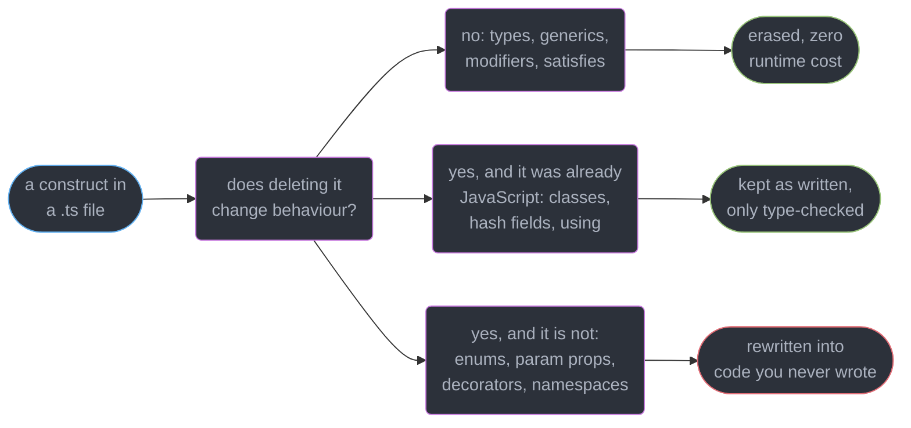
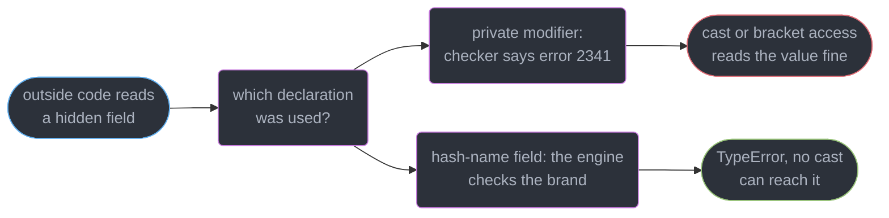
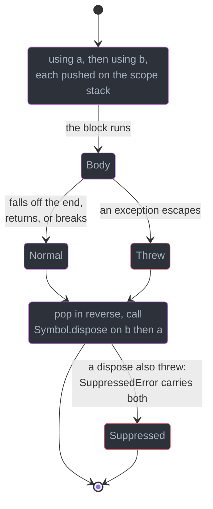
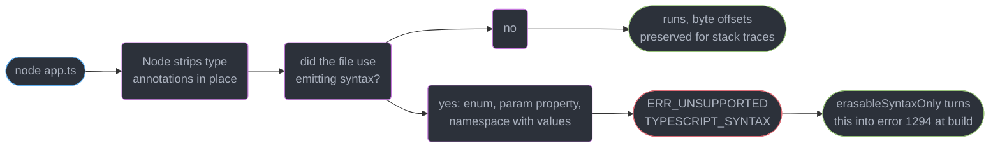
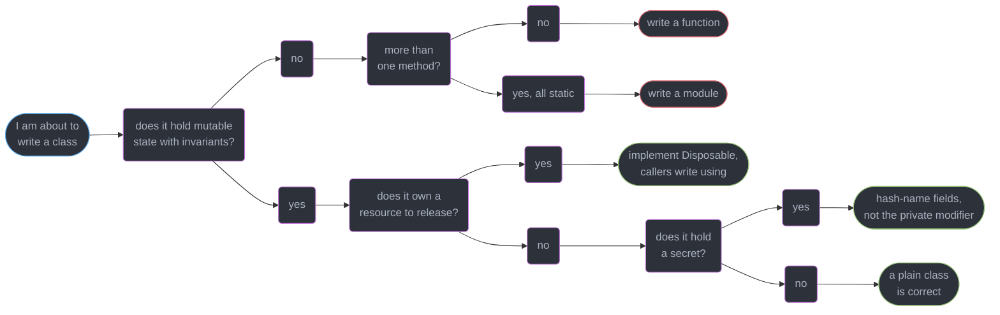

# Classes, Decorators and Resource Management

---

## 1. Concept Overview

Most of TypeScript is a lie you tell the compiler and nobody else. `interface`, `type`, generic
parameters, `satisfies` — all of it is deleted before a single byte reaches a runtime, which is
why `../typescript_at_runtime_node_deno_bun/typescript_at_runtime_node_deno_bun.md` can strip
types with a regex-grade transform and get a correct program.

This module is about the handful of constructs where that stops being true. An `enum` emits an
object. A parameter property emits an assignment. A decorator emits a call. A `using` declaration
emits a `try`/`finally`. Each is a place where a *type-level* feature has a *runtime* consequence
you now own — emitted code, a shape other tools must reproduce, or a construct Node's own type
stripping refuses to run.

| Construct | Erases cleanly | What actually ships |
|-----------|----------------|---------------------|
| `interface`, `type`, generics, `satisfies` | Yes | Nothing |
| `private` / `protected` / `public`, `readonly`, `implements`, `override` | Yes | Nothing — the field is a plain property |
| `#name` fields and methods | It is not TypeScript | A real, engine-enforced private slot |
| Parameter properties | **No** | `this.x = x` injected into the constructor |
| `enum` (numeric or string) | **No** | An object, plus reverse-mapping keys if numeric |
| `namespace` with a value inside | **No** | An IIFE assigning onto an object |
| Decorators | **No** | A call per decorator, plus initializer plumbing |
| `using` / `await using` `[5.2]` | **No** | A disposal stack and a `try`/`finally` |

The target is **TypeScript 7.0** (GA 2026-07-08, native Go compiler). The rule organising
everything below: **if the construct emits code, someone downstream has to agree with it** — your
bundler, your consumer's transpiler, or Node's stripper, which refuses three of these outright.

---

## 2. Intuition

> Every feature in this module is a bargain. You get a nicer declaration site, and you pay
> in emitted code that a tool somewhere else must reproduce exactly.

**Mental model.** Sort the language into three bins. **Annotations** are removed and cost nothing.
**Syntax with a runtime shape** — enums, parameter properties, namespaces — is rewritten into
JavaScript that never existed in your source. **Real JavaScript that TypeScript merely types** —
classes, `#private`, `using` — was going to be there anyway.

**Why it matters.** The bins are invisible in a diff. `private password` and `#password` look
like the same declaration with the same intent, and one survives `JSON.stringify`, `Object.keys`,
a cast and `obj["password"]` while the other throws a `TypeError` from outside.
`constructor(private id: string)` looks shorter than declaring the field, and is the reason
`node app.ts` refuses to start.

**Key insight.** Erasability is not an aesthetic preference — it is a **compatibility surface**.
The more of the middle bin you use, the more of your toolchain must be a full compiler rather
than a stripper, and the more places two tools that both claim to support TypeScript can compile
your program *differently*.

---

## 3. Core Principles

1. **Access modifiers are compile-time only.** `private` is enforced by the checker and by
   nothing else; a cast, an index access, or plain JavaScript reaches straight through it.
2. **`#name` is a JavaScript feature, not a TypeScript one.** The engine enforces it, and the
   brand it creates makes the class **nominally** typed inside an otherwise structural system —
   see `../structural_typing_and_assignability/structural_typing_and_assignability.md`.
3. **An abstract class is both a type and a value.** The value is a real constructor function
   you can extend and reference; what the checker forbids is calling it with `new`.
4. **`implements` checks, `extends` inherits.** `implements` adds no members and changes no
   emit; it only asserts that the class satisfies a shape.
5. **A construct that emits code is a construct someone else must implement.** Enums, parameter
   properties, decorators and namespaces all fall here.
6. **Decorators are still not ECMAScript.** TypeScript ships the proposal's shape `[5.0]`; the
   proposal itself sits at **Stage 2.7**.
7. **`using` is `try`/`finally` with correct ordering and less ceremony** — reverse-order
   disposal, guaranteed on throw, on early return and on `break`.
8. **A class is a tool for state plus invariants.** With no state it is a function; with no
   substitutable hierarchy it is a module.

---

## 4. Types / Architectures / Strategies

### 4.1 The four ways to keep a field out of reach

| Mechanism | Enforced by | Visible at runtime | Survives a cast |
|-----------|-------------|--------------------|-----------------|
| `private x`, `protected x` | The checker only | Yes — `Object.keys`, `JSON.stringify`, `obj["x"]` | Yes, trivially |
| `#x` | The JavaScript engine | No — invisible to every reflection API | No, it is a `TypeError` |
| Closure variable in the constructor | The engine (scope) | No | No |
| `WeakMap` keyed by instance | The engine | No, unless the map leaks | No |

`#x` is the default; a `WeakMap` is for private state on an object you did not construct.

### 4.2 Enum forms, honestly

| Form | Emits | Reverse mapping | Nominal | Use when |
|------|-------|-----------------|---------|----------|
| `enum E { A, B }` numeric | An object | Yes — `E[0] === "A"` | Yes | You genuinely need integer wire values |
| `enum E { A = "a" }` string | An object | No | Yes | You want a nominal tag *and* a runtime list |
| `const enum E { A }` | Nothing, inlined | No | Yes | Almost never — breaks under `isolatedModules` |
| `type E = "a" \| "b"` | Nothing | n/a | No | **The default.** Narrowing, exhaustiveness, zero cost |
| `const E = { A: "a" } as const` | An object literal | No | No | You need the runtime list *and* erasability |

The last two are the modern default; reserve a real `enum` for an integer protocol value or a
bidirectional lookup you actually use.

### 4.3 Decorator kinds in the modern form `[5.0]`

| Kind | Receives | A useful return value | Typical job |
|------|----------|----------------------|-------------|
| `class` | The constructor | A replacement class | Registration, sealing, wrapping |
| `method` | The function | A replacement function | Logging, timing, retry, memoisation |
| `getter` / `setter` | The accessor function | A replacement accessor | Caching, validation on write |
| `field` | `undefined` | `(initial) => value` — an initializer mutator | Defaulting, coercion |
| `accessor` | `{ get, set }` | A replacement pair | Observable properties, dirty tracking |

There is **no parameter decorator** in the modern form (`Decorators are not valid here. ts(1206)`),
which is the single most common reason a codebase is still on `experimentalDecorators`.

---

## 5. Architecture Diagrams

### Which bin is this construct in



The bottom branch is the whole module: everything there needs a real compiler downstream.

### Two kinds of private, two enforcement points



The escape on the left is deliberate: `obj["secret"]` is a documented hole for JavaScript callers.

### What a modern decorator actually runs


Evaluation order and application order are opposite, so a decorator reading external state at
definition time sees a different world than one reading it on apply.

### `using` and the disposal stack



Reverse order is the guarantee that matters: the transaction closes before the connection it
was opened on.

### Why `--erasableSyntaxOnly` `[5.8]` exists



Node's stripper replaces annotations with whitespace so stack traces survive. It cannot *insert*
code, which is exactly what the three rejected constructs require.

---

## 6. How It Works — Detailed Mechanics

### 6.1 Class typing: fields, `readonly`, accessors, `static`

```ts
abstract class Repository<T extends { id: string }> {
  static readonly registry = new Map<string, Repository<never>>();
  readonly createdAt = new Date();           // inferred Date, no annotation needed
  protected abstract table: string;          // subclass must supply it
  abstract find(id: string): Promise<T | undefined>;
  get name(): string { return this.constructor.name; }
}

// const r = new Repository();   // Cannot create an instance of an abstract class. ts(2511)
type AnyRepo = Repository<{ id: string }>;   // ...but it is perfectly usable as a TYPE
const factories: Array<new (db: Db) => AnyRepo> = [];   // ...and as a VALUE in a type position
```

`readonly` is checked at declaration sites and assignments (`Cannot assign to 'createdAt'
because it is a read-only property. ts(2540)`) and erases to nothing — the field is writable
from JavaScript. `Repository` is simultaneously a type (the instance shape) and a value (the
constructor function), which is why `abstract new (…) => T` types a factory of subclasses while
`new Repository()` is rejected.

With `useDefineForClassFields` — on by default from `target: ES2022` — a field declaration emits
`Object.defineProperty` semantics, so a subclass field shadows an inherited accessor instead of
calling its setter. Constraints and variance on the class's own type parameters are
`../generics_and_type_parameters/generics_and_type_parameters.md`.

### 6.2 `implements` versus `extends`, and `override`

```ts
interface Closable { close(): void }

class Socket implements Closable {          // an assertion, adds nothing, emits nothing
  close(): void { /* ... */ }
  // Missing it: Class 'Socket' incorrectly implements interface 'Closable'.
  //   Property 'close' is missing in type 'Socket' but required in type 'Closable'. ts(2420)
}

class Base { handleMessage(m: string): void {} }
class Child extends Base {
  override handleMessage(m: string): void {}   // required under noImplicitOverride; without it:
  // This member must have an 'override' modifier because it overrides a member
  //   in the base class 'Base'. ts(4114)
}
```

`implements` never contributes members: a class implementing a 12-method interface still writes
all 12. `extends` inherits real prototype members. `noImplicitOverride` turns a base-class rename
from a silent orphan — `Child.handleMessage` still compiles, never called again — into
`This member cannot have an 'override' modifier because it is not declared in the base class
'Base'. ts(4113)`.

### 6.3 `private` erases; `#private` brands

```ts
class Session {
  private token: string;    // compile-time only
  #secret: string;          // engine-enforced
  constructor(t: string, s: string) { this.token = t; this.#secret = s; }
  static is(x: unknown): x is Session { return #secret in (x as object); }
}

const s = new Session("t", "s");
// s.token;  Property 'token' is private and only accessible within class 'Session'. ts(2341)
s["token"];              // allowed by design — no error, returns "t"; (s as any).token too
JSON.stringify(s);       // {"token":"t"}  — #secret is absent entirely, as it is from Object.keys

// (s as any).#secret;  Property '#secret' is not accessible outside class 'Session'
//                      because it has a private identifier. ts(18013)
```

The structural consequence is the interesting one. TypeScript compares classes by shape, so two
unrelated classes with identical members are mutually assignable — but a `#` field is a **brand no
other declaration can produce**:

```ts
class Meters { #brand!: void; constructor(readonly value: number) {} }
class Feet   { #brand!: void; constructor(readonly value: number) {} }

const m: Meters = new Feet(3);
// Type 'Feet' is not assignable to type 'Meters'.
//   Types have separate declarations of a private property '#brand'. ts(2322)
```

That is **nominal typing** inside a structural system for the cost of one unused field, and
unlike a `private` field the brand survives into runtime as a real `in`-testable slot. The
branded-primitive version for non-class types lives in
`../structural_typing_and_assignability/structural_typing_and_assignability.md`.

### 6.4 `this` typing: polymorphic returns and call-site constraints

```ts
class Query {
  private parts: string[] = [];
  where(c: string): this { this.parts.push(`WHERE ${c}`); return this; }   // polymorphic this
  build(): string { return this.parts.join(" "); }
}
class PagedQuery extends Query {
  limit(n: number): this { return this.where(`LIMIT ${n}`); }
}
new PagedQuery().where("a = 1").limit(10);   // typed PagedQuery — returning Query would break this

// A `this` parameter constrains the CALL SITE and erases entirely:
function onClick(this: HTMLButtonElement, e: MouseEvent) { this.disabled = true; }
document.querySelector("button")!.addEventListener("click", onClick);   // fine
// onClick(new MouseEvent("click"));
// The 'this' context of type 'void' is not assignable to method's 'this'
//   of type 'HTMLButtonElement'. ts(2684)
```

The extracted-method problem is the practical payoff. `const build = q.build; build();` loses
the receiver and throws at runtime; adding `build(this: Query)` makes the checker reject the
unbound call instead. `strictBindCallApply` extends the same checking to `.bind`, `.call` and
`.apply`. Why the binding is lost at all is JavaScript, not TypeScript —
`../../frontend_platform/javascript_language_semantics/javascript_language_semantics.md` owns it.

### 6.5 Parameter properties: the shortcut that emits

```ts
class UserService {
  constructor(private readonly db: Db, public readonly logger: Logger) {}
}
// emits, into the constructor body:  this.db = db;  this.logger = logger;
```

Two declarations, zero lines of body, and a construct that **cannot be stripped**. Under
`--erasableSyntaxOnly` `[5.8]`:

```
This syntax is not allowed when 'erasableSyntaxOnly' is enabled. ts(1294)
```

and under `node app.ts` without that flag, at load time:

```
SyntaxError [ERR_UNSUPPORTED_TYPESCRIPT_SYNTAX]: TypeScript parameter property is not
  supported in strip-only mode
```

The erasable form costs three lines and runs everywhere:

```ts
class UserService {
  readonly db: Db;
  readonly logger: Logger;
  constructor(db: Db, logger: Logger) { this.db = db; this.logger = logger; }
}
```

### 6.6 Enums, and what to use instead

```ts
enum Level { Debug, Info, Warn }
// emits a bidirectional object: Level[Level["Debug"] = 0] = "Debug"; for every member
Level[0];              // "Debug" — the reverse mapping, and the reason the object is bigger

enum Role { Admin = "admin" }        // string enums have NO reverse mapping
// const r: Role = "admin";
// Type '"admin"' is not assignable to type 'Role'. ts(2322)
```

That last error is the one genuine advantage: a string enum is **nominal**, so a raw `"admin"`
cannot be passed where a `Role` is required. A union of literals is structural and accepts the
raw string, which is usually what you want and occasionally not.

```ts
// The default: a union. Zero emit, exhaustiveness-checkable, narrows on comparison.
type Level = "debug" | "info" | "warn";

// When you also need the runtime list, an `as const` object gives both, still erasable:
const LEVELS = { debug: 10, info: 20, warn: 30 } as const;
type LevelName = keyof typeof LEVELS;                 // "debug" | "info" | "warn"
type LevelValue = (typeof LEVELS)[LevelName];         // 10 | 20 | 30
Object.keys(LEVELS);                                  // a real array at runtime
```

`const enum` inlines every use site and emits nothing, which is why it is unusable under
`isolatedModules`, esbuild, swc or Node's stripper: inlining needs the *declaring* file, and a
single-file transpiler has only this one — the single-file constraint is
`../modules_resolution_and_package_exports/modules_resolution_and_package_exports.md`. An ambient
one is `Ambient const enums are not allowed when the '--isolatedModules' flag is provided.
ts(1209)`; exhaustiveness over unions is
`../unions_narrowing_and_exhaustiveness/unions_narrowing_and_exhaustiveness.md`.

### 6.7 Decorators: the modern form, and why legacy persists

**The proposal is at Stage 2.7, not Stage 3.** It reached Stage 3 in 2022; TC39 later inserted
2.7 as an intermediate checkpoint and re-slotted the existing proposals into it — a **process
change, not a rejection on the merits**, and why nearly every blog post still says Stage 3.
Decorators are therefore not ECMAScript yet, so something must compile them.

```ts
// Modern [5.0]: (value, context) => replacement | void
function timed<This, A extends unknown[], R>(
  fn: (this: This, ...args: A) => R,
  ctx: ClassMethodDecoratorContext<This, (this: This, ...args: A) => R>,
) {
  return function (this: This, ...args: A): R {
    const t0 = performance.now();
    try { return fn.call(this, ...args); }
    finally { console.log(`${String(ctx.name)} ${performance.now() - t0}ms`); }
  };
}

class Api {
  @timed getUser(id: string) { return fetch(`/u/${id}`); }
}
```

The `context` object is the whole API surface: `kind` (§4.3), `name`, `static`, `private`, an
`access` object with `get`/`set`/`has`, `addInitializer(fn)` to run code at construction, and
`metadata` for cross-decorator communication. No parameter decorators, no `design:type` metadata.

The legacy form is a different function: `(target, propertyKey, descriptor)`, mutating a
`PropertyDescriptor` in place, plus a fourth shape taking a parameter index.
`emitDecoratorMetadata` works **only** with it, emitting a
`Reflect.metadata("design:paramtypes", [Db, Logger])` call that carries the constructor's
parameter *types* as runtime values — how NestJS resolves DI without tokens and how TypeORM
infers a column's SQL type from `name: string`. No equivalent exists in the modern form, so those
frameworks stay on `"experimentalDecorators"` plus `"emitDecoratorMetadata"`; enabling the
metadata flag without the legacy one is an immediate config error.

### 6.8 `using`, `await using` and `DisposableStack` `[5.2]`

```ts
class Tx implements Disposable {
  #done = false;
  constructor(private conn: Conn) { conn.exec("BEGIN"); }
  commit() { this.conn.exec("COMMIT"); this.#done = true; }
  [Symbol.dispose]() { if (!this.#done) this.conn.exec("ROLLBACK"); }
}

function transfer(conn: Conn, from: string, to: string, cents: number) {
  using tx = new Tx(conn);          // disposed at scope exit, whatever happens
  debit(conn, from, cents);
  credit(conn, to, cents);          // throws -> ROLLBACK, no finally written
  tx.commit();
}
```

The desugaring is a disposal stack plus one `try`/`finally` — the same guarantee, with
**reverse-order** disposal across N resources for free and no way to forget the `finally`.
Declaring `using x` on a type without the method is `The type of a 'using' declaration must be
assignable to type 'Disposable'.` `await using` is the asynchronous half, requiring
`[Symbol.asyncDispose](): Promise<void>` and awaiting it at scope exit — which plain `finally` does
only if you remembered the `await`. Node's `FileHandle` already implements one.

```ts
async function ingest(urls: string[]) {
  await using stack = new AsyncDisposableStack();
  const db = stack.use(await openDb());          // disposed last
  for (const u of urls) {
    using file = await open(u);                  // disposed each iteration
    stack.defer(() => metrics.flush(u));         // arbitrary cleanup callback
    await db.write(await file.readFile());
  }
  return stack.move();   // ownership passes to the caller; this scope disposes nothing
}
```

`DisposableStack` covers what a bare `using` cannot: a conditional acquisition, a variable number
of them, `defer()` for cleanup owning no object, `adopt(value, fn)` for a non-standard close, and
`move()` to transfer ownership out. If the body and a disposer both throw you get a
`SuppressedError` whose `.error` is the disposal failure and `.suppressed` the original, instead
of a `finally` silently replacing your real exception. `Symbol.dispose` needs `lib` at `esnext`;
Node has had the symbols since 20.5 and runs the syntax natively on 24 and 26.

### 6.9 When a class is the wrong tool

Three tells. **A class with one method and no state is a function** — `new PriceFormatter()
.format(1299)` is pure ceremony, and the function tree-shakes while the class does not. **A class
whose members are all `static` is a module.** **A class you never instantiate twice is a value.**

A class earns its place when it holds **state with invariants** (a balance validated in one
constructor), a **resource with a lifecycle** (open, use, dispose — what `Disposable` formalises),
or a **hierarchy with real substitutability** (three implementations used through one base type).
Almost no React-era component code meets any of those, which is why components are functions; the
class that survives wraps a socket, a transaction, or a parser's mutable position.

---

## 7. Real-World Examples

**NestJS** is the ecosystem's largest legacy-decorator dependency: `@Injectable()`,
`@Controller("/users")` and `@Get(":id")` are all legacy-form, and the DI container reads
`design:paramtypes` to resolve `constructor(private users: UserService)` without a token. Both
flags are on in every Nest `tsconfig.json`, and both parameter properties and the metadata emit
are unstrippable — so `node main.ts` is not an option, only `nest start` or a compiled `dist/`.

**TypeORM** reads the same metadata: `@Column() name: string` infers `varchar` from `design:type`,
and dropping the flag means every column needs `@Column({ type: "varchar" })`.

**Prisma and Drizzle** take the opposite route — no decorators, schema as data, types generated or
inferred — which is why both run unmodified under Node's type stripping.

**Effect** uses `#private` brands heavily to make structurally identical wrapper types
non-interchangeable — the nominal trick from §6.3 at library scale.

---

## 8. Tradeoffs

| Decision | Cheaper option | Costlier option | What the cost buys |
|----------|----------------|-----------------|--------------------|
| Hiding a field | `private` — zero emit, readable in a debugger | `#name` — real enforcement | Secrets that survive `JSON.stringify` and casts |
| Constructor wiring | Parameter property — 1 line | Explicit field + assign — 3 lines | Erasability; `node app.ts` works |
| A closed set of values | Union of literals — zero emit | `enum` — an object | A runtime list and nominal tagging |
| Cross-cutting behaviour | A higher-order function | A decorator | Declaration-site readability, at the cost of a compiler |
| Decorator mode | Modern `[5.0]` — standards-track | Legacy — frozen shape | Parameter decorators and `design:paramtypes` |
| Cleanup | `try`/`finally` — no new syntax | `using` `[5.2]` — needs 5.2 and a modern runtime | Reverse ordering, no forgotten `finally` |
| Grouping behaviour | A module of functions | A class | Encapsulated state and substitutable subtypes |

Every row has the same shape: the costlier option costs **because something downstream has to
understand it**, and is worth paying only where the guarantee is load-bearing.

---

## 9. When to Use / When NOT to Use



**Reach for `#private` when** the value is a secret or brand, or must not appear in serialised
output. **Reach for `using` when** an object has a close, release, unlock or rollback step, and
**for a decorator when** the same cross-cutting behaviour applies to 10+ methods.

**Do NOT use an `enum`** unless the emitted object is used at runtime. **Do NOT use parameter
properties** in a codebase that wants to run under Node's stripper, Bun's strip-only mode, or
`--erasableSyntaxOnly`. **Do NOT ship `const enum` from a library** — it inlines into consumers
and breaks under every single-file transpiler. **Do NOT reach for a decorator** where one wrapper
function would do.

---

## 10. Common Pitfalls

### Pitfall 1: a `const enum` in a published package (BROKEN → FIX)

```ts
// BROKEN — packages/core/src/status.ts
export const enum Status { Active = 1, Suspended = 2 }

// packages/api/src/user.ts, compiled by esbuild
import { Status } from "@acme/core";
if (user.status === Status.Active) { /* ... */ }
// esbuild emits:  if (user.status === Status.Active)   with Status undefined at runtime
// TypeError: Cannot read properties of undefined (reading 'Active')
// tsc with isolatedModules: Ambient const enums are not allowed when the
//   '--isolatedModules' flag is provided. ts(1209)

// FIX — a const object plus a derived type: same call sites, real runtime value
export const Status = { Active: 1, Suspended: 2 } as const;
export type Status = (typeof Status)[keyof typeof Status];
```

`tsc` resolves `Status.Active` to the literal `1` by reading the declaring file. esbuild, swc and
Node's stripper compile one file at a time and cannot, so they leave a reference to a binding that
was never emitted — a runtime failure in the consumer's build, not yours.

### Pitfall 2: an extracted method silently loses `this`

```ts
class Poller {
  private count = 0;
  tick() { this.count++; }
}
const p = new Poller();
setInterval(p.tick, 1000);
// TypeError: Cannot read properties of undefined (reading 'count')
```

The checker allows it because `p.tick` is a perfectly good `() => void`. Adding `tick(this: Poller)`
makes the unbound reference `ts(2684)` at compile time; an arrow-function class field
(`tick = () => { … }`) binds per instance instead, at one closure each and no prototype member.

### Pitfall 3: `using` on a value you did not want disposed

```ts
using conn = pool.acquire();
return conn;              // the connection is released before the caller ever sees it
```

`using` means *this scope owns it*. Returning the resource is the case for `stack.move()`, or for
not writing `using` at all. The same trap hits a cached client: dispose it once at scope exit and
every later reader of the cache holds a closed handle.

---

## 11. Technologies & Tools

| Tool | Role | Relevance here |
|------|------|----------------|
| TypeScript | The compiler and checker (7.0, native Go binary) | Owns both decorator modes, `--erasableSyntaxOnly` |
| Node.js | Runtime with built-in type stripping (26 Current, 24 LTS) | Rejects enums, param properties, value namespaces |
| NestJS | Backend framework built on legacy decorators | The largest `emitDecoratorMetadata` dependency |
| TypeORM | Decorator-driven ORM | Infers column types from `design:type` metadata |
| Prisma / Drizzle ORM | Schema-first ORMs, no decorators | Run unmodified under type stripping |
| esbuild | Single-file transpiler | Where `const enum` breaks; supports both decorator modes |
| typescript-eslint | Lint rules over the type checker | `no-unsafe-declaration-merging`, enum rules |

---

## 12. Interview Questions with Answers

**Q: What is the difference between `private` and `#private`, and when does it matter?**
**Short:** Compiler-only visibility disappears at emit, while a hash-name field is a real slot the JavaScript engine enforces and no cast can reach.

`private token` is checked (`ts(2341)`) then erased, so `obj["token"]`, `obj as any`,
`Object.keys`, `JSON.stringify` and any plain-JavaScript caller read it freely. `#token` throws a
`TypeError` from outside and is invisible to every reflection API — use it for anything that must
not reach a serialised payload, a log line or an error report.

**Q: Why are TypeScript enums discouraged, and what do you use instead?**
**Short:** Enums emit a runtime object rather than erasing, and a numeric one also emits reverse-mapping keys, so the feature is not free and not strippable.

A numeric enum compiles to `E[E["A"] = 0] = "A"`, doubling the object's keys so `E[0]` returns
`"A"`. Node's type stripping refuses enums outright and `--erasableSyntaxOnly` `[5.8]` rejects
them with `ts(1294)`. The replacement is a union of string literals — zero emit, narrowing,
exhaustiveness — or `const X = {…} as const` when you also need the runtime list.

**Q: What stage are decorators actually at in TC39?**
**Short:** Decorators sit at Stage 2.7 after TC39 inserted that checkpoint below Stage 3 and re-slotted existing proposals into it, so they are still not ECMAScript.

They reached Stage 3 in 2022, then TC39 added 2.7 as an intermediate gate — tests written and
signed off by the editors before returning to 3 — and re-slotted several proposals into it. It is
a **process change, not a rejection on the merits**, though most blog posts still say Stage 3.
The consequence: some compiler must still transform them, so a decorator is never free.

**Q: What exactly does a `using` declaration guarantee?**
**Short:** Scope exit calls Symbol.dispose on every declared resource in reverse acquisition order, on a normal return, an early break, and a thrown exception alike.

It desugars to a disposal stack plus one `try`/`finally` — the same guarantee as nested
`try`/`finally`, with ordering right by construction and no way to omit the `finally`.
`await using` `[5.2]` awaits `[Symbol.asyncDispose]()`. If the body and a disposer both throw you
get a `SuppressedError` carrying both. Use it for transactions, file handles, locks and spans.

**Q: Why does a `const enum` break under `isolatedModules` or esbuild?**
**Short:** Inlining requires reading the file that declares the member, and a single-file transpiler only ever has the file in front of it.

`tsc` replaces `Status.Active` with the literal `1` by resolving across files and emits nothing
for the declaration. esbuild, swc and Node's stripper compile one file at a time, so they leave a
reference to a binding nobody emitted and the consumer gets `Cannot read properties of undefined`.
An ambient one is `ts(1209)`. Replace it with `as const` plus `keyof typeof`.

**Q: Why do parameter properties break `node app.ts`?**
**Short:** Parameter properties emit assignment statements into the constructor body, so they are syntax that produces code rather than syntax that can be deleted.

Node's stripper replaces annotations with whitespace to keep stack traces intact; it cannot
*insert* `this.db = db`. You get `ERR_UNSUPPORTED_TYPESCRIPT_SYNTAX: TypeScript parameter
property is not supported in strip-only mode`, and `--erasableSyntaxOnly` `[5.8]` surfaces it at
build time as `ts(1294)`. Declare the field and assign it — see
`../typescript_at_runtime_node_deno_bun/typescript_at_runtime_node_deno_bun.md`.

**Q: How does a `#private` field change assignability between two classes?**
**Short:** No other declaration can produce that brand, so structural comparison fails and the class becomes nominally typed inside a structural system.

TypeScript normally treats two classes with identical members as mutually assignable. Give
`Meters` and `Feet` each a `#brand` and the assignment is `Types have separate declarations of a
private property '#brand'. ts(2322)`. One unused field buys nominal typing, and the brand exists
at runtime too, so `#brand in x` is a real type guard. See
`../structural_typing_and_assignability/structural_typing_and_assignability.md`.

**Q: In what sense is an abstract class both a type and a value?**
**Short:** An abstract class declaration creates an instance type and a real constructor function, and only direct instantiation of that constructor is forbidden.

`new Repository()` is `Cannot create an instance of an abstract class. ts(2511)`, but
`Repository` still names the instance type, still exists as a binding you can extend and pass
around, and `abstract new (…) => T` types a factory over its subclasses. That duality is why an
abstract class is the right tool when you need shared *implementation* plus a contract; an
interface, which has no value side at all, is right when you need only the contract.

**Q: What does a modern decorator receive, and what can it return?**
**Short:** Every modern decorator receives the decorated value plus a context object carrying kind, name, static, private, access and addInitializer.

`kind` is `"class" | "method" | "getter" | "setter" | "field" | "accessor"`, each with its own
return contract: a method decorator returns a replacement function, a class decorator a
replacement class, a field decorator an `(initial) => value` initializer mutator.
`context.addInitializer(fn)` queues work for construction time, which is how registration works
without touching a prototype. There are **no parameter decorators** — that is `ts(1206)`.

**Q: Why are NestJS and TypeORM still on `experimentalDecorators`?**
**Short:** Legacy decorators take target, key and descriptor, and they are the only form emitDecoratorMetadata supports, which is what those frameworks read.

With both flags on, the compiler emits `Reflect.metadata("design:paramtypes", [Db, Logger])`
alongside the class — constructor parameter *types* as runtime values. Nest resolves DI from it
without tokens; TypeORM infers `varchar` from `name: string`. The modern form has no equivalent
and no parameter decorators, so `experimentalDecorators` is a supported setting, not a legacy one.

**Q: What is polymorphic `this` and what breaks without it?**
**Short:** Returning this as a type rather than the class name keeps a fluent chain typed as the subclass all the way through inherited methods.

`where(c: string): this` means the inherited method returns `PagedQuery` when called on one, so
`.where("a = 1").limit(10)` type-checks. Annotate it `: Query` and the chain collapses to the
base class after the first inherited call, making `.limit()` a
`Property 'limit' does not exist on type 'Query'`. The cost is that `this` types are invariant in
some positions, so an over-wide fluent hierarchy gets hard to satisfy.

**Q: How do you stop a method losing its `this` when it is passed as a callback?**
**Short:** A method detached from its receiver loses the binding, and a leading this parameter makes the checker reject the unbound call site.

`setInterval(p.tick, 1000)` type-checks — `p.tick` is a valid `() => void` — and throws
`Cannot read properties of undefined` on the first tick. Declaring `tick(this: Poller)` makes it
`ts(2684)` at compile time; the parameter erases and `strictBindCallApply` extends the check to
`.bind`/`.call`/`.apply`. The alternative is an arrow-function class field, one closure per instance.

**Q: What is the difference between `implements` and `extends`?**
**Short:** Implements is a checked assertion that contributes nothing, while extends inherits real prototype members and changes what the class contains.

A class implementing a 12-method interface must write all 12 itself; missing one is
`Class 'X' incorrectly implements interface 'Y'. ts(2420)`. `implements` emits nothing and makes
the class a subtype of nothing it would not already structurally satisfy. Use it to pin a
contract early and get the error at the class rather than the call site; `extends` only when you
want the inherited implementation.

**Q: What does `noImplicitOverride` protect against?**
**Short:** Marking an override makes renaming a base method a compile error rather than a subclass method that silently stops being called.

Without it, renaming `Base.handleMessage` to `Base.onMessage` leaves `Child.handleMessage`
compiling perfectly and never invoked again — a bug with no error anywhere. With it every
overriding member needs `override`, missing one is `ts(4114)`, and an `override` that overrides
nothing is `ts(4113)`. Both erase completely, so it is free safety on an otherwise invisible refactor.

**Q: When do you need `DisposableStack` instead of a plain `using`?**
**Short:** A disposable stack collects resources acquired conditionally or in a loop and releases them all when the stack itself leaves scope.

A `using` declaration binds exactly one resource at one place. `stack.use(x)` registers a variable
number, `stack.defer(fn)` cleanup that owns no object, `stack.adopt(v, fn)` a non-standard close,
and `stack.move()` transfers ownership out so nothing is disposed on exit. `AsyncDisposableStack`
is the `await using` half. Reach for it in loops, branches, and functions returning a live resource.

**Q: When is a class the wrong tool in TypeScript?**
**Short:** A class with one method and no state is a function wearing ceremony, and a class whose members are all static is a module with a constructor bolted on.

Both cost tree-shaking — a module's functions are individually removable, a class is one binding —
and buy nothing. A class earns its place with state plus invariants enforced in a constructor, a
resource with a real lifecycle (what `Disposable` formalises), or a hierarchy with three
implementations genuinely used through one type. Almost no React component code qualifies.

---

## 13. Best Practices

1. **`#name` for anything secret, branded or serialisation-sensitive**; `private` where a debugger
   view is a feature.
2. **Default to a union of string literals**, and to `as const` on an object when you also need a
   runtime list. Reserve `enum` for an emitted object you actually use, and **never ship a
   `const enum` from a library** — it inlines into consumers and breaks every single-file transpiler.
3. **Turn on `--erasableSyntaxOnly` `[5.8]`** in any codebase that wants `node app.ts` to work —
   the only mechanical way to keep parameter properties and enums out.
4. **Turn on `noImplicitOverride`** on day one; retrofitting it is one error per overriding member,
   each a rename waiting to go silently wrong.
5. **Pick one decorator mode per repository** and enforce it — mixing them across packages
   produces a decorator called with the wrong arity at class-definition time.
6. **Implement `Disposable` on anything with a close, unlock, release or rollback**, then let
   callers write `using`. Use `DisposableStack` for loops and conditional acquisition.
7. **Add a `this` parameter to any method passed as a callback**, or make it an arrow-function
   class field — do not leave the choice to the call site. And reach for a decorator only when the
   same behaviour applies to 10+ members; below that a wrapper function needs no compiler support.

---

## 14. Case Study

### The migration that could not run its own source

A logistics company runs a 210-file NestJS service and spends 38 seconds per `tsc` build on every
save. A platform engineer proposes dropping the build step in development: Node 24 runs TypeScript
directly, so `node --watch src/main.ts` should start in under a second. It does not start at all.

```ts
// BROKEN — src/shipments/shipment.service.ts, the first file Node reaches
export enum ShipmentState { Created = 0, InTransit = 1, Delivered = 2 }

@Injectable()
export class ShipmentService {
  constructor(private readonly repo: ShipmentRepo, private readonly bus: EventBus) {}
}
```

```
SyntaxError [ERR_UNSUPPORTED_TYPESCRIPT_SYNTAX]:
  TypeScript enum is not supported in strip-only mode
    at file:///srv/api/src/shipments/shipment.service.ts:1
```

Three separate blockers in one 8-line file: the `enum` emits an object, the two parameter
properties emit constructor assignments, and `@Injectable()` with `emitDecoratorMetadata` emits
`Reflect.metadata("design:paramtypes", [ShipmentRepo, EventBus])` — the only reason DI resolves
those two dependencies without explicit tokens.

Turning on the gate to find the true scope took one flag and produced **414 errors across 190
files**:

```
src/shipments/shipment.service.ts:1:1 - error TS1294: This syntax is not allowed when
  'erasableSyntaxOnly' is enabled.
```

The breakdown: 61 enums, 302 parameter properties, 4 namespaces with runtime values, 47 decorated
classes. The first three are mechanical; the last is not.

```ts
// FIX — erasable where it is free, and honest about where it is not
export const ShipmentState = { Created: 0, InTransit: 1, Delivered: 2 } as const;
export type ShipmentState = (typeof ShipmentState)[keyof typeof ShipmentState];

@Injectable()
export class ShipmentService {
  private readonly repo: ShipmentRepo;
  private readonly bus: EventBus;
  constructor(repo: ShipmentRepo, bus: EventBus) { this.repo = repo; this.bus = bus; }
}
```

**What shipped.** Enums and namespaces went by codemod in an afternoon; 5 numeric enums relied on
the reverse mapping (`ShipmentState[row.state]` for a log label) and got an explicit
`STATE_LABELS` record. The 302 parameter properties expanded mechanically — Nest's DI reads
constructor parameter *types*, not properties, so the container was unaffected — and
`--erasableSyntaxOnly` went into `tsconfig.json` to stop all three reappearing.

**What did not.** The decorators stayed, so `node src/main.ts` still does not work; dev runs
`nest start --watch` over `swc`, which cut the 38-second rebuild to 2.1 seconds and was the real
win. The audit still paid: 302 constructs had no reason to be unstrippable, and the codebase now
has exactly **one** unerasable dependency instead of four, with a flag holding the line.

**The lesson.** "Can this codebase run without a compiler?" is answered by its least erasable
construct, not its average one. The gate flag turns that from an archaeology project into a
number, and the number is usually dominated by conveniences nobody chose deliberately.
