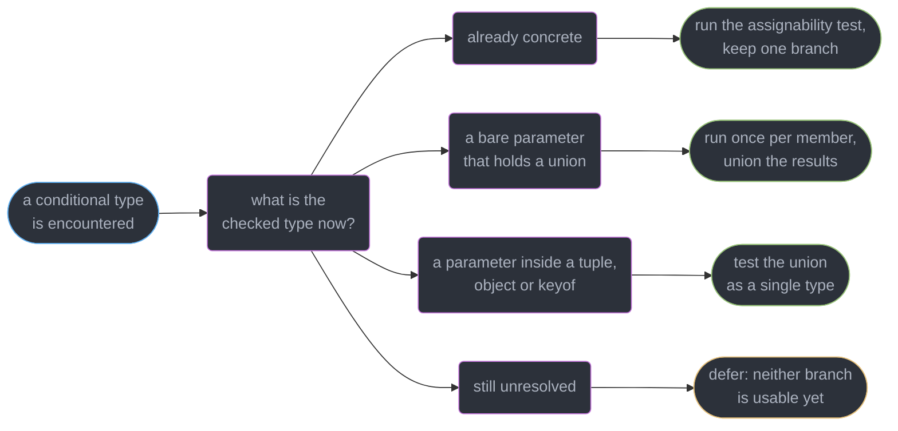
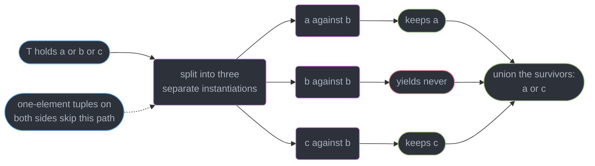
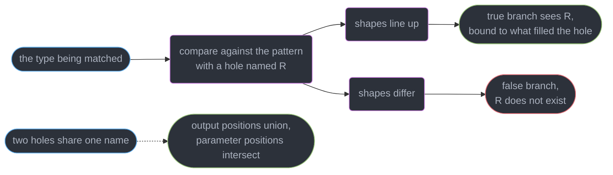
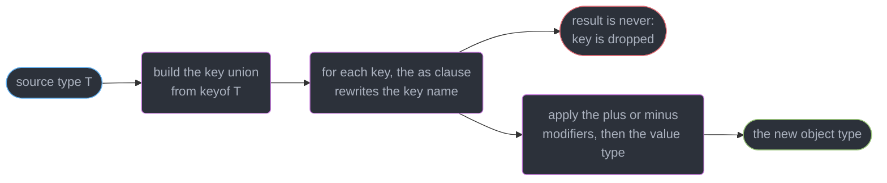
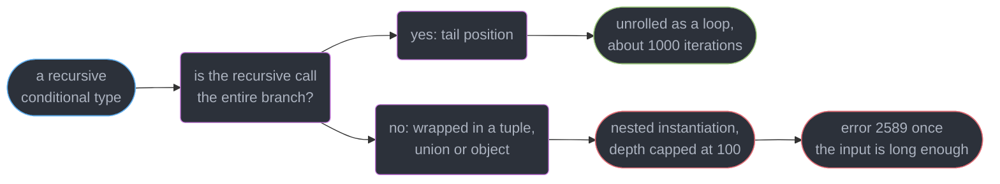
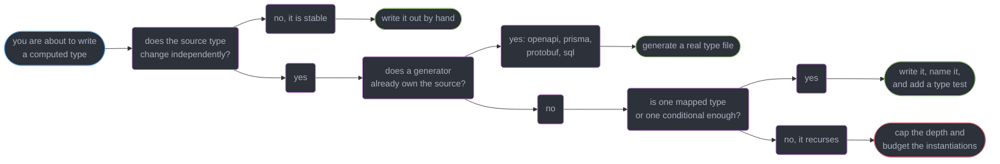

# Conditional and Mapped Types

---

## 1. Concept Overview

A conditional type is an `if` the checker evaluates, and a mapped type is a `for` loop it unrolls.
Together they turn the type system from a language of **declarations** into a language of
**computations**: `Partial<T>`, `ReturnType<F>` and `Omit<T, K>` are not compiler builtins, they are
eleven lines of ordinary TypeScript in `lib.es5.d.ts` that you could have written yourself.

That is the spine of this module. **Every built-in utility type is explained by implementing it**,
because the fastest way to stop treating `Exclude` as magic is to see that it is a single line —
`T extends U ? never : T` — and that the surprising part of its behaviour comes from one rule about
where `T` appears, not from anything special in the compiler.

Four mechanisms carry everything here:

| Mechanism | Syntax | What it gives you |
|-----------|--------|-------------------|
| Conditional | `T extends U ? X : Y` | A type-level branch, resolved by assignability |
| `infer` | `T extends F<infer R> ? R : never` | Pattern-matching a type out of a position |
| Distribution | a **naked** `T` as the checked type | The branch runs once per union member |
| Mapped | `{ [K in keyof T]: … }` | One output property per input key, modifiers included |

The target is **TypeScript 7.0** (GA 2026-07-08). The native Go checker re-implemented instantiation
without changing any of these rules, and the depth ceilings below are the same on `tsc6`. This
module assumes generics, constraints and inference from
`../generics_and_type_parameters/generics_and_type_parameters.md` and assignability from
`../structural_typing_and_assignability/structural_typing_and_assignability.md`. Template literal
types are used here but taught in
`../template_literal_types_and_type_level_programming/template_literal_types_and_type_level_programming.md`.

---

## 2. Intuition

> A conditional type is an `if` whose condition is "is this assignable to that", and a mapped type is
> a `for … in` over a union of keys. Both run in the checker, on every keystroke.

**Mental model.** Imagine the checker holding a type and asking one question at a time. `T extends U`
is that question. If `T` is already a concrete type it answers immediately and one branch is thrown
away. If `T` is still a type parameter it cannot answer, so it **writes the question down** and
resolves it later at the instantiation site. And if `T` is a bare parameter that turns out to hold a
union, it asks the question once per member and unions the answers back together.

**Why it matters.** Nearly every real TypeScript API above trivial CRUD is shaped by these: a form
library derives its error object from your schema, an ORM derives a row type from a table
definition, tRPC derives the client from the router. All of it is `keyof`, `in`, `extends ? :` and
`infer`.

**Key insight.** The two most confusing behaviours in the whole type system — "why did my type turn
into a union" and "why is this type still unevaluated" — are the **same rule** seen from two sides:
a conditional over an unresolved parameter is deferred, and when it finally resolves against a
union, it distributes.

---

## 3. Core Principles

1. **A conditional resolves by assignability, not by identity.** `T extends U` asks whether every
   `T` is a valid `U`, which is the same relation `../structural_typing_and_assignability/` teaches.
2. **A conditional over an unresolved type parameter is deferred**, so neither branch is available
   inside a generic function body until the parameter is instantiated.
3. **Distribution requires a *naked* type parameter** in the checked position. `T extends U` splits;
   `[T] extends [U]`, `{ v: T } extends { v: U }` and `keyof T extends U` do not.
4. **`never` is the empty union**, so a distributive conditional given `never` produces `never`
   without evaluating either branch. This is a feature, and it is also a trap.
5. **`infer` declares a type variable inside the `extends` clause** and binds it to whatever occupies
   that position in a successful match. It is legal nowhere else.
6. **A homomorphic mapped type — written `[K in keyof T]` — preserves the input's shape**: arrays
   stay arrays, tuples stay tuples, and `readonly` and `?` carry over unless you change them.
7. **Every instantiation is work the checker pays for**, on every build and every editor keystroke.
   A derived type is not free just because it produces no JavaScript.

---

## 4. Types / Architectures / Strategies

### 4.1 The conditional forms

| Form | Distributes | Typical use |
|------|-------------|-------------|
| `T extends U ? X : Y` | Yes, when `T` is a naked parameter | `Exclude`, `Extract`, filtering a union |
| `[T] extends [U] ? X : Y` | No | Testing the union *as a whole*: `IsNever`, `IsAny` |
| `T extends U ? X : T extends V ? Y : Z` | Yes | A type-level `switch`, tested top to bottom |
| `T extends F<infer R> ? R : never` | Yes | Extracting a positional type |

### 4.2 The mapped forms

| Form | Homomorphic | Effect |
|------|-------------|--------|
| `{ [K in keyof T]: T[K] }` | Yes | Identity: preserves `readonly`, `?`, arrays, tuples |
| `{ [K in K2]: V }` where `K2` is a key union | No | Builds a fresh object, no modifiers inherited |
| `{ [K in keyof T]?: T[K] }` | Yes | Adds optional to every property |
| `{ [K in keyof T]-?: T[K] }` | Yes | Removes optional, and removes `undefined` from the value |
| `{ [K in keyof T as NewK]: T[K] }` `[4.1]` | Yes | Renames or drops keys — `never` drops |

`+` is the explicit form of the default: `+?` and `+readonly` add, `-?` and `-readonly` remove. Nobody
writes `+` in practice, but reading `-?` correctly is worth the two seconds it takes.

### 4.3 Where the key union comes from

A mapped type's `in` clause takes any union of `string | number | symbol`. `keyof T` is the common
source; a literal union (`"read" | "write"`), a template literal type, and `T[number]` over a tuple
are the other three. Anything outside that set reports
`An index signature parameter type must be 'string', 'number', 'symbol', or a template literal type. (1268)`.

---

## 5. Architecture Diagrams

### How the checker resolves one conditional



Deferral and distribution are one rule at two moments: the checker waits, then answers per member.

### What distribution actually unrolls



This is the whole of `Exclude`. The `never` in the middle vanishes because a union drops `never`,
which is why filtering a union needs no special syntax.

### `infer` as a pattern match



The hole is positional: `T extends (…a: infer P) => infer R` opens two and binds both in one match.

### A mapped type, key by key



A map written directly over `keyof T` is homomorphic and keeps the source's `readonly` and `?`; an
`as` clause does not break that, which is why `Getters` below preserves `readonly`.

### Recursion: why one form survives and the other does not



Both forms agree on a 10-element tuple and differ at 60. Moving to tail position is a small edit.

---

## 6. How It Works — Detailed Mechanics

### 6.1 A conditional is a branch the checker evaluates

```ts
// A type-level switch: nested conditionals, tested top to bottom
type TypeName<T> =
  T extends string ? "string" :
  T extends number ? "number" :
  T extends undefined ? "undefined" :
  T extends (...args: never[]) => unknown ? "function" :
  "object";

type N1 = TypeName<() => void>;    // "function" — resolved now, the other arms are discarded
type N2 = TypeName<Date>;          // "object" — the default arm

// Deferred: inside a generic, the parameter is not yet known
function label<T>(v: T): TypeName<T> {
  // return "object";
  // Type '"object"' is not assignable to type 'TypeName<T>'. (2322)
  return typeof v as TypeName<T>;   // an assertion is required, and that is the honest signal
}
```

The arms are tested **in order**, exactly as in a `switch`: putting `T extends object` above the
function arm makes that arm unreachable, because a function type is assignable to `object`. The
deferral in `label` is the important part — inside the body `TypeName<T>` is opaque, so every
concrete return is rejected. Needing that assertion is a signal: a function whose return type is
computed usually wants an overload set instead.

### 6.2 `infer` pattern-matches a type out of a position

```ts
type MyReturnType<T extends (...a: never[]) => unknown> =
  T extends (...a: never[]) => infer R ? R : never;

type MyParameters<T extends (...a: never[]) => unknown> =
  T extends (...a: infer P) => unknown ? P : never;

type MyInstanceType<T extends abstract new (...a: never[]) => unknown> =
  T extends abstract new (...a: never[]) => infer R ? R : never;

type ElementType<T> = T extends readonly (infer E)[] ? E : T;

// Awaited is infer plus recursion, and it matches the `then` METHOD rather than Promise,
// which is why any user-defined thenable unwraps identically to a native promise.
type MyAwaited<T> =
  T extends object & { then(onfulfilled: infer F, ...a: never[]): unknown }
    ? F extends (value: infer V, ...a: never[]) => unknown ? MyAwaited<V> : never
    : T;

declare function save(id: string, body: { title: string }, retries?: number): Promise<number>;
type R1 = MyReturnType<typeof save>;      // Promise<number>
type P1 = MyParameters<typeof save>;      // [id: string, body: { title: string }, retries?: number]
type E1 = ElementType<Date[]>;            // Date — and ElementType<number> is number, unmatched
type W1 = MyAwaited<Promise<Promise<string>>>;    // string — the recursion unwraps both layers

// infer is legal ONLY in an extends clause
// type Bad<T> = infer X;
// 'infer' declarations are only permitted in the 'extends' clause of a conditional type. (1338)
```

`MyParameters` returns a **labelled tuple** — the parameter names survive into the type, which is why
your editor shows `[id: string, …]` and not `[string, …]`. Two `infer` sites sharing a name are
allowed: in covariant (output) positions the candidates are **unioned**, in contravariant (parameter)
positions **intersected**.

```ts
type Both<T> = T extends { a: infer U; b: infer U } ? U : never;
type U1 = Both<{ a: string; b: number }>;          // string | number — output positions union

type Args<T> = T extends { f: (x: infer U) => void; g: (x: infer U) => void } ? U : never;
type U2 = Args<{ f: (x: string) => void; g: (x: number) => void }>;   // string & number, i.e. never

// A constrained infer [4.8] filters the match and narrows the result in one step
type FirstStringOr<T, F> = T extends readonly [infer H extends string, ...unknown[]] ? H : F;
type S1 = FirstStringOr<["get", 200], "none">;     // "get" — H is string-typed, not unknown
type S2 = FirstStringOr<[200, "get"], "none">;     // "none" — the constraint failed the match
```

`infer X extends string` `[4.8]` refuses the match when the position is not a string **and** types
`X` as `string` rather than `unknown` in the true branch. Before 4.8 this needed a second nested
conditional (`H extends string ? H : never`), costing an extra instantiation per element and reading
much worse inside a recursive type.

### 6.3 Distribution — the single most misunderstood rule here

```ts
type MyExclude<T, U> = T extends U ? never : T;
type MyExtract<T, U> = T extends U ? T : never;

type E3 = MyExclude<"a" | "b" | "c", "b">;    // "a" | "c" — three instantiations, unioned
type E4 = MyExtract<string | number | boolean, boolean>;   // boolean

// The naked-parameter rule, demonstrated by breaking it
type Naked<T> = T extends "b" ? never : T;
type Wrapped<T> = [T] extends ["b"] ? never : T;
type D1 = Naked<"a" | "b">;      // "a"          — distributed
type D2 = Wrapped<"a" | "b">;    // "a" | "b"    — the whole union failed the test, so no filtering

// never is the empty union, so a distributive conditional over it runs zero times
type NeverCase = MyExclude<never, string>;         // never
type IsNeverWrong<T> = T extends never ? true : false;
type Z1 = IsNeverWrong<never>;                     // never  — NOT false, and not true
type IsNever<T> = [T] extends [never] ? true : false;
type Z2 = IsNever<never>;                          // true   — the tuple wrapper is what makes it work

// boolean is true | false, so it distributes too
type Wrap<T> = T extends unknown ? { v: T } : never;
type B1 = Wrap<boolean>;      // { v: true } | { v: false } — usually not what the author wanted
type B2 = [boolean] extends [unknown] ? { v: boolean } : never;   // { v: boolean }
```

Three facts explain every distribution bug in production code. **First**, only a *bare* type
parameter in the checked position distributes — `[T]`, `{ x: T }` and `keyof T` all suppress it.
**Second**, `never` is a union with zero members, so distributing over it produces `never` and the
branches never run; `IsNeverWrong<never>` returning `never` instead of `true` is this and nothing
else. **Third**, `boolean` is stored as `true | false`, so any distributive helper silently doubles
when a boolean flows through.

`NonNullable` is the utility people expect to be a conditional and is not — it is
`type NonNullable<T> = T & {}`. That works because `{}` accepts every value except `null` and
`undefined`, so the intersection removes exactly those two. The payoff is that it is **not** a
conditional and therefore never defers: inside a generic function body `NonNullable<T>` is a usable
type, while the pre-`[4.8]` `T extends null | undefined ? never : T` would have been opaque and
forced an assertion. It is also not distributive, which never matters, because an intersection
spreads over a union on its own.

### 6.4 Mapped types, and the four utilities that are one line each

```ts
type MyPartial<T>  = { [K in keyof T]?: T[K] };
type MyRequired<T> = { [K in keyof T]-?: T[K] };
type MyReadonly<T> = { readonly [K in keyof T]: T[K] };
type MyMutable<T>  = { -readonly [K in keyof T]: T[K] };
type MyPick<T, K extends keyof T> = { [P in K]: T[P] };
type MyRecord<K extends keyof never, V> = { [P in K]: V };
type MyOmit<T, K extends keyof never> = MyPick<T, MyExclude<keyof T, K>>;
```

```ts
interface Config { readonly host: string; port?: number; tags: string[] }
type C1 = MyPartial<Config>;    // { readonly host?: string; port?: number; tags?: string[] }
type C2 = MyMutable<Config>;    // host loses readonly, port stays optional

// -? removes `undefined` from the value type as well, not only the question mark
type Loose = { a?: string | undefined; b: number | undefined };
type Tight = MyRequired<Loose>;   // { a: string; b: number | undefined } — only `a` was optional

// Homomorphic types preserve arrays and tuples
type P2 = MyPartial<[string, number]>;   // [(string | undefined)?, (number | undefined)?]
```

`MyRequired` shows the subtlety in `-?`: it strips the optional marker **and** the `undefined` the
marker implied, but not an `undefined` you wrote by hand into the value type. The tuple result is the
homomorphism at work — `MyPartial` maps over `keyof T`, so the checker maps element positions
instead of producing `{ 0?: string; 1?: number; length?: 2 }`.

`MyOmit` is where the classic confusion lives. It is `Pick` over `Exclude<keyof T, K>`: `Exclude`
does the union filtering, `Pick` rebuilds the object. So **`Exclude` works on unions and `Omit`
works on keys**, and `Omit` is implemented in terms of `Exclude` rather than being a variant of it.

### 6.5 Key remapping with `as` `[4.1]`

```ts
type Getters<T> = {
  [K in keyof T & string as `get${Capitalize<K>}`]: () => T[K];
};
type G1 = Getters<{ id: string; age: number }>;
// { getId: () => string; getAge: () => number }

// Returning never from the as clause DROPS the key — this is how filtering is expressed
type OnlyFunctions<T> = {
  [K in keyof T as T[K] extends (...a: never[]) => unknown ? K : never]: T[K];
};
type F1 = OnlyFunctions<{ id: string; save(): void; load(): number }>;
// { save(): void; load(): number }

// A remap can also collapse several keys onto one name, and the values union
type Squash<T> = { [K in keyof T as "all"]: T[K] };
type S3 = Squash<{ a: string; b: number }>;   // { all: string | number }
```

Three uses, in the order you will meet them: **rename** with a template literal type, **drop** by
producing `never`, and **collapse** by mapping several keys to one name. The template literal
machinery itself belongs to
`../template_literal_types_and_type_level_programming/template_literal_types_and_type_level_programming.md`;
here it is only the key generator. `keyof T & string` is not decoration either — `keyof T` can
include `number` and `symbol`, and `Capitalize` requires a string, so without the intersection a
symbol-keyed type reports `Type 'keyof T' does not satisfy the constraint 'string'. (2344)`.

### 6.6 The utility types, by implementation

| Utility | Implementation | Distributive |
|---------|---------------|--------------|
| `Partial<T>` | `{ [K in keyof T]?: T[K] }` | Homomorphic, not conditional |
| `Required<T>` | `{ [K in keyof T]-?: T[K] }` | Homomorphic |
| `Readonly<T>` | `{ readonly [K in keyof T]: T[K] }` | Homomorphic |
| `Pick<T, K>` | `{ [P in K]: T[P] }` | Not homomorphic over `T` |
| `Record<K, V>` | `{ [P in K]: V }` | Not homomorphic |
| `Omit<T, K>` | `Pick<T, Exclude<keyof T, K>>` | **No** — collapses a union of objects |
| `Exclude<T, U>` | `T extends U ? never : T` | **Yes** |
| `Extract<T, U>` | `T extends U ? T : never` | **Yes** |
| `NonNullable<T>` | `T & {}` | Not a conditional at all |
| `Parameters<T>` | `T extends (...a: infer P) => unknown ? P : never` | Yes |
| `ReturnType<T>` | `T extends (...a: never[]) => infer R ? R : unknown` | Yes |
| `InstanceType<T>` | `T extends abstract new (...a: never[]) => infer R ? R : never` | Yes |
| `Awaited<T>` | recursive `infer` on a `then` method | Yes |
| `NoInfer<T>` `[5.4]` | compiler intrinsic, no type-level body | Not applicable |

`NoInfer` is the one row with no implementation to read: it is an intrinsic the checker special-cases
to mark a position non-inferential, covered in
`../generics_and_type_parameters/generics_and_type_parameters.md`.

### 6.7 Recursion and the depth ceiling

```ts
type Json = string | number | boolean | null | Json[] | { [k: string]: Json };

// Not tail-recursive: the call sits inside a tuple spread, so each step nests
type ReverseSlow<T extends readonly unknown[]> =
  T extends readonly [infer H, ...infer R] ? [...ReverseSlow<R>, H] : [];

// Tail-recursive [4.5]: the call IS the branch, so the checker unrolls it as a loop
type Reverse<T extends readonly unknown[], Acc extends unknown[] = []> =
  T extends readonly [infer H, ...infer R] ? Reverse<R, [H, ...Acc]> : Acc;

type Ok = Reverse<[1, 2, 3]>;            // [3, 2, 1]
// type Boom = ReverseSlow<VeryLongTuple>;
// Type instantiation is excessively deep and possibly infinite. ts(2589)
```

The numbers that matter: the checker caps **nested instantiation depth at 100** and total
**instantiations at 5,000,000** per compilation unit, and tail-recursion elimination `[4.5]` lets a
tail-position recursive conditional run to roughly **1,000 iterations** because it consumes no depth.
`ReverseSlow` fails somewhere between 45 and 50 elements depending on what else is on the stack;
`Reverse` handles 500 without complaint. Two other errors come from the same family:
`Excessive stack depth comparing types 'A' and 'B'. (2321)` when two deep recursive types are
compared, and `Expression produces a union type that is too complex to represent. (2590)` when a
cross-product of unions exceeds the 100,000-member union limit.

Three restructurings fix almost every 2589: move the recursive call into tail position with an
accumulator, add an early-exit arm for the concrete cases you pass, and cap depth with a counter
parameter so a mistake fails at your bound rather than the compiler's.

### 6.8 What the cleverness costs

A chain such as `DeepPartial<Readonly<Omit<AppConfig, "secrets">>>` over a 412-property config type
is instantiated **per reference**, on every full build and on every incremental check the editor runs
while you type. The §14 measurement is one such chain: 1.9 million of a project's 6.2 million
instantiations, and 4.1s of hover latency, for a type that was entirely correct.

The rule of thumb: a derived type earns its place when the source **changes** and the derivation keeps
the two in step. When the source is stable, an explicit type is cheaper for the compiler and for the
next reader. `--generateTrace` and the instantiation counters live in
`../the_typescript_compiler_and_type_performance/the_typescript_compiler_and_type_performance.md`.

---

## 7. Real-World Examples

### Deriving an API client's argument types from its route table

```ts
type Routes = {
  "GET /users/:id": { params: { id: string }; response: { id: string; email: string } };
  "POST /users": { params: never; body: { email: string }; response: { id: string } };
};

type HasBody<R> = R extends { body: unknown } ? R["body"] : undefined;

async function call<K extends keyof Routes>(
  route: K,
  args: { params: Routes[K]["params"]; body: HasBody<Routes[K]> },
): Promise<Routes[K]["response"]> {
  return fetch(route).then(r => r.json());
}

// call("POST /users", { params: undefined as never, body: { email: 42 } });
// Type 'number' is not assignable to type 'string'. (2322)
```

One table, and the argument and return types of every call site follow. The conditional `HasBody`
exists because only one route carries a body, and the alternative — two overloads per route — does
not scale past a dozen endpoints.

---

## 8. Tradeoffs

| Approach | Stays in step with the source | Checker cost | Error messages | Best when |
|----------|-------------------------------|--------------|----------------|-----------|
| Explicit hand-written type | No, drifts silently | Near zero | Names the type you wrote | The source is stable |
| Mapped type over `keyof T` | Yes | One instantiation per key | Usually readable | Shapes track a source object |
| Conditional with `infer` | Yes | One per instantiation | Names the pattern, not your intent | Extracting from a signature |
| Recursive conditional | Yes | Grows with input depth | 2589 with no useful location | Nothing shallower will do |
| Codegen to a `.ts` file | Only when regenerated | Zero at check time | Perfect, it is a real type | The source is a schema or a DB |

---

## 9. When to Use / When NOT to Use



**Reach for these when:** a type must track a source that changes (a route table, a schema, an event
map), an API's return type genuinely depends on an argument's type, or you are removing duplication
between a type and a value that already exist and disagree.

**Do NOT reach for them when:** the source is a stable 40-field interface and writing it out is
40 lines you will never touch again; a code generator already owns the shape, because a generated
`.ts` file costs nothing at check time and produces perfect error messages; the derivation needs a
comment to explain it, which means every future reader pays; or you are computing something the
runtime could carry as a value, in which case
`../runtime_validation_and_parse_dont_validate/runtime_validation_and_parse_dont_validate.md` has the
better answer.

---

## 10. Common Pitfalls

### Pitfall 1: the conditional that distributed when you did not want it to (BROKEN → FIX)

```ts
type Shape = { kind: "circle"; r: number } | { kind: "square"; side: number };

// BROKEN — a naked T splits the union, so the "is this an object" test runs per member
type Boxed<T> = T extends object ? { value: T; at: number } : never;
type B3 = Boxed<Shape>;
// { value: { kind: "circle"; r: number }; at: number }
//   | { value: { kind: "square"; side: number }; at: number }
declare const b: B3;
// const all: Shape = b.value;  // fine, but every consumer must now handle a union of boxes
// const one: { value: Shape; at: number } = b;
// Type 'B3' is not assignable to type '{ value: Shape; at: number }'. (2322)

// FIX — wrap both sides so the union is tested as a single type
type BoxedFixed<T> = [T] extends [object] ? { value: T; at: number } : never;
type B4 = BoxedFixed<Shape>;   // { value: Shape; at: number }
```

The tell is a result type with more members than the input had. Distribution is the default and it is
usually what you want (`Exclude` depends on it), so the fix is never to avoid conditionals — it is to
ask, every time, whether the branch should see one member or the whole union.

### Pitfall 2: `Omit` flattening a discriminated union

```ts
// BROKEN — Omit computes keyof over the union first, which is only the SHARED keys
type Event = { type: "click"; x: number; id: string } | { type: "key"; code: string; id: string };
type NoId = Omit<Event, "id">;
// { type: "click" | "key" } — x and code are gone, and the discriminant no longer narrows
declare const e: NoId;
// if (e.type === "click") e.x;
// Property 'x' does not exist on type '{ type: "click" | "key"; }'. (2339)

// FIX — distribute deliberately, so Omit is applied to each member
type DistributiveOmit<T, K extends keyof never> = T extends unknown ? Omit<T, K> : never;
type NoIdFixed = DistributiveOmit<Event, "id">;
// { type: "click"; x: number } | { type: "key"; code: string } — narrowing works again
```

`keyof (A | B)` is `keyof A & keyof B`, the shared keys only — so `Omit` over a union silently keeps
just those. `T extends unknown ? … : never` is the standard idiom for forcing distribution: the test
always passes, and its only job is to put a naked `T` in the checked position.

### Pitfall 3: a recursive type that only fails on real data

```ts
// BROKEN — no exit arm for functions, and the recursive call is not in tail position
type DeepPartialBad<T> = { [K in keyof T]?: DeepPartialBad<T[K]> };
interface Handler { onSave(v: string): void }
type H1 = DeepPartialBad<Handler>;   // { onSave?: {} } — the method is now an empty object
// h.onSave?.("x");
// This expression is not callable. Type '{}' has no call signatures. (2349)

// FIX — exit on functions and primitives before recursing into objects
type DeepPartial<T> =
  T extends (...a: never[]) => unknown ? T :
  T extends readonly (infer E)[] ? readonly DeepPartial<E>[] :
  T extends object ? { [K in keyof T]?: DeepPartial<T[K]> } :
  T;

// DeepReadonly is the same four arms with `readonly [K in keyof T]` in the object arm.
```

Every recursive type needs its exit arms **before** the `extends object` arm, because functions,
arrays, `Date`, `Map` and `RegExp` are all `extends object` and all get mangled into property bags.
The failure is invisible on a flat test type and appears the first time someone maps a real domain
model.

---

## 11. Technologies & Tools

| Tool | Role | Relevance here |
|------|------|----------------|
| TypeScript | The compiler and checker (7.0, native Go binary) | Owns conditional resolution, distribution, mapped types |
| tsc6 | The 6.0 binary shipped as `@typescript/typescript6` | The only stable Compiler API until 7.1 |
| type-fest | A library of derived types | `SetRequired`, `Simplify`, `CamelCasedProperties` |
| Vitest | Test runner exposing `expectTypeOf` | Asserts a derived type equals what you meant |
| typescript-eslint | Type-aware linting (8.71.2) | Flags redundant `Exclude` and `any` inside a conditional |
| Zod | Runtime schema parsing | `z.infer` is exactly this machinery over a schema value |
| Prisma | Database client generator | Emits real `.ts` types instead of deriving them at check time |

**Compiler options that matter:** `--generateTrace` (where the instantiations went),
`--extendedDiagnostics` (the `Instantiations` counter), and `skipLibCheck` (stops you paying for a
dependency's recursive types). None of them change semantics — they only tell you the bill.

---

## 12. Interview Questions with Answers

**Q: Why did my conditional type distribute over a union when I did not want it to?**
**Short:** A naked type parameter in the checked position makes the checker run the branch once per union member and union the results back together.

`type Boxed<T> = T extends object ? { value: T } : never` given `A | B` returns
`{ value: A } | { value: B }`, not `{ value: A | B }`. Distribution fires only for a **bare** checked
parameter, so `[T] extends [object]` tests the union as a whole. The tell is a result with more union
members than the input had.

**Q: What does `infer` actually do?**
**Short:** `infer X` declares a fresh type variable inside an extends clause and binds it to whatever occupies that position when the pattern matches.

`T extends (...a: never[]) => infer R ? R : never` is the whole of `ReturnType`: a function-shaped
pattern with a hole in the return position, named `R`. It is legal only in an `extends` clause —
anywhere else reports `'infer' declarations are only permitted in the 'extends' clause of a
conditional type. (1338)`. `infer X extends string` `[4.8]` also filters the match and types `X`.

**Q: What is the difference between `Omit` and `Exclude`?**
**Short:** Exclude filters members out of a union while Omit filters keys out of an object type, and Omit is implemented on top of Exclude rather than being a variant of it.

`Omit<T, K>` is `Pick<T, Exclude<keyof T, K>>`. Using the wrong one fails quietly:
`Exclude<User, "id">` returns `User` unchanged because `User` is not assignable to `"id"`, and
`Omit<"a" | "b", "b">` gives `{}`. Ask what you are filtering — union members, or property names.

**Q: What causes `Type instantiation is excessively deep and possibly infinite. ts(2589)` and how do you fix it?**
**Short:** The checker caps nested instantiation depth at 100 and total instantiations at 5,000,000, and a recursive type whose call is not in tail position consumes depth on every step.

`type Rev<T> = T extends [infer H, ...infer R] ? [...Rev<R>, H] : []` nests because the recursive call
sits inside a tuple spread, and it fails around 45 to 50 elements. Rewriting it with an accumulator so
the call **is** the branch gets tail-recursion elimination `[4.5]` and roughly 1,000 iterations. Add
an early-exit arm for the concrete cases you pass, and cap depth with a counter parameter.

**Q: What does the `[T] extends [U]` trick do?**
**Short:** Wrapping both sides in one-element tuples makes the checked type non-naked, so the conditional evaluates against the entire union instead of splitting it.

It is the canonical `IsNever<T> = [T] extends [never] ? true : false`, because the naked form returns
`never` for `never` rather than `true`. Any wrapper works — `{ v: T } extends { v: U }` suppresses
distribution equally — but the tuple is the idiom everyone recognises. Reach for it whenever a helper
must answer about a union rather than about its members.

**Q: Why does `NonNullable` behave differently from a hand-written conditional?**
**Short:** Defining it as `T & {}` instead of a distributive conditional lets it strip null and undefined without deferring on an unresolved type parameter.

`{}` accepts every value except `null` and `undefined`, so the intersection removes exactly those two.
Because it is not a conditional, `NonNullable<T>` is usable inside a generic function body where the
old `T extends null | undefined ? never : T` would have been opaque and forced an assertion. That is
also why it does not distribute — intersections spread over unions on their own.

**Q: Why can I not use either branch of a conditional type inside a generic function body?**
**Short:** A conditional whose checked type is still an unresolved type parameter is deferred, so the checker knows neither branch until an actual call instantiates it.

`function f<T>(v: T): TypeName<T> { return "object"; }` reports
`Type '"object"' is not assignable to type 'TypeName<T>'. (2322)` — inside the body `TypeName<T>` is
opaque. The escape is an assertion, and needing one is a signal: a function whose return type is
computed usually wants an overload set with a wide implementation signature instead.

**Q: What do the `+` and `-` modifiers in a mapped type do?**
**Short:** The minus modifier removes `readonly` or optional from every mapped property, and `-?` also strips the `undefined` that the optional marker implied.

`{ [K in keyof T]-?: T[K] }` is `Required`, `{ -readonly [K in keyof T]: T[K] }` is a mutable clone.
`+?` and `+readonly` are the explicit form of the default and nobody writes them. The subtlety: `-?`
removes the `undefined` contributed by the `?`, but not an `undefined` you wrote by hand into the
value type, so `{ b: number | undefined }` stays `number | undefined`.

**Q: What makes a mapped type homomorphic, and why does it matter?**
**Short:** A homomorphic mapped type is written directly over `keyof T`, which makes it preserve arrays, tuples and the source's existing modifiers instead of flattening them.

`Partial<[string, number]>` gives `[(string | undefined)?, (number | undefined)?]` and
`Partial<string[]>` gives `(string | undefined)[]` — because `[K in keyof T]` keeps the origin. Write
the same map over a separately computed key union and you get a plain object with `0`, `1` and
`length` properties. `readonly` and `?` also carry across only in the homomorphic form.

**Q: How do you delete a key from a mapped type?**
**Short:** Returning never from the `as` clause drops that key entirely, which is the general form of every key-filtering utility including `Omit`.

`{ [K in keyof T as T[K] extends Function ? K : never]: T[K] }` keeps only the methods. The `as`
clause must produce `string | number | symbol` or `never`; anything else reports
`Type 'X' is not assignable to type 'string | number | symbol'. (2322)`. Use this rather than chaining
`Omit` when the condition depends on the **value** type.

**Q: Why does `Omit` destroy a discriminated union?**
**Short:** Omit resolves `keyof` over the whole union first, and `keyof (A | B)` is only the shared keys, so the result collapses to one flat object.

`Omit<{ type: "click"; x: number } | { type: "key"; code: string }, "id">` yields
`{ type: "click" | "key" }` and the discriminant stops narrowing, giving 2339 on the member fields.
The fix is a deliberately distributive version: `T extends unknown ? Omit<T, K> : never`. The `extends
unknown` test always passes — its only job is to put a naked `T` in the checked position.

**Q: What happens when the same `infer` name appears in two positions?**
**Short:** Several infer sites sharing one name produce a union of the candidates in output positions and an intersection of them in parameter positions.

`{ a: infer U; b: infer U }` over `{ a: string; b: number }` gives `string | number`, while
`{ f: (x: infer U) => void; g: (x: infer U) => void }` gives `string & number`, which is `never`. The
asymmetry follows from variance — output positions covariant, parameter positions contravariant, per
`../generics_and_type_parameters/generics_and_type_parameters.md`. Use distinct names unless you want
the merge.

**Q: What does a constraint on an `infer` declaration buy you `[4.8]`?**
**Short:** A constraint on an infer site filters the match and narrows the bound type in one step, replacing a second nested conditional.

`T extends [infer H extends string, ...unknown[]] ? H : never` fails the match when the first element
is not a string, and types `H` as `string` rather than `unknown` in the true branch. Before 4.8 this
needed `H extends string ? H : never` nested inside, which costs an extra instantiation per element —
material in a recursive type walking a 500-element tuple.

**Q: How would you implement `ReturnType` and `Parameters` from scratch?**
**Short:** Both are one conditional each — match a function shape and put the `infer` hole in either the return position or the whole rest-parameter list.

`type R<T> = T extends (...a: never[]) => infer X ? X : unknown` and
`type P<T> = T extends (...a: infer X) => unknown ? X : never`. `Parameters` yields a **labelled
tuple**, so parameter names survive into the type. Both are distributive, so `ReturnType` over a
union of function types returns a union of return types, which is usually what you want.

**Q: What is tail-recursion elimination on conditional types `[4.5]`?**
**Short:** Writing the recursive call as the entire branch lets the checker unroll it as a loop instead of nesting instantiations, raising the ceiling to roughly 1,000 iterations.

`type Rev<T, Acc extends unknown[] = []> = T extends [infer H, ...infer R] ? Rev<R, [H, ...Acc]> :
Acc` handles 500 elements; the same logic with `[...Rev<R>, H]` fails near 50 with 2589. The
accumulator is what moves the call into tail position — reach for it whenever a type walks a list of
unknown length.

**Q: How does `Awaited` unwrap a nested promise?**
**Short:** Awaited recursively matches a `then` method rather than the `Promise` type, extracting the fulfilment value and re-applying itself to it.

`Awaited<Promise<Promise<string>>>` is `string`, and a user-defined thenable unwraps identically
because the pattern is structural. `Awaited<number>` is `number` — a non-thenable falls through the
false branch untouched, which is what makes it safe on the return type of a function that may or may
not be async. It is the type-level mirror of what `await` does at runtime.

**Q: What does a clever derived type actually cost?**
**Short:** Every instantiation is computed by the checker on every build and every editor keystroke, so a deep chain shows up as hover latency long before it shows up in CI.

One measured case: a `DeepPartial<Readonly<Omit<…>>>` chain over a 412-property config accounted for
1.9 million of 6.2 million instantiations, and hover latency fell from 4.1s to 110ms when it was
replaced by an explicit 38-field interface. Derive when the source changes, write it out when it does
not, and measure with `--generateTrace` per
`../the_typescript_compiler_and_type_performance/the_typescript_compiler_and_type_performance.md`.

**Q: How does `Record<K, V>` differ depending on its key type?**
**Short:** Record maps a key union to one value type, so a finite union produces required properties while `Record<string, V>` produces an index signature with no presence checking.

`Record<"a" | "b", number>` requires both keys and reports 2741 if one is missing, while
`Record<string, number>` accepts any key and, without `noUncheckedIndexedAccess`, types every lookup
as `number` even when absent. It is `{ [P in K]: V }`, non-homomorphic, so it inherits no modifiers.
Turn on `noUncheckedIndexedAccess` before using the string form on real data.

---

## 13. Best Practices

1. **Ask whether the branch should see one union member or the whole union**, every time you write a
   conditional. `[T] extends [U]` when it is the whole thing.
2. **Write `T extends unknown ? … : never` explicitly** when you *want* distribution over a union of
   objects, rather than relying on a reader to notice a naked parameter.
3. **Put exit arms before the `extends object` arm** in every recursive type — functions, arrays,
   `Date` and `Map` are all objects and all get mangled without them.
4. **Move recursive calls into tail position with an accumulator.** It is a five-character edit and
   raises the ceiling from about 50 to about 1,000.
5. **Cap recursion with a depth counter** so a mistake fails at your bound with your message, not at
   depth 100 with 2589 and no location.
6. **Name every derived type and test it** with `expectTypeOf` per
   `../testing_typed_code/testing_typed_code.md`.
7. **Prefer a generated `.ts` file to a derived type** whenever a generator already owns the source —
   OpenAPI, Prisma, protobuf. Zero check-time cost, perfect error messages.
8. **Budget instantiations like you budget bundle size.** Run `--extendedDiagnostics` before and after
   adding a mapped type over a large interface.

---

## 14. Case Study

### The type helper that cost an internal platform 4.1 seconds per keystroke

A 210-engineer platform team maintains a TypeScript 7.0 config service whose settings type has 412
properties across 3 levels. Two derived types written for convenience produced one silent correctness
bug and one editor that had become unusable: `tsserver` hover latency on the config module measured
4.1s at p50, and `--extendedDiagnostics` reported 6.2 million instantiations against a 5,000,000 soft
budget the team had never looked at.

```ts
// BROKEN — three defects, none of which produce an error on the day they are written
type DeepPartial<T> = { [K in keyof T]?: DeepPartial<T[K]> };        // 1. no exit arm
type Draft = DeepPartial<Readonly<Omit<AppConfig, "secrets">>>;      // 2. re-derived at every use

type Event =
  | { type: "deploy"; service: string; sha: string }
  | { type: "rollback"; service: string; toSha: string };
type Audited = Omit<Event, "service">;                               // 3. Omit over a union
// { type: "deploy" | "rollback" } — sha and toSha are gone, and the discriminant no longer narrows

declare const a: Audited;
// if (a.type === "deploy") a.sha;
// Property 'sha' does not exist on type '{ type: "deploy" | "rollback"; }'. (2339)
```

The audit bug shipped. `Audited` was the payload type for the deploy-audit log; because `Omit`
collapsed the union to its shared keys, the writer serialised `{ type }` and nothing else for
11 weeks, and the SHA of every deploy was absent from the audit trail. Nothing errored — the type
said the field did not exist, and the code faithfully did not write it. It was found during an
incident review that needed to answer "what was deployed at 02:14" and could not.

```ts
// FIX — one exit arm, one distribution, one explicit type at the boundary
type DeepPartial<T> =
  T extends (...a: never[]) => unknown ? T :
  T extends readonly (infer E)[] ? readonly DeepPartial<E>[] :
  T extends object ? { [K in keyof T]?: DeepPartial<T[K]> } :
  T;

type DistributiveOmit<T, K extends keyof never> = T extends unknown ? Omit<T, K> : never;
type Audited = DistributiveOmit<Event, "service">;
// { type: "deploy"; sha: string } | { type: "rollback"; toSha: string } — narrowing restored

// The 412-property draft is written out once, in one file, and type-tested against the source
interface ConfigDraft { /* the 38 fields the draft endpoint actually accepts */ }
type _Check = ConfigDraft extends DeepPartial<AppConfig> ? true : never;   // must be true
```

**What the migration cost.** Adding the function exit arm to `DeepPartial` produced 14 errors, 9 of
them methods that had been typed as `{}` and were only ever called through an `any`-typed façade.
`DistributiveOmit` produced 6 errors, every one a place a field had been silently dropped. Replacing
`Draft` with the explicit 38-field `ConfigDraft` removed 1.9 million instantiations; hover latency on
the config module fell from 4.1s to 110ms and a full `tsc` build from 38s to 24s. The `_Check` line
is 30 characters and is what stops `ConfigDraft` drifting from `AppConfig`.

**The lesson.** Both defects were the same defect: a computed type that was *plausible* and unchecked.
`DeepPartial` looked right because it was tested on a flat object; `Omit` looked right because the
union it was given had a shared key that survived. A derived type is code with no tests unless you
write one, and the cost of the wrong one is 11 weeks of an audit log missing a column.
