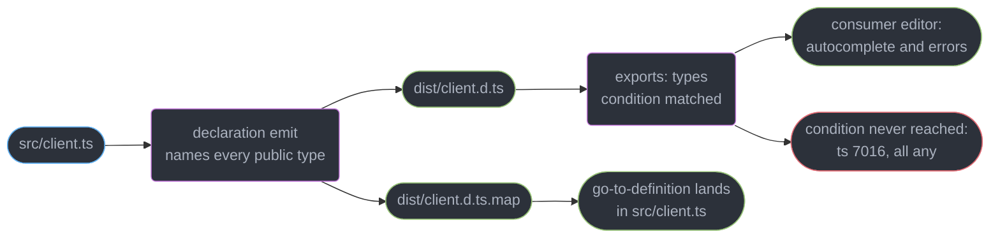
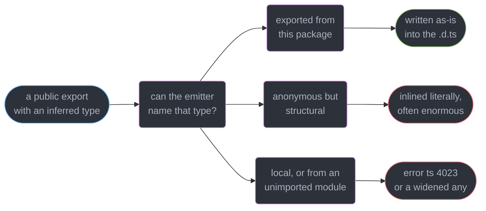
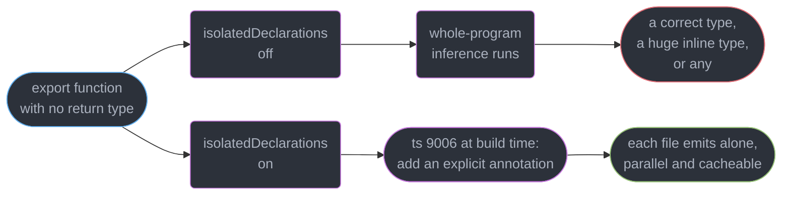
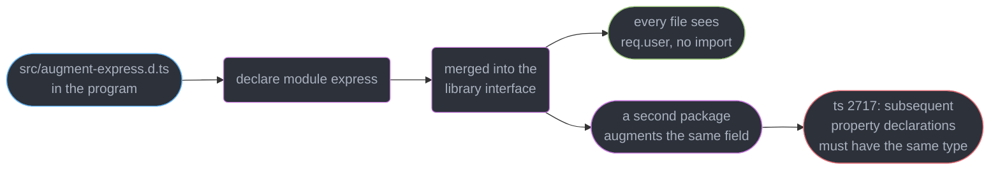
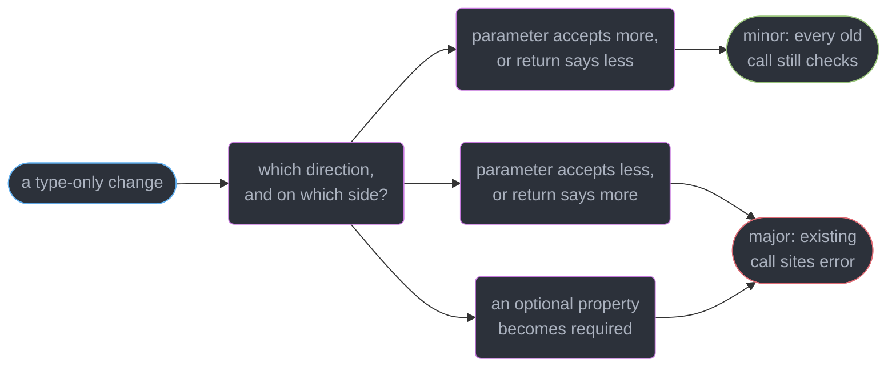
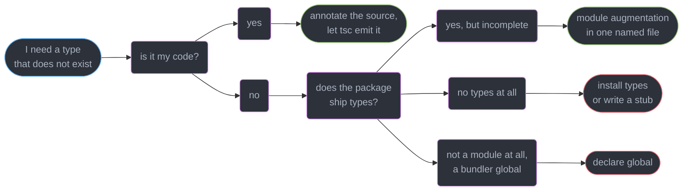

# Declaration Files and Library Authoring

---

## 1. Concept Overview

A library ships two artifacts and most teams review only one. The JavaScript is tested,
benchmarked and read line by line; the `.d.ts` beside it is produced by a build step nobody
opens, and it is the surface every consumer actually programs against — autocomplete,
parameter hints, the red squiggle that stops a wrong call before it runs.

That is the framing of this module: **a library's type surface is its API.** A change to it
is a breaking change even when the emitted JavaScript is byte-identical, and a regression in
it is invisible to every runtime test you own, because the values were never wrong.

| What a consumer experiences | Where it comes from | What silently destroys it |
|-----------------------------|---------------------|---------------------------|
| Autocomplete on your exports | `dist/*.d.ts` reached through the `types` condition | a dropped `export` on a type alias |
| Go-to-definition landing in your source | `declarationMap` plus the `.ts` files inside the tarball | a `files` array that excludes `src/` |
| An error on a wrong argument | the annotations the emitter was able to *name* | an inferred type widened to `any` |
| Types at all, for CJS consumers | a `.d.cts` describing the CJS shape | one `.d.ts` serving both formats |

The target is **TypeScript 7.0** (GA 2026-07-08, a native Go compiler); `isolatedDeclarations`
has been available since **5.5**. One constraint matters before you reach for a declaration
bundler: **TS 7.0 exposes no stable programmatic Compiler API until 7.1**, so API Extractor,
ts-morph, dts-bundle-generator and every other tool built on that API still run on
`typescript@npm:@typescript/typescript6` (binary `tsc6`).

`exports` conditions, `moduleResolution`, ESM/CJS interop and the dual-package hazard belong
to `../modules_resolution_and_package_exports/modules_resolution_and_package_exports.md`;
this page uses them and does not re-derive them. Type-level assertions live in
`../testing_typed_code/testing_typed_code.md`, generics in
`../generics_and_type_parameters/generics_and_type_parameters.md`, conditional and mapped
types in `../conditional_and_mapped_types/conditional_and_mapped_types.md`, build speed in
`../the_typescript_compiler_and_type_performance/the_typescript_compiler_and_type_performance.md`,
and npm publishing in
`../../frontend_platform/package_management_and_supply_chain/package_management_and_supply_chain.md`.

---

## 2. Intuition

> A `.d.ts` is the shadow your implementation casts. You do not carve the shadow — you shape
> the object and check the shadow came out right.

**Mental model.** The declaration emit is a *second compiler pass with a much smaller
vocabulary*. The checker knows every type in your program, including anonymous ones it
inferred and local ones you never exported; the declaration writer may only use names a
consumer could also write. When those vocabularies disagree, the default give is your public
type getting wider.

**Why it matters.** Consumers cannot see your source. Everything they know arrives through a
generated file and a resolution path, both of which break while every unit test stays green
and the package installs cleanly.

**Key insight.** Every failure in this module is the same failure: **a type that was correct
in your source did not survive the trip into someone else's editor.** It got widened by the
emitter, blocked by a resolver, overwritten by an augmentation, or narrowed by a "harmless"
patch release. Nothing threw.

---

## 3. Core Principles

1. **The declaration is generated, not authored.** `declaration: true` derives it from the
   implementation, so the two cannot drift; a hand-written `.d.ts` for your own code is a
   second source of truth with no compiler holding it to the first.
2. **The emitter can only use names it can reference.** If a public signature's type is not
   exported the emitter must error or widen — the single most common way a library ships `any`.
3. **`isolatedDeclarations` `[5.5]` converts that whole class of bug into a compile error**
   by requiring every export to carry an explicit annotation.
4. **Declarations merge; implementations do not.** Two `interface Foo` in one scope become one
   interface — the mechanism behind every ecosystem extension point and its worst errors.
5. **Augmentation is action at a distance.** `declare module "express"` in any file included
   by your program changes types everywhere in the program, with no import at the use site.
6. **Semver applies to types.** Narrowing a parameter, widening a return and adding a
   required property are breaking changes with zero runtime diff.
7. **Publish-time correctness is a property of the tarball**, not the repo — verify with
   `@arethetypeswrong/cli` and `publint` against what `npm pack` produced.
8. **A type surface without type tests has no regression guard.** Runtime tests assert on
   values, and a widened type produces correct values.

---

## 4. Types / Architectures / Strategies

### 4.1 The four kinds of declaration file

| Kind | Written by | Typical home | Rule of thumb |
|------|-----------|--------------|---------------|
| **Generated** — emitted from your own `.ts` | `tsc --declaration` | `dist/*.d.ts` | Always, for your own code |
| **Ambient global** — `declare global`, `declare const` | you | `src/globals.d.ts` | Only for things no import produces |
| **Module augmentation** — `declare module "pkg"` | you | one named file, e.g. `src/augment-express.d.ts` | Only to extend someone else's type |
| **Standalone stub** — types for JavaScript you do not own | you or DefinitelyTyped | `@types/<pkg>` | Only when the package ships none |

The distinction that matters: the first is a *derivative* of code you control, the other
three are *assertions* nothing verifies. Treat the last three as unsafe casts scaled to a
whole module — the same trust boundary `../runtime_validation_and_parse_dont_validate/runtime_validation_and_parse_dont_validate.md`
describes for data.

Who *ships* the types follows from the same split. Bundling them inside your package is the
default for anything written in TypeScript, because they are then locked to the code. A
`@types/*` package on DefinitelyTyped exists for libraries authored in JavaScript and tracks
the library's major and minor only, never its patch — `@types/express@5.0.x` lags Express 5.1
by weeks. Neither present means `ts(7016)` and a package typed `any` end to end.

### 4.2 What merges with what

| Left | Right | Result |
|------|-------|--------|
| `interface` | `interface` | One interface with the union of members |
| `namespace` | `namespace` | One namespace; only `export`ed members are visible across |
| `namespace` | `function` | Function with static properties |
| `namespace` | `class` | Class with static/nested members |
| `namespace` | `enum` | Enum with computed extras |
| `type` alias | anything of the same name | **Error** — `ts(2300) Duplicate identifier` |
| `class` | `class` | **Error** — implementations never merge |

Interfaces merge, type aliases do not. That one row explains why every extensible library
API in the ecosystem — Express's `Request`, Vitest's `Assertion`, `ProcessEnv` — is declared
as an `interface`.

---

## 5. Architecture Diagrams

### From your source to a consumer's autocomplete



The `.map` is optional; the `types` condition is not — miss it and the whole package is `any`.

### The naming decision that widens your API



Only the first outcome is what you meant; the middle one is why a `.d.ts` can run 9,000 lines
for a 300-line module.

### What `isolatedDeclarations` changes



The parallel-emit speed-up is the advertised benefit; the reason to turn it on is that the
`maybe` box becomes an error instead of a shipped `any`.

### Where an augmentation actually lands



Nothing imports the augmentation file: that is what makes it convenient, and untraceable.

### Classifying a change to the type surface



Read it as variance: loosening an input and tightening an output are the two safe moves.

---

## 6. How It Works — Detailed Mechanics

### 6.1 What the compiler actually emits

```json
{ "compilerOptions": {
    "declaration": true, "declarationMap": true, "isolatedDeclarations": true,
    "module": "nodenext", "moduleResolution": "nodenext", "strict": true,
    "outDir": "dist", "rootDir": "src" } }
```

`declaration: true` runs a second emit that keeps every type and throws away every body:

```ts
// src/client.ts
export interface ClientOptions { baseUrl: string; retries?: number }

export class Client {
  #token: string;
  constructor(private readonly opts: ClientOptions) { this.#token = ""; }
  async get(path: string): Promise<Response> { return fetch(this.opts.baseUrl + path); }
}

// dist/client.d.ts — generated, never hand-edited
export interface ClientOptions { baseUrl: string; retries?: number }
export declare class Client {
    #private;
    private readonly opts;
    constructor(opts: ClientOptions);
    get(path: string): Promise<Response>;
}
```

Two details carry weight. `#token` becomes an opaque `#private` marker, recording that the
class is nominally branded without leaking the field; and `private readonly opts` **stays in
the declaration**, because a `private` member still affects assignability under structural
typing (`../structural_typing_and_assignability/structural_typing_and_assignability.md`).

`declarationMap: true` also writes `dist/client.d.ts.map`, mapping each declaration back to
the `src/client.ts` line that produced it. Without it, go-to-definition on `Client` lands in
the stub — signatures, no bodies, no comments; with it, in your source, so the tarball must
carry `src/` too: `"files": ["dist", "src"]`, roughly 30-60% more download.

**Hand-writing a `.d.ts` for your own TypeScript is almost always a mistake.** It is a second
declaration of the same API that no compiler checks against the first, so the day a parameter
changes the stub keeps advertising the old signature and the error surfaces in a consumer's
build. The one legitimate case is describing JavaScript you do not own.

### 6.2 The emit trap: a type the declaration cannot name

The checker resolves types across the whole program; the declaration writer may only use
names a consumer's checker can also resolve. When a public signature depends on something
unexported, you get an error — or, where the emitter can widen instead, silence:

```ts
// src/api.ts
type Envelope<T> = { data: T; requestId: string };   // NOT exported

export function fetchUser(id: string) {              // inferred return
  return request<Envelope<{ id: string; name: string }>>(id);
}
```

```
error TS4023: Exported variable 'fetchUser' has or is using name 'Envelope' from external
module "/src/api" but cannot be named.

error TS4053: Return type of public method from exported class has or is using name
'Envelope' from external module "/src/types" but cannot be named.

error TS9006: Declaration emit for this file requires adding a type annotation on the
return type of exported function 'fetchUser'. Add a type annotation or move the expression
to a separate file.
```

`ts(4023)` and `ts(4053)` are the loud form, fixed by adding the `export`. The dangerous form
is where the emitter has a fallback: an inferred type that resolved to `any` upstream
propagates outward, the declaration is written with `any` in it, and **no error is produced
at all** — every runtime test passes, because the values were always correct.
`../testing_typed_code/testing_typed_code.md` §14 tells that story from the consumer's side;
§10 below tells it from yours. `ts(9006)` is the third message above: what
`isolatedDeclarations` `[5.5]` reports instead, by refusing to infer at a declaration
boundary at all.

```ts
// FIX — export the type and annotate the boundary
export type Envelope<T> = { data: T; requestId: string };
export function fetchUser(id: string): Promise<Envelope<User>> {
  return request<Envelope<User>>(id);
}
```

The flag's headline benefit is that each file's declaration can be produced from that file
alone — parallelisable, cacheable, and implementable by non-`tsc` tools, which is why
esbuild-based and Rust-based emitters require it. Its value to a library author is `ts(9006)`
itself: an annotation you wanted anyway, demanded at the moment you skip it. The cost is
churn — a 900-file package typically needs 300-500 new annotations.

### 6.3 Declaration merging

Two declarations of the same name in the same scope combine rather than collide, as long as
both are of a mergeable kind:

```ts
interface Config { host: string }
interface Config { port: number }          // one interface: { host: string; port: number }

// A namespace merges with a function, class or enum of the same name — statics without a class
export function parse(s: string): Date { return new Date(s); }
export namespace parse {
  export const iso = /^\d{4}-\d{2}-\d{2}/;   // parse.iso, typed, and real at runtime
}
// A type alias never merges: a second `type Config` here is ts(2300) Duplicate identifier
```

Merging is what makes third-party extension possible without a fork, and why two declarations
of one name can be in scope with neither obviously "the" definition. Conflicts are strict:
same-named properties must have **identical** types or you get `ts(2717) Subsequent property
declarations must have the same type`, and a merge may only add members, never override one.

### 6.4 Module augmentation

To add to a library's types, reopen its module declaration from inside a file your program
includes:

```ts
// src/augment-express.d.ts — the only file in the repo that augments express
import "express";                       // required: makes this a module, not a global script

declare module "express-serve-static-core" {
  interface Request { user?: { id: string; roles: readonly string[] } }
}
```

Three rules make this survivable. **The specifier must be the one the library's own
declaration uses** — augmenting `"express"` does nothing, because `Request` is declared in
`express-serve-static-core`, and the augmentation lands silently on a module that never had
that interface. **The file must be a module** (that `import "express"` is load-bearing —
without it, `declare module` declares an *ambient* module and shadows the real one entirely).
And **you may only add**: changing an existing property's type is `ts(2717)`.

The discipline is the important half. An augmentation has no import at the use site, so
`req.user` simply exists everywhere and nothing points at why. Keep one file per augmented
package, named for what it augments, never inside a module that also exports runtime code.
An augmentation shipped *by* your library edits a type in every consumer's program: that is a
documented feature and a major-version concern, not an implementation detail.

### 6.5 Ambient declarations and globals

```ts
// src/globals.d.ts
export {};                                    // makes this a module so declare global is legal

declare global {
  // a value your bundler's define/replace injects — real at runtime, invisible to tsc
  const __BUILD_SHA__: string;
  interface Window { __APP_CONFIG__?: { apiBase: string } }
}

// asset imports a bundler resolves and the checker has never heard of:
//   Cannot find module './logo.svg' or its corresponding type declarations. ts(2307)
declare module "*.svg" { const src: string; export default src; }
declare module "*.css";                       // side-effect import, no exports
```

`declare global` only works inside a module; in a script file every top-level declaration is
already global and the wrapper is an error. The wildcard is a pure assertion — nothing checks
that your bundler really produces a string — so keep it to the shapes it documents.

Pulling in *someone else's* ambient types has two mechanisms that differ in blast radius. A
`/// <reference types="node" />` directive is baked into the file that carries it, so a
published `.d.ts` containing one forces `@types/node` into every consumer's compilation —
correct for a Node-only library, hostile in a browser package. A
`"types": ["node", "vitest/globals"]` array in `tsconfig.json` configures only your own
build, and setting it at all switches off the default "include every `@types` package in
`node_modules`" behaviour, which is the cheapest cut to a large project's declaration load
(see
`../the_typescript_compiler_and_type_performance/the_typescript_compiler_and_type_performance.md`).

### 6.6 Versioning a type surface

| Change | Runtime diff | Semver | Why |
|--------|--------------|--------|-----|
| Add an optional property to a returned object | none | minor | consumers ignore what they do not read |
| Widen a parameter, e.g. `string` to `string \| number` | none | minor | every old call still checks |
| Add an overload for a new argument shape | none | minor | existing overloads unchanged |
| Narrow a parameter, e.g. `string` to a union of 4 literals | none | **major** | existing call sites now error |
| Widen a return, e.g. `User` to `User \| null` | none | **major** | consumers must handle the new member |
| Make an optional property required | none | **major** | every existing object literal fails |
| Add a required property to an options interface | none | **major** | same, at every construction site |
| Rename an exported type | none | **major** | `ts(2724)` at every import |
| Fix a return that was wrongly `any` | none | **major** in practice | code that compiled against `any` now errors |

Ship `RetryOptions.backoff` narrowed from `string` to `"fixed" | "exponential"` in a patch and
every consumer passing a computed string fails on `npm ci`, with no line of their code and no
line of your runtime having changed. The last row is the one teams argue about: tightening a
wrongly-`any` return is an improvement *and* breaks builds, so it goes in a major. To make the
strict version available sooner, ship it as a **new export name** in a minor.

### 6.7 Publishing the declarations correctly

```json
{
  "name": "@acme/sdk", "type": "module", "types": "./dist/index.d.ts",
  "exports": {
    ".": {
      "types": { "import": "./dist/index.d.mts", "require": "./dist/index.d.cts" },
      "import": "./dist/index.mjs", "require": "./dist/index.cjs"
    },
    "./package.json": "./package.json"
  },
  "files": ["dist", "src"]
}
```

The top-level `types` (and its older spelling `typings`) is a **fallback for resolvers that
do not read `exports` at all**. Every current resolver uses the `types` condition and ignores
the field once `exports` exists — which is precisely why a broken condition hides behind a
healthy-looking top-level `types` for weeks. Condition ordering is owned by
`../modules_resolution_and_package_exports/modules_resolution_and_package_exports.md`; the
declaration-specific fact is that **a `.d.ts` describes module shape as well as types**, so
one file cannot honestly serve both formats — `.d.mts` says `export declare function x`,
`.d.cts` says `export = `, and `attw` reports the mismatch as `Masquerading as CJS`.

```bash
npm pack                                             # the exact tarball npm will publish
npx publint ./acme-sdk-4.0.0.tgz                     # missing files, bad fields, wrong order
npx @arethetypeswrong/cli ./acme-sdk-4.0.0.tgz       # resolve types as node10/node16/bundler
npx tsc --noEmit -p tsconfig.dist-test.json          # a consumer-shaped project against dist
```

Run all four in the release job, against the tarball. `tsc --noEmit` over `src/` exercises
none of them: it checks the sources, not the declarations, resolution or packaging.

### 6.8 Type tests are the regression guard

```ts
// test/surface.test-d.ts — runs against dist, not src
import { expectTypeOf } from "vitest";
import { createClient } from "@acme/sdk";      // resolved like a consumer, via exports

const c = createClient({ baseUrl: "https://x.test" });
expectTypeOf(c.getUser).parameters.toEqualTypeOf<[id: string]>();
expectTypeOf(c.getUser("u1")).resolves.not.toBeAny();       // the widening guard
expectTypeOf(c.getUser("u1")).resolves.toEqualTypeOf<{ id: string; name: string }>();

// @ts-expect-error - retries must be a number
createClient({ baseUrl: "https://x.test", retries: "3" });
```

`not.toBeAny()` maps directly to the emit trap, and pointing the test project at `dist`
rather than `src` is what makes it a *publishing* test instead of another source test.
`../testing_typed_code/testing_typed_code.md` owns `expectTypeOf`, `tsd` and
`@ts-expect-error` in full.

---

## 7. Real-World Examples

### Turning on `isolatedDeclarations` in a 640-file package

A design-system package, 640 source files, 210 public exports, 41-second declaration emit.
Enabling the flag produced **387 `ts(9006)` errors** in one run. The team split them:

1. 291 were mechanical — an obvious return type; the codemod annotated them in one commit.
2. 78 needed a local `type` alias exported, which is the bug the flag exists to find. Three
   of those sat behind methods whose declarations had been emitting `any` for **fourteen
   months**, unnoticed by 240 runtime tests.
3. 18 were awkward generic returns, annotated by hand over two days.

Declaration emit dropped from 41s to 9s once each file could be emitted independently. The
three recovered `any`s were why the work was approved; the speed-up was why it was scheduled.

### Moving from `@types` to bundled declarations

A JavaScript logging library with 1.1M weekly downloads had DefinitelyTyped types trailing
the implementation by two minor versions. A hand-written `.d.ts` in the repo took two days
and began drifting at the next refactor — the §6.1 problem at 1.1M installs — so it served
only as a bridge to a six-week TypeScript rewrite. The step that mattered on release day was
deprecating the `@types` package the same week: with both present, a consumer installing
`@types/thelib` shadows the bundled declarations and stays two versions behind forever.

---

## 8. Tradeoffs

| Decision | Cheaper option | What it costs | Take the expensive one when |
|----------|----------------|---------------|----------------------------|
| Generated vs hand-written `.d.ts` | hand-written stub, 2 days | drift, forever, invisible to you | always, for code you own |
| `isolatedDeclarations` on/off | off | inferred `any` can ship silently | the package is published |
| `declarationMap` on/off | off, smaller tarball | consumers navigate into a stub | consumers debug your library |
| Per-file `.d.ts` vs one rolled-up file | per-file, no extra tool | large surfaces are hard to review | you need an API report for review |
| Bundled types vs `@types` | `@types`, someone else's work | version skew and a shadowing hazard | you control the release |
| Dual `.d.mts` + `.d.cts` vs one `.d.ts` | one file | `Masquerading as CJS` for half your users | you publish a dual build |
| Major bump for a type-only fix | patch, "no runtime change" | broken `npm ci` across your dependents | the change narrows or widens anything |

A declaration bundler (API Extractor, `dts-bundle-generator`, `rollup-plugin-dts`) buys one
reviewable file and an API report that fails CI when the surface changes — useful above
roughly 150 exports. Those tools sit on the Compiler API, so on TS 7.0 they run under `tsc6`
until the 7.1 API stabilises.

---

## 9. When to Use / When NOT to Use



**Reach for a generated declaration when:** the code is yours. There is no second case.
**Reach for augmentation when:** a library's own types miss a field its runtime really has —
`req.user` after your auth middleware, a Vitest matcher, an extra `ProcessEnv` key. **Reach
for `declare global` when:** a value exists at runtime with no import producing it.

**Do NOT hand-write a `.d.ts` for your own TypeScript** — that is a second API nothing checks
against the first. **Do NOT augment a type to make a cast compile**: augmentation asserts a
runtime fact, and if the fact is false you have moved a crash from the checker to production.
**Do NOT put `declare global` in a published library** unless the global really is global.
**Do NOT use `/// <reference types="node" />` in shipped declarations** for a package that
also runs in browsers; it forces `@types/node` into their build.

---

## 10. Common Pitfalls

### Pitfall 1: one missing `export` widens a public method to `any` (BROKEN → FIX)

```ts
// BROKEN — a refactor extracted this alias and dropped the export keyword
type PaymentResult = { id: string; status: "settled" | "pending"; amountMinor: number };

export class Payments {
  // The emitter cannot name PaymentResult from the declaration file, and here it has a
  // fallback rather than an error: the emitted method returns Promise<any>.
  async charge(cents: number) { return this.post<PaymentResult>("/charge", cents); }
}

// FIX — export the type, and annotate the boundary so the emit cannot drift again
export type PaymentResult = { id: string; status: "settled" | "pending"; amountMinor: number };
export class Payments {
  async charge(cents: number): Promise<PaymentResult> {
    return this.post<PaymentResult>("/charge", cents);
  }
}
```

The diff that caused it removes six characters. Every runtime test passes — the *values* were
never wrong — while every consumer loses autocomplete and every guard on `status`. Two things
catch it: `isolatedDeclarations` at build time, and `not.toBeAny()` against `dist` in CI.

### Pitfall 2: augmenting the wrong module specifier

```ts
// BROKEN — silently does nothing; Request lives in express-serve-static-core
declare module "express" { interface Request { user?: AuthUser } }

// FIX — augment the module that actually declares the interface
import "express";
declare module "express-serve-static-core" { interface Request { user?: AuthUser } }
```

The broken form produces no error at all: it creates a `Request` interface inside the
`"express"` module declaration, which nothing references. The symptom is `Property 'user'
does not exist on type 'Request'. ts(2339)` in the handler, with a correct-looking
augmentation file open in the next tab. Read the library's own `.d.ts` for where the
interface is declared before writing the augmentation.

### Pitfall 3: declarations nothing keeps honest

A package shipped `index.d.ts` by hand because "the build was fussy". Eight months later
`createServer(opts)` had gained a required `region` field and the stub still declared it
optional, so consumers compiled clean and crashed at startup with `Cannot read properties of
undefined (reading 'region')`. Nothing in CI compares a hand-written declaration to the
implementation — that comparison is exactly what `declaration: true` is.

The same shape appears in packaging: `declarationMap: true` with `"files": ["dist"]` publishes
`.d.ts.map` files pointing at a `../src/client.ts` that is not in the tarball, so
go-to-definition fails on an unresolved path — worse than landing in the stub. `publint` flags
the dangling reference; `tsc` never will, because from inside your repo the file exists.

---

## 11. Technologies & Tools

| Tool | Role | Relevance here |
|------|------|----------------|
| TypeScript | Compiler and declaration emitter (7.0, native Go) | Owns `declaration`, `declarationMap`, `isolatedDeclarations` |
| tsc6 | The 6.0 binary as `@typescript/typescript6` | The only stable Compiler API until 7.1 |
| arethetypeswrong | Resolves your types as each consumer would | Catches masquerading and missing declarations |
| publint | Lints the packed tarball | Missing files, dangling maps, bad fields |
| API Extractor | Rolls up one `.d.ts` plus a reviewable API report | Fails CI when the surface changes |
| dts-bundle-generator | Lighter declaration rollup | Single-file `.d.ts` without the report |
| tsd | Type assertions from a test file | Runs against `dist` in the publish job |
| Vitest | Test runner with `expectTypeOf` | Type-level assertions beside unit tests |
| DefinitelyTyped | The `@types/*` registry | Types for packages authored in JavaScript |

---

## 12. Interview Questions with Answers

**Q: A public method's return type silently became `any` after a refactor with no error anywhere. What happened?**
**Short:** The emitter cannot name a type the declaration file has no way to reference, so it fell back to any and every runtime test still passed.

Something in the signature — usually a `type` alias that lost its `export` during an extraction
— is unreachable from the `.d.ts`. Where the emitter can error it reports `ts(4023)`; where it
has a fallback it writes `any` quietly, so tests stay green while every consumer loses
autocomplete. Export the type, annotate the boundary, and assert `not.toBeAny()` against `dist`.

**Q: What does `isolatedDeclarations` actually buy a library author?**
**Short:** Explicit annotations on every export are required, which turns an inferred type that would have shipped as any into a build error instead.

`[5.5]` It refuses to infer at a declaration boundary and reports `ts(9006): Declaration emit
for this file requires adding a type annotation`. The advertised win is that each file's
`.d.ts` comes from that file alone — parallel, cacheable, roughly 4x on emit time in a 640-file
package. The real win is that silent widening is impossible; the cost is 300-500 annotations.

**Q: Which changes to a type surface are breaking, given identical runtime behaviour?**
**Short:** Narrowing a parameter, widening a return, and making an optional property required all break consumer builds without changing a byte of emitted JavaScript.

Also breaking: adding a required property to an options object, renaming an exported type,
and fixing a return that was wrongly `any` — that last one is an improvement that still fails
`npm ci` for anyone who compiled against `any`. Safe: adding an optional property, widening a
parameter, adding an overload. Semver governs the type surface, so a tightening ships major.

**Q: What is `declarationMap` for, and what does it require you to publish?**
**Short:** Source maps for declarations tie each emitted type back to the .ts line that produced it, so navigation reaches real code with comments and context.

Without it, a consumer pressing go-to-definition on your class lands in the generated stub —
signatures with no bodies. With it they land in `src/client.ts`. The catch is that the map
names files that must be in the tarball, so `"files"` has to include `src` as well as `dist`,
roughly 30-60% more download. Shipping the map without the sources is worse than neither.

**Q: What does `ts(4023)` mean and how do you fix it?**
**Short:** A referenced type lives somewhere the declaration file cannot import from, so the emitter refuses to write a name a consumer could not resolve.

The full text is `has or is using name 'X' from external module "..." but cannot be named`,
with `ts(4053)` as the method-return variant. Almost always the cause is a missing `export`
on a type alias used in a public signature, so export it. Inlining the type or annotating the
export with an already-public type work too; silencing it with `any` does not.

**Q: Why is hand-writing a `.d.ts` for your own TypeScript a mistake?**
**Short:** Hand-written declarations drift from the implementation the moment anyone edits it, because no compiler ever compares the two.

`declaration: true` derives the file from the code, so they cannot disagree. A hand-written
stub is a parallel API definition: the day a parameter becomes required the stub keeps
advertising it as optional, and the error appears in a consumer's runtime rather than your
build. Legitimate uses are JavaScript you do not own, ambient globals and augmentations.

**Q: What is declaration merging, and what merges with what?**
**Short:** Two declarations of the same name in one scope combine into one, which works for interfaces and namespaces and is an error for type aliases and classes.

`interface Config` twice yields one interface with both members. A `namespace` merges with a
function, class or enum of the same name, which is how a function gains typed statics. `type`
aliases never merge (`ts(2300) Duplicate identifier`), nor do class implementations, and
conflicting property types are `ts(2717)`. Hence every extensible API is an `interface`.

**Q: How do you add a property to a third-party library's type, and what is the discipline around it?**
**Short:** Reopening a library's module declaration merges new members into its interfaces, and the file must itself be a module or it shadows the library instead.

`declare module "express-serve-static-core" { interface Request { user?: AuthUser } }`, in a
file containing an `import` so it is a module. You may only add — changing an existing
member's type is `ts(2717)`. Nothing imports the augmentation, so `req.user` appears everywhere
with no trace of why: keep one clearly-named file per augmented package, with no runtime code.

**Q: When is `declare global` right, and when is module augmentation right?**
**Short:** The global variant edits the ambient scope, so it is only correct for values that exist at runtime with no import producing them.

Bundler-injected constants like `__BUILD_SHA__`, a `window` property set by a script tag, a
polyfill — those are globals; anything reachable through an import is a module augmentation
instead. `declare global` is legal only inside a module, which is why such files carry a bare
`export {}`. Never publish one unless the global is genuinely global.

**Q: How do you type a non-code import such as `import logo from "./logo.svg"`?**
**Short:** Bundlers invent module specifiers the checker has never seen, so a wildcard ambient declaration is what gives the import a type.

Without one you get `Cannot find module './logo.svg' or its corresponding type declarations.
ts(2307)`. Declare `declare module "*.svg" { const src: string; export default src; }` in an
ambient file, matching what your bundler actually produces — a URL string, a component, raw
source. It is an unchecked assertion, so prefer the declarations your bundler ships.

**Q: `/// <reference types="node" />` or `"types": ["node"]` in tsconfig — what is the difference?**
**Short:** A triple-slash directive travels inside the file that carries it, while the tsconfig array configures only your own compilation.

Put the directive in a published `.d.ts` and every consumer's build pulls `@types/node` in —
correct for a Node-only library, hostile for a package that also runs in browsers. The
`types` array affects your project alone, and setting it at all disables the default "include
every `@types` package in `node_modules`", the cheapest cut to a large declaration load.

**Q: `types` in `package.json` or the `types` condition inside `exports` — which does a consumer use?**
**Short:** The exports condition wins wherever a resolver reads exports at all, leaving the top-level field as a fallback for resolvers that do not.

Modern resolvers ignore the top-level `types`/`typings` once `exports` exists, which is why a
broken condition hides: the root entry keeps working through the fallback while every subpath
silently resolves to `any`. Verify with `attw` on the tarball; ordering rules belong to
`../modules_resolution_and_package_exports/modules_resolution_and_package_exports.md`.

**Q: Bundled declarations or a `@types` package on DefinitelyTyped?**
**Short:** Shipping declarations inside the package keeps them versioned with the code, while DefinitelyTyped types are maintained separately and lag by design.

Bundle them for anything written in TypeScript — `declaration: true` and a `types` condition.
`@types/*` exists for libraries authored in JavaScript, and its version tracks the library's
major and minor only, so skew of weeks is normal. Never ship both: an installed
`@types/thelib` shadows your bundled declarations and consumers stay stale without noticing.

**Q: How do you ship declarations that work for both ESM and CJS consumers?**
**Short:** Each format needs its own declaration file, because a .d.ts describes module shape as well as types and one file cannot describe both.

`.d.mts` declares ESM exports, `.d.cts` declares `export =`, and each nests under the matching
condition inside `types`. One `.d.ts` serving both is what `attw` reports as `Masquerading as
CJS`: the checker describes a shape their runtime will not produce. The simpler answer in 2026
is ESM-only — `../modules_resolution_and_package_exports/modules_resolution_and_package_exports.md`.

**Q: Why does adding a required property to an options interface break consumers with no runtime change?**
**Short:** A required property makes every existing construction site an error, since object literals that were complete yesterday are now missing a member.

`createServer({ port: 8080 })` stops compiling the moment `region` becomes required, across
every dependent, on their next `npm ci`. Your JavaScript is unchanged and possibly still
handles the missing field. Add it optional with a documented default, or add a new overload
or a new factory taking the stricter shape, and require it in the next major.

**Q: Why is widening a parameter safe when widening a return is breaking?**
**Short:** Parameters are contravariant and returns covariant, so accepting more input is compatible while promising less about output is not.

A function taking `string | number` still accepts every call that passed a `string`, while one
returning `User | null` breaks every consumer that read `.name` off the result without a
check. The mirror image holds — narrowing a parameter breaks callers, narrowing a return is
safe. Full variance rules: `../generics_and_type_parameters/generics_and_type_parameters.md`.

**Q: How do you stop a type regression from shipping at all?**
**Short:** Assertions run against the built dist rather than the sources are the only test that exercises the artifact a consumer actually resolves.

Point a `tsd` or `expectTypeOf` project at your package name so it resolves through `exports`
exactly as a consumer does, assert the shape of every public export, and include
`not.toBeAny()` on anything crossing the declaration emit. Add `attw` and `publint` on the
tarball in the same job; `../testing_typed_code/testing_typed_code.md` owns the vocabulary.

**Q: What is the cost of enabling `declarationMap` on a published package?**
**Short:** Declaration maps point at .ts files, so navigation only works when the tarball actually contains the sources those maps name.

That means `"files": ["dist", "src"]` and roughly 30-60% more install size, plus publishing
source you may have preferred to keep private. In exchange, a consumer stepping into your API
sees the real implementation with its comments instead of a bodiless stub. Ship maps and
sources together or neither — a dangling map is a broken jump, and only `publint` reports it.

---

## 13. Best Practices

1. **Generate every declaration for code you own.** `declaration: true`, and never a
   hand-written `.d.ts` beside your own `.ts`.
2. **Turn on `isolatedDeclarations` `[5.5]` before the package has consumers** — the
   annotation debt only grows, and `ts(9006)` is the cheapest place to meet it.
3. **Annotate every exported function's return type**, even where inference is correct today —
   the annotation is the contract; inference is a detail of the current body.
4. **Export every type that appears in a public signature.** If it is in your API, it is API.
5. **Ship `declarationMap` with `src` in `files`**, or neither.
6. **One augmentation file per augmented package**, named for its target, no runtime code.
7. **Treat a type-only tightening as a major version.** Narrowing a parameter, widening a
   return, or fixing a wrong `any` all break `npm ci` for dependents.
8. **Verify the tarball, not the repo:** `npm pack`, then `publint` and `attw`, in CI.
9. **Assert the public surface with type tests against `dist`**, including `not.toBeAny()` on
   anything crossing the declaration emit.

---

## 14. Case Study

### The patch release that broke 1,900 builds and changed nothing at runtime

**The package.** `@acme/feature-flags`, 1,900 dependent repositories inside one company. A
`4.7.2` patch shipped with a commit titled "tighten flag typings" and no JavaScript diff at
all — the build output was byte-identical to `4.7.1`, as the release notes said.

```ts
// BROKEN — shipped as 4.7.2, "types only, no runtime change"
export interface FlagOptions {
  key: string;
  variant: "on" | "off" | "percent";   // was: string
  rollout: number;                     // was: rollout?: number
}
export function evaluate(o: FlagOptions): boolean { /* unchanged */ }
```

Within four hours, 1,180 repositories failed CI. Two errors dominated:

```
Type 'string' is not assignable to type '"on" | "off" | "percent"'. ts(2322)
Property 'rollout' is missing in type '{ key: string; variant: string; }' but required
in type 'FlagOptions'. ts(2741)
```

Nothing had broken at runtime, and nothing could: `evaluate` had always tolerated a missing
`rollout` and an unrecognised variant. The type surface had simply stopped describing what
the function accepted, and every consumer computing `variant` from a config string had a
build error with no upgrade path inside a patch range.

```ts
// FIX — additive in the patch, strict in the next major
export interface FlagOptions { key: string; variant: string; rollout?: number }  // as 4.7.1
// the strict shape arrives as a NEW export, so adoption is opt-in
export interface StrictFlagOptions extends Omit<FlagOptions, "variant"> {
  variant: "on" | "off" | "percent";
  rollout: number;
}
export function evaluate(o: FlagOptions | StrictFlagOptions): boolean { /* unchanged */ }
```

`4.7.3` reverted within 40 minutes; `5.0.0` two weeks later made `StrictFlagOptions` the type
of `evaluate`, adopted deliberately, repository by repository.

**What went into the release job afterwards.**

| Guard | Catches | Cost |
|-------|---------|------|
| `tsd` against `dist`, asserting the 4.7.1 surface | any narrowing of a shipped type | 2.4s per release |
| `attw` + `publint` on the packed tarball | resolution and packaging regressions | 6s per release |
| A pinned "consumer" fixture repo type-checked in CI | breakage in the shape a real dependent has | 31s per release |
| `isolatedDeclarations` in the package tsconfig | inferred `any` reaching the surface | 300 annotations, once |

The fixture repo is the guard that would have caught this release: a surface test only fails
if someone remembered to assert the property that changed, and the `rollout?` to `rollout`
edit looked like a correctness fix to all three reviewers.

**The lesson.** The commit message was accurate — types only, no runtime change — and that is
precisely the category that needs a major version. A library's type surface is the API its
consumers compile against, so "no runtime change" describes the blast radius of the diff,
not its compatibility.
