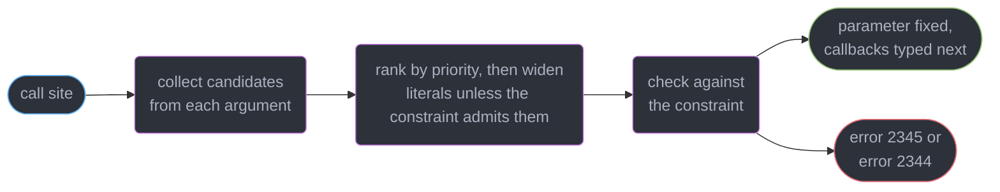
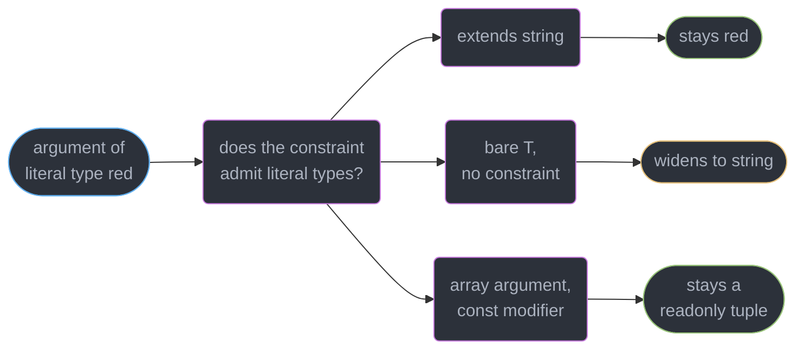
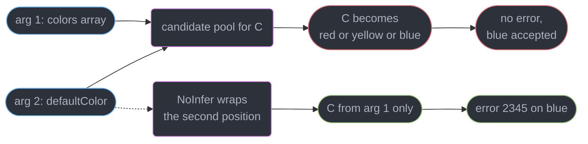
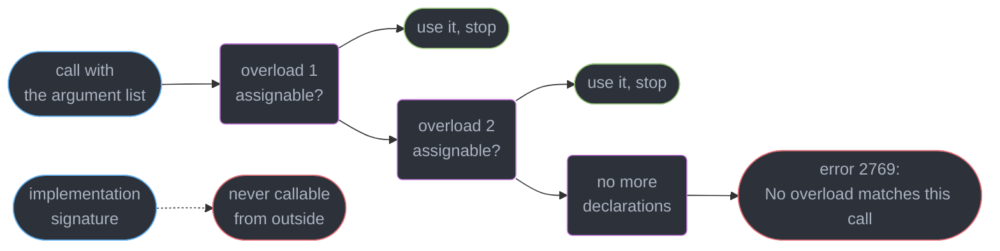
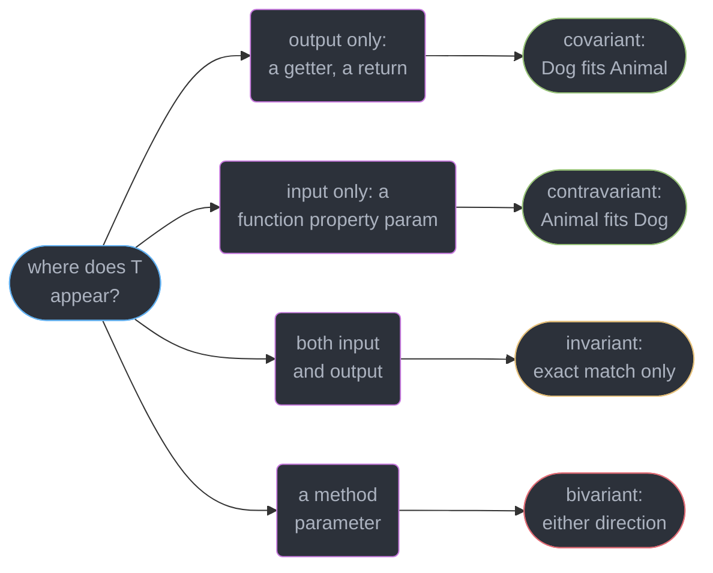
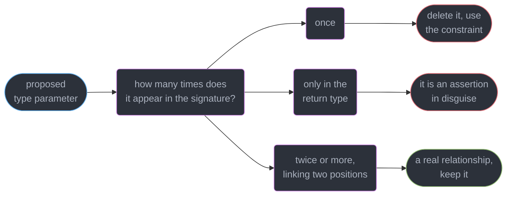

# Generics and Type Parameters

---

## 1. Concept Overview

A type parameter is a **placeholder the checker resolves separately at every call site**. It is not
a runtime value, it has no representation after emit, and it does not exist inside the function
body as anything you can inspect. What it buys is a **relationship**: `<T>(xs: T[]) => T` says the
element type going in is the type coming out, and the checker enforces that for every caller
without either side naming a concrete type.

Generics are where TypeScript inference stops being invisible. Up to module 3 the checker mostly
narrowed types you had already written. Here it **manufactures** them: it walks the arguments at a
call site, collects candidate types for each parameter, ranks the candidates, picks one, and checks
it against the constraint. Four separate things can go wrong in that pipeline, and each has a
distinct fix:

| Symptom | Where in the pipeline | Fix |
|---------|----------------------|-----|
| Inferred `string` where you wanted `"a" \| "b"` | Candidate widening | `extends string` on the parameter |
| Inferred `string[]` where you wanted a tuple | Candidate widening, array form | `const` type parameter `[5.0]` |
| One argument poisoning another's inference | Two competing inference sites | `NoInfer<T>` `[5.4]` |
| `unknown`, or the default, with no error | Nothing to infer from | Stop inferring from the return position |

The target is **TypeScript 7.0** (GA 2026-07-08). The native Go checker re-implemented inference
without changing its rules, so everything here holds on `tsc6` as well. This module assumes
assignability and literal widening from
`../structural_typing_and_assignability/structural_typing_and_assignability.md` and narrowing from
`../unions_narrowing_and_exhaustiveness/unions_narrowing_and_exhaustiveness.md`. `infer`,
conditional types and mapped types are **module 5**,
`../conditional_and_mapped_types/conditional_and_mapped_types.md` — named here, taught there.

---

## 2. Intuition

> A type parameter is a **hole with a rule attached**. The caller fills it, the constraint says what
> fits, and the signature says where the same fill has to appear more than once.

**Mental model.** A generic signature is a wiring diagram, not a type. `<T>(x: T) => T[]` wires the
argument socket to the return socket. Every call plugs one concrete type into the hole and the whole
diagram resolves. A type parameter that appears in only **one** socket is wired to nothing — which
is the source of most over-engineered generics in real code.

**Why it matters.** The difference between `any[]` and `T[]` is the difference between a function
that compiles and a function that keeps a promise. And the difference between `<T>` and
`<T extends string>` is the difference between `string` and `"GET" | "POST"` at every call site —
the same signature, two very different APIs.

**Key insight.** Inference is a **search over candidates, not a lookup**. When two arguments suggest
different types for one parameter the checker picks a supertype, and the result can be wider than
either. Understanding which positions produce candidates is the whole skill.

---

## 3. Core Principles

1. **A type parameter is resolved per call site.** Two calls to the same function instantiate it
   with two unrelated types, and neither is visible at runtime.
2. **A constraint bounds the parameter; an annotation replaces it.** `T extends string` keeps the
   caller's exact type and requires it to be a string; `x: string` throws the exact type away.
3. **Candidates come from argument positions.** A parameter appearing only in the return type has no
   candidate, falls to its default or `unknown`, and should not have been a type parameter at all.
4. **Literal candidates widen unless the constraint admits literals.** This one rule explains most
   "why is it `string`?" questions.
5. **Contextual typing flows the other way.** A callback's parameters are typed *from* the signature
   the callback is passed into, after the enclosing parameters have been fixed.
6. **Overloads resolve top to bottom, first match wins**, and the implementation signature is not
   part of the callable surface.
7. **Method parameters are bivariant; standalone function-typed properties are contravariant** under
   `strictFunctionTypes`. That asymmetry is deliberate, not an oversight.
8. **Mutable generic containers are unsound when treated covariantly** — `Dog[]` is assignable to
   `Animal[]`, and the compiler will then let you push a `Cat` into it.

---

## 4. Types / Architectures / Strategies

### 4.1 Constraint forms

| Form | Means | Typical use |
|------|-------|-------------|
| `<T>` | Anything, including `unknown` | Pure pass-through containers |
| `<T extends string>` | Any string type, literals preserved | Route names, event tags, enum-ish keys |
| `<T extends object>` | Any non-primitive | Object utilities |
| `<K extends keyof T>` | A key of another parameter | `pick`, `get`, `orderBy` |
| `<T extends { id: string }>` | A shape | Anything requiring a field |
| `<T = Record<string, never>>` | A default, used when nothing is supplied | Optional config slots |
| `<const T extends readonly string[]>` `[5.0]` | Infer literally, keep the tuple | Route tables, option lists |

```ts
function get<T extends object, K extends keyof T>(obj: T, key: K): T[K] {
  return obj[key];
}
const u = { id: "u_1", age: 31 };
const a = get(u, "age");    // number — K inferred as "age", so T[K] is number
// get(u, "nope");          // Argument of type '"nope"' is not assignable to parameter
//                          // of type '"id" | "age"'. (2345)
```

### 4.2 Where a default is applied

A default `<T = X>` fires only when the parameter is **neither supplied explicitly nor inferable**.
Supply one argument that produces a candidate and the default is ignored entirely. The default is
also checked against the constraint at the declaration: `<T extends string = number>` reports
`Type 'number' does not satisfy the constraint 'string'. (2344)` on the declaration line, before any
caller exists.

---

## 5. Architecture Diagrams

### The inference pipeline at one call site



The parameter is **fixed before** callback bodies are contextually typed, so reordering arguments
changes what a callback sees.

### Why a literal widened



### What `NoInfer` blocks



Without the block, the argument you wanted **checked** instead **defines** the parameter, so nothing
can ever be wrong.

### Overload resolution order



### Variance by position



`bi` is red because it is the one **unsound** cell: it is kept because `Array` and the DOM
declarations depend on it, not because it is safe.

### Should this even be a generic?



---

## 6. How It Works — Detailed Mechanics

### 6.1 A parameter on the type versus a parameter on a method

```ts
class TypedEmitter<Events extends Record<string, unknown>> {
  private handlers = new Map<keyof Events, Array<(p: never) => void>>();

  on<K extends keyof Events>(event: K, fn: (payload: Events[K]) => void): this {
    this.handlers.set(event, [...(this.handlers.get(event) ?? []), fn as (p: never) => void]);
    return this;
  }

  emit<K extends keyof Events>(event: K, payload: Events[K]): void {
    for (const fn of this.handlers.get(event) ?? []) (fn as (p: Events[K]) => void)(payload);
  }
}

const bus = new TypedEmitter<{ login: { userId: string }; tick: number }>();
bus.on("login", p => p.userId.trim());   // p: { userId: string } — K fixed to "login"
bus.on("tick", p => p.toFixed(1));       // p: number — K fixed to "tick" on this call
// bus.emit("tick", "now");
// Argument of type 'string' is not assignable to parameter of type 'number'. (2345)
```

`Events` belongs on the **class**: every method shares it, and one emitter serves one event map.
`K` belongs on the **method**: each `on` call selects a different event. Putting `K` on the class
would force `new TypedEmitter<Map, "login">()` and give you one emitter per event. The rule is
mechanical — a parameter that varies per call goes on the member that varies.

### 6.2 Constraining versus annotating

```ts
function routeA(path: string): string { return path; }
function routeB<T extends string>(path: T): T { return path; }
function routeC<T>(path: T): T { return path; }

const a = routeA("/users");    // string  — the annotation discarded the literal
const b = routeB("/users");    // "/users" — the constraint admits literals, so it is kept
const c = routeC("/users");    // string  — unconstrained, so the candidate widened

function requireId<T extends { id: string }>(x: T): T { return x; }
requireId({ id: "u_1", email: "a@b.c" }).email;   // string — the extra property survives
// A plain `(x: { id: string })` returns exactly that shape, so the same read reports
// Property 'email' does not exist on type '{ id: string; }'. (2339)
```

The distinction is not stylistic. `routeA` and `routeB` accept exactly the same arguments; they
differ entirely in what the **caller** gets back. A constraint is a *filter* on the caller's type;
an annotation is a *replacement* for it. Reach for `extends` whenever the return type, or any later
parameter, depends on what the caller actually passed.

### 6.3 Inference sites, priority, and the return position

```ts
declare function merge<T>(a: T, b: T): T;
const m1 = merge({ id: "x" }, { id: "y" });          // { id: string }
const m2 = merge("a", 1);
// Argument of type 'number' is not assignable to parameter of type 'string'. (2345)
// The first argument fixed T = string; the second is checked, not merged.

declare function pipe<A, B>(v: A, f: (a: A) => B): B;
const n = pipe(7, x => x.toFixed(2));                // A = number fixed first, x: number, B = string

declare function make<T>(): T;                        // T appears only in the return
const bad = make();                                   // unknown — nothing produced a candidate
const worse = make<{ id: string }>();                 // typed by fiat: an `as` with extra syntax
```

The checker collects a candidate from **each argument position** and, where several disagree, prefers
the one from the highest-priority site — a plain argument outranks a candidate inferred from a
return type, which outranks a default. In `merge`, the first argument fixes `T` and the second is
merely checked against it, so the error names `string` rather than reporting a union.

Contextual typing runs **after** the enclosing parameters are fixed, which is why `pipe(7, x => …)`
gives `x: number` with no annotation: `A` was already `number` when the arrow body was checked.
Reverse the arguments and the arrow is checked first, with nothing to type `x` from —
`Parameter 'x' implicitly has an 'any' type. (7006)` under `noImplicitAny`. Put the value-producing
argument before the callback that consumes it.

### 6.4 Why an inference widens to `string`

```ts
declare function tag<T>(v: T): T;
declare function tagC<T extends string>(v: T): T;

const w1 = tag("GET");                 // string
const w2 = tagC("GET");                // "GET"
const w3 = tag("GET" as const);        // "GET" — as const at the call site
const w4 = tag(["a", "b"]);            // string[] — the array widens too

const method = "GET";                  // "GET" — a const binding keeps the literal
let mutable = "GET";                   // string — a let binding widens immediately
const w5 = tag(method);                // string — the parameter is unconstrained, so it widens anyway
```

The rule: when a candidate for a type parameter is a **fresh literal type**, the checker widens it
to its base primitive *unless* the parameter's constraint could contain a literal — `extends string`,
`extends string | number`, `extends keyof T`. A bare `<T>` cannot, so `"GET"` becomes `string`.
`w5` is the line that surprises people: the *variable* holds `"GET"`, and the inference still
widens, because widening is decided by the parameter's constraint and not by the argument's
declaration. Adding `extends string` fixes every one of these at once and costs nothing.

### 6.5 `const` type parameters `[5.0]`

```ts
// Before: every caller had to remember `as const`
declare function routesOld<T extends readonly string[]>(paths: T): T;
const r1 = routesOld(["/a", "/b"]);                  // string[] — the tuple is gone
const r2 = routesOld(["/a", "/b"] as const);         // readonly ["/a", "/b"]

// After [5.0]: the modifier moves the burden into the declaration
declare function routes<const T extends readonly string[]>(paths: T): T;
const r3 = routes(["/a", "/b"]);                     // readonly ["/a", "/b"] — no as const
type Route = (typeof r3)[number];                    // "/a" | "/b"

declare function opts<const T>(o: T): T;
const o1 = opts({ mode: "fast", retries: 3 });       // { readonly mode: "fast"; readonly retries: 3 }
```

`const` on a type parameter means "infer this argument as if the caller had written `as const`". It
affects **only the inference at the call site**: pass a variable already typed `string[]` and you get
`string[]` back, because there is no literal left to preserve. Two more limits — the constraint must
permit `readonly` (write `readonly string[]`, not `string[]`, or the modifier is stripped straight
back off), and `const` does nothing for a parameter typed as a mutable array, since a `readonly`
tuple is not assignable to `string[]` (`4104`).

### 6.6 `NoInfer<T>` `[5.4]`

```ts
declare function streetLight<C extends string>(colors: C[], fallback: C): C;
streetLight(["red", "yellow", "green"], "blue");
// No error. C infers "red" | "yellow" | "green" | "blue" — the fallback defined the palette.

declare function light<C extends string>(colors: C[], fallback: NoInfer<C>): C;
light(["red", "yellow", "green"], "blue");
// Argument of type '"blue"' is not assignable to parameter of type
// '"red" | "yellow" | "green"'. (2345)
```

`NoInfer<T>` marks a position as **non-inferential**: the argument there is still type-checked, but
it contributes no candidate. Before 5.4 the workaround was a second parameter defaulted to the first
(`<C extends string, D extends C = C>`), which worked, leaked an extra parameter into the signature,
and broke as soon as anyone supplied type arguments explicitly. Use `NoInfer` on any parameter whose
job is to be *validated against* another parameter — defaults, fallbacks, initial values, a subset
of a key list. It is a `lib` type with no runtime footprint.

### 6.7 Overload resolution

```ts
function parse(input: string): string[];
function parse(input: string, limit: number): string[];
function parse(input: Buffer): string[];
function parse(input: string | Buffer, limit?: number): string[] {   // implementation
  const s = typeof input === "string" ? input : input.toString("utf8");
  return s.split(",", limit);
}

parse("a,b", 2);                 // overload 2 — overload 1 failed on arity, so the search continued

declare const src: string | Buffer;
parse(src);
// No overload matches this call.
//   Overload 1 of 3, '(input: string): string[]', gave the following error.
//     Argument of type 'string | Buffer' is not assignable to parameter of type 'string'. (2769)

// FIX for the union caller: one signature with a union parameter
function parseUnion(input: string | Buffer, limit?: number): string[] { return []; }
```

Three rules cover almost every overload question. **Order matters** — the checker tries declarations
top to bottom and stops at the first whose parameters accept the argument list, so a wider signature
placed above a narrower one shadows it permanently. **The implementation signature is not callable**;
it exists only to be compatible with the declarations above it, and a mismatch reports
`This overload signature is not compatible with its implementation signature. (2394)`. And **each
overload is tested against the whole argument type**, never against its constituents — which is the
union trap above: a `string | Buffer` matches neither the `string` overload nor the `Buffer` one,
even though every possible runtime value matches one of them.

Prefer a **union parameter** when the argument types vary but the return type does not, a **generic**
when the return type depends on the argument, and an overload set only for the genuinely irregular
case — differing arity, or a return type that changes discontinuously like `createElement("a")`
returning `HTMLAnchorElement`.

### 6.8 Variance, and the two deliberate holes

```ts
class Animal { name = ""; }
class Dog extends Animal { bark() {} }
class Cat extends Animal { meow() {} }

// Covariance on a read-only view is sound
declare const dogsRO: readonly Dog[];
const animalsRO: readonly Animal[] = dogsRO;     // fine — nothing can be written

// Contravariance: a handler for every Animal can stand in for a handler of Dogs
type Handler<T> = { handle: (x: T) => void };    // property syntax: contravariant in T
const anyHandler: Handler<Animal> = { handle: a => console.log(a.name) };
const dogHandler: Handler<Dog> = anyHandler;     // fine — Animal accepts every Dog
// const wrong: Handler<Animal> = { handle: (d: Dog) => d.bark() };
// Type '(d: Dog) => void' is not assignable to type '(x: Animal) => void'.
//   Types of parameters 'd' and 'x' are incompatible.
//     Type 'Animal' is not assignable to type 'Dog'. (2322)

// Method syntax is BIVARIANT — the same wrong assignment compiles
interface MethodHandler<T> { handle(x: T): void; }
const alsoWrong: MethodHandler<Animal> = { handle: (d: Dog) => d.bark() };   // no error at all
```

Both holes are choices. **Method bivariance** exists because `Array<T>` declares `push(item: T)`,
`indexOf(item: T)` and `forEach(cb: (v: T) => void)` as methods; making those contravariant would
make `Array` invariant, and `Dog[]` would stop being assignable to `Animal[]` — breaking a very
large fraction of existing code and every DOM event-handler map. `strictFunctionTypes` therefore
applies contravariance **only to function-type positions written as properties**, never to method
declarations, and that exemption is permanent by design.

The second hole is **mutable-container covariance**: `Dog[]` is assignable to `Animal[]`, so a
function taking `Animal[]` may push a `Cat` into your `Dog[]` with no `any`, no `as` and no error.
Pitfall 1 in section 10 shows the crash that follows.

Optional variance annotations `[4.7]` let you state the intended variance instead of letting the
checker derive it:

```ts
interface Producer<out T> { get(): T; }
interface Consumer<in T> { set: (v: T) => void; }
interface Box<in out T> { get(): T; set: (v: T) => void; }
// interface Wrong<out T> { set: (v: T) => void; }
// Type 'Wrong<Dog>' is not assignable to type 'Wrong<Animal>' as implied by variance annotation.
```

They introduce **no new behaviour**. Their two real jobs are documenting intent and cutting checker
work: without them the checker infers variance structurally for every generic type, which on deep
generic hierarchies is measurable — see
`../the_typescript_compiler_and_type_performance/the_typescript_compiler_and_type_performance.md`.
A wrong annotation is an error, so they also act as an assertion about your own API.

---

## 7. Real-World Examples

### A fluent builder that survives subclassing

```ts
class Query {
  protected parts: string[] = [];
  where(clause: string): this { this.parts.push(`WHERE ${clause}`); return this; }
  build(): string { return this.parts.join(" "); }
}

class PagedQuery extends Query {
  limit(n: number): this { this.parts.push(`LIMIT ${n}`); return this; }
}

new PagedQuery().where("age > 18").limit(50).build();   // PagedQuery throughout

// Declaring `where(clause: string): Query` instead breaks the chain at the first call:
// Property 'limit' does not exist on type 'Query'. (2339)
```

`this` is a **polymorphic type parameter the compiler supplies for free** — it is implicitly bound to
the receiver's type at each call site. It is the right tool exactly when the return value is the
receiver; a hand-rolled `<Self extends Query>` parameter is strictly worse because the caller can
supply the wrong `Self`.

### A `pick` whose result names its keys

```ts
function pick<T extends object, K extends keyof T>(obj: T, keys: readonly K[]): Pick<T, K> {
  const out = {} as Pick<T, K>;
  for (const k of keys) out[k] = obj[k];
  return out;
}

const user = { id: "u_1", email: "a@b.c", passwordHash: "...", createdAt: 1767225600 };
const safe = pick(user, ["id", "email"]);    // { id: string; email: string } — 2 keys, not 4
// pick(user, ["id", "passwordHash2"]);
// Type '"passwordHash2"' is not assignable to type '"id" | "email" | "passwordHash" | "createdAt"'.
```

Two parameters, three positions between them: `T` links the object to the result, `K` links the key
list to the result's keys. That is a real relationship, so both parameters earn their place. The
`Pick` mapped type itself belongs to
`../conditional_and_mapped_types/conditional_and_mapped_types.md`.

---

## 8. Tradeoffs

| Signature style | Caller keeps their exact type | Inference cost | Fails when |
|-----------------|-------------------------------|----------------|------------|
| `x: string` | No, widened to `string` | None | You need the literal back |
| `<T extends string>(x: T)` | Yes | One candidate, one constraint check | Never — this is the default choice |
| `<T>(x: T)` | No, literals widen | One candidate | You wanted `"a" \| "b"` |
| `<const T extends readonly string[]>` `[5.0]` | Yes, tuple and all | Slightly higher, per call | The caller passes a pre-widened variable |
| `<T>(): T` | Not applicable — caller asserts | None | Always. It is `as` in disguise |

| Dispatch mechanism | Reads well | Union argument | Return depends on argument | Cost |
|--------------------|-----------|----------------|----------------------------|------|
| Union parameter | Yes | Works | No | Cheapest |
| Generic | Yes | Works | Yes | One instantiation per call |
| Overload set | Only in the `.d.ts` | **Fails with 2769** | Yes, discontinuously | N signatures to keep in sync |
| Conditional return type | Rarely | Works | Yes | Highest — see module 5 |

---

## 9. When to Use / When NOT to Use

**Reach for a type parameter when:**

- It appears in **two or more** positions and links them — argument to return, key to value, object
  to result. That link is the entire product.
- The caller's exact type must survive the call: `extends string` for tags and routes, `const T` for
  option tables and route lists.
- A container holds values it never inspects — a cache, a queue, an event map, a `Result`.

**Reach for an overload set when** arity differs between forms, or the return type changes
discontinuously with a literal argument. **Reach for a union parameter** in every other multi-shape
case, because a union caller works and an overload set does not.

**Do NOT use a generic when:**

- The parameter appears **once**. `function log<T>(x: T): void` is `function log(x: unknown): void`
  with extra characters, and `<T extends string>(s: T): number` is `(s: string): number`.
- It appears **only in the return type**. There is nothing to infer from, so the caller is asserting;
  parse the value instead, per
  `../runtime_validation_and_parse_dont_validate/runtime_validation_and_parse_dont_validate.md`.
- You are reaching for a fourth or fifth parameter to keep types flowing, or the generic defers a
  decision nobody will make. Past three parameters, split the function or take an object argument;
  instantiation cost and error-message length both grow with the count.

---

## 10. Common Pitfalls

### Pitfall 1: covariant mutable containers (BROKEN → FIX)

```ts
// BROKEN — no `any`, no `as`, no error, and it throws at runtime
function labelAll(items: Animal[]): void { items.push(new Cat()); }
const kennel: Dog[] = [new Dog(), new Dog()];
labelAll(kennel);            // Dog[] is assignable to Animal[] — arrays are covariant
kennel[2].bark();            // TypeError: kennel[2].bark is not a function

// FIX — take `readonly` when you only read; the covariance is then sound
function labelAllFixed(items: readonly Animal[]): void {
  for (const a of items) console.log(a.name);
  // items.push(new Cat());
  // Property 'push' does not exist on type 'readonly Animal[]'. (2339)
}
labelAllFixed(kennel);       // still accepts Dog[], and now cannot corrupt it
```

`readonly T[]` is covariant **and** sound, because the unsoundness lives entirely in the write side.
Annotating every read-only array parameter as `readonly` costs one keyword and removes the whole
class of bug. `Array<Dog>` to `Array<Animal>` stays allowed for compatibility, so the discipline has
to come from your own signatures.

### Pitfall 2: the fallback that defines the set (BROKEN → FIX)

```ts
// BROKEN — the value being validated is also an inference site, so nothing is ever invalid
function withDefault<T extends string>(allowed: readonly T[], fallback: T): T {
  return allowed.includes(fallback) ? fallback : allowed[0]!;
}
const chosen = withDefault(["light", "dark"], "sephia");   // compiles: T is "light" | "dark" | "sephia"

// FIX — block the second inference site
function withDefaultFixed<T extends string>(allowed: readonly T[], fallback: NoInfer<T>): T {
  return allowed.includes(fallback) ? fallback : allowed[0]!;
}
// withDefaultFixed(["light", "dark"], "sephia");
// Argument of type '"sephia"' is not assignable to parameter of type '"light" | "dark"'. (2345)
```

The typo ships. Every argument position is an inference site by default, so a parameter meant to be
*checked against* a set silently *joins* the set. Any signature with the shape "a collection plus one
member of it" needs `NoInfer` on the member.

### Pitfall 3: the callback typed before its input

```ts
// BROKEN — the arrow is checked before A has a candidate
declare function applyBad<A, B>(f: (a: A) => B, v: A): B;
// applyBad(x => x.length, "abc");
// Parameter 'x' implicitly has an 'any' type. (7006)

// FIX — put the value-producing argument first
declare function apply<A, B>(v: A, f: (a: A) => B): B;
const len = apply("abc", x => x.length);     // x: string, len: number
```

Contextual typing runs left to right after each parameter is fixed, so argument order is part of a
generic function's ergonomics rather than a style question. `Array.prototype.reduce` puts the
accumulator's initial value last and pays for it with an annotation on almost every non-trivial call.

---

## 11. Technologies & Tools

| Tool | Role | Relevance to generics |
|------|------|----------------------|
| TypeScript | The compiler and checker (7.0, native Go binary) | Owns inference, variance and overload resolution |
| tsc6 | The 6.0 binary shipped as `@typescript/typescript6` | The only stable Compiler API until 7.1 |
| typescript-eslint | Type-aware linting (8.71.2) | `no-unnecessary-type-parameters` finds single-use parameters |
| Vitest | Test runner exposing `expectTypeOf` | Asserts an inferred instantiation is what you expected |
| tsd | Type-level assertion runner | `expectType` on a published generic signature |
| ts-morph | Compiler-API wrapper for codemods | Rewriting overload sets to union parameters at scale |
| Zod | Runtime schema parsing | Supplies the parser a return-only type parameter was faking |
| tRPC | End-to-end typed RPC | A production-scale study in inference across a boundary |

**Compiler options that change generics:** `strictFunctionTypes` (contravariant function-property
parameters), `noImplicitAny` (surfaces an un-inferable callback parameter as 7006), `strict` (turns
both on). Neither variance annotations nor `const` type parameters have a flag — they are syntax.

---

## 12. Interview Questions with Answers

**Q: Why did my inference produce `string` when I passed the literal `"GET"`?**
**Short:** An unconstrained type parameter widens a fresh literal candidate to its base primitive, because a bare `T` cannot hold a literal type meaningfully.

`declare function tag<T>(v: T): T; tag("GET")` gives `string`. Widening is decided by
the **parameter's constraint**, not by the argument, so it happens even for a `const` binding typed
`"GET"`. Add `extends string` and the literal survives; for arrays use a `const` type parameter
`[5.0]`. Reaching for `as const` at every call site treats the symptom, not the signature.

**Q: Why are method parameters bivariant when function-typed properties are contravariant?**
**Short:** Method parameters keep an unsound bidirectional rule on purpose, because making them contravariant would turn `Array` invariant and break the DOM declarations.

`{ handle: (x: T) => void }` is contravariant under `strictFunctionTypes`, so assigning a
`Dog`-taking handler to a `Handler<Animal>` reports 2322; written as `{ handle(x: T): void }` the
same assignment compiles silently. `Array<T>` declares `push`, `indexOf` and `forEach` as methods, so
contravariance there would stop `Dog[]` being assignable to `Animal[]`. Write callback members as
arrow-typed properties whenever you want the check.

**Q: When should something NOT be a generic?**
**Short:** A type parameter appearing exactly once in a signature links nothing, so it should be deleted and replaced by its constraint.

`function log<T>(x: T): void` is `(x: unknown): void`; `<T extends string>(s: T): number` is
`(s: string): number`. The worst case is a parameter appearing only in the **return** type, which has
no inference site and forces the caller to assert. Count the appearances before adding one, and let
`typescript-eslint`'s `no-unnecessary-type-parameters` find the ones already in the codebase.

**Q: What problem does `NoInfer<T>` `[5.4]` solve?**
**Short:** Blocking one argument position from contributing an inference candidate, so a value meant to be validated against a set cannot silently widen that set.

`streetLight<C extends string>(colors: C[], fallback: C)` called with `(["red","green"], "blue")`
infers `C` as `"red" | "green" | "blue"` and reports nothing. Wrapping the second parameter as
`NoInfer<C>` makes it check-only, producing 2345 on `"blue"`. The pre-5.4 trick, a second parameter
`<C, D extends C = C>`, leaked into the public signature. Use it on defaults and initial values.

**Q: Why does a type parameter that appears only in the return type infer as `unknown`?**
**Short:** Nothing on the call side produces a candidate for it, so the checker falls back to the declared default or to the top type.

`declare function make<T>(): T; make()` gives `unknown`, and `make<User>()` gives whatever the caller
named — the function verified nothing. This is the shape of a mistyped `getJson<T>(url)` helper,
where a bad payload becomes a `TypeError` several frames away. Return `unknown` and narrow, or take a
parser argument so `T` gains a real inference site.

**Q: In what order are overloads resolved, and does declaration order matter?**
**Short:** The checker tries each declaration top to bottom and commits to the first whose parameters accept the argument list, so a wider signature above shadows a narrower one below.

Overload 1 is attempted, then 2, then 3; the search stops at the first success, with no "best match"
scoring. Placing `(x: any): any` first makes every later declaration unreachable. Order specific
signatures before general ones and keep the set small — each one is another thing to keep in sync
with the implementation.

**Q: Why can you not call the implementation signature of an overloaded function?**
**Short:** Only the overload declarations form the callable surface; the implementation signature exists solely to be compatible with them.

Given three declarations and an implementation taking `string | Buffer`, callers see only the three.
That is the point: the implementation is usually wider than any legal call, and exposing it would let
callers pass combinations no overload permits. An implementation that cannot satisfy its declarations
reports `This overload signature is not compatible with its implementation signature. (2394)`.

**Q: Why does passing a `string | Buffer` to a function overloaded on `string` and on `Buffer` fail?**
**Short:** Each overload is tested against the whole argument type rather than against the union's constituents, so a union that spans two overloads matches neither.

The error is 2769, `No overload matches this call`, elaborated with the first overload's failure:
`Argument of type 'string | Buffer' is not assignable to parameter of type 'string'`. There is no
per-constituent dispatch — resolution is a single assignability test per declaration. Replace the
set with one union-parameter signature when the return type is the same for both.

**Q: Why is assigning `Dog[]` to `Animal[]` unsound, and what is the fix?**
**Short:** Arrays are covariant in their element type, so the widened alias accepts a `Cat` push that corrupts the original array with no `any` and no cast anywhere.

`const animals: Animal[] = dogs; animals.push(new Cat());` compiles, and the next `dogs[i].bark()`
throws `is not a function`. Covariance is only sound for a read-only view, so type every array
parameter you do not write to as `readonly Animal[]` — that still accepts `Dog[]` and makes `push`
report 2339. The mutable form stays legal for compatibility, so the discipline is yours.

**Q: What exactly does a `const` type parameter `[5.0]` change?**
**Short:** Adding the const modifier makes the call site infer the argument as if the caller had written `as const`, preserving tuples and literal object members.

`declare function routes<const T extends readonly string[]>(paths: T): T` turns `routes(["/a","/b"])`
into `readonly ["/a", "/b"]` instead of `string[]`. Two limits: the constraint must permit `readonly`
or the modifier is stripped, and it does nothing for an argument that was already widened at its own
declaration — passing a variable of type `string[]` yields `string[]`.

**Q: What is the difference between constraining a parameter and annotating it?**
**Short:** Constraining bounds the parameter while keeping the caller's exact type; annotating discards that type and replaces it with the annotation.

`<T extends { id: string }>(x: T): T` returns the caller's object with every extra property intact;
`(x: { id: string })` returns exactly `{ id: string }`, so reading `.email` on the result reports
2339. They accept identical arguments and differ only in what flows out. Constrain whenever the
return type or a later parameter depends on what was actually passed.

**Q: When is a default type parameter actually applied?**
**Short:** A default fills the slot only when no type argument was supplied and no argument produced an inference candidate, and it is itself checked against the constraint.

Supply one argument that yields a candidate and the default is ignored entirely — defaults do not
compete with inference, they replace its absence. `<T extends string = number>` is an error at the
declaration: `Type 'number' does not satisfy the constraint 'string'. (2344)`. Defaults are mostly
useful on generic **types** such as `Result<T, E = Error>`, where there is no argument to infer from.

**Q: How does a `K extends keyof T` constraint make an accessor type-safe?**
**Short:** Tying the key parameter to the object parameter lets the return type be the indexed access `T[K]`, so each key yields its own value type.

`function get<T extends object, K extends keyof T>(o: T, k: K): T[K]` returns `number` for `"age"`
and `string` for `"id"` from one signature, and rejects an unknown key with 2345 naming the legal
ones. The failure mode is a dynamic key: a `string[]` of keys infers `K` as `string` and fails the
constraint — pass `as const` or use a `const` type parameter.

**Q: When should a method return `this` instead of its class type?**
**Short:** Returning this rather than the class name keeps a fluent chain working in subclasses, because the type is rebound to the receiver at each call site.

`where(c: string): Query` in a base class breaks `new PagedQuery().where(...).limit(50)` with
`Property 'limit' does not exist on type 'Query'. (2339)`, while `where(c: string): this` types the
whole chain as `PagedQuery`. `this` is a type parameter the compiler supplies and binds for you, so a
hand-written `<Self extends Query>` is strictly worse — the caller could name the wrong `Self`.

**Q: What do the `in` and `out` variance annotations `[4.7]` actually do?**
**Short:** Writing in and out states the variance the checker would otherwise derive structurally, documenting intent and cutting checker work without changing any assignability rule.

`interface Box<in out T>` declares invariance, `<out T>` covariance, `<in T>` contravariance. An
annotation contradicting the structure is an error — `not assignable ... as implied by variance
annotation` — so they double as an assertion about your own API. The payoff is on deep generic
hierarchies where structural variance computation is measurable, and nothing on a small interface.

**Q: Why does a callback parameter sometimes have an implicit `any`?**
**Short:** Callback parameters get their types contextually from the enclosing signature, and that only works once the surrounding type parameters have already been fixed by earlier arguments.

`apply(v: A, f: (a: A) => B)` types `x` in `apply("abc", x => x.length)` as `string`, because `A` was
fixed by the first argument. Swap the parameter order and the arrow is checked with `A` still open,
giving `Parameter 'x' implicitly has an 'any' type. (7006)`. Put value-producing arguments before the
callbacks that consume them; `reduce` is the standard library's counterexample.

**Q: What exactly does `strictFunctionTypes` change?**
**Short:** Only function-typed properties and standalone function types become contravariant in their parameters; method declarations are explicitly exempt and stay bivariant.

Under the flag, `(d: Dog) => void` is no longer assignable to `(a: Animal) => void`, with 2322
elaborating `Types of parameters 'd' and 'x' are incompatible`. Writing the same member with method
syntax opts out of the check entirely — which is why the same logical callback is checked or not
depending purely on `handle: (x: T) => void` versus `handle(x: T): void`. Prefer the property form
for anything you assign across types.

**Q: When does a type parameter belong on a class rather than on its methods?**
**Short:** A class type parameter is fixed once per instance and shared by every member, while a method parameter is chosen fresh at each call.

`class Cache<K, V>` puts `K` and `V` on the class because every `get` and `set` on one cache shares
them. `on<K extends keyof Events>(event: K, ...)` puts `K` on the method because each call selects a
different event and needs a different payload type. Hoisting a per-call parameter to the class forces
one instance per instantiation; pushing a shared one down to methods lets two members disagree.

---

## 13. Best Practices

1. **Count the appearances before adding a type parameter**, and keep the list under four. One
   appearance means delete it; only in the return type means you are writing an assertion.
2. **Default to `<T extends string>` over `<T>`** for anything tag-like — routes, event names, status
   codes — so literals survive without `as const` at every call.
3. **Use `const T` `[5.0]` for option tables and key lists**, and write the constraint as
   `readonly T[]` so the modifier is not stripped.
4. **Put `NoInfer<T>` on every parameter whose job is to be checked against another** — defaults,
   fallbacks, initial sort keys, subset selections.
5. **Type read-only array parameters as `readonly T[]`.** It accepts the same arguments and removes
   the mutable-covariance hole from your own code.
6. **Write callback members as arrow-typed properties, not methods**, wherever you want
   `strictFunctionTypes` to check them.
7. **Prefer a union parameter to an overload set** unless arity differs or the return type changes
   with a literal argument; a union caller fails an overload set with 2769.
8. **Order arguments so values precede the callbacks that consume them**, or the callback parameters
   arrive implicitly `any`.
9. **Return `this` from fluent methods**, never the class name, or every subclass breaks the chain.

---

## 14. Case Study

### An SDK whose "flexible" generics shipped a runtime crash

A platform team maintains an internal TypeScript 7.0 SDK used by 34 services and 210 engineers. Two
generic signatures written for flexibility caused a four-hour incident: a config typo passed type
checking and a batch job corrupted a shared array. Neither file contained `any` or `as`.

```ts
// BROKEN — three independent defects in nine lines
async function request<T>(path: string): Promise<T> {              // 1. T appears only in the return
  return (await fetch(path)).json() as Promise<T>;
}
function configure<M extends string>(modes: M[], initial: M): M {  // 2. initial defines the set
  return modes.includes(initial) ? initial : modes[0]!;
}
function auditAll(records: AuditRecord[]): void {                  // 3. mutable covariance
  records.push({ kind: "synthetic" } as AuditRecord);
}

const mode = configure(["batch", "stream"], "steam");   // typo compiles: M widened to include "steam"
const user = await request<{ id: string; plan: string }>("/v1/me");
user.plan.toUpperCase();                                // TypeError when the field is absent
```

The typo is the instructive one. `initial` was written to be **validated against** `modes`, but as an
ordinary parameter it is an inference site, so `M` became `"batch" | "stream" | "steam"` and the
guard could never fail. The job ran in `steam` mode — falling through to `modes[0]` at runtime while
the type said otherwise — for 41 minutes before anyone noticed.

```ts
// FIX — one blocked inference site, one parser, one readonly annotation
function configure<M extends string>(modes: readonly M[], initial: NoInfer<M>): M {
  return modes.includes(initial) ? initial : modes[0]!;
}
// configure(["batch", "stream"], "steam");
// Argument of type '"steam"' is not assignable to parameter of type '"batch" | "stream"'. (2345)

async function request<T>(path: string, parse: (v: unknown) => T): Promise<T> {
  return parse(await (await fetch(path)).json());       // T now has a real inference site
}
const user = await request("/v1/me", parseUser);        // T inferred from parseUser's return

function auditAll(records: readonly AuditRecord[]): void {
  for (const r of records) sink.write(r);
  // records.push(...);  Property 'push' does not exist on type 'readonly AuditRecord[]'. (2339)
}
```

**What the migration cost.** `NoInfer` on `configure` produced 7 errors across 4 services, 3 of them
real typos in mode names that had been silently running in fallback. Threading a parser through
`request` touched 96 call sites via a `ts-morph` codemod; 12 of them were asserting a shape the API
had not returned since a v2 field rename. The `readonly` annotations produced 2 errors, both
functions mutating a caller's array by accident. Check time moved from 11.2s to 11.4s.

**The lesson.** Both defects were the same defect in different clothes: a type parameter that nothing
on the call side constrained. `request<T>` had no inference site, so the caller invented `T`;
`configure`'s `initial` had one too many, so the argument being validated defined the rule it was
checked against. Ask of every parameter where its candidate comes from and how many positions it
links — a parameter with no answer to the first is an assertion, and one with the answer "one" to the
second is noise.
