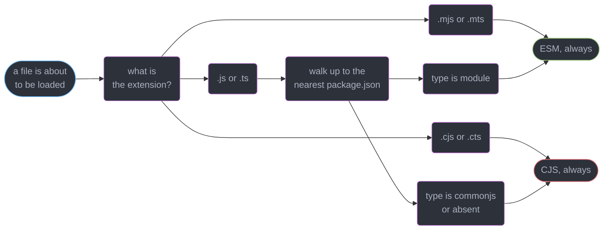
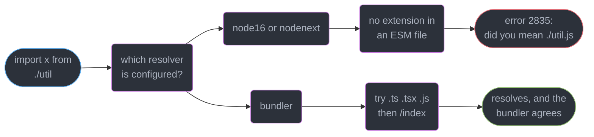
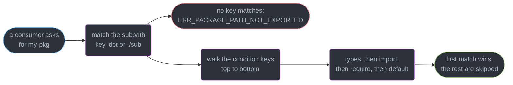
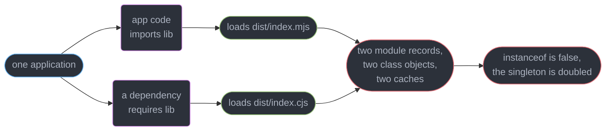
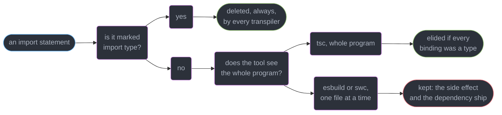
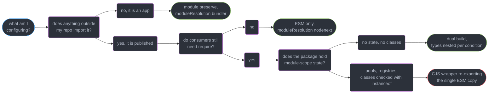

# Modules, Resolution and Package Exports

---

## 1. Concept Overview

"It works locally but not when published" is one bug wearing a dozen costumes. Locally, your
imports are resolved by `tsc` reading your source tree with your `tsconfig.json`. After
publishing, they are resolved by **someone else's runtime or bundler**, reading your
`package.json` with their config — and those two resolvers do not have to agree.

The gap has a shape. There are two module systems in JavaScript, not one with two spellings:
**ESM** (static, live bindings, asynchronous graph) and **CJS** (dynamic `require`, value
copies, synchronous). Everything else here falls out of that split — which file is which
format, how a specifier becomes a path, and why one class can fail `instanceof` against itself.

| Layer | Who decides | The field or flag |
|-------|-------------|-------------------|
| Is this file ESM or CJS? | Node, at load | `"type"` in the nearest `package.json`, or `.mjs`/`.cjs` |
| What does this specifier point at? | Node or the bundler | `exports`, `imports`, the resolution algorithm |
| What does `tsc` think happens? | You | `module`, `moduleResolution`, `verbatimModuleSyntax` |
| What did you actually ship? | Nobody, unless you check | `@arethetypeswrong/cli`, `publint` |

The target is **TypeScript 7.0** (GA 2026-07-08, a native Go compiler) on **Node 26 Current /
24 Active LTS**. `.d.ts` authoring lives in
`../declaration_files_and_library_authoring/declaration_files_and_library_authoring.md`, bundler
behaviour and tree-shaking in
`../../frontend_platform/modules_bundling_and_the_build_pipeline/modules_bundling_and_the_build_pipeline.md`,
npm resolution and lockfiles in
`../../frontend_platform/package_management_and_supply_chain/package_management_and_supply_chain.md`,
and ESM's language semantics in
`../../frontend_platform/javascript_language_semantics/javascript_language_semantics.md`.

---

## 2. Intuition

> A specifier is not a file path. It is a **question** you ask a resolver, and there are at
> least four resolvers with four different answers: `tsc`, Node, your bundler, and your
> consumer's bundler.

**Mental model.** `main` was a doormat with one address on it. `exports` is a receptionist who
looks at *who is asking* — a type-checker, an `import`, a `require` — and hands each a different
file, reading their instructions **top to bottom, stopping at the first match**. That is why key
order in that object is load-bearing rather than cosmetic.

**Why it matters.** Every published TypeScript package is a contract with three audiences
that never see your source: the type-checker resolving `.d.ts`, the ESM loader resolving
`import`, and the CJS loader resolving `require`. A local `tsc --noEmit` exercises none of
them against the built artifact.

**Key insight.** The dual-package hazard, the wrong-types bug, the missing-extension error and
the "cannot find module" after publish are all the same failure: **you tested the resolver you
control and shipped to the resolvers you do not.**

---

## 3. Core Principles

1. **ESM and CJS are different systems, not different spellings.** Bindings, evaluation
   order, timing and available globals all differ. Syntax is the least of it.
2. **Format is a property of the file, decided before any code runs** — by the nearest
   `package.json` `"type"`, overridden by a `.mjs`/`.cjs` (or `.mts`/`.cts`) extension.
3. **In ESM a relative specifier is resolved like a URL**, so the file extension is required
   and there is no directory-index fallback. CJS guesses; ESM does not.
4. **`moduleResolution` must mirror the resolver that will actually run.** `node16`/`nodenext`
   models Node, `bundler` models Vite and webpack. `classic` no longer exists `[6.0]`.
5. **`exports` conditions match in key order, first hit wins** — so `types` must be listed
   before `import` and `require`, and `default` must be last.
6. **`exports` is also a wall.** Declaring one blocks every subpath you did not list, which
   is the point and is simultaneously a breaking change for consumers.
7. **Two copies of one module are two modules.** Identity, `instanceof` and module-scope
   state do not cross the ESM/CJS boundary.
8. **Erasure is per-file for a single-file transpiler**, so a type imported in value position
   can survive into the output and drag a runtime dependency with it.

---

## 4. Types / Architectures / Strategies

### 4.1 The two module systems, side by side

| Property | ESM | CJS |
|----------|-----|-----|
| Statement form | `import` / `export`, static, hoisted | `require()` / `module.exports`, a runtime call |
| Binding | **Live** — the importer sees later reassignments | A **copy** of the value at `require` time |
| Evaluation | Graph linked first, then executed | Executed inline, on the first `require` |
| Conditional loading | `await import()` only | `require()` inside an `if` is normal |
| Top-level `await` | Allowed | Not allowed — the module body is synchronous |
| `__dirname`, `__filename`, `require` | Absent | Present |
| Path of the current file | `import.meta.url` (a `file:` URL) | `__filename` |
| Extension in a relative specifier | **Required** | Optional, with index fallback |

### 4.2 `moduleResolution` settings that still exist

| Value | Models | Extension required | Reads `exports` | Use for |
|-------|--------|--------------------|-----------------|---------|
| `node16` | Node's real algorithm, pinned to Node 16 semantics | Yes, in ESM files | Yes | Anything Node runs directly |
| `nodenext` | The same, tracking newer Node behaviour | Yes, in ESM files | Yes | Libraries — the strictest realistic model |
| `bundler` `[5.0]` | Vite, webpack, esbuild, Rollup | No | Yes | Apps behind a bundler |

`classic` was **removed in TypeScript 6.0**, along with `--outFile`, the AMD/UMD/SystemJS
module formats, `esModuleInterop: false` and `--baseUrl` as a resolution root. `target: es5`
and `--downlevelIteration` were **deprecated in 6.0 but not removed** — they still work.

**Pick by who resolves at runtime.** A library published to npm: `nodenext`, because your
consumers include Node, and it is the only setting that will tell you about a missing
extension or an unreachable subpath before they do. An application bundled by Vite:
`bundler`, because pretending Node's rules apply produces extension errors that no runtime
will ever enforce.

### 4.3 `module` settings

| Value | Emits | When |
|-------|-------|------|
| `node16` / `nodenext` | ESM or CJS per file, decided the way Node decides | Node-targeted output |
| `preserve` `[5.4]` | The import syntax **untouched**, `require` calls kept as-is | A bundler is downstream |
| `esnext` | Always ESM, `import` left alone | Legacy of the above, no per-file logic |

`module: preserve` implies `moduleResolution: bundler` and allows `import` and `require()` in
one file. It exists because when a bundler runs next, every transformation `tsc` performs is one
the bundler must undo.

---

## 5. Architecture Diagrams

### How Node decides one file's format



The extension always wins; `"type"` decides only the ambiguous `.js`/`.ts` cases, and no
`package.json` at all resolves to CJS rather than to an error.

### One specifier, two resolvers



Under `nodenext` you write the **output** extension `./util.js` for a file named `util.ts` —
the specifier survives into the emit unchanged.

### The `exports` condition walk



The checker matches `import` and `require` too, so `types` listed after either is never reached
and the checker reads a `.js` file for your types.

### The dual-package hazard



Node's ESM and CJS loaders keep **separate module caches**, and this only reproduces when both
entry points land in one process.

### What `import type` guarantees



`verbatimModuleSyntax` collapses this: an unmarked import is always emitted, so the error
arrives at compile time instead of in production.

---

## 6. How It Works — Detailed Mechanics

### 6.1 Live bindings, value copies, and the globals that vanish

```js
// counter.mjs — ESM exports a live binding
export let count = 0;
export function bump() { count += 1; }

// consumer.mjs
import { count, bump } from "./counter.mjs";
console.log(count);   // 0
bump();
console.log(count);   // 1 — the importer sees the reassignment. count is read-only here:
// count = 5;         // TypeError: Assignment to constant variable.

// counter.cjs — CJS exports a value: module.exports = { count: c, ... } copies the number,
// so a consumer's m.count stays 0 forever after m.bump().
```

The live binding is why ESM tolerates cycles that break CJS: the linker creates every binding
before any module body runs, so a cyclic import is uninitialised rather than missing.

```ts
// ESM has no __dirname, __filename or require:
// Cannot find name '__dirname'. Do you need to install type definitions for node? (2304)
import { fileURLToPath } from "node:url";
import { dirname, join } from "node:path";

const here = dirname(fileURLToPath(import.meta.url));
const schema = join(here, "schema.sql");

// Top-level await is an ESM-only privilege, and it is what makes the module ASYNCHRONOUS
const secrets = await fetch("http://169.254.169.254/creds").then(r => r.json());
```

On Node 24 and 26 the `fileURLToPath` dance collapses to `import.meta.dirname` (added in 20.11);
keep the long form only when the same source runs in a browser. When an ESM file must load a
CJS-only addon, `createRequire(import.meta.url)` is the escape hatch.

### 6.2 Which format is this file, and what may it say

One field, `"type": "module"`, re-formats every `.js` file under its directory that is not
shadowed by a nearer `package.json`. Adding it to an existing CJS package breaks every file at
once, which is why the `.cjs` escape exists: a single `scripts/build.cjs` keeps working.

TypeScript mirrors the whole scheme: `.mts` compiles to `.mjs` and is always ESM, `.cts`
compiles to `.cjs` and is always CJS, and a plain `.ts` follows `"type"`. Under
`module: nodenext` the checker enforces the distinction:

```ts
// legacy.cts — a CJS file
// import { z } from "./esm-only.mjs";
// The current file is a CommonJS module whose imports will produce 'require' calls; however,
// the referenced file is an ECMAScript module and cannot be imported with 'require'.
// Consider writing a dynamic 'import("./esm-only.mjs")' call instead. (1479)

const load = async () => (await import("./esm-only.mjs")).z;   // the fix ts(1479) names
```

On Node 24 and 26 `require()` of an ES module **does work** for a graph containing no
top-level await, returning the module namespace object — so `require("./esm-only.mjs")` gives
you `{ z }`, never `z` itself. Put a top-level `await` anywhere in that graph and you get
`Error [ERR_REQUIRE_ASYNC_MODULE]: require() cannot be used on an ESM graph with top-level
await. Use import() instead.` Bundlers and older runtimes in a consumer's CI still report the
classic `Error [ERR_REQUIRE_ESM]: require() of ES Module /app/node_modules/pkg/index.mjs from
/app/main.js not supported.`

### 6.3 Extensions are mandatory in ESM

```ts
// src/index.ts, with "type": "module" and moduleResolution: nodenext
// import { parse } from "./util";
// Relative import paths need explicit file extensions in ECMAScript imports when
// '--moduleResolution' is 'node16' or 'nodenext'. Did you mean './util.js'? (2835)

import { parse } from "./util.js";   // correct: the file is util.ts, the specifier is .js
```

Ship it without the extension and the consumer sees Node's version of the same complaint:

```
node:internal/modules/esm/resolve:265
Error [ERR_MODULE_NOT_FOUND]: Cannot find module '/app/dist/util' imported from /app/dist/index.js
    Did you mean to import "./util.js"?
```

There is no directory-index fallback either: `import "./commands"` will not find
`commands/index.js`. CJS's four guesses cost a `stat` call each and were dropped deliberately.

### 6.4 `moduleResolution` and the two tsconfigs you actually write

```json
{
  "compilerOptions": {
    "module": "nodenext",
    "moduleResolution": "nodenext",
    "strict": true,
    "verbatimModuleSyntax": true,
    "declaration": true,
    "outDir": "dist"
  }
}
```

That is the library config: anything `nodenext` accepts, Node accepts. The application config
differs in three keys — `"module": "preserve"`, `"moduleResolution": "bundler"`, and
`"noEmit": true`, because Vite or esbuild produces the output.

`--baseUrl` no longer works as a resolution root `[6.0]`: a bare `utils/date` will not find
`src/utils/date.ts`. `paths` still works, resolved relative to the `tsconfig.json` that declares
it. Bare aliases were always a lie to the runtime — `tsc` succeeded on a specifier Node could
not resolve — which is the exact class of bug this module is about.

### 6.5 The `exports` field, condition order first

```json
{
  "name": "@acme/tokens",
  "type": "module",
  "main": "./dist/index.js",
  "types": "./dist/index.d.ts",
  "exports": {
    ".": {
      "types": "./dist/index.d.ts",
      "default": "./dist/index.js"
    },
    "./theme": {
      "types": "./dist/theme.d.ts",
      "default": "./dist/theme.js"
    },
    "./package.json": "./package.json"
  }
}
```

Three things are happening. **`types` is first** in every condition object, because the walk
stops at the first key that matches and the checker also matches `import` and `require`.
**`main` and `types` at the top level are the fallback** for a resolver too old to read
`exports`; every modern resolver ignores them entirely once `exports` exists. And **`./package.json`
is explicitly exported** because tools read it and `exports` would otherwise block them.

The wall is the part consumers feel. With `exports` declared, a deep import that used to work
now fails at the resolver:

```
Error [ERR_PACKAGE_PATH_NOT_EXPORTED]: Package subpath './dist/internal/cache.js' is not
defined by "exports" in /app/node_modules/@acme/tokens/package.json
```

and in the editor, `Cannot find module '@acme/tokens/dist/internal/cache' or its corresponding
type declarations. ts(2307)`. That is the encapsulation boundary arriving: everything unlisted
is private, everything listed is public API under semver, and adding `exports` to a package that
never had one is a **major** version bump.

A `"./icons/*"` wildcard key keeps a wide surface manageable, and mapping a narrower key to
`null` carves a hole back out of it.

### 6.6 `imports` — the `#` prefix for your own internals

```json
{
  "imports": {
    "#db": { "node": "./src/db/pg.js", "default": "./src/db/memory.js" },
    "#internal/*": "./src/internal/*.js"
  }
}
```

`import { query } from "#db"` then resolves per condition, with no `../../..` chain. Every key
must start with `#`, which makes these unambiguously package-internal rather than a bare
specifier that could collide with a dependency. Unlike `paths`, this is a **runtime** feature
that Node, Vite, webpack, Jest and Vitest all implement, so the alias survives into shipped
code. `paths` is right only when nothing at runtime resolves the specifier.

### 6.7 The dual-package hazard, concretely

```ts
// @acme/db ships both dist/index.mjs and dist/index.cjs from the same source.
// app.mjs:            import { Pool, connect } from "@acme/db";   -> loads index.mjs
// node_modules/orm:   const { Pool } = require("@acme/db");       -> loads index.cjs

const pool = connect();                 // built by the ESM copy
// orm.attach(pool) does, internally:
//   if (!(p instanceof Pool)) throw new TypeError("expected a Pool");
// TypeError: expected a Pool
```

Two loaders, two caches, two evaluations of one source, two `Pool` class objects that are
structurally identical and referentially different. `instanceof` is the loud failure. The quiet
one is worse: any module-scope `let` — a connection pool, a plugin registry, an incrementing
request id — now exists twice, so a plugin registered through the ESM copy is invisible to the
CJS copy and a "singleton" serves two populations.

The honest 2026 answer is **ship ESM-only**: Node 24 and 26 can `require()` ESM and every
current bundler consumes it. If you must dual-publish, the mitigation is architectural, not a
flag — **keep all state and identity out of module scope**: a `createClient()` factory over a
singleton, a structural `isPool(x)` over `instanceof`, and a `globalThis`-keyed registry when a
true singleton is unavoidable. Each survives being loaded twice.

### 6.8 `verbatimModuleSyntax` and `import type`

```ts
// heavy.ts exports a type AND registers a global side effect on import
import { Report } from "./heavy.js";          // no marker
export function render(r: Report): string { return r.title; }
```

`tsc` sees the whole program, knows `Report` was only ever a type, and **elides the entire
statement** — `heavy.js` never loads. esbuild and swc compile one file at a time, cannot know
what `Report` is, and keep the import, so the side effect fires and 400 KB of transitive
dependency lands in the bundle. Same source, two outputs.

```ts
import type { Report } from "./heavy.js";     // erased by every tool, unconditionally
import { formatDate, type DateStyle } from "./format.js";   // inline form, mixed statement
export type { Report };                       // re-export must be marked too
```

`verbatimModuleSyntax` `[5.0]` removes the ambiguity by removing the elision: **every import
and export statement without a `type` marker is emitted verbatim**, and every one with a
marker is dropped. So an unmarked type import becomes a compile error rather than a runtime
difference between toolchains:

```
'Report' is a type and must be imported using a type-only import when
'verbatimModuleSyntax' is enabled. ts(1484)
```

`isolatedModules` is the weaker, older guarantee — it bans what a single-file transpiler cannot
compile correctly (`Re-exporting a type when 'isolatedModules' is enabled requires using
'export type'. ts(1205)`, cross-file `const enum`, ambiguous re-exports) but still lets `tsc`
elide. If anything other than `tsc` produces your JavaScript, `verbatimModuleSyntax` is
mandatory rather than stylistic. It also forces a `.cts` file to use `export =` rather than ESM
syntax, so a file's format and its syntax can no longer disagree.

### 6.9 Verify the artifact, not the source

```bash
npm pack                                  # produce the exact tarball npm will publish
npx publint ./acme-tokens-3.1.0.tgz       # packaging: missing files, bad main, condition order
npx @arethetypeswrong/cli ./acme-tokens-3.1.0.tgz   # resolution across the ESM/CJS matrix
```

`publint` checks `package.json` against the files actually in the tarball: a `main` pointing at a
path `files` excluded, an `exports` whose `types` is not first, a `.js` file using `import`
without `"type": "module"`. `attw` resolves your entry points **the way each consumer would**,
under `node10`, `node16` from CJS, `node16` from ESM and `bundler`; the two findings you will
hit are **`Masquerading as CJS`** (the ESM entry ships a `.d.ts` declaring CJS shapes) and
**`Masquerading as ESM`**. Run both in CI on the packed tarball, and run the suite against
`dist/` once per release — `../testing_typed_code/testing_typed_code.md` owns the type-level
half. A green `tsc --noEmit` over `src/` has tested none of this.

---

## 7. Real-World Examples

### Migrating an app to ESM without a big-bang rewrite

A 340-file Express service flipping `"type": "module"` in one commit:

1. Rename the 11 build and ops scripts that use `require` to `.cjs`. They keep working.
2. Set `"module": "nodenext"`, `"moduleResolution": "nodenext"`, then run `tsc --noEmit` and
   fix the 780 `ts(2835)` extension errors with one codemod — `tsc` names the correct
   specifier in every message, so the fix is mechanical.
3. Replace 23 `__dirname` uses with `import.meta.dirname`.
4. Turn on `verbatimModuleSyntax`, which surfaced 96 `ts(1484)` errors — 96 imports silently
   elided by `tsc` that were about to become real requires under esbuild.

The 780-error step reads alarming and is the cheap one. The 96-error step is the one that would
otherwise have shipped.

---

## 8. Tradeoffs

| Publishing strategy | Consumer reach | Dual-package hazard | Build complexity | Package size |
|---------------------|----------------|---------------------|------------------|--------------|
| ESM only | Node 24+, all current bundlers | Impossible | One build, one `.d.ts` | Smallest |
| CJS only | Everything, but no top-level await, poor tree-shaking | Impossible | One build | Small, ships more to the client |
| Dual, stateless | Everything | Harmless if truly stateless | Two builds, `.d.mts` + `.d.cts` | Roughly 2x |
| Dual, with state | Everything | **Real**, and intermittent | Two builds plus a mitigation | Roughly 2x |
| Dual via a CJS wrapper re-exporting ESM | Everything | Avoided — one instance | A hand-written wrapper per entry | Smallest of the duals |

---

## 9. When to Use / When NOT to Use



**Reach for `exports` when:** you publish anything, even internally — it is the only private
surface there is, and adding it later is a breaking change. **Reach for `nodenext` when:** the
artifact leaves your repo.

**Do NOT reach for a dual build when:** your consumers are all on Node 24+ or behind a bundler,
which in 2026 is most of them. Do NOT use `bundler` resolution in a published library — it
accepts extensionless specifiers Node rejects at your consumer's runtime, and nothing in your CI
notices. Do NOT use `paths` for a specifier the runtime must resolve: use `imports` with `#`.

---

## 10. Common Pitfalls

### Pitfall 1: `types` listed after `import` (BROKEN → FIX)

```json
{
  "exports": {
    ".": {
      "import": "./dist/index.mjs",
      "require": "./dist/index.cjs",
      "types": "./dist/index.d.ts"
    }
  }
}
```

```
// BROKEN — the checker matches "import" first and reads a .js file as types
// Could not find a declaration file for module '@acme/tokens'.
// '/app/node_modules/@acme/tokens/dist/index.mjs' implicitly has an 'any' type. (7016)
// publint: pkg.exports["."].types should be the first in the object as required by TypeScript

// FIX — types first, and default last
{
  "exports": {
    ".": {
      "types": "./dist/index.d.ts",
      "import": "./dist/index.mjs",
      "require": "./dist/index.cjs",
      "default": "./dist/index.cjs"
    }
  }
}
```

Conditions match in **object key order** and the first hit wins, so `types` after `import`
is never reached. Consumers with `skipLibCheck` and a loose `noImplicitAny` see no error at
all — they just get `any` for your whole package and lose every type you shipped.

### Pitfall 2: adding `exports` and breaking every deep import

Three hundred consumers had `import { fmt } from "@acme/util/lib/format"` because there was no
`exports` map to stop them. Shipping one as a **minor** version broke every one of those builds
with `ERR_PACKAGE_PATH_NOT_EXPORTED`. The fix is boring: ship it as a major, and add explicit
subpath keys for the deep paths that had already become de-facto API. Grep your own dependents
first — the list is always shorter than you fear and never empty.

### Pitfall 3: `bundler` resolution in a published library

```ts
// tsconfig.json: "moduleResolution": "bundler" in a package with "type": "module"
export { parse } from "./util";      // tsc: accepted, no error, no extension needed
```

The build passes, the tests pass under Vitest (which resolves like a bundler), and the tarball
ships `export { parse } from "./util"` verbatim into `dist/index.js`. The first consumer to run
it under plain Node gets `ERR_MODULE_NOT_FOUND` on a file that exists. The whole failure lives
in the gap between your resolver and theirs, which is precisely why a library uses `nodenext`.

### Pitfall 4: a type import that shipped

`import { User } from "@acme/schemas"` where `User` is a type vanishes under `tsc` and does not
under esbuild, so 1.2 MB of Zod enters a browser bundle that needed only the type. The tell is a
bundle-size regression with no code change, and `verbatimModuleSyntax` turns it into `ts(1484)`
at compile time — the only reliable place to catch it.

---

## 11. Technologies & Tools

| Tool | Role | Relevance here |
|------|------|----------------|
| TypeScript | The compiler and checker (7.0, native Go binary) | Owns `module`, `moduleResolution`, `verbatimModuleSyntax` |
| tsc6 | The 6.0 binary shipped as `@typescript/typescript6` | The only stable Compiler API until 7.1 |
| Node.js | The ESM and CJS loaders (26 Current, 24 Active LTS) | Implements `exports`, `imports`, `require(esm)` |
| arethetypeswrong | Resolution checker across the ESM/CJS matrix | Names the masquerading-as-CJS/ESM failures |
| publint | Packaging linter over the packed tarball | Condition order, missing files, format mismatches |
| esbuild | Single-file transpiler | Why `verbatimModuleSyntax` stops being optional |
| swc | Single-file transpiler in Rust | Same erasure constraint as esbuild |
| Vite | Dev server and app bundler | The resolver `moduleResolution: bundler` models |

---

## 12. Interview Questions with Answers

**Q: A package works locally and breaks the moment it is published. What is the mechanism?**
**Short:** Two different resolvers ran: locally tsc read your source tree and tsconfig, while the consumer's Node or bundler read your package.json and dist.

Locally `tsc` maps `./util` to `src/util.ts` using your `moduleResolution`. The consumer's Node
resolves the emitted `./util` as a URL, finds no file, and reports `ERR_MODULE_NOT_FOUND`. The
same gap produces missing types, blocked subpaths and format mismatches. The fix is to test the
artifact: `npm pack`, then `publint` and `@arethetypeswrong/cli` on the tarball, in CI.

**Q: What does the dual-package hazard actually break?**
**Short:** Two copies of one module load into one process with separate caches, so instanceof fails and every module-scope value exists twice.

Node's ESM and CJS loaders keep separate caches. If your app imports `@acme/db` and a
dependency requires it, both halves of your dual build evaluate, producing two `Pool` classes
and two connection pools. `instanceof` is the loud symptom, a "singleton" registry serving two
populations is the quiet one. Ship ESM-only, or keep all state and identity out of module scope.

**Q: Why must `types` be listed first in an `exports` condition object?**
**Short:** Condition keys are matched top to bottom and the first hit wins, and TypeScript also matches import and require, so a later types key is never reached.

With `import` first, the checker resolves to `./dist/index.mjs` and reports
`implicitly has an 'any' type. ts(7016)` — or silently gives `any` when `noImplicitAny` is off.
`default` must be last for the same reason: it matches everything. `publint` reports this
directly, which is the cheapest way to never think about it again.

**Q: What is the difference between `import type` and a plain import of a type?**
**Short:** A value-position import survives erasure whenever the tool compiles one file at a time, so the runtime dependency and its side effects ship.

`tsc` sees the whole program, knows the binding was a type, and elides the statement. esbuild
and swc see one file, cannot tell, and keep it — so importing a type from a 1.2 MB module puts
that module in the bundle. `import type` is deleted unconditionally by every tool. Turn on
`verbatimModuleSyntax` and the unmarked form becomes `ts(1484)` at compile time.

**Q: `node16`/`nodenext` or `bundler` — how do you choose?**
**Short:** Mirroring the runtime's own algorithm is the point, so pick the resolver that will actually run your emitted code in production.

`nodenext` models Node: extensions required in ESM, `exports` honoured, format enforced per
file. `bundler` `[5.0]` models Vite and webpack: no extension needed, `exports` still honoured.
A published library uses `nodenext` because its friction is the only thing that catches a
specifier Node will reject. An app behind a bundler uses `bundler`, with `module: preserve`.

**Q: Why does ESM require the file extension when CJS never did?**
**Short:** The specifier is resolved as a URL against the importing module, and URLs have no extension guessing and no directory-index fallback.

CJS tried four candidates per specifier — `util`, `util.js`, `util/index.js`,
`util/package.json` — costing a `stat` each. ESM resolves exactly one. In TypeScript you write
the **output** extension, `./util.js`, for a file named `util.ts`, because the specifier is
copied into the emit unchanged. `ts(2835)` names the correct specifier in its message.

**Q: Can CommonJS `require()` an ES module on current Node?**
**Short:** Requiring an ES module works on Node 24 and 26 and returns the namespace object, unless the graph contains top-level await.

`require("./m.mjs")` gives you `{ default, ...named }`, never the default export directly — so
code expecting `module.exports = fn` gets an object. A top-level `await` anywhere in that graph
throws `ERR_REQUIRE_ASYNC_MODULE`, and bundlers or older runtimes still report
`ERR_REQUIRE_ESM`. Use `await import()` when either might apply.

**Q: What does `module: preserve` do and when do you want it?**
**Short:** Emitting the import syntax untouched is right when a bundler runs next, because every transformation tsc performs is one the bundler must undo.

`preserve` `[5.4]` leaves `import` as `import` and `require()` as `require()`, and implies
`moduleResolution: bundler`, so both forms are legal in one file. Use it in applications where
Vite, esbuild or webpack produces the shipped output and `tsc` runs with `noEmit`. Use
`nodenext` instead whenever Node executes the emit directly.

**Q: How does Node decide whether a given file is ESM or CJS?**
**Short:** The nearest package.json walking upward supplies the type field, and an explicit .mjs or .cjs extension overrides it entirely.

`.mjs`/`.mts` are always ESM, `.cjs`/`.cts` always CJS, and `.js`/`.ts` follow `"type"` — with
`"commonjs"` as the default when the field or the file is absent. This is why adding
`"type": "module"` reformats an entire directory at once, and why renaming one build script to
`.cjs` is the standard escape during a migration.

**Q: What exactly does `verbatimModuleSyntax` change?**
**Short:** Every import and export statement without a type marker is emitted as written, and every one with a marker is dropped, removing all elision guesswork.

Before it, whether `import { Report } from "./heavy.js"` produced a runtime load depended on
which tool compiled the file. After it, an unmarked type import is `ts(1484)` and the answer is
the same everywhere. It also enforces that a `.cts` file uses `export =` rather than ESM
syntax. Turn it on in any project where something other than `tsc` emits JavaScript.

**Q: What happens to consumers when you add an `exports` map to an existing package?**
**Short:** Declaring an exports map blocks every subpath you did not list, so any deep import a consumer relied on stops resolving.

They get `ERR_PACKAGE_PATH_NOT_EXPORTED` at runtime and `ts(2307)` in the editor. That is the
encapsulation you wanted, and it is a breaking change: ship it as a major version, and add
explicit keys for the deep paths that had already become de-facto API. Export `./package.json`
too — tools read it and the map would otherwise block them.

**Q: What is the `imports` field and how does it differ from `paths`?**
**Short:** Subpath imports beginning with a hash are resolved by the runtime itself, so the alias survives into shipped code instead of existing only during type-checking.

`"#db": { "node": "./src/db/pg.js", "default": "./src/db/memory.js" }` lets `import "#db"` pick
an implementation per condition, and Node, Vite, webpack, Jest and Vitest all implement it. The
`#` prefix is mandatory and is what makes the specifier unambiguously internal. `paths` is
type-check-only, so it is right only when nothing at runtime resolves that specifier.

**Q: Why does top-level `await` exist in ESM but not CJS, and what else disappears?**
**Short:** Top-level await exists because an ES module body is asynchronous by design, while a CJS body must run synchronously inside the require call.

ESM links the whole graph before executing, so a module can suspend. That same asynchrony is
why `require()` of an ESM graph containing top-level await throws. ESM also has no `__dirname`,
`__filename` or `require`: use `import.meta.dirname` (Node 20.11+) and `createRequire(import.meta.url)`
when a CJS-only addon must be loaded.

**Q: What does `@arethetypeswrong/cli` catch that `tsc` cannot?**
**Short:** Simulating every resolution mode a consumer might use is something your own build never does, because it only ever runs your own configuration.

`attw` resolves your entry points as `node10`, `node16` from CJS, `node16` from ESM and
`bundler`, then names the mismatches — `Masquerading as CJS` means your ESM entry ships `.d.ts`
describing CJS shapes, so consumers get types their runtime will not produce. Pair it with
`publint`, which checks `package.json` against the packed tarball's real contents.

**Q: How do `isolatedModules` and `verbatimModuleSyntax` relate?**
**Short:** Single-file transpilers see one file at a time, and isolatedModules bans the constructs that break under that constraint while verbatimModuleSyntax removes the elision itself.

`isolatedModules` rejects an unmarked type re-export (`ts(1205)`), cross-file `const enum`, and
ambiguous re-exports — but still lets `tsc` elide imports, so `tsc` and esbuild can still differ.
`verbatimModuleSyntax` closes that gap. If esbuild or swc produces your JavaScript, enable both
and treat them as correctness settings rather than style.

**Q: `moduleResolution: classic` is gone — what replaced it and what else went with it?**
**Short:** Only the Node algorithm and the bundler model remain, because classic never matched any real runtime and quietly accepted specifiers nothing could resolve.

TypeScript 6.0 removed `classic`, `--outFile`, the AMD/UMD/SystemJS formats, `esModuleInterop:
false` and `--baseUrl` as a resolution root. It **deprecated** `target: es5` and
`--downlevelIteration` without removing them. Losing `baseUrl` means a bare `utils/date` no
longer finds `src/utils/date.ts`: use `paths` for type-only aliases, `imports` for runtime ones.

**Q: `esModuleInterop` cannot be turned off any more. What does that actually mean for a default import?**
**Short:** Interop shims are now unconditional, so importing a CJS module's default gives you its module.exports wrapped rather than a raw namespace object.

`import express from "express"` works because the emit calls an interop helper that checks
`__esModule` and wraps a plain `module.exports` as `{ default: … }`. Without it you needed
`import * as express` and then could not call it, since a namespace object is not callable. TS
6.0 removed the `false` setting, so this behaviour is now simply how the language emits.

**Q: What is a live binding, and where does the difference from CJS bite?**
**Short:** Imported names stay bound to the exporting module's variable, so a later reassignment there is visible to every importer, where require copies the value once.

`export let count` reassigned by `bump()` reads as the new value in the importer, and assigning
to the imported name is a `TypeError`. CJS copied the number at export time, so the importer
holds a stale value forever. This is also why ESM survives cyclic imports that break CJS —
bindings exist before any body runs. Full semantics live in
`../../frontend_platform/javascript_language_semantics/javascript_language_semantics.md`.

---

## 13. Best Practices

1. **Test the tarball, not the source:** `npm pack`, then `publint` and `@arethetypeswrong/cli`
   on the `.tgz`, in CI, on every release.
2. **`types` first in every condition object, `default` last.** First match wins, and the
   checker matches `import` and `require` too.
3. **Use `nodenext` for anything published**, `bundler` with `module: preserve` for apps.
4. **Ship ESM-only unless a named consumer needs CJS** — skipping the second build removes the
   dual-package hazard by construction.
5. **If you must dual-publish, hold no module-scope state** — factories over singletons,
   structural checks over `instanceof`, `globalThis` keys when a real singleton is unavoidable.
6. **Turn on `verbatimModuleSyntax` on day one** — retrofitting it produces one error per
   ambiguous import, 96 in a 340-file service, and every one is a real difference.
7. **Export `./package.json`** whenever you declare an `exports` map.
8. **Use `imports` with `#`, never `paths`,** when the runtime must resolve the specifier.
9. **Treat adding `exports` as a major version** — it is a real boundary and it will break
   somebody.

---

## 14. Case Study

### The SDK that shipped `any` to 4,200 consumers for 6 weeks

A payments company publishes `@acme/pay-sdk`, a dual ESM/CJS build with 31 subpath exports and
4,200 weekly downloads. Version 4.2.0 added two subpaths and reordered the `exports` object
during review "for readability". Nothing failed. Six weeks later a consumer opened an issue
titled "no autocomplete since 4.2".

```json
// BROKEN — the reorder put types last, and a stale top-level "types" hid it in the editor
{
  "exports": {
    ".": {
      "import": "./dist/index.mjs",
      "require": "./dist/index.cjs",
      "types": "./dist/index.d.ts"
    },
    "./webhooks": {
      "import": "./dist/webhooks.mjs",
      "types": "./dist/webhooks.d.ts"
    }
  },
  "types": "./dist/index.d.ts"
}
```

```
// What a consumer on moduleResolution: nodenext actually saw
Could not find a declaration file for module '@acme/pay-sdk/webhooks'.
'/app/node_modules/@acme/pay-sdk/dist/webhooks.mjs' implicitly has an 'any' type. (7016)
```

The root export looked healthy because the **top-level `"types"` field** was still there for
older resolvers to fall back to, so the maintainers' smoke test passed. The subpaths had no
fallback: every consumer on `nodenext` got `any` for 30 of 31 subpaths, and those with
`noImplicitAny` off got no error at all. One webhook handler destructured `event.data.ammount`,
typed `any`, and reconciliation dropped 1,900 events over 11 days.

```json
// FIX — types first per condition, dual declarations per format, package.json exported
{
  "exports": {
    ".": {
      "types": { "import": "./dist/index.d.mts", "require": "./dist/index.d.cts" },
      "import": "./dist/index.mjs",
      "require": "./dist/index.cjs"
    },
    "./webhooks": {
      "types": { "import": "./dist/webhooks.d.mts", "require": "./dist/webhooks.d.cts" },
      "import": "./dist/webhooks.mjs",
      "require": "./dist/webhooks.cjs"
    },
    "./package.json": "./package.json"
  }
}
```

**What the fix cost and caught.** Adding `publint` and `@arethetypeswrong/cli` to the release
job took 40 minutes and reported 30 condition-order violations plus 4 `Masquerading as CJS`
findings on subpaths where one `.d.ts` had served both formats — a second bug nobody had seen,
because the CJS consumers who would have hit it were all on `skipLibCheck`. The team also
deleted the top-level `"types"` field, since that fallback is why the failure went 6 weeks
unreported.

**The lesson.** Three engineers reviewed the reorder, and key order in JSON reads as arbitrary
while being, here, semantic. Review does not substitute for resolving the packed artifact the
way each consumer will — which `publint` and `attw` are the only two tools here that do.
