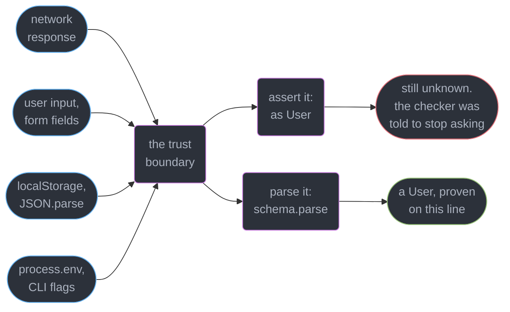
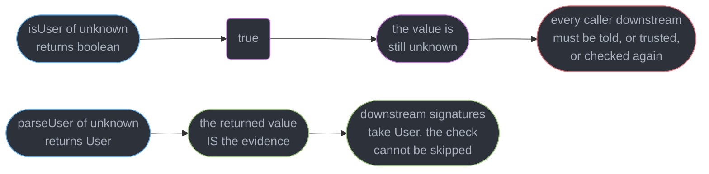
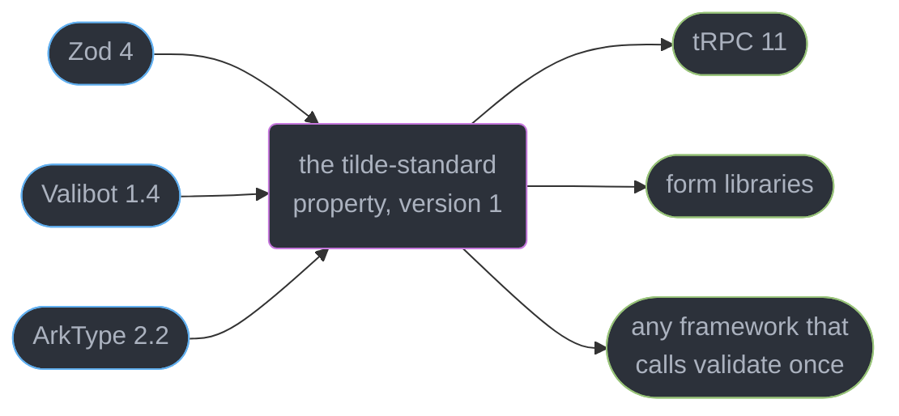
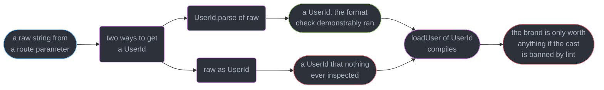
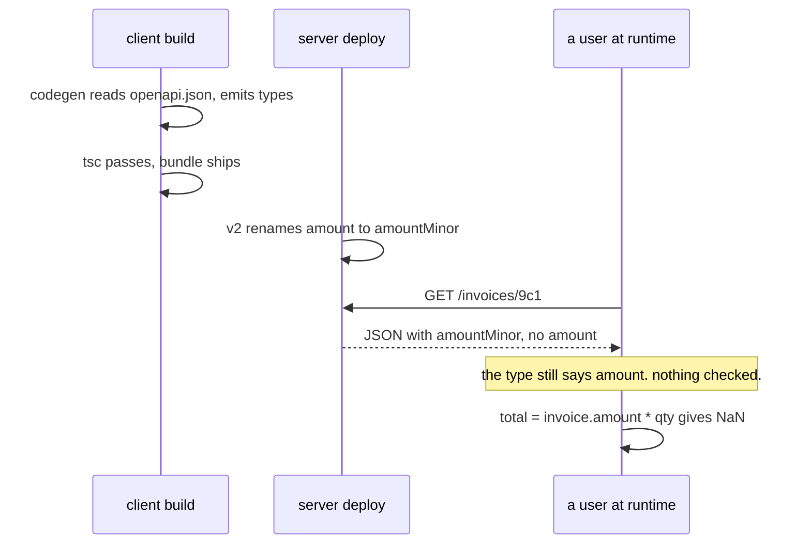
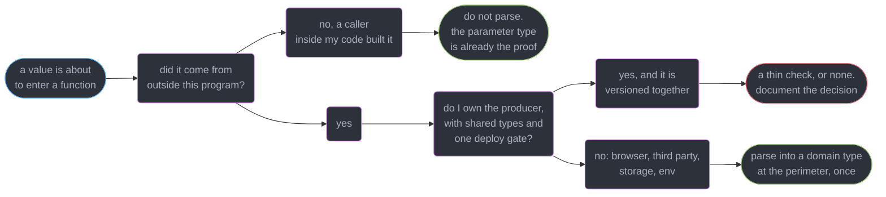

# Runtime Validation and Parse, Don't Validate

---

## 1. Concept Overview

TypeScript's types do not exist at runtime. `tsc` checks, then erases: the emitted JavaScript
has no record that a variable was declared `User`. That is fine for values your program
constructs, because the checker saw them being built. It is a fiction for every value that
arrives from outside, because nothing checked those at all.

So the honest starting position is blunt: **every value entering the program from outside is
`unknown`, whatever the annotation claims.** There are four boundaries where this happens, and
they are the same four in every application.

| Boundary | What actually comes back | What the code usually claims |
|----------|--------------------------|------------------------------|
| Network response | whatever the server sent today | `await res.json() as User` |
| User input | strings, from a form the user can edit in devtools | `FormData` typed as a struct |
| `localStorage` / `JSON.parse` | a string written by a build from 8 months ago | `JSON.parse(raw) as Settings` |
| `process.env` | `string \| undefined`, always | `process.env.DB_URL!` |

`res.json()` is typed `Promise<any>` in the DOM lib, and `JSON.parse` returns `any`. Both are
holes in the type system by design — the standard library cannot know your shapes. An `as User`
on either does not check anything; it instructs the checker to stop asking.

This module is about the discipline that closes the gap: **parse at the boundary, once, into a
type that carries the proof**. `unknown` and narrowing live in
`../unions_narrowing_and_exhaustiveness/unions_narrowing_and_exhaustiveness.md`; structural
typing and `satisfies` in
`../structural_typing_and_assignability/structural_typing_and_assignability.md`. The target is
TypeScript 7.0 with Zod 4.5.4.

---

## 2. Intuition

> A validator asks "is this a `User`?" and answers **yes**. A parser asks the same question and
> answers **"here is the `User`"**. The first answer is forgotten by the next function. The
> second one cannot be.

**Mental model.** Think of the boundary as passport control. A validator is a guard who glances
at your passport, nods, and waves you through with nothing in your hand — three desks later
someone asks again, and there is no evidence. A parser is a guard who stamps a visa and hands it
back. The stamp travels with you, and the type of the thing you are holding has changed.

**Why it matters.** The compiler will believe any assertion you write. The cost of a wrong one
is not a type error at the cast site — it is a `TypeError: Cannot read properties of undefined`
three layers away, in a function that had every right to trust its parameter, with a stack trace
that points at the innocent code rather than at the lie.

**Key insight.** Runtime validation is not defensive programming sprinkled everywhere. It is a
**single conversion at the perimeter** from `unknown` into your domain types, after which the
static type system is telling the truth again and every internal function can be written without
a guard.

---

## 3. Core Principles

1. **Types are erased; the boundary is not.** Nothing you write in the type system runs. Only a
   function that inspects the value at runtime can establish anything about it.
2. **Return the evidence, not a verdict.** A parser's return type is more precise than its
   parameter type. That difference is what carries the check forward.
3. **One source of truth.** Write the schema, derive the type with `z.infer`. A hand-written
   `interface` beside a schema is two truths that drift on the first edit.
4. **Validate at trust boundaries, once.** Re-parsing an already-parsed value costs CPU and buys
   nothing — the type already says it was parsed.
5. **A brand makes "checked" a compile-time fact.** If only a parser can produce a
   `UserId`, then a function taking `UserId` cannot be called with an unchecked string.
6. **The failure path is a product requirement, not an afterthought.** A form needs field-level
   messages, an API needs a 400 body, a startup needs a crash. Pick the shape deliberately.
7. **Generated types are not runtime checking.** OpenAPI and GraphQL codegen give you the shape
   the contract *claimed*, not the bytes the server *sent*.
8. **Parsing is not free.** It is proportional to payload size and schema depth. Measure it on
   your largest response before deciding where the boundary goes.

---

## 4. Types / Architectures / Strategies

### 4.1 The three shapes a boundary check can take

| Shape | Signature | What survives the call |
|-------|-----------|------------------------|
| Assertion | `value as User` | Nothing. No code runs |
| Validator | `isUser(v: unknown): boolean` | Nothing, unless you also narrow |
| Type predicate | `isUser(v: unknown): v is User` | Narrowing inside the `if`, and nothing about *why* |
| Parser | `parseUser(v: unknown): User` | A value whose type is the proof |

The predicate is the interesting middle case: it does carry knowledge, but only into one
lexical block, and TypeScript takes your word that the body of the predicate is honest — a
predicate that returns `true` unconditionally compiles cleanly. A parser has no such loophole,
because the value it returns is the value it inspected.

### 4.2 The libraries, on criteria

| Library | Version | Shape of the API | Where it wins |
|---------|---------|------------------|---------------|
| Zod | 4.5.4 | chained methods, one namespace import | ecosystem, error tooling, familiarity |
| Valibot | 1.4.2 | standalone functions composed with `pipe` | bundle size — you import only what you use |
| ArkType | 2.2.3 | schemas written as TypeScript-shaped strings | syntax closest to the types themselves |
| Effect Schema | 3.22.1 | bidirectional codecs inside a larger effect system | encode as well as decode, typed errors |

**Choose on four axes.** Bundle size (does this ship to a browser?), error ergonomics (does a
form need field-level messages?), transform needs (are you only checking, or also converting?),
and team familiarity (Zod is what most people already read fluently). For a Node service where
bundle size is irrelevant, familiarity usually wins outright.

### 4.3 Where the boundary goes

| Location | Parse here? | Reason |
|----------|-------------|--------|
| HTTP handler input | Yes | untrusted by definition |
| Third-party API response | Yes | they deploy without telling you |
| `localStorage` read | Yes | written by an older version of your own code |
| `process.env` at startup | Yes | crash on line 1 beats `undefined` at 3am |
| Your own service's response, shared types, same deploy gate | Often no | the contract is enforced upstream |
| Internal function call | No | the argument's type is already the proof |

---

## 5. Architecture Diagrams

### The four boundaries, and the two things you can do at them



All four carry `unknown` no matter what the annotation says. The only difference between the two
outgoing paths is whether any code ran.

### Validate versus parse — what each call leaves behind



The boolean is discarded by the next line. The narrowed value is carried by the type system into
every function it is passed to.

### Standard Schema v1 collapses the adapter matrix



Before the spec, every framework shipped one adapter per library. After it, the framework calls
one method and the library choice becomes yours rather than the framework's.

### Where a branded value can come from



A brand is a convention the compiler enforces only against *accident*. Banning `as` on branded
types in review or lint is what turns it into a guarantee.

### Contract drift: the two clocks that are not synchronised

The client and the API are separate deployments, so a type that was correct when the
client was built can be wrong by the time a user runs it. The React side of this seam --
how a query cache surfaces a drifted response, and how to version the boundary -- is
[Server State and Data Fetching](../../react/server_state_and_data_fetching/server_state_and_data_fetching.md).



The build-time type was correct when it was generated and wrong by the time it ran. Only a check
executed on the response can notice.

---

## 6. How It Works — Detailed Mechanics

### 6.1 The `as` on a `fetch` result, and where it detonates

```ts
type User = { id: string; email: string; profile: { displayName: string } };

async function getUser(id: string): Promise<User> {
  const res = await fetch(`/api/users/${id}`);
  return (await res.json()) as User;   // res.json() is Promise<any>. Nothing is checked.
}

// 200 lines away, in a component that was written correctly:
function greeting(u: User) {
  return `Hi, ${u.profile.displayName}`;
}
// TypeError: Cannot read properties of undefined (reading 'displayName')
```

Three separate ways this fires with no code change on your side: the endpoint returns a 500 with
`{ "error": "..." }` and `res.ok` was never checked, a nullable column starts returning `null`
for `profile`, or the API renames `displayName` to `display_name` in a minor release. In all
three the stack trace points at `greeting`, which is correct in every respect except that its
parameter was a lie.

The `as` is not even required to be plausible. TypeScript rejects an assertion only between
types with no overlap; `any` overlaps everything, so `as` on a `json()` result is always
accepted. That is why the fix is not "assert more carefully" — there is no careful version.

### 6.2 The two shapes, side by side

```ts
// Shape A: validate. The return type throws away everything the function learned.
function isEmail(v: unknown): boolean {
  return typeof v === "string" && v.includes("@");
}
if (isEmail(input)) {
  sendTo(input);   // input is still unknown here if isEmail returns plain boolean
}

// Shape B: parse. The return type is narrower than the parameter type.
function parseEmail(v: unknown): string {
  if (typeof v !== "string" || !v.includes("@")) throw new TypeError("not an email");
  return v;
}
sendTo(parseEmail(input));   // string, and the check provably ran
```

A type predicate (`v is string`) is the halfway house: it narrows, but only inside the branch,
and only because you promised it does — the compiler does not verify the predicate body. Details
in `../unions_narrowing_and_exhaustiveness/unions_narrowing_and_exhaustiveness.md`.

The structural point is that Shape B's signature is a *theorem*: given `unknown`, produce
`string`. Shape A's signature is `unknown -> boolean`, which any function can satisfy, including
`() => true`.

### 6.3 Zod 4: the schema is the source of truth

```ts
import { z } from "zod";

const User = z.object({
  id: z.uuid(),
  email: z.email(),
  age: z.number().int().min(13).max(130),
  role: z.enum(["admin", "member", "viewer"]),
  createdAt: z.iso.datetime(),
  profile: z.object({ displayName: z.string().min(1).max(80) }),
});

type User = z.infer<typeof User>;   // derived, never declared twice
```

`z.infer` reads the schema's static type out of the schema object. Add a field and every
consumer of `User` updates; remove one and every use site becomes a compile error. Write the
`interface` by hand instead and the two drift on the first edit, silently, because the schema
still parses and the type still checks — they simply describe different things.

```ts
const parsed = User.parse(raw);        // returns User, or throws ZodError
const result = User.safeParse(raw);    // never throws
if (!result.success) {
  return json({ errors: z.treeifyError(result.error) }, { status: 400 });
}
result.data.profile.displayName;       // fully typed, no assertion anywhere
```

Use `.parse` where a failure is a bug or a startup abort — config, env, an internal invariant.
Use `.safeParse` on any path where failure is an expected outcome with a user-visible
consequence, which is every HTTP handler and every form. `.parseAsync` / `.safeParseAsync` are
required when any refinement is `async`, such as a uniqueness check against a database.

### 6.4 Coercion, transforms, and why `z.input` differs from `z.output`

```ts
const Query = z.object({
  page: z.coerce.number().int().min(1).default(1),        // "3" from a query string -> 3
  tags: z.string().transform(s => s.split(",")),          // "a,b" -> ["a", "b"]
  since: z.iso.datetime().transform(s => new Date(s)),    // string -> Date
});

type QueryIn = z.input<typeof Query>;    // { page?: unknown; tags: string; since: string }
type QueryOut = z.output<typeof Query>;  // { page: number; tags: string[]; since: Date }
// z.infer is z.output. Annotating a handler parameter with z.input is the classic mix-up:
// Property 'getTime' does not exist on type 'string'. ts(2339)
```

Coercion is not validation — `z.coerce.number()` runs `Number(value)` first, so `""` becomes
`0` and `true` becomes `1`. That is what you want for a query string and dangerous for a JSON
body, where a string `"0"` in a numeric field usually means the client is broken and should be
told so. Reserve coercion for genuinely stringly-typed sources: query params, `FormData`,
environment variables.

A `.transform()` makes the schema a one-way codec: it can decode but not re-encode. If you need
both directions — a domain object serialised back onto the wire in the same shape it arrived —
that is what Effect Schema's bidirectional codecs exist for.

### 6.5 Discriminated unions and refinements

```ts
const Event = z.discriminatedUnion("type", [
  z.object({ type: z.literal("click"), x: z.number(), y: z.number() }),
  z.object({ type: z.literal("keypress"), key: z.string().length(1) }),
  z.object({ type: z.literal("scroll"), delta: z.number() }),
]);

const Signup = z.object({
  password: z.string().min(12),
  confirm: z.string(),
}).refine(v => v.password === v.confirm, {
  error: "passwords do not match",
  path: ["confirm"],          // attach the issue to the field the user must fix
});
```

`z.discriminatedUnion` reads the literal key first and tries exactly one member. A plain
`z.union` tries all three and, on failure, reports an `invalid_union` issue containing every
branch's errors — for a 3-member union that is a 12-issue payload where 8 issues are noise about
branches the input never intended. The discriminated form reports 1.

`.refine()` runs after the base shape parses, so it never sees a malformed object. Cross-field
rules always belong on the object, never on a field, and `path` is what puts the message under
the right input.

### 6.6 Formatting errors for a form

```ts
const result = Signup.safeParse(await req.formData());
if (!result.success) {
  const flat = z.flattenError(result.error);
  // { formErrors: [], fieldErrors: { password: ["Too small: expected string to have >=12 characters"],
  //                                  confirm: ["passwords do not match"] } }
  return { fieldErrors: flat.fieldErrors };
}
```

`z.flattenError` gives one level of `fieldErrors` keyed by top-level field, which is exactly the
shape a flat form needs. `z.treeifyError` preserves nesting for a form with grouped or repeated
sections. `z.prettifyError` produces a multi-line human string for a CLI or a log line. React
Hook Form and TanStack Form consume the flattened shape directly — see
`../../react/forms_and_validation/forms_and_validation.md`, which owns form state and submission.

### 6.7 Standard Schema v1: one interface, any validator

`@standard-schema/spec` 1.1.0 defines a single property that a conforming library attaches to
every schema it produces.

```ts
import type { StandardSchemaV1 } from "@standard-schema/spec";

async function parseWith<T extends StandardSchemaV1>(
  schema: T,
  input: unknown,
): Promise<StandardSchemaV1.InferOutput<T>> {
  let r = schema["~standard"].validate(input);
  if (r instanceof Promise) r = await r;
  if (r.issues) throw new Error(r.issues.map(i => i.message).join(", "));
  return r.value;
}
```

The whole contract is `~standard: { version: 1, vendor, validate, types }`, where `validate`
returns either `{ value }` or `{ issues }` — never throws for a validation failure — and may
return a promise. The tilde prefix sorts the property to the bottom of editor autocomplete so it
never clutters the schema's own API.

Zod 4, Valibot 1.4 and ArkType 2.2 all implement it. **tRPC 11.18.0 accepts any conforming
validator natively** in `.input()` and `.output()`, with no adapter package. That is the point:
the framework author writes one code path, and swapping Zod for Valibot to save bundle size
becomes a dependency change rather than a migration.

### 6.8 Branded types: making "validated" a compile-time fact

TypeScript is structural (see
`../structural_typing_and_assignability/structural_typing_and_assignability.md`), so a
`type UserId = string` is *exactly* `string`, and every string in the program is assignable to
it. The alias documents intent and enforces nothing.

```ts
declare const brand: unique symbol;
type Brand<T, B> = T & { readonly [brand]: B };

type UserId = Brand<string, "UserId">;
type OrderId = Brand<string, "OrderId">;

// The ONLY way to make one:
const UserIdSchema = z.uuid().brand<"UserId">();
function toUserId(v: unknown): UserId { return UserIdSchema.parse(v) as UserId; }

declare function loadUser(id: UserId): Promise<User>;

loadUser("9c1f-not-a-uuid");
// Argument of type 'string' is not assignable to parameter of type 'UserId'.
//   Type 'string' is not assignable to type '{ readonly [brand]: "UserId"; }'. ts(2345)

declare const o: OrderId;
loadUser(o);   // also an error: the brands differ, though both are strings at runtime
```

The brand property is phantom: `unique symbol` guarantees no other declaration can produce the
same key, and no runtime value ever carries it, so the intersection costs zero bytes. The
discipline is that the single `as UserId` lives inside `toUserId` and nowhere else — one
audited line. `no-unnecessary-type-assertion` will not catch a stray one, so this is enforced by
convention and review; a project that casts to `UserId` in twelve places has a brand that means
nothing.

### 6.9 Env at startup, and what parsing costs

```ts
const Env = z.object({
  DATABASE_URL: z.url(),
  PORT: z.coerce.number().int().min(1).max(65535).default(3000),
  LOG_LEVEL: z.enum(["debug", "info", "warn", "error"]).default("info"),
  STRIPE_KEY: z.string().startsWith("sk_"),
});
export const env = Env.parse(process.env);   // throws at import time, before the server listens
```

`process.env.PORT` is `string | undefined` and `process.env.NOPE` is *also* `string | undefined`
rather than an error, so a typo in a variable name is invisible until something reads
`undefined`. Parsing once at module load turns that into a crash on the first line of the boot
sequence, naming the variable, which is the cheapest possible failure.

The cost of parsing is real and worth measuring rather than assuming:

```ts
const raw = JSON.parse(await readFile("invoices-5mb.json", "utf8"));   // 12,000 objects
console.time("parse");
const invoices = z.array(Invoice).parse(raw);
console.timeEnd("parse");   // measure this on YOUR shapes before deciding
```

A schema walk is proportional to node count and refinement count. On a 12,000-element array of
9-field objects it is milliseconds, not microseconds — irrelevant next to the network round trip
that fetched it, and not irrelevant inside a loop that runs per request on an already-parsed
value. That asymmetry is the whole argument for parsing at the boundary and only there.

---

## 7. Real-World Examples

### A `localStorage` migration nobody wrote

A settings object was persisted as `{ theme, fontSize }` in 2024 and extended to
`{ theme, fontSize, density }` in 2026. Six months of returning users still had the old shape.
The read path was `JSON.parse(raw) as Settings`, so `density` was `undefined`, and
`density.toUpperCase()` threw on mount for roughly 30% of sessions — invisible in testing,
because every test browser had fresh storage.

The fix was four lines: `Settings.safeParse(JSON.parse(raw))`, and on failure fall back to
defaults and overwrite the key. `.catch()` on the schema does the same inline. The
non-obvious part is that this is a **versioning** problem wearing a validation costume: old
persisted data is a third-party API whose vendor is your own past self.

### Generated schemas instead of generated types

A team consuming a partner's OpenAPI spec ran `openapi-typescript`, got clean types, and shipped
`as components["schemas"]["Invoice"]` on every response. The partner shipped a v2 that changed
`amount` from a number of dollars to `amountMinor` in cents. The client's types said `amount`,
the field was absent, and totals rendered `NaN` for 4 hours across 900 accounts.

Switching the generator to one that emits Zod schemas (`openapi-zod-client`) changed nothing at
build time and everything at runtime: the first response after the partner's deploy failed
`safeParse`, the client logged a structured issue naming the missing path, and the error surfaced
as a handled banner instead of `NaN`. Contract governance itself lives in
`../../backend/api_contracts_and_schema_governance/api_contracts_and_schema_governance.md`.

---

## 8. Tradeoffs

| Approach | Bundle cost (browser) | Errors for a form | Transforms | Catches drift |
|----------|----------------------|-------------------|------------|---------------|
| `as` assertion | 0 bytes | none — it crashes later | none | never |
| Hand-written type predicates | tens of bytes each | you write them | manual | only what you remember to check |
| Zod 4 | roughly 13 kB gzipped for the full import | best-in-class: flatten, treeify, prettify | yes, one-way | yes |
| Valibot 1.4 | roughly 1 kB gzipped for a small schema | good, issue array | yes, one-way | yes |
| ArkType 2.2 | comparable to Zod, syntax-first | good | yes | yes |
| Effect Schema 3.22 | largest, and it brings the Effect runtime | typed, structured | **bidirectional** | yes |
| Generated types only (OpenAPI, GraphQL) | 0 bytes | none | none | never |

Zod's `zod/mini` entry point trades the chained API for a functional one and drops a small-schema
build to roughly 2 kB gzipped. On a Node service none of this column matters and familiarity
should decide.

---

## 9. When to Use / When NOT to Use



**Reach for a parser when:** the value crossed a process boundary, a network, a disk, a form, or
a version gap in your own persisted data. **Reach for a brand when:** two values share a runtime
type and confusing them is a real bug class — ids, currency amounts, unescaped versus escaped
HTML.

**Do NOT parse when:** the value came from a function whose signature already types it — that is
re-proving a theorem and it costs CPU per call. Do NOT parse the same response twice at two
layers. Do NOT reach for a validation library to check a single boolean flag from your own
config. And do not assume an internal RPC needs it: a service you own, whose types come from a
shared package released with the same deploy, has its contract enforced at build time on both
sides — that is a legitimate reason to skip runtime validation, provided the deploy coupling is
real and written down.

---

## 10. Common Pitfalls

### Pitfall 1: the `as` on a `json()` result that crashes three layers away (BROKEN → FIX)

```ts
// BROKEN — no check runs, and res.ok is never consulted
async function getInvoice(id: string): Promise<Invoice> {
  const res = await fetch(`/api/invoices/${id}`);
  return (await res.json()) as Invoice;
}
const inv = await getInvoice("9c1");          // a 500 body: { error: "db timeout" }
const total = inv.lines.reduce((s, l) => s + l.amountMinor, 0);
// TypeError: Cannot read properties of undefined (reading 'reduce')
//     at renderInvoice (invoice-view.tsx:41)   <- the innocent frame

// FIX — the boundary function is the only place that touches unknown
async function getInvoice(id: string): Promise<Invoice> {
  const res = await fetch(`/api/invoices/${id}`);
  if (!res.ok) throw new HttpError(res.status, await res.text());
  const parsed = Invoice.safeParse(await res.json());
  if (!parsed.success) {
    throw new ContractError(`GET /api/invoices/${id}`, z.prettifyError(parsed.error));
  }
  return parsed.data;   // Invoice, and it is one
}
```

The fix moves the failure from `invoice-view.tsx:41` to the fetch call, and the message names
the endpoint and the missing path instead of a property on `undefined`.

### Pitfall 2: declaring the type and the schema separately

An `interface User` beside a `const UserSchema` compiles forever while they disagree. Someone
adds `phone` to the interface, the schema strips it (Zod objects drop unknown keys by default),
and every read of `user.phone` is `undefined` with a type that says `string`. Derive with
`z.infer` and there is nothing to keep in sync. If you must go the other direction — an existing
type that a schema must satisfy — Zod 4's `z.object({...}) satisfies z.ZodType<User>` fails at
compile time when they diverge.

### Pitfall 3: `.parse` on a request handler

`.parse` throws a `ZodError`, and an unhandled throw in an Express handler without an error
middleware becomes a 500 with a stack trace in the body — leaking your schema's field names and
file paths to the caller. A malformed request is a **400**, not a server error. Use `.safeParse`
on every request path and map issues to a response body deliberately.

### Pitfall 4: coercion hiding a broken client

`z.coerce.number()` on a JSON body accepts `""`, `null`, `[]` and `true` — `Number()` maps them
to `0`, `0`, `0` and `1`. A client sending `{"quantity": ""}` produces an order for 0 items that
parses cleanly. Coerce query strings and `FormData`. In a JSON body, `z.number()` is what tells a
broken client it is broken.

### Pitfall 5: validating on every internal call

A service added `Order.parse(order)` at the top of nine internal functions "for safety". Each
one re-walked a 40-field object with 6 refinements; p99 on the order path rose 34 ms and the
extra parses caught zero defects in 4 months, because the only untrusted entry was the handler
that had already parsed. The type system's whole job is to carry that fact forward — a `parse`
on a parameter already typed `Order` is an admission that you do not believe your own types.

---

## 11. Technologies & Tools

| Tool | Role | Relevance here |
|------|------|----------------|
| Zod | Schema validation and inference (4.5.4) | The default choice: `z.infer`, `safeParse`, error tooling |
| Valibot | Modular schema library (1.4.2) | Tree-shakes to roughly 1 kB — the browser-bundle choice |
| ArkType | Type-syntax schema library (2.2.3) | Schemas written the way the types are written |
| Effect Schema | Bidirectional codecs (Effect 3.22.1) | Encode as well as decode, inside a typed effect system |
| Standard Schema | The `~standard` interface spec (1.1.0) | One interface all three implement, and tRPC consumes |
| tRPC | End-to-end typed RPC (11.18.0) | Accepts any Standard Schema validator with no adapter |
| openapi-zod-client | OpenAPI to Zod generator | Generated *checking*, not just generated types |
| Pydantic | The same discipline in Python (v2) | The parallel model, in `../../fastapi/pydantic_v2_deep_dive/` |

---

## 12. Interview Questions with Answers

**Q: Why is `as User` on a `fetch().json()` result unsafe when it compiles cleanly?**
**Short:** Assertions silence the checker without inspecting anything, so a wrong shape flows on until some field is read layers away.

`res.json()` is typed `Promise<any>`, and `any` overlaps every type, so TypeScript accepts the
assertion unconditionally — there is no "careful" version of it. When the endpoint returns a 500
body or renames a field, the crash lands in a function whose parameter type was correct. Parse
the response at the fetch call and the error names the endpoint instead.

**Q: What does "parse, don't validate" actually change about a function's signature?**
**Short:** Returning a typed value instead of a boolean carries the proof forward in the type system, where no downstream caller can forget it.

`isUser(v: unknown): boolean` throws away everything it learned the moment it returns.
`parseUser(v: unknown): User` has a return type narrower than its parameter, so the value itself
is the evidence. A predicate `v is User` is the halfway house: it narrows in one block, and the
compiler never verifies the body, so `return true` type-checks.

**Q: Why derive the type with `z.infer` rather than declaring an interface next to the schema?**
**Short:** Deriving the type keeps one source of truth, so a schema edit becomes a compile error at every use site instead of a silent divergence.

Two hand-maintained declarations compile forever while disagreeing: add `phone` to the
interface, the schema strips it as an unknown key, and `user.phone` is `undefined` with a type
saying `string`. `type User = z.infer<typeof User>` makes that impossible. Going the other way,
`satisfies z.ZodType<User>` checks a schema against an existing type at compile time.

**Q: Where do you put the validation boundary in a service?**
**Short:** Validate once at each trust boundary as early as possible, then trust the parsed value through every internal call.

The boundaries are the HTTP handler, third-party responses, disk and `localStorage` reads, and
`process.env` at startup. Internal calls do not re-parse: the parameter's type is already the
proof, and re-walking a 40-field schema in nine internal functions cost one team 34 ms of p99
and caught zero defects in 4 months. Parsing twice is an admission you distrust your own types.

**Q: `.parse` or `.safeParse` — how do you decide?**
**Short:** Throwing on failure suits startup and invariant code, while a result object suits every path where failure is an expected, user-visible outcome.

`.parse` throwing inside an Express handler with no error middleware becomes a 500 with a stack
trace in the body, leaking field names and paths — a malformed request is a 400. `.safeParse`
returns `{ success: false, error }` and forces you to shape the response. Use `.parseAsync` when
any refinement is async, such as a database uniqueness check.

**Q: What is Standard Schema v1 and what problem does it remove?**
**Short:** A single interface property lets any conforming library plug into any framework, decoupling the validator choice from the framework choice.

The contract is `~standard: { version: 1, vendor, validate, types }`, where `validate` returns
`{ value }` or `{ issues }` and may return a promise. Zod 4, Valibot 1.4 and ArkType 2.2 all
implement it, and tRPC 11.18.0 accepts any of them natively with no adapter package. Swapping
Zod for Valibot to save bundle size becomes a dependency change rather than a migration.

**Q: How does a branded type make "this value was validated" a compile-time fact?**
**Short:** A brand is a phantom property no runtime value carries, so the only honest way to obtain one is through the parser that asserts it.

`type UserId = string & { readonly [brand]: "UserId" }` with a `unique symbol` key is
unforgeable by accident, and structural typing then rejects a plain `string` where `UserId` is
required — including a `OrderId`, which is also a string. The single `as UserId` lives inside
the parser and nowhere else; a codebase that casts in twelve places has a brand meaning nothing.

**Q: Why annotate a `JSON.parse` result `unknown` rather than letting it be `any`?**
**Short:** JSON.parse is typed any, which disables checking silently, and annotating the result unknown forces a parse before any property access.

`any` propagates: `JSON.parse(raw).user.email` type-checks and every downstream inference is
poisoned. `const data: unknown = JSON.parse(raw)` makes the very next line a compile error until
something narrows it, which is exactly the prompt you want. The same trick applies to a
`catch (e)` binding, which is `unknown` under `useUnknownInCatchVariables`.

**Q: When would you choose Valibot over Zod?**
**Short:** Importing only the validators you use lets the bundler drop the rest, which is why a modular API ships far less browser code.

Valibot 1.4.2 composes standalone functions with `pipe`, so a small login schema lands around
1 kB gzipped against roughly 13 kB for Zod's full import — material on a landing page, invisible
in a Node service. Zod's `zod/mini` closes most of the gap at around 2 kB with a functional API.
Both implement Standard Schema, so the switch is a dependency change, not a rewrite.

**Q: Why do `z.input` and `z.output` differ, and where does that bite?**
**Short:** A transform makes the parsed shape differ from the accepted shape, so the inferred type must come from the output side.

`z.iso.datetime().transform(s => new Date(s))` accepts a `string` and produces a `Date`.
`z.infer` is `z.output`; annotating a handler parameter with `z.input` gives
`Property 'getTime' does not exist on type 'string'. ts(2339)`. A `.transform()` also makes the
schema one-way — if you need to re-encode the domain object, that is Effect Schema's territory.

**Q: Why prefer `z.discriminatedUnion` over `z.union` for tagged shapes?**
**Short:** Discriminating on a literal key lets the parser try exactly one branch instead of all of them, and the errors name that branch.

A plain `z.union` of three event shapes reports an `invalid_union` issue carrying every branch's
failures — 12 issues where 8 concern branches the input never intended, and no way to tell a
client which field to fix. The discriminated form reads `type` first and reports 1 issue. It is
also faster, since it stops after one match attempt instead of three.

**Q: Generated types from OpenAPI give you the shape. What do they not give you?**
**Short:** Generated types describe the contract at build time only, while a generated schema also checks it at runtime, which is what catches drift.

The client and server deploy independently, so a type that was correct when codegen ran can be
wrong by the time the response arrives — a renamed `amount` field produces `NaN` totals with a
green build. Generating Zod schemas instead (openapi-zod-client) turns that into a handled
`safeParse` failure naming the missing path. Governance lives in
`../../backend/api_contracts_and_schema_governance/api_contracts_and_schema_governance.md`.

**Q: How expensive is runtime validation, and how do you decide it is worth it?**
**Short:** Parsing costs CPU proportional to node count and refinement count, so measure your largest real payload before choosing where the boundary goes.

A 12,000-element array of 9-field objects parses in milliseconds — irrelevant beside the network
round trip that fetched it, and very relevant inside a per-request loop over an already-parsed
value. That asymmetry is the argument for the perimeter: one walk per external value, zero walks
internally. Time it with `console.time` on your own shapes rather than trusting a benchmark blog.

**Q: How do you turn a `ZodError` into something a form can render?**
**Short:** Flattening the issue array by path gives a field-to-message map that a form library can consume directly.

`z.flattenError(err)` returns `{ formErrors, fieldErrors }` keyed by top-level field — the shape
React Hook Form and TanStack Form want. `z.treeifyError` preserves nesting for grouped or
repeated sections, and `z.prettifyError` makes a multi-line string for a CLI or a log. For a
cross-field rule, `.refine(..., { path: ["confirm"] })` puts the message under the right input.

**Q: Why validate `process.env` at startup rather than at the point of use?**
**Short:** Parsing the environment at import time turns a missing variable into a crash on line one instead of an undefined deep inside a request.

Every `process.env.X` is `string | undefined`, including typos, so a misspelled variable name is
invisible until something reads `undefined` in production. One `Env.parse(process.env)` at module
load names the offending variable before the server listens, and `z.coerce.number()` plus
`.default()` handle the fact that every value arrives as a string.

**Q: Is there a case where runtime validation is genuinely unnecessary?**
**Short:** An internal service you own, with a shared versioned type package and a single deploy gate, can reasonably skip it.

The contract is then enforced at build time on both sides, and adding a parse buys latency
rather than safety. The conditions are strict: you own the producer, the types ship from one
package, and both sides release together — break any of those and the two clocks desynchronise
exactly like a third-party API. Write the decision down, because the coupling that justifies it
is invisible in the code.

---

## 13. Best Practices

1. **Never write `as` on a `json()` or `JSON.parse` result.** Annotate `unknown` and parse.
2. **Schema first, `z.infer` second.** One declaration, never two.
3. **`.safeParse` on every request path, `.parse` at startup** — a bad request is a 400.
4. **Coerce only genuinely stringly-typed sources** — query strings, `FormData`, env. Never a
   JSON body, where `""` silently coercing to `0` hides a broken client.
5. **Parse once, at the perimeter**, and let the type carry it inward. Re-parsing a typed
   parameter costs CPU and proves nothing.
6. **Brand the ids and the money**, and confine the single `as` to the parser.
7. **Prefer `z.discriminatedUnion` for anything with a `type` key** — one branch tried, one
   issue reported.
8. **Generate schemas, not just types**, from any contract that deploys on someone else's clock.
9. **Measure the parse on your largest payload** before arguing about it.

---

## 14. Case Study

### The webhook that reconciled 1,900 payments to zero

A marketplace ingests payment webhooks from a provider, at 340 events per minute. The handler
was written in 2025 against a spec that typed `amount` as a number of cents. It shipped with
generated types from the provider's OpenAPI document and an assertion at the boundary.

```ts
// BROKEN — generated types, zero runtime checking, and a silent numeric default
app.post("/webhooks/payments", async (req, res) => {
  const evt = req.body as PaymentEvent;                  // generated type, never verified
  await ledger.credit(evt.account_id, evt.amount ?? 0);  // "?? 0" added to satisfy strictness
  res.sendStatus(200);
});
```

The provider released v2 and moved `amount` to `amount_minor` under a nested `money` object,
announced in a changelog the team did not read. Nothing threw. `evt.amount` was `undefined`,
`?? 0` turned it into a credit of zero, and the handler answered `200`, so the provider never
retried. Over 11 days 1,900 payments were recorded at zero. The discrepancy surfaced in a
monthly finance reconciliation, and by then the provider's replay window had closed on 640 of
them, requiring a manual export and a bulk correction.

The `?? 0` deserves attention: it was added to silence a `strictNullChecks` error. The type
system asked a real question — "what if this is missing?" — and the answer was a default that
made a missing value indistinguishable from a legitimate zero.

```ts
// FIX — parse the body, brand the money, and make a contract failure loud
const PaymentEvent = z.object({
  id: z.string(),
  account_id: z.uuid().brand<"AccountId">(),
  money: z.object({ amount_minor: z.number().int(), currency: z.enum(["USD", "EUR"]) }),
});

app.post("/webhooks/payments", async (req, res) => {
  const parsed = PaymentEvent.safeParse(req.body);
  if (!parsed.success) {
    log.error({ issues: z.treeifyError(parsed.error), raw: req.body }, "webhook contract broken");
    metrics.increment("webhook.contract_violation");
    return res.sendStatus(422);       // NOT 200: the provider retries, nothing is lost
  }
  await ledger.credit(parsed.data.account_id, parsed.data.money.amount_minor);
  res.sendStatus(200);
});
```

**What changed and what it cost.** The schema was 14 lines. The status code was the other half of
the fix: answering `422` rather than `200` put the events in the provider's retry queue instead
of the void, so the same incident today would cost a paged engineer and zero lost payments. The
brand on `account_id` caught a separate latent bug within a week — a helper that took
`(accountId, userId)` and had been called with the arguments transposed in one code path, which
both being `string` had made invisible.

**The lesson.** The generated types were not wrong; they were *stale*, and staleness has no
compile-time signature. Two systems on independent deploy clocks cannot be kept in agreement by
a type that was checked on one of those clocks. Only a check that runs when the bytes arrive can
see the disagreement — and when it does, the response code decides whether the data is
recoverable.
