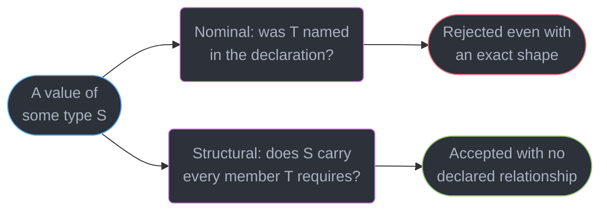
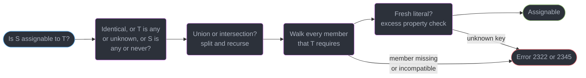
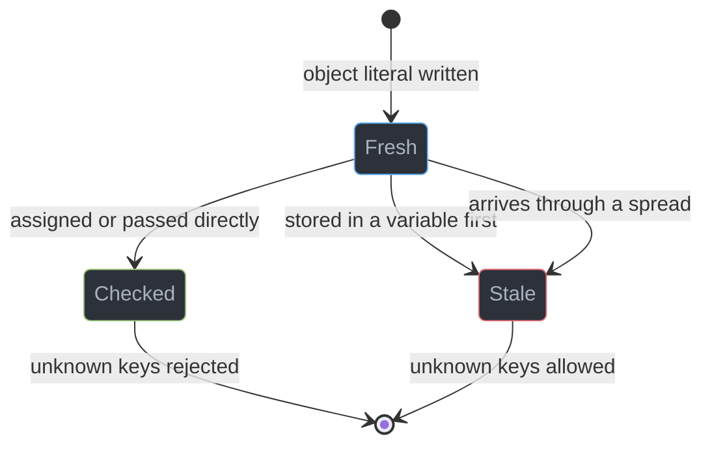
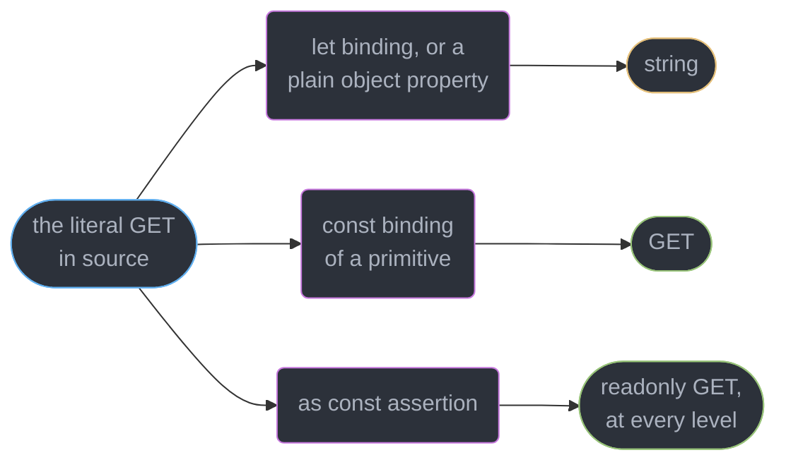
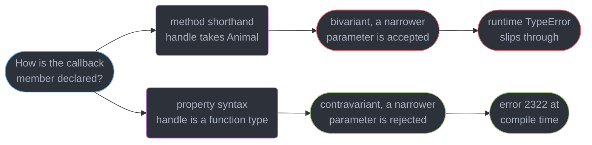
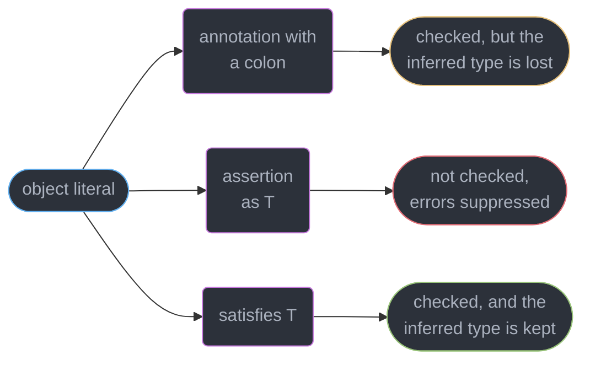

# Structural Typing and Assignability

---

## 1. Concept Overview

TypeScript decides whether a value of type `S` may be used where type `T` is expected by
comparing **shapes**, not names. Two types declared in different files, by different authors,
with no shared ancestor, are interchangeable the moment their members line up. That is
**structural typing**, and the relation implementing it is **assignability** — the most-consulted
relation in the compiler. Every argument passed, value returned, variable stored, `implements`
clause satisfied and `T extends Constraint` checked is one assignability query.

Six rules sit around that core relation and generate most day-to-day surprises:

| Rule | What it does | Introduced |
|------|--------------|-----------|
| Excess property checking | Rejects unknown keys on a **fresh** object literal only | 1.6 |
| Literal widening | Turns `"GET"` into `string` at a mutable binding | 1.8 |
| `as const` | Suppresses widening, adds `readonly` recursively | 3.4 |
| Weak type detection | Rejects a value sharing zero properties with an all-optional target | 2.4 |
| `strictFunctionTypes` | Makes standalone function parameters contravariant | 2.6 |
| `satisfies` | Checks assignability without replacing the inferred type | 4.9 |

The target is **TypeScript 7.0** (GA 2026-07-08), whose native Go compiler rewrote the checker
but changed no assignability rule — the relation caches got 7.7-11.9x faster and the semantics are
identical to 6.0. Every example below type-checks under `strict`.

---

## 2. Intuition

> A TypeScript type is a **description of a shape**, not a membership card. The checker never
> asks "where did this come from?" — only "does it have what I need?"

**Mental model.** Nominal typing (Java, C#) is a passport check: you are a `Duck` because your
declaration says `class Duck`. Structural typing is a customs inspection — you are a `Duck`
because you walk, swim and quack, and the officer never looks at your passport.

**Why it matters.** This is what lets TypeScript describe JavaScript written before TypeScript
existed — a jQuery options bag, a JSON response, a `process.env` slice, none of which can be
retrofitted with an `implements` clause.

**Key insight, and the one that catches everyone.** Extra properties are normally **legal**:
width subtyping says a wider object works wherever a narrower one is expected. Excess property
checking is a *separate* rule firing only on a literal in the exact position being checked, so
storing that literal in a variable makes the check evaporate.

---

## 3. Core Principles

1. **Shape decides, name does not.** `interface A { x: number }` and `type B = { x: number }` are
   the same type regardless of file, package, or author.
2. **Assignability is directional, and wider sources win.** `S` fits `T` when `S` has at least
   every member `T` requires. Missing members are fatal; extra ones are fine.
3. **Freshness is syntactic and single-use** — any binding, `as` cast, or spread strips it.
4. **Widening is a property of the binding, not the value.** `const m = "GET"` infers `"GET"` and
   `let m = "GET"` infers `string`, from an identical right-hand side.
5. **`readonly` is compile-time only** — erased at emit, exactly one level deep, and ignored by
   object-to-object assignability.
6. **Variance follows position.** Return types are covariant; parameter types are contravariant
   under `strictFunctionTypes`, except for method shorthand, which stays bivariant forever.
7. **Three relations exist:** identity, assignability, comparability. `as` uses the third.
8. **`satisfies` [4.9] checks without capturing.** An annotation validates and *replaces* the
   inferred type; `satisfies` validates and keeps it.

---

## 4. Types / Architectures / Strategies

### 4.1 The four ways to attach a type to a literal

```ts
type Route = { path: string; method: "GET" | "POST" };

const a = { path: "/u", method: "GET" };                    // { path: string; method: string }
const b: Route = { path: "/u", method: "GET" };             // Route — inferred type discarded
const c = { path: "/u", method: "GET" } as Route;           // Route — no excess check, unsafe
const d = { path: "/u", method: "GET" } satisfies Route;    // { path: string; method: "GET" }
```

`a` loses the literal type, `b` flattens `method` to the full union, `c` suppresses errors you
wanted. `d` [4.9] is what you almost always mean: full checking plus the narrow inferred type.
Two identical class shapes are mutually assignable too — a `Meters` accepts a `Feet`, and §6.4
buys that distinction back.

### 4.2 Assignability special forms

| Source | Target | Assignable? | Why |
|--------|--------|-------------|-----|
| `any` | anything, and anything to `any` | Yes | `any` is both top and bottom |
| `unknown` | anything but `unknown`/`any` | No | must narrow first |
| anything | `unknown` | Yes | `unknown` is the sound top type |
| `never` | anything | Yes | `never` is the bottom type |
| anything but `never` | `never` | No | nothing inhabits `never` |
| `A \| B` | `T` | Only if both fit | every constituent must be assignable |
| `S` | `A \| B` | If either fits | one constituent suffices |
| `S` | `A & B` | Only if both fit | intersection demands all |
| `null` / `undefined` | `T` | Only with `strictNullChecks: false` | strict mode separates them |

### 4.3 Index signatures vs `Record`

```ts
type Bag = { [k: string]: number };            // any key allowed, unknown keys never error
type Fixed = Record<"a" | "b", number>;        // exactly { a: number; b: number }, both required

const fixed: Fixed = { a: 1 };
// Property 'b' is missing in type '{ a: number; }' but required in type 'Record<"a" | "b", number>'.
```

`Record<K, V>` over a **finite key union** is a mapped type producing required keys, while
`Record<string, V>` desugars to an index signature — same utility, opposite behaviour.

---

## 5. Architecture Diagrams

### Structural vs nominal: what the checker asks

TypeScript takes the lower path exclusively; §6.4 shows how to reach the upper one.



### The assignability decision path

Cheap cases short-circuit first; the member walk is the expensive tail, and freshness is the last
gate, applied only to literals.



### Freshness: a property spent on first use



### Literal widening and how to stop it



### Parameter variance: the method-shorthand hole



---

## 6. How It Works — Detailed Mechanics

### 6.1 Width subtyping, and why the error is about literals

```ts
interface Config { host: string; port: number }
function connect(c: Config): void {}

const raw = { host: "db", port: 5432, ssl: true };
connect(raw);                                  // OK — width subtyping, ssl is simply ignored

connect({ host: "db", port: 5432, ssl: true });
// Argument of type '{ host: string; port: number; ssl: boolean; }' is not assignable to
// parameter of type 'Config'.
//   Object literal may only specify known properties, and 'ssl' does not exist in type 'Config'.

interface Outer { inner: { a: number } }
const nested: Outer = { inner: { a: 1, b: 2 } };
// Object literal may only specify known properties, and 'b' does not exist in type '{ a: number; }'.
const base = { a: 1, b: 2 };
const escaped: Outer = { inner: { ...base } };   // NO error — spread members are never checked
```

Both calls pass an identical runtime value. The second is rejected because the literal is fresh
at the argument position, and a fresh literal with an unknown key is almost always a typo — the
rule is a **heuristic against mistakes**, not a soundness rule. When the unknown key resembles a
known one, the compiler upgrades to error 2561 with a "Did you mean" suggestion (see §10).
Freshness propagates into the nested `{ a: 1, b: 2 }` literal, but properties arriving through a
spread are exempt, making `{ ...req.body }` the standard accidental escape hatch.

### 6.2 Weak type detection and the empty object type

```ts
interface Options { timeout?: number; retries?: number }
function run(o: Options): void {}

run({ timeuot: 3000 });
// Type '{ timeuot: number; }' has no properties in common with type 'Options'.

let anything: {} = 42;          // OK — braces mean "not null and not undefined"
anything = () => {};            // OK
// anything = null;             // Type 'null' is not assignable to type '{}'.
const empty: Record<string, never> = {};   // "an object with no known properties"
```

If every target property is optional, `{}` satisfies it and excess property checking alone cannot
catch a misspelling. **Weak type detection** [2.4] adds the requirement of one property in common;
it fires on any source, fresh or not, and one index signature on the target disables it. And `{}`
is the second-widest type after `unknown` and `any` — `function f(o: {})` accepts numbers and
functions, which is almost never what the author meant.

### 6.3 Widening, `as const`, and `satisfies` [4.9]

```ts
const method = "GET";              // "GET"
let mutable = "GET";               // string
const obj = { method: "GET" };     // { method: string } — properties are mutable, so they widen
const routes = ["/a", "/b"] as const;   // readonly ["/a", "/b"] — a tuple, not string[]

type Colors = Record<string, [number, number, number] | string>;

const palette = { red: [255, 0, 0], green: "#00ff00" } satisfies Colors;
palette.green.toUpperCase();     // OK — green is still known to be string
// palette.blue                  // Property 'blue' does not exist

const annotated: Colors = { red: [255, 0, 0], green: "#00ff00" };
annotated.green.toUpperCase();
// Property 'toUpperCase' does not exist on type 'string | [number, number, number]'.
```

Widening exists because a mutable location must accept a later reassignment; `as const` [3.4]
declares that none will happen, keeps the narrow type, and adds `readonly` at every level. The
annotated palette replaced its inferred type with `Colors`, discarding the key set and the per-key
value types; `satisfies` runs the identical check, then lets inference stand.



### 6.4 `readonly`, and buying nominality back

```ts
interface Frozen { readonly id: number; readonly tags: string[] }
const f: Frozen = { id: 1, tags: ["a"] };
// f.id = 2;                     // Cannot assign to 'id' because it is a read-only property.
f.tags.push("b");                // OK — readonly is exactly one level deep
const mutable: { id: number; tags: string[] } = f;   // OK — readonly is ignored between objects

const ro: readonly number[] = [1, 2, 3];
const rw: number[] = ro;
// The type 'readonly number[]' is 'readonly' and cannot be assigned to the mutable type 'number[]'.

declare const brand: unique symbol;
type UserId = string & { readonly [brand]: "UserId" };
const asUserId = (s: string): UserId => s as UserId;
function loadUser(id: UserId): void {}
loadUser(asUserId("u_1"));      // OK
// loadUser("u_1");             // Argument of type 'string' is not assignable to 'UserId'.

class Left  { private token = 0 }
class Right { private token = 0 }
const l: Left = new Right();
// Type 'Right' is not assignable to type 'Left'. Types have separate declarations of a
// private property 'token'.
```

Three `readonly` facts surprise people independently: it blocks direct assignment, does not freeze
the referenced array, and is ignored between object types — only `ReadonlyArray` gets
one-directional enforcement, and `Object.freeze()` is the runtime tool. The brand adds a phantom
property existing only in the type system, so the emitted JavaScript is unchanged. Classes get a
weaker version free: a `private` member is matched by declaration site rather than name, the one
place TypeScript is nominal by default.

### 6.5 Function assignability and `strictFunctionTypes`

```ts
interface Animal { name: string }
interface Dog extends Animal { bark(): void }

// Property syntax: contravariant under strictFunctionTypes, which is on under strict
type PropHandler = { handle: (a: Animal) => void };
const p: PropHandler = { handle: (d: Dog) => d.bark() };
// Type '(d: Dog) => void' is not assignable to type '(a: Animal) => void'.
//   Types of parameters 'd' and 'a' are incompatible.
//     Property 'bark' is missing in type 'Animal' but required in type 'Dog'.

// Method shorthand: permanently bivariant, so the identical bug compiles clean
type MethodHandler = { handle(a: Animal): void };
const m: MethodHandler = { handle: (d: Dog) => d.bark() };   // no error
m.handle({ name: "cat" });                                    // TypeError: d.bark is not a function
```

Dropping parameters is always allowed — `arr.map(x => x * 2)` depends on it, since `map` supplies
three arguments — while parameter *types* run the other way: wider is accepted, narrower is not.
The exemption is deliberate, since `Array.prototype.push` and most of `lib.dom.d.ts` would fail a
contravariant check. Declare callback members with property syntax so the flag protects them.

### 6.6 Optional properties and `exactOptionalPropertyTypes` [4.4]

```ts
interface User { name: string; nickname?: string }

const a: User = { name: "ada" };                      // OK
const b: User = { name: "ada", nickname: undefined }; // OK by default, `?` implies `| undefined`

// With "exactOptionalPropertyTypes": true, b becomes:
// Type '{ name: string; nickname: undefined; }' is not assignable to type 'User' with
// 'exactOptionalPropertyTypes: true'. Consider adding 'undefined' to the types of the
// target's properties.

interface Precise { name: string; nickname?: string | undefined }
const c: Precise = { name: "ada", nickname: undefined };  // OK — explicitly permitted
```

The flag separates "absent" from "present and undefined", which matters wherever the two differ
at runtime: `in` checks, `Object.keys()` length, `JSON.stringify` output that omits undefined
values, and a partial database update where a present-but-undefined field would null a column.
It is **not** part of `strict` and must be enabled deliberately.

---

## 7. Real-World Examples

### Structural duck typing across package boundaries

```ts
export interface Logger { info(msg: string): void; error(msg: string): void }

function withLogging<T>(fn: () => T, log: Logger): T {
  log.info("start");
  try { return fn(); } finally { log.info("done"); }
}

withLogging(() => 1, console);   // OK — console structurally satisfies Logger
```

`console` was never written to implement anything, but it has `info` and `error` with compatible
signatures, so it is a `Logger` — the adapter a nominal language would require is absent.

### Comparison to Go interfaces and Python `Protocol`

| Dimension | TypeScript | Go | Python `Protocol` |
|-----------|-----------|-----|------------------|
| Match performed | Compile time only | Compile time, plus a runtime itable | Static checker only |
| Runtime artefact | None — types are erased | Header holds type and itable pointers | None, unless `@runtime_checkable` |
| Members matched | Any member, data fields included | Methods only | Methods and attributes |
| Explicit opt-in | Optional `implements` clause | None, and none possible | Optional inheritance |
| Failure surface | Error 2322 at the assignment | Compile error at the assignment | Checker error, silent at runtime |

Go is the closest relative — an interface value carries a method table built at the assignment, so
the match is a real runtime artefact
([Interfaces, Methods and Embedding](../../go/interfaces_methods_and_embedding/interfaces_methods_and_embedding.md)).
Python's `Protocol` sits closest to TypeScript, a purely static shape check with no runtime
presence ([The Type System and typing](../../python/the_type_system_and_typing/the_type_system_and_typing.md)).
The TypeScript-only wrinkle is excess property checking — neither of the others has an
object-literal syntax whose type is inferred at the assignment site.

---

## 8. Tradeoffs

| Dimension | Structural (TypeScript, Go) | Nominal (Java, C#, Rust) |
|-----------|----------------------------|--------------------------|
| Adapting existing code | Free — no declaration to change | Requires a wrapper or adapter class |
| Accidental compatibility | Common — `Meters` accepts `Feet` | Impossible by construction |
| Refactor blast radius | Renaming a type breaks nothing | Renaming propagates to all implementers |
| Error message quality | Deep member-by-member elaborations | One line naming the missing interface |
| Check cost | Recursive member walk, cached per pair | Single name comparison |
| Intent documentation | Weak — shape is not meaning | Strong — the name is the contract |

| Approach to a config object | Excess keys caught | Literal types kept | Unsafe |
|-----------------------------|--------------------|--------------------|--------|
| `const x = { ... }` | No | Widened | No |
| `const x: T = { ... }` | Yes | No | No |
| `const x = { ... } as T` | No | No | Yes |
| `const x = { ... } satisfies T` | Yes | Yes | No |
| `const x = { ... } as const satisfies T` | Yes | Yes, plus `readonly` | No |

| Flag | On under `strict` | What it costs | What it buys |
|------|-------------------|---------------|--------------|
| `strictFunctionTypes` | Yes | Property-declared callbacks get stricter | Catches the `Dog`/`Animal` handler bug |
| `exactOptionalPropertyTypes` | No | Explicit `\| undefined` on many fields | Separates absent from undefined |
| `noUncheckedIndexedAccess` | No | Every index read becomes `T \| undefined` | Removes a class of runtime crashes |

---

## 9. When to Use / When NOT to Use

**Lean on structural typing when:**

- Describing data crossing a boundary you do not own — JSON responses, `process.env`,
  third-party callbacks, a legacy global.
- Writing a function needing only a slice of an object: declare the 2 fields you read, not the
  40-field entity, and every caller becomes compatible for free.
- Defining test doubles — a mock implementing 3 of 30 methods satisfies a 3-method parameter type.

**Reach for `satisfies` [4.9] when** the object is a configuration map, route table, or palette
whose keys and value types you want kept for downstream inference — or whenever you are tempted
to write `as T` purely to get a check, since `satisfies` gives the check without the suppression.

**Reach for branded types when** two primitives of the same base type must not be interchangeable
(user id vs order id, cents vs dollars, raw vs escaped HTML) and the confusion has already caused
an incident. A brand costs one constructor function, so it is not worth applying to every string.

**Do NOT rely on structural typing when:**

- The distinction is semantic rather than shaped — `{ amount: number }` for cents and for dollars
  is one type, and no care in the shape separates them.
- You need runtime enforcement. Assignability is erased at emit, so a value arriving over the
  network has never been checked — parse it, per
  `../runtime_validation_and_parse_dont_validate/runtime_validation_and_parse_dont_validate.md`.
- You are modelling a closed set of variants: a discriminated union with a literal tag is the
  right tool.

---

## 10. Common Pitfalls

### Pitfall 1: the excess property check that vanished (BROKEN → FIX)

```ts
// BROKEN — the typo is silently accepted because the literal is no longer fresh
interface ServerOptions { port: number; hostname: string; keepAliveMs: number }
function startServer(o: ServerOptions): void {}

const opts = { port: 8080, hostname: "0.0.0.0", keepAliveMS: 5000 };
startServer(opts);   // compiles clean; keepAliveMs is undefined at runtime

// FIX — annotate at the declaration, or use satisfies, so the literal is checked where written
const fixed: ServerOptions = { port: 8080, hostname: "0.0.0.0", keepAliveMS: 5000 };
// Object literal may only specify known properties, but 'keepAliveMS' does not exist in type
// 'ServerOptions'. Did you mean to write 'keepAliveMs'?
const alt = { port: 8080, hostname: "0.0.0.0", keepAliveMs: 5000 } satisfies ServerOptions;
```

Both spellings are plausible, so shape matching alone cannot save you. **Annotating the variable
at its declaration** is the habit that closes this hole across a whole codebase.

### Pitfall 2: `readonly` mistaken for immutability

```ts
// BROKEN — the cache believes it is frozen
interface CacheEntry { readonly key: string; readonly hits: number[] }
function record(e: CacheEntry): void {
  e.hits.push(Date.now());          // compiles — readonly is one level deep
}

// FIX — make the nested type readonly too, and return a new value
interface SafeEntry { readonly key: string; readonly hits: readonly number[] }
function recordSafe(e: SafeEntry): SafeEntry {
  // e.hits.push(...) → Property 'push' does not exist on type 'readonly number[]'.
  return { ...e, hits: [...e.hits, Date.now()] };
}
```

### Pitfall 3: widening kills a discriminant

```ts
type Action = { type: "add"; value: number } | { type: "clear" };
function dispatch(a: Action): void {}

const action = { type: "add", value: 1 };   // { type: string; value: number }
dispatch(action);
// Argument of type '{ type: string; value: number; }' is not assignable to parameter of
// type 'Action'. Types of property 'type' are incompatible.
//   Type 'string' is not assignable to type '"add" | "clear"'.
```

Fix with any of `const action: Action = ...`, `... satisfies Action`, or
`{ type: "add" as const, value: 1 }`. Prefer `satisfies` when the object is also read locally.

### Pitfall 4: `any` and open index signatures disabling the relation

```ts
const data = JSON.parse(body);      // any
const user: { id: number } = data;  // no error whatsoever
user.id.toFixed(2);                 // TypeError at runtime if the payload had id: "7"

type Handlers = Record<string, () => void>;
const handlers: Handlers = { onSave: () => {} };
handlers.onSve();                   // no error — every string key is declared to exist
```

`any` is assignable in both directions, so one disables checking everywhere it flows; type parse
results as `unknown` and narrow. An index signature separately turns off excess property checking
and weak type detection for its type — use `Record<"onSave" | "onCancel", T>` for a closed key
set, and `noUncheckedIndexedAccess` when the keys are genuinely dynamic.

---

## 11. Technologies & Tools

| Tool | Role | Relevance to assignability |
|------|------|---------------------------|
| TypeScript | The compiler and checker (7.0, native Go binary) | Owns the relation; `--checkers` parallelises it |
| tsc6 | The 6.0 binary shipped as `@typescript/typescript6` | The only stable Compiler API until 7.1 |
| typescript-eslint | Type-aware linting (8.71.2) | `no-unsafe-assignment` catches `any` crossing boundaries |
| ts-morph | Programmatic AST and type manipulation | Queries checker assignability results in codemods |
| Vitest | Test runner with `expectTypeOf` | `toMatchTypeOf` is an assignability assertion |
| Zod | Runtime schema validation | Closes the gap assignability leaves at the network edge |
| arethetypeswrong | Package type-resolution auditor | Verifies published declarations resolve for consumers |
| ts-reset | Stricter standard library declarations | Retypes `JSON.parse` and response bodies to `unknown` |

**Compiler options that change the relation itself:** `strictFunctionTypes`,
`exactOptionalPropertyTypes`, `noUncheckedIndexedAccess`, `noPropertyAccessFromIndexSignature`
and `strictNullChecks` — only the first and last are on under `strict`.

---

## 12. Interview Questions with Answers

**Q: Why does adding an unknown property to an object literal error, but assigning the same object through a variable does not?**
**Short:** Object literals are checked for freshness at the exact position they are written, and storing one in a variable spends that freshness.

Excess property checking fires only on a **fresh** literal — one written directly at the
assignment or argument position. Once bound to a variable, only width subtyping applies, which
permits extra members; the value is identical and only the syntactic position differs. The rule is
a typo-catcher, so annotating the variable at its declaration is what keeps it working.

**Q: What does `satisfies` do that a type annotation does not?**
**Short:** It validates a value against a type while leaving the narrower inferred type in place, instead of replacing it.

An annotation performs the check and then *becomes* the variable's type, so
`const p: Record<string, string | number[]> = {...}` loses the key set and the per-key value
types. `satisfies` [4.9] runs the identical check, excess property checking included, and lets
inference stand. It replaces the habit of writing `as T` merely to trigger a check.

**Q: Is `readonly` enforced at runtime, and how deep does it go?**
**Short:** It is erased entirely at emit and applies to exactly one level, so the referenced array or object stays fully mutable.

`readonly id: number` blocks `obj.id = 2` at compile time and nothing more. A
`readonly tags: string[]` still allows `obj.tags.push("x")`, because the annotation constrains the
property slot rather than the value behind it. It also does not participate in object-to-object
assignability, so use `Object.freeze()` when the constraint must survive to runtime.

**Q: What is weak type detection and when does it fire?**
**Short:** When every property of the target is optional, the source must share at least one property with it or the assignment is rejected.

An all-optional interface such as `{ timeout?: number; retries?: number }` is satisfied by `{}`,
so excess property checking alone could not catch `{ timeuot: 3000 }` once freshness was gone.
Weak type detection [2.4] adds the requirement of one property in common and applies to non-fresh
sources too. A single index signature on the target disables the rule entirely.

**Q: Why does `strictFunctionTypes` not protect a callback declared with method shorthand?**
**Short:** Method-declared parameters remain bivariant permanently, because thousands of built-in library members would otherwise fail the stricter check.

Under `strictFunctionTypes` a function-typed **property** has contravariant parameters, so
supplying a handler taking `Dog` where one taking `Animal` is expected is an error. The same member
written as `handle(a: Animal): void` is checked bivariantly, accepts the narrower parameter
silently, and produces a runtime `TypeError` when a non-`Dog` `Animal` arrives.

**Q: Can a function with fewer parameters be assigned where more are expected?**
**Short:** Yes, dropping parameters is always allowed, because JavaScript callers routinely pass arguments a callback ignores.

`arr.map(x => x * 2)` is the everyday proof: `map` supplies three arguments and the callback
declares one. Assignability requires the source to *handle* everything the target may pass, and
ignoring an argument handles it. Parameter **types** run opposite to parameter **count**: a wider
type is accepted, a narrower one is not.

**Q: What does the empty object type accept?**
**Short:** Braces with no members accept every value except `null` and `undefined`, including numbers, strings, and functions.

`let x: {} = 42` compiles, as does assigning a string or a function, because the type constrains
nothing beyond non-nullishness. It is the second-widest type in the language after `unknown` and
`any`. Use `Record<string, never>` for an object with no known properties, and `unknown` plus
narrowing for any non-nullish value.

**Q: What changes when `exactOptionalPropertyTypes` is enabled?**
**Short:** An optional property stops implicitly accepting an explicit `undefined`, so an absent key and a key set to undefined become different things.

By default `nickname?: string` behaves as `string | undefined`, and both `{}` and
`{ nickname: undefined }` are assignable. With the flag [4.4] the second is rejected unless the
declaration says `nickname?: string | undefined`. That matters for `in` checks, `Object.keys()`,
`JSON.stringify` output, and partial database updates. It is not in `strict`.

**Q: When does a string literal keep its literal type and when does it widen?**
**Short:** A `const` binding of a primitive keeps the literal type, while a `let` binding or a plain object property widens it to the base primitive.

`const m = "GET"` infers `"GET"` because the location can never be reassigned; `let m = "GET"` and
`{ method: "GET" }` both infer `string` because they can. That widening breaks a
discriminated-union dispatch built from a plain literal. `as const` [3.4] suppresses it throughout
the value, adds `readonly` at every level, and converts array literals into readonly tuples.

**Q: How do `any` and `unknown` behave differently in the assignability relation?**
**Short:** `any` flows in both directions and disables checking wherever it lands, while `unknown` accepts everything but flows out to nothing.

Anything is assignable to `any` and `any` is assignable to anything, so a single `any` from
`JSON.parse` silently satisfies every downstream annotation and the first real check becomes a
runtime `TypeError`. `unknown` is the sound top type: every value goes in, but it flows out only
after narrowing by `typeof`, a type predicate, or a validator.

**Q: How can two classes with identical members be made incompatible?**
**Short:** Declaring a `private` or `protected` member makes a class compare by declaration site rather than by shape.

Private members are matched nominally, giving `Types have separate declarations of a private
property 'token'`. Two classes with the same private field name declared separately are therefore
unrelated, and this is the only place TypeScript is nominal by default. For plain object types the
equivalent is a branded intersection carrying a phantom `unique symbol` property.

**Q: Why does spreading an object into a literal bypass the unknown-key error?**
**Short:** Properties arriving through a spread are exempt from the excess check, so only keys written by hand are validated.

`const c: Config = { ...userInput }` reports nothing even when `userInput` carries a dozen
unrelated fields, whereas writing those fields out by hand would error. The exemption exists
because a spread's contributed keys are frequently unknowable at the type level, which makes
`{ ...req.body }` the most common accidental escape hatch in real codebases.

**Q: What is the difference between an index signature and `Record`?**
**Short:** `Record` over a finite key union produces required named keys, whereas an index signature declares that any key of that type may exist.

`Record<"a" | "b", number>` is a mapped type yielding both properties as required, so omitting one
is an error. `Record<string, number>` desugars to `{ [k: string]: number }`, under which every
string key is declared to exist and `obj.typo` type-checks while returning `undefined` at runtime.
Pair a genuine index signature with `noUncheckedIndexedAccess`.

**Q: How do you stop a user id and an order id from being interchangeable?**
**Short:** Intersect the primitive with a phantom property keyed by a `unique symbol`, then produce values only through one constructor function.

`type UserId = string & { readonly [brand]: "UserId" }` makes a plain `string` non-assignable to
`UserId` while every `UserId` still behaves as a string at runtime, because the brand disappears at
emit. Values enter through `const asUserId = (s: string) => s as UserId`, localising the one unsafe
assertion to a single auditable line rather than scattering casts.

**Q: How does TypeScript's shape matching compare with Go interfaces and Python `Protocol`?**
**Short:** All three match on members without a declared relationship, and only Go keeps a method table at runtime.

Go builds an interface value carrying a type pointer and a method table at the assignment, so the
match is a real runtime artefact and satisfaction covers methods only. Python's `Protocol` is
checked by mypy or pyright and leaves nothing behind unless marked `@runtime_checkable`.
TypeScript matches any member including data fields, then erases everything.

**Q: Why is a wider object accepted where a narrower one is expected?**
**Short:** Width subtyping says a value carrying more members than required can still honour every member the target declares.

A function reading `host` and `port` works perfectly against a value that also has `ssl`, so
rejecting it would forbid ordinary composition and force every helper to demand an exact shape.
This is why declaring only the fields a function reads is good practice — the narrower the
parameter type, the more callers are compatible for free.

**Q: In which direction are readonly arrays assignable?**
**Short:** A mutable array may be used where a readonly one is expected, and never the reverse.

`const ro: readonly number[] = someMutableArray` is fine, because promising not to mutate weakens
what the source already allowed. The opposite is blocked with `The type 'readonly number[]' is
'readonly' and cannot be assigned to the mutable type 'number[]'`. This strictness is specific to
arrays and tuples — `readonly` on an object property is ignored between object types.

**Q: How are unions and intersections resolved during an assignability check?**
**Short:** A source union must have every constituent assignable, while a target union needs only one constituent to match.

For `S` assignable to `A | B` the checker succeeds as soon as one constituent fits, which is why
`"GET"` flows into `"GET" | "POST"`. For `A | B` assignable to `T` every constituent must fit
independently, which is why an un-narrowed `string | number` cannot be passed where `string` is
expected. Intersections invert the target rule and require both.

---

## 13. Best Practices

1. **Annotate the variable, not the eventual use.** `const opts: ServerOptions = {...}` catches a
   typo that `const opts = {...}` followed by `use(opts)` will not.
2. **Reach for `satisfies` [4.9] whenever the object is also read locally** — it gives the check an
   annotation gives while keeping the inference an annotation destroys.
3. **Never use `as` to obtain a check** — it uses the comparability relation and suppresses the
   very errors you wanted.
4. **Declare callback members with property syntax** — a function-typed property gets
   contravariant parameter checking, and the method-shorthand form does not.
5. **Type the narrowest parameter you actually read** — structural typing then makes every caller
   compatible for free.
6. **Type untrusted input as `unknown`, never `any`.** `ts-reset` retypes `JSON.parse` and response
   bodies to `unknown` project-wide, forcing the narrowing that `any` skips.
7. **Turn on `exactOptionalPropertyTypes` and `noUncheckedIndexedAccess` deliberately** — neither
   is in `strict`, and each removes a category of runtime crash the relation waves through.
8. **Brand identifiers and units where confusion has a cost** — one `unique symbol` and one
   constructor per branded type, not a brand on every string.
9. **Prefer a finite `Record` key union to an index signature** whenever the key set is closed.
10. **Add `readonly` for intent and `Object.freeze()` for enforcement**, and remember the relation
    stops at the process boundary — parse anything arriving from the network or disk.

---

## 14. Case Study

### A payments service where two identical shapes meant different money

A payments team runs a TypeScript 7.0 service reconciling 1.2M transactions a day across two
providers. Provider A reports amounts in **cents** as integers; provider B reports **dollars** as
floats. Both are modelled as `{ amount: number; currency: string }`, so both are the same type and
the checker has no opinion about which one a reconciliation function receives.

The incident: a refactor moved a helper so a provider-B record reached a function expecting cents.
`$18.40` was recorded as `18` cents. It ran for 6 days across 41,000 refunds before a ledger
mismatch of `$743,281` surfaced it.

```ts
// BROKEN — two distinct concepts share one structural type, so nothing here is a type error
interface Money { amount: number; currency: string }

function toCents(m: Money): number { return m.amount; }        // silently assumes provider A
function refund(id: string, cents: number): Promise<void> { return Promise.resolve(); }

const fromProviderB: Money = { amount: 18.40, currency: "USD" };  // dollars, not cents
await refund("r_1", toCents(fromProviderB));                      // 18 cents refunded
```

Brand the two representations so the structural match no longer holds, and funnel construction
through one converter. Both brands are erased at emit, so the fix costs 0 bytes at runtime.

```ts
// FIX — nominal separation via phantom brands
declare const unit: unique symbol;
type Cents   = number & { readonly [unit]: "Cents" };
type Dollars = number & { readonly [unit]: "Dollars" };

const dollarsToCents = (d: Dollars): Cents => Math.round(d * 100) as Cents;

interface MoneyB { readonly amount: Dollars; readonly currency: string }
function refundCents(id: string, amount: Cents): Promise<void> { return Promise.resolve(); }

const b: MoneyB = { amount: 18.40 as Dollars, currency: "USD" };
// await refundCents("r_1", b.amount);
// Argument of type 'Dollars' is not assignable to parameter of type 'Cents'.
//   Type 'Dollars' is not assignable to type '{ readonly [unit]: "Cents"; }'.

await refundCents("r_1", dollarsToCents(b.amount));   // OK, and the conversion is explicit
```

Provider payloads arrive as `unknown`, and a `satisfies`-checked table keeps the per-provider
metadata narrow while still validating it:

```ts
type ProviderName = "alpha" | "beta";
type Ingest = { unit: "cents" | "dollars"; endpoint: string; timeoutMs: number };

const providers = {
  alpha: { unit: "cents",   endpoint: "https://a.example.com/tx", timeoutMs: 2_000 },
  beta:  { unit: "dollars", endpoint: "https://b.example.com/tx", timeoutMs: 5_000 },
} as const satisfies Record<ProviderName, Ingest>;

type AlphaUnit = typeof providers.alpha.unit;   // "cents" — kept, not widened to the union
```

An annotation of `Record<ProviderName, Ingest>` would flatten `unit` to `"cents" | "dollars"` on
every entry, so the branch selecting the converter would need a runtime check instead of an
exhaustive compile-time one.

**Outcome over the following quarter.** The brands reached 34 call sites across 9 modules in 2
days, and the compile pass surfaced 3 further latent unit mismatches, one on a path never exercised
in production. `exactOptionalPropertyTypes`, enabled in the same change, caught 11 places where a
present-but-`undefined` `refundReason` was written into a column the ledger treated as required.
Type-check time rose from 4.1s to 4.3s, and the emitted JavaScript was byte-identical.

**The lesson.** Structural typing gives compatibility for free and *distinction* only when asked
for it explicitly. The question worth putting to any domain type is not "does it have the right
fields" but "could a different concept with the same fields end up here" — if it could, it will.
