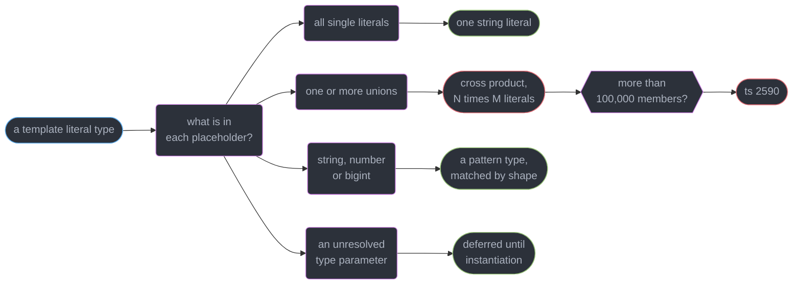
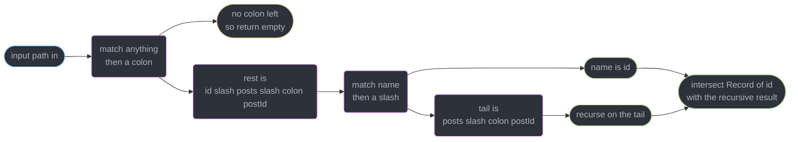
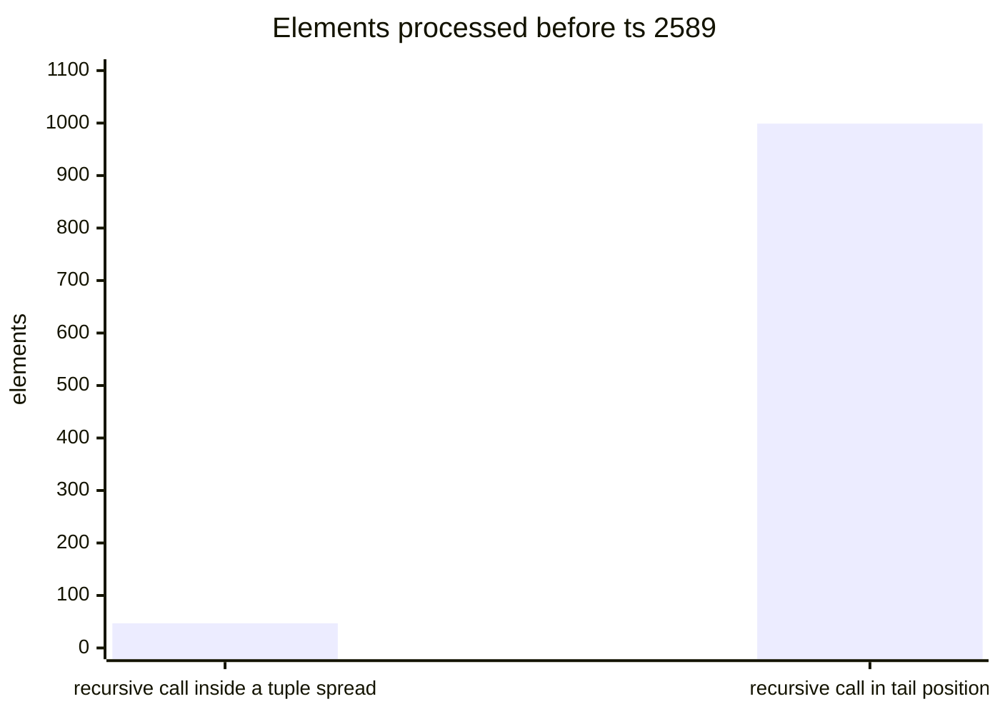
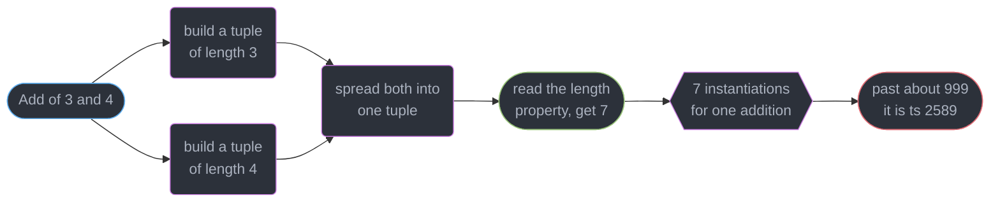
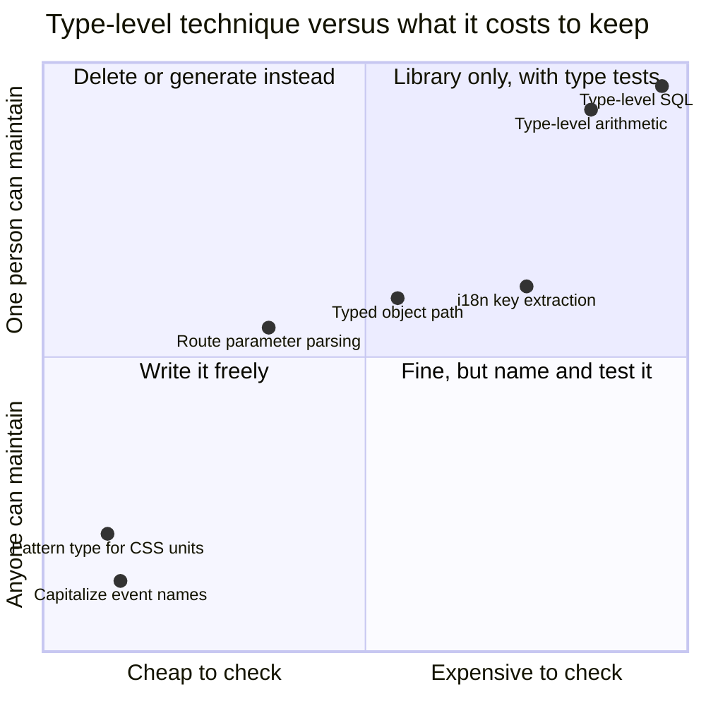
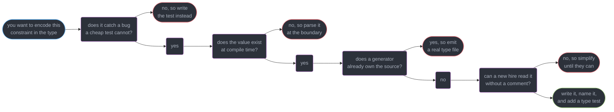

# Template Literal Types and Type-Level Programming

---

## 1. Concept Overview

A template literal type is string concatenation that runs in the checker. `` `on${Capitalize<T>}` ``
turns `"click"` into `"onClick"` without a single byte of emitted JavaScript, and once you can build
a string type you can also **take one apart** — `infer` inside a template pattern-matches
`"/users/:id"` and hands back `"id"`. Add tuples as the list type and recursion as the only loop, and
TypeScript's type system becomes a small, slow, untyped functional language that happens to run
inside your editor.

This module teaches that language, and then argues you should mostly not write it.

That second half is the point, not a disclaimer. Every technique below is real and a handful of them
earn their cost every day — typed route parameters, typed event names, a typed object path. The rest
form a spectrum that ends in type-level arithmetic, a Sudoku solver, and an editor that takes 4
seconds to show a hover. The skill this module is actually trying to install is **knowing which end
of that spectrum you are standing on**, because the compiler will happily let you walk to the far end
and only tell you when the build goes red.

The techniques stack in five layers — concatenation, destructuring, tuple manipulation, recursion
over characters, and arithmetic built from tuples of `unknown` used as tally marks — and the cost per
layer is tabulated in §4.2 alongside the judgment call in §4.4.

The target is **TypeScript 7.0** (GA 2026-07-08). The native Go checker changed how fast these
resolve, not what they mean, and every limit quoted here holds on `tsc6` as well. Conditional types,
`infer` mechanics, distribution and mapped types are owned by
`../conditional_and_mapped_types/conditional_and_mapped_types.md` and used freely below without
re-explanation; generics and constraints come from
`../generics_and_type_parameters/generics_and_type_parameters.md`.

---

## 2. Intuition

> The type system is a pure functional language whose only data types are strings, unions and
> tuples, whose only control flow is a conditional, whose only loop is recursion, and which has no
> debugger, no `console.log` and a stack depth of 100.

**Mental model.** Think of every type-level program as a `map`/`filter` over a list. Tuples are the
list — ordered, indexable, destructurable with `[Head, ...Tail]`. Unions look like a list and are
not: they are a **set**, unordered and deduplicated, so `"a" | "a"` is one member and you cannot ask
for the first one. Strings are the only primitive you can inspect, and you inspect them the way a
1970s parser did: match a prefix, recurse on the remainder.

**Why it matters.** The APIs that feel magical are built here. `router.get("/users/:id", (c) =>
c.req.param("id"))` autocompletes `"id"` because a template literal type parsed the first argument.
`t("cart.items", { count: 3 })` rejects a missing `count` because a recursive type walked the
translation string. Neither needs a code generator, a build step, or a runtime lookup.

**Key insight.** The expressiveness and the cost are the same fact. A template over a union does not
*describe* N x M strings, it **materialises** all of them in the checker, and a recursive parser does
not *describe* a loop, it materialises one type instantiation per character — every keystroke, in
every editor, for everyone on the team. The type system has no laziness and no memoisation you
control. That is why the interesting question is never "can this be typed" but "should this be typed
here, at this price, for this reader".

---

## 3. Core Principles

1. **A template literal type over unions is a cross product.** `` `${A}_${B}` `` with `A` of 60
   members and `B` of 40 produces 2,400 string literals, all of them real and all of them held.
2. **The four intrinsics are compiler builtins, not library types.** `Uppercase`, `Lowercase`,
   `Capitalize` and `Uncapitalize` are declared `= intrinsic` in `lib.es5.d.ts`; there is no
   TypeScript source to read and no fifth one you can add.
3. **`infer` inside a template is a parser, and it matches lazily.** The first placeholder takes the
   shortest match, so `` `${infer A}.${infer B}` `` splits `"a.b.c"` at the first dot, not the last.
4. **Tuples are the type-level list; unions are not.** Order, duplicates and indexing exist only in a
   tuple. `T["length"]` is the only way to get a number out of the type system.
5. **There is no arithmetic.** `Add<3, 4>` is built by concatenating a 3-element tuple onto a
   4-element one and reading `["length"]`. Every counted unit is an instantiation.
6. **Recursion has two ceilings.** Nested instantiation depth caps at 100; a call in **tail
   position** gets tail-recursion elimination `[4.5]` and runs to about 1,000. Total instantiations
   cap around 5,000,000 for the whole program.
7. **Every one of these is evaluated on every keystroke**, not on every build. Editor latency, not
   CI time, is what a bad type-level program actually costs. See
   `../the_typescript_compiler_and_type_performance/the_typescript_compiler_and_type_performance.md`.
8. **A type that needs a comment to explain it has failed the maintainer test.** The person who
   deletes it at 2am will not read the comment; they will `@ts-ignore` past it.
9. **Parsing at the boundary is often the better answer.** A `string` plus a Zod parse gives a real
   error message at the real failure point —
   `../runtime_validation_and_parse_dont_validate/runtime_validation_and_parse_dont_validate.md`.

---

## 4. Types / Architectures / Strategies

### 4.1 The four intrinsic string types

| Type | Input | Output | Notes |
|------|-------|--------|-------|
| `Uppercase<S>` | `"click"` | `"CLICK"` | ASCII-plus-Unicode simple case mapping, locale-independent |
| `Lowercase<S>` | `"Click"` | `"click"` | the inverse; not the same as `String.prototype.toLowerCase` under a locale |
| `Capitalize<S>` | `"click"` | `"Click"` | first character only |
| `Uncapitalize<S>` | `"OnClick"` | `"onClick"` | first character only |

All four distribute over a union (`Capitalize<"a" \| "b">` is `"A" \| "B"`) and all four pass
`string` through unchanged, because there is no first character to map. Applied to `` `${string}` ``
patterns they are the identity.

### 4.2 The template forms

| Form | What it does | Cost |
|------|-------------|------|
| `` `pre${T}post` `` with `T` a single literal | concatenation | 1 type |
| `` `${A}${B}` `` with unions | cross product | `A` x `B` types |
| `` `${string}` `` / `` `${number}` `` / `` `${bigint}` `` | a **pattern**, not a set | 1 type, checked by shape |
| `` T extends `${infer A}${D}${infer B}` `` | destructuring | 1 conditional per call |
| `` [K in keyof T as `on${Capitalize<K & string>}`] `` | key remapping | 1 per key |

### 4.3 Tuple operations, and the whole toolbox

| Operation | Implementation |
|-----------|---------------|
| Head | `T extends [infer H, ...unknown[]] ? H : never` |
| Tail | `T extends [unknown, ...infer R] ? R : []` |
| Length | `T["length"]` |
| Push | `[...T, X]` |
| Concat | `[...A, ...B]` |
| Reverse | recursive: `[...Reverse<Tail>, Head]` — **not** tail-recursive |
| Zip | recursive over two heads at once |

### 4.4 The four levels, and where to stop

| Level | Example | Verdict |
|-------|---------|---------|
| 1. Concatenate | `` `on${Capitalize<E>}` `` for an event map | Write it. One line, obvious, cheap |
| 2. Destructure once | `` `${infer Method} ${infer Path}` `` for `"GET /users"` | Write it. Still readable in isolation |
| 3. Recurse over a string | `Params<"/users/:id/posts/:postId">` | Write it **once**, in a library, with type tests |
| 4. Compute | `Add`, `Compare`, a type-level parser for SQL | Stop. Something else in the design is wrong |

Level 3 is the honest boundary. Below it, the type is self-explanatory to any reader who knows
conditional types. Above it, you are writing a program that only one person on the team can modify
and that nobody can step through.

---

## 5. Architecture Diagrams

### The cross product is materialised, not described

```
   Verb (6 members)  x  Entity (5 members)   ->   `${Verb}_${Uppercase<Entity>}`

              user        order       invoice     payment     session
           +-----------+-----------+-----------+-----------+-----------+
   create  | create_   | create_   | create_   | create_   | create_   |
           | USER      | ORDER     | INVOICE   | PAYMENT   | SESSION   |
   read    | read_USER | read_ORDER| read_INV..| read_PAY..| read_SES..|
   update  |    ...    |    ...    |    ...    |    ...    |    ...    |
   delete  |    ...    |    ...    |    ...    |    ...    |    ...    |
   list    |    ...    |    ...    |    ...    |    ...    |    ...    |
   archive |    ...    |    ...    |    ...    |    ...    |    ...    |
           +-----------+-----------+-----------+-----------+-----------+
                          6 x 5 = 30 string literals held in memory

   Add one more placeholder over a 9-member Surface union:  6 x 5 x 9 = 270
   Add a 22-member Result union on top of that:             6 x 5 x 9 x 22 = 5,940
```

The union does not grow linearly with the placeholders you add — it multiplies. Two extra
placeholders took 30 literals to 5,940, and the checker holds every one of them.

### How the checker resolves a template literal type



Only the union branch can explode. A pattern type such as `` `${number}px` `` stays one type no
matter how many values satisfy it, which is why patterns are the cheap way to constrain a string.

### One recursion step of a route parser



Two nested conditionals do all the work: the outer one finds a parameter, the inner one finds where
that parameter's name ends. The base case is "no colon left", which returns the empty object.

### Why tail position changes the ceiling by 20x



`[...Reverse<Tail>, Head]` nests the call inside a spread, so each step adds a frame and it dies
around 47 elements. `Reverse<Tail, [Head, ...Acc]>` makes the call **be** the branch, which is what
tail-recursion elimination `[4.5]` requires, and the same algorithm reaches 999.

---

## 6. How It Works — Detailed Mechanics

### 6.1 Concatenation and the intrinsics

The cheapest useful thing here is deriving an event-handler surface from an event map, which is one
key remapping in a mapped type (`../conditional_and_mapped_types/` owns the remapping mechanics):

```ts
type EventMap = { click: MouseEvent; keydown: KeyboardEvent; focus: FocusEvent };

type Handlers<M> = { [K in keyof M as `on${Capitalize<K & string>}`]?: (e: M[K]) => void };

type Props = Handlers<EventMap>;
// { onClick?: (e: MouseEvent) => void; onKeydown?: ...; onFocus?: ... }

// The intrinsics are declared, not implemented, in lib.es5.d.ts:
//   type Capitalize<S extends string> = intrinsic;
// so there is no fifth one you can write, and no way to make a CamelCase intrinsic.
```

`K & string` is required because `keyof M` is `string | number | symbol` and a template placeholder
rejects `symbol` with `Type 'symbol' is not assignable to type 'string | number | bigint | boolean |
null | undefined'. (2322)`. Three characters, and every real codebase forgets them once.

Camel-casing a multi-word key needs real recursion, because there is no intrinsic for it:

```ts
type CamelCase<S extends string> =
  S extends `${infer H}_${infer T}` ? `${H}${Capitalize<CamelCase<T>>}` : S;

type A = CamelCase<"created_at_utc">;   // "createdAtUtc"
```

That is level 2 territory and defensible. `type-fest` ships `CamelCasedProperties` doing exactly
this — reach for the library before writing your own, because theirs has the edge cases for digits,
leading underscores and consecutive separators that yours will not.

### 6.2 Parsing a route

```ts
type Prettify<T> = { [K in keyof T]: T[K] } & {};

type Params<P extends string> =
  P extends `${string}:${infer Rest}`
    ? Rest extends `${infer Name}/${infer Tail}`
      ? Record<Name, string> & Params<Tail>
      : Record<Rest, string>
    : {};

type R = Prettify<Params<"/users/:id/posts/:postId">>;
// { id: string; postId: string }

declare function get<P extends string>(
  path: P,
  handler: (req: { params: Prettify<Params<P>> }) => void,
): void;

get("/users/:id/posts/:postId", (req) => {
  req.params.id;       // string
  req.params.postId;   // string
  // req.params.userId;
  // Property 'userId' does not exist on type '{ id: string; postId: string; }'. (2339)
});
```

Two things make this work and both are easy to lose. `P extends string` on the function's type
parameter is what makes TypeScript infer the **literal** `"/users/:id"` instead of widening to
`string`; without it `Params<string>` resolves to `Record<string, string>` and every autocomplete
disappears. And `Prettify` exists purely so hovers show `{ id: string; postId: string }` rather than
`Record<"id", string> & Record<"postId", string>` — it is a no-op at the type level and a large
improvement in the error messages your users read.

Cost: 4 instantiations per call site for a two-parameter route, proportional to the number of
**parameters** rather than the path length. That is why every router on npm can afford it.

### 6.3 Splitting, and walking a string one character at a time

```ts
// Not tail-recursive: the call sits inside a tuple spread, so it nests. Dies near 47 segments.
type SplitSlow<S extends string, D extends string> =
  S extends `${infer H}${D}${infer T}` ? [H, ...SplitSlow<T, D>] : [S];

// Tail-recursive: the call IS the branch. Eligible for TRE [4.5], reaches ~999 segments.
type Split<S extends string, D extends string, Acc extends string[] = []> =
  S extends `${infer H}${D}${infer T}` ? Split<T, D, [...Acc, H]> : [...Acc, S];

type Parts = Split<"a.b.c.d", ".">;   // ["a", "b", "c", "d"]
```

A per-character walk is the same shape with the empty string as the delimiter:

```ts
type Chars<S extends string, Acc extends string[] = []> =
  S extends `${infer C}${infer R}` ? Chars<R, [...Acc, C]> : Acc;

type L = Chars<"abc">["length"];      // 3
```

TypeScript 7.0 infers template placeholders by Unicode code point, the way `for...of` iterates a
string. 6.0 matched UTF-16 code units, so an astral character such as an emoji split into two
surrogate halves:

```ts
type E = Split<"😀abc", "">;           // 7.0: ["😀", "a", "b", "c"]
type First<S extends string> = S extends `${infer C}${infer R}` ? [C, R] : never;
type F = First<"😀abc">;               // 7.0: ["😀", "abc"]   6.0: ["\ud83d", "\ude00abc"]

// BROKEN: a type-level length cap assumed to match the runtime check
type Len<S extends string> = Chars<S>["length"];
type T = Len<"😀">;                    // 1 on 7.0
"😀".length;                           // 2: UTF-16 code units, so a 1-char cap rejects at runtime

// FIX: count code points at runtime too, so both sides agree
[..."😀"].length;                      // 1
```

A database column or API limit measured in UTF-16 units (JavaScript `.length`, SQL Server
`NVARCHAR`) still needs the runtime check; the type-level count no longer matches it for any string
outside the Basic Multilingual Plane.

The accumulator rewrite is a five-character structural change with a 20x effect, and it is the single
most useful optimisation in this whole module. The rule for TRE: the recursive reference must be the
**entire** true or false branch of the conditional. Wrap it in a tuple, an object, a template
literal, or anything else and the elimination silently does not apply — there is no diagnostic
telling you it did not fire, only a `ts(2589)` twenty times sooner than you expected.

A per-character walk is 1 instantiation per character. A 60-character string is 60 instantiations for
one call — fine once, ruinous inside a mapped type over 400 keys.

### 6.4 Tuples as the list

```ts
type Head<T extends readonly unknown[]> = T extends readonly [infer H, ...unknown[]] ? H : never;
type Tail<T extends readonly unknown[]> = T extends readonly [unknown, ...infer R] ? R : [];

type ReverseSlow<T extends unknown[]> =
  T extends [infer H, ...infer R] ? [...ReverseSlow<R>, H] : [];      // nests, dies near 47

type Reverse<T extends unknown[], Acc extends unknown[] = []> =
  T extends [infer H, ...infer R] ? Reverse<R, [H, ...Acc]> : Acc;    // TRE, reaches ~999

type Zip<A extends unknown[], B extends unknown[], Acc extends unknown[] = []> =
  A extends [infer AH, ...infer AR]
    ? B extends [infer BH, ...infer BR] ? Zip<AR, BR, [...Acc, [AH, BH]]> : Acc
    : Acc;

type Z = Zip<["a", "b"], [1, 2]>;   // [["a", 1], ["b", 2]]
```

`T["length"]` on a fixed tuple is a numeric literal type; on `string[]` it is `number`. That
distinction is the entire foundation of the next section.

### 6.5 Type-level arithmetic, and why it is a warning sign



```ts
type Tuple<N extends number, A extends unknown[] = []> =
  A["length"] extends N ? A : Tuple<N, [...A, unknown]>;

type Add<A extends number, B extends number> = [...Tuple<A>, ...Tuple<B>]["length"] & number;
type Sub<A extends number, B extends number> =
  Tuple<A> extends [...Tuple<B>, ...infer R] ? R["length"] & number : never;

type S1 = Add<3, 4>;      // 7   -- 7 instantiations
type S2 = Sub<10, 4>;     // 6
type S3 = Add<600, 600>;
// Type instantiation is excessively deep and possibly infinite. ts(2589)
```

This is genuinely impressive and almost always a mistake. The honest accounting: `Add<600, 600>` is
one addition a CPU does in under a nanosecond, and here it is 1,200 type instantiations that then
fail. No negative numbers, no decimals, no multiplication that is not repeated addition, and it
collapses at 999. The narrow cases where it earns its place are bounded and small — a fixed-size
vector of exactly `N` elements, a depth counter limited to 10 — all of them single digits.

Reaching for `Add` on a number that came from real data means you are trying to make the checker
verify something only the runtime knows. That is the signal, and the answer is
`../runtime_validation_and_parse_dont_validate/runtime_validation_and_parse_dont_validate.md`.

### 6.6 A typed object path

```ts
type Path<T> = T extends object
  ? { [K in keyof T & string]: T[K] extends object ? K | `${K}.${Path<T[K]>}` : K }[keyof T & string]
  : never;

type At<T, P extends string> =
  P extends `${infer K}.${infer R}`
    ? K extends keyof T ? At<T[K], R> : never
    : P extends keyof T ? T[P] : never;

interface User { id: string; address: { city: string; geo: { lat: number } } }

type P = Path<User>;
// "id" | "address" | "address.city" | "address.geo" | "address.geo.lat"

declare function at<T, K extends Path<T>>(obj: T, path: K): At<T, K>;
const lat = at({} as User, "address.geo.lat");   // number
// at({} as User, "address.geo.lng");
// Argument of type '"address.geo.lng"' is not assignable to parameter of type 'Path<User>'. (2345)
```

`Path` produces one union member per leaf **and** per interior node, so the union size is the tree's
total node count. On a 412-property config nested 3 levels that is roughly 550 members and about
1,100 instantiations per use — fine in one helper, not fine across every entity in a 200-model
schema. `Date`, `Map` and arrays are all `extends object`, so add exit arms before shipping this or
`Path` walks into `Date`'s 40 methods.

---

## 7. Real-World Examples

**Routers.** Hono, TanStack Router and Elysia all type their handlers with a `Params`-shaped type.
Hono's `c.req.param("id")` autocompletes because the route string was parsed by two nested template
conditionals. The cost is a few instantiations per route, and the payoff is catching a renamed
parameter at compile time instead of as `undefined` in production.

**Typed event names.** Node's `EventEmitter` and every front-end design system derive props from an
event map with `` `on${Capitalize<E>}` ``. One union, one intrinsic, no recursion — the archetype of
a type-level technique that pays for itself.

**i18n key checking.** `typesafe-i18n` and `next-intl` parse `"You have {count} items"` at the type
level to require `{ count: number }` at the call site. This is a per-character recursion over every
message in the catalogue:

```ts
type Vars<S extends string> =
  S extends `${string}{${infer V}}${infer R}` ? V | Vars<R> : never;

type T = Vars<"Hi {name}, you have {count} items">;    // "name" | "count"
declare function t<K extends string>(msg: K, vars: Record<Vars<K>, string | number>): string;
```

A 2,000-message catalogue is where this technique stops being free: measured on a real project, the
i18n type alone added 1.4 million instantiations and 900ms to a cold `tsc` run. Teams that hit that
switch to generating a `.d.ts` from the catalogue at build time — same guarantees, zero check-time
cost.

**SQL and CSS.** `` `${number}px` `` and `` `#${string}` `` constrain a CSS value by shape for one
instantiation each, which is the best cost-to-value ratio in the whole module. Full type-level SQL
parsing (as in early Prisma experiments and `ts-sql`) is the opposite: it works, it is a landmark
piece of engineering, and every production database library ships a code generator instead.

---

## 8. Tradeoffs



| Approach | Check-time cost | Error message quality | Who can change it |
|----------|----------------|----------------------|-------------------|
| Template literal type | proportional to the cross product | good for small unions, unreadable past ~50 members | anyone who knows conditionals |
| Recursive type parser | 1 instantiation per character | poor: points at the call site, names no cause | the author, and one other person |
| Generated `.d.ts` | zero, it is a plain type | excellent: real named types, real locations | anyone, by re-running the generator |
| Runtime parse at the boundary | zero | best: names the field and the received value | anyone who can read an `if` |

The row that decides most real arguments is **error message quality**. A failed 8-level recursive type
reports `Type '"users/x"' is not assignable to type 'never'` at the call site, which tells the reader
nothing about which of the eight levels rejected it.

---

## 9. When to Use / When NOT to Use



**Reach for it when** the string is a literal in the source (a route, an event name, a CSS value, a
translation key), the constraint has a small closed set of valid shapes, and getting it wrong is a
bug that only shows up in production. Those four conditions together are what make router typing the
best-loved example in the ecosystem.

**Do NOT reach for it when** the value arrives at runtime — a template literal type cannot check a
string that came from `fetch`, and pretending otherwise with `as` is worse than no type at all. Nor
when a generator already owns the shape: a generated `.ts` file costs zero check time and gives
perfect errors. Nor when the type needs a comment or a Stack Overflow link to explain — failing that
maintainer test means the next person deletes the type rather than fixing it.

---

## 10. Common Pitfalls

### Pitfall 1: the cross product that took the build red (BROKEN → FIX)

```ts
type Surface = "web" | "ios" | "android" | "cli" | "email";              // 5
type Verb = "view" | "click" | "submit" | "fail" | "retry" | "close";    // 6
type Entity = "cart" | "order" | "user" | "invoice" | "coupon";          // 5

// BROKEN — every added placeholder multiplies. This is 150 today and 3,300 the day
// someone adds a 22-member Result union, on the way to 2590.
type EventName = `${Surface}.${Verb}.${Entity}`;
declare function track(name: EventName): void;

// FIX — the pattern type constrains the SHAPE for one instantiation, and the closed set
// lives in a value that both the type and the runtime read.
const EVENTS = ["web.view.cart", "ios.click.order"] as const;
type EventNameFixed = (typeof EVENTS)[number];                 // 2 literals, not 150
declare function trackFixed(name: EventNameFixed): void;
```

A `const` array is exhaustive, greppable, iterable at runtime, and grows by one type per entry
instead of by a multiplication. The cross-product form gives you 150 names of which 40 are
meaningless (`email.retry.coupon`), and it is the meaningless ones that make the union expensive.

### Pitfall 2: the clever validator that hit the depth limit (BROKEN → FIX)

```ts
// BROKEN — validating a semver at the type level. One instantiation per character,
// three nested splits, and a numeric check built on tuple arithmetic.
type Digits = "0"|"1"|"2"|"3"|"4"|"5"|"6"|"7"|"8"|"9";
type IsNum<S extends string> =
  S extends `${infer C}${infer R}` ? C extends Digits ? IsNum<R> : false : true;
type SemVer<S extends string> =
  S extends `${infer A}.${infer B}.${infer C}`
    ? IsNum<A> extends true ? IsNum<B> extends true ? IsNum<C> extends true ? S : never
      : never : never : never;

declare function release<S extends string>(v: SemVer<S>): void;
// release("1.4.11");
// Type instantiation is excessively deep and possibly infinite. ts(2589)
// -- and even when it resolves, a typo reports: Argument of type '"1.4.x"' is not
//    assignable to parameter of type 'never'. (2345)   <- names nothing

// FIX — a pattern type for the shape, a runtime parse for the rest. 1 instantiation.
type SemVerish = `${number}.${number}.${number}`;
function release(v: SemVerish): void {
  const [a, b, c] = v.split(".").map(Number);
  if (![a, b, c].every(Number.isInteger)) throw new Error(`bad version: ${v}`);
}
```

The FIX is not a cleverer type — it is a **weaker** type plus four words of runtime code. It catches
`"1.4"` at compile time (wrong shape), catches `"1.4.x"` at the boundary with a message naming the
value, costs one instantiation, and is readable by someone who has never heard of `infer`. That trade
is the module's thesis in eight lines. Note that `` `${number}` `` is a shape check only: it accepts
`"1e5"`, `"-0"` and `"0x10"`, which is exactly why the runtime check is not optional.

### Pitfall 3: lazy placeholder matching splits at the wrong end

```ts
// BROKEN — you wanted the file extension. The first placeholder matches the SHORTEST
// possible string, so this splits at the first dot, not the last.
type ExtBad<S extends string> = S extends `${infer _}.${infer E}` ? E : never;
type E1 = ExtBad<"archive.tar.gz">;   // "tar.gz"  -- not "gz"

// FIX — recurse on the remainder so the last match wins.
type Ext<S extends string> = S extends `${infer _}.${infer R}` ? Ext<R> : S;
type E2 = Ext<"archive.tar.gz">;      // "gz"
```

Template inference always takes the leftmost, shortest match for each placeholder in turn — no greedy
modifier, no lookahead. When you need the last delimiter, recursion on the tail is the only tool.

---

## 11. Technologies & Tools

| Tool | Role | Relevance here |
|------|------|----------------|
| TypeScript | The compiler and checker (7.0, native Go) | Owns template resolution, TRE, the depth and union caps |
| tsc6 | The 6.0 binary as `@typescript/typescript6` | The only stable Compiler API until 7.1 |
| type-fest | Derived-type library | `CamelCase`, `Split`, `Get`, `Join` — already written and edge-cased |
| ts-toolbelt | Type-level standard library | Full arithmetic and list algebra; the reference for what is possible |
| Hono | Web framework | Route-parameter typing straight out of the path string |
| TanStack Router | Client router | Typed params and typed search from a route literal |
| Zod | Runtime schema parsing | The alternative when the value only exists at runtime |
| typesafe-i18n | Typed translations | Per-character parsing of interpolation keys, and its cost |
| Vitest | Test runner exposing `expectTypeOf` | The only way to test any of these — see `../testing_typed_code/testing_typed_code.md` |

**Compiler flags that matter:** `--extendedDiagnostics` prints the `Instantiations` counter and
`Check time` — the before/after number for any change here — and `--generateTrace ./trace` emits a
Chrome-tracing file plus `types.json`, where one hot template type shows as a single wide block. Both
live in `../the_typescript_compiler_and_type_performance/the_typescript_compiler_and_type_performance.md`.

---

## 12. Interview Questions with Answers

**Q: When should you NOT reach for type-level programming?**
**Short:** Reach for it only when the value is a literal in the source, a cheap test cannot catch the bug, and a new hire can read the type without a comment.

The three disqualifiers, in the order they occur: the value arrives at runtime (a template literal
type cannot check a `fetch` response, so parse at the boundary instead), a generator already owns the
shape (a generated `.ts` costs zero check time and gives better errors), or the type needs an
explanation. A wrong-but-simple type plus a runtime check beats a correct-but-unreadable one, because
the failed clever type reports `not assignable to type 'never'` and names nothing.

**Q: What causes `Type instantiation is excessively deep and possibly infinite. ts(2589)`?**
**Short:** Nested instantiation depth is capped at 100 frames, so a recursive type whose call is not in tail position consumes one frame per step and dies around 47 elements.

The cap exists because the checker cannot prove termination. `[...Reverse<Tail>, Head]` nests the
call inside a tuple spread; `Reverse<Tail, [Head, ...Acc]>` makes the call the entire branch and gets
tail-recursion elimination `[4.5]`, reaching about 999. Fix it by adding an accumulator, adding an
early-exit arm for the concrete inputs you actually pass, or by capping depth with your own counter
so the failure has your message and your location.

**Q: How is a typed route-parameter type actually built?**
**Short:** Two nested template conditionals do it: the outer finds a colon and keeps the remainder, the inner splits the parameter name at the next slash, then it recurses on the tail.

`` P extends `${string}:${infer Rest}` `` finds the first parameter; `` Rest extends
`${infer Name}/${infer Tail}` `` separates its name from the rest; the result is
`Record<Name, string> & Params<Tail>`, with `{}` as the base case. Two details make or break it: the
function's parameter must be constrained `P extends string` or TypeScript widens the argument to
`string` and every name disappears, and a `Prettify` wrapper is worth adding so hovers show
`{ id: string }` instead of an intersection of `Record`s.

**Q: Why does adding one more placeholder to a template literal type take the build red?**
**Short:** Every union placeholder multiplies rather than adds, so a fourth union over three existing ones can take a 5,000-member type past the checker's 100,000-constituent limit.

Five surfaces times six verbs times five entities is 150 literals; adding a 22-member result union
makes it 3,300, and one more dimension reaches
`Expression produces a union type that is too complex to represent. ts(2590)`. Every one of those
strings is materialised and held, and typically a third of them are meaningless combinations. Replace
the cross product with a `const` array of the names that really exist and take
`(typeof NAMES)[number]`.

**Q: What are the four intrinsic string types and why can you not write a fifth?**
**Short:** Four string intrinsics exist — Uppercase, Lowercase, Capitalize and Uncapitalize — and they are declared as `= intrinsic` in the lib files with the implementation living in the checker itself.

There is no TypeScript source behind them, so a `CamelCase` or `KebabCase` intrinsic cannot be added
by a library. All four distribute over a union, all four pass `string` and pattern types through
unchanged, and their case mapping is locale-independent — unlike `toLowerCase()` at runtime, which is
not, and which is a real divergence for Turkish dotted-i. When you need camel-casing, write the
recursion or take `type-fest`'s.

**Q: In `` `${infer A}.${infer B}` ``, which side gets `"a.b.c"`?**
**Short:** Placeholder matching is lazy and leftmost, so the first placeholder takes the shortest match and `A` becomes `"a"` while `B` becomes `"b.c"`.

There is no greedy modifier and no lookahead in template inference. Extracting a file extension with
one split therefore returns `"tar.gz"` from `"archive.tar.gz"`; the fix is to recurse on the
remainder — `` S extends `${infer _}.${infer R}` ? Ext<R> : S `` — until it stops matching. Assume
first-match semantics whenever a delimiter can repeat, and write a type test that uses a
three-segment input, since a two-segment one passes either way.

**Q: Why does `Chars<"😀">["length"]` give 1 on TypeScript 7.0 when `"😀".length` is 2?**
**Short:** TypeScript 7.0 infers template placeholders by Unicode code point, while `.length` counts UTF-16 code units, so the two disagree on every astral character.

6.0 matched one UTF-16 code unit per `${infer C}`, so `"😀abc"` split as `["\ud83d", "\ude00abc"]`.
7.0 (GA 2026-07-08) follows `for...of` semantics and yields `["😀", "abc"]`. A type-level length cap
written against 6.0 now counts one less unit per emoji than the runtime check. Count with
`[...s].length` at runtime when you want parity with the type, and keep `.length` where the limit is
defined in UTF-16 units, such as a column width.

**Q: What is tail-recursion elimination in TypeScript and how do you restructure to get it?**
**Short:** Tail-recursion elimination applies only when the recursive reference is the entire true or false branch of a conditional, which raises the ceiling from about 47 steps to about 999.

Introduced in `[4.5]`, it is why `Split<T, D, [...Acc, H]>` works on a 400-segment string while
`[H, ...Split<T, D>]` does not. Move the work into an accumulator type parameter so nothing wraps the
call. The trap is that there is **no diagnostic** when it fails to apply — wrapping the call in a
tuple, an object or a template literal silently reverts you to the 100-frame limit, and the only
symptom is a `ts(2589)` twenty times earlier than expected.

**Q: How does type-level arithmetic work, and why is it a warning sign?**
**Short:** Counting is done by building tuples of `unknown` as tally marks and reading their `length`, which costs one instantiation per counted unit and collapses past about 999.

`Add<A, B>` is `[...Tuple<A>, ...Tuple<B>]["length"]`; `Sub` matches a prefix and reads the rest's
length. There are no negatives, no decimals, and multiplication is repeated addition. The narrow
legitimate cases involve single digits — a fixed-size vector, a recursion counter. Reaching for it on
a number that came from data means you are asking the checker to verify something only the runtime
knows, and the answer there is a runtime parse.

**Q: How do you get a number out of the type system?**
**Short:** Reading the `length` property of a fixed tuple yields a numeric literal type, and that is the only route from a type back to a number.

`["a", "b"]["length"]` is `2`; `string[]["length"]` is `number`, because the tuple must be
fixed-length for a literal to exist. Everything numeric downstream — arithmetic, comparison, a depth
counter — is built on that one fact. Watch the widening: `& number` is often needed on the result so
it is usable where a `number` is expected rather than staying a `"length"` lookup type.

**Q: What does `` `${number}` `` actually check?**
**Short:** The `number` placeholder is a shape constraint rather than a value set, so it accepts scientific notation, hex and negative zero while costing exactly one instantiation.

`` type Px = `${number}px` `` accepts `"1e5px"`, `"-0px"` and `"0x10px"`, and rejects `"autopx"`. Its
value is that it stays a **pattern type** — one type no matter how many strings satisfy it — where a
union of literals would explode. Use it to constrain shape cheaply, then validate the range at
runtime; treating it as a real numeric check is the mistake it invites.

**Q: How do you split a string type on a delimiter?**
**Short:** Splitting works by matching head, delimiter and tail, pushing the head onto an accumulator tuple, and recursing on the tail until no delimiter remains.

`` S extends `${infer H}${D}${infer T}` ? Split<T, D, [...Acc, H]> : [...Acc, S] ``. The accumulator
form is required, not stylistic: the spread-into-the-result form nests and dies near 47 segments.
Setting `D` to the empty string turns the same type into a per-character walk, which is 1
instantiation per character — cheap once and ruinous inside a mapped type over 400 keys.

**Q: How does a typed object path like `"user.address.city"` work?**
**Short:** A dotted path union is built by recursively emitting `K` and `` `${K}.${Path<T[K]>}` `` for every object-valued key, and a second type walks the dots to resolve the value.

`Path<T>` yields one union member per node, so the union size equals the tree's node count — about
550 members on a 412-property config. `At<T, P>` splits at the first dot and indexes recursively. Add
exit arms for `Date`, `Map` and arrays before shipping it, or `Path` walks into `Date`'s 40 methods
and the union quadruples.

**Q: How do you measure what a type-level program costs?**
**Short:** Instantiation counts come from `--extendedDiagnostics`, and `--generateTrace` writes a Chrome-tracing file plus `types.json` showing which type consumed the time.

Take the `Instantiations` and `Check time` numbers before and after the change; a hot recursive type
typically shows as one wide block in the trace and a single dominant entry in `types.json`. The
number that matters to your team is not CI wall clock but `tsserver` hover latency, since these
resolve on every keystroke. Full method in
`../the_typescript_compiler_and_type_performance/the_typescript_compiler_and_type_performance.md`.

**Q: What happens when you apply `Capitalize` to a union?**
**Short:** `Capitalize` distributes over each member independently, so a 40-member union yields a 40-member union and a template around it multiplies from there.

`Capitalize<"click" | "focus">` is `"Click" | "Focus"`, and `` `on${Capitalize<K & string>}` `` over
a 40-key event map builds 40 literals. The `& string` is not optional — `keyof T` includes `symbol`,
which a placeholder rejects with `Type 'symbol' is not assignable to type 'string | number | bigint |
boolean | null | undefined'. (2322)`. Applied to `string` or to a pattern type, all four intrinsics
are the identity.

**Q: How do you stop a recursive type from failing at depth 100 with no useful message?**
**Short:** A depth counter parameter that fails at your own bound gives you a named error at a known limit instead of `ts(2589)` pointing at an unrelated call site.

Carry `D extends unknown[] = []`, push one element per step, and return `never` (or a branded error
type such as `{ __error: "path too deep" }`) once `D["length"] extends 10`. The branded form is
better: it surfaces in the hover text and tells the reader which limit they hit. Pair it with an
`expectTypeOf` test that asserts the deep case produces the error type, so the guard itself cannot
rot.

**Q: A colleague's clever type is correct but nobody can maintain it. What do you do?**
**Short:** Error messages from a deep recursive type name nothing, so the review question is what a failure looks like to a caller, not whether the type is right.

Ask three things: does it catch a class of bug a cheap test cannot, will the next maintainer
understand it without a comment, and does its failure message help or bewilder? A type that reports
`Argument of type '"1.4.x"' is not assignable to parameter of type 'never'` fails the third test no
matter how elegant it is. The usual resolution is to weaken the type to a pattern and add a runtime
parse, which is a smaller diff than it sounds and is covered by
`../typescript_patterns_and_antipatterns/typescript_patterns_and_antipatterns.md`.

---

## 13. Best Practices

1. **Constrain with `extends string`** on any type parameter that should receive a string literal,
   or inference widens to `string` and every derived name silently disappears.
2. **Prefer a pattern type to a union of literals.** `` `${number}px` `` is one type; the union it
   replaces can be thousands.
3. **Prefer a `const` array to a cross product.** It grows linearly, it is greppable, and the same
   value is available at runtime for validation.
4. **Put the recursive call in tail position** with an accumulator. Five characters, 20x ceiling.
5. **Add an explicit depth counter** with a branded error type, so a failure names your limit instead
   of reporting `ts(2589)` at a caller.
6. **Wrap public derived types in `Prettify`** — `{ [K in keyof T]: T[K] } & {}` — because the error
   messages your users read are part of the API.
7. **Take the library type before writing your own.** `type-fest`'s `CamelCase` and `Split` already
   handle digits, leading separators and empty segments.
8. **Measure before and after with `--extendedDiagnostics`**, and treat editor hover latency, not CI
   time, as the number that matters.
9. **Type-test every derived type with `expectTypeOf`** per
   `../testing_typed_code/testing_typed_code.md`, failure cases included — and write the runtime
   check anyway wherever the string can arrive from outside the source.

---

## 14. Case Study

### The analytics event grammar that cost a 40-engineer team its editor

A product analytics team on TypeScript 7.0 encoded their event-naming convention in the type system
so that `track()` could only be called with a well-formed name. Four unions, one template, and for
14 months it worked: 9 surfaces, 14 verbs, 96 entities and 8 outcomes gave 96,768 valid names, every
typo caught at compile time, and nobody had to read the naming RFC.

Then a new outcome value was added.

```ts
// BROKEN — the grammar as a cross product. Adding one Outcome member takes the
// union from 96,768 to 108,864 and past the checker's 100,000-constituent limit.
type Surface = "web" | "ios" | /* 7 more */ "watch";        // 9
type Verb = "view" | "click" | /* 12 more */ "expire";      // 14
type Entity = "cart" | "order" | /* 94 more */ "webhook";   // 96
type Outcome = "ok" | "error" | /* 6 more */ "cancelled";   // 9 after the change

type EventName = `${Surface}.${Verb}.${Entity}.${Outcome}`;
declare function track(name: EventName, props: Record<string, unknown>): void;

// track("web.click.cart.ok");
// Expression produces a union type that is too complex to represent. ts(2590)
```

The build went red on a one-word pull request. Worse, it had been degrading for a year without
anyone connecting the two facts: `--extendedDiagnostics` showed 8.7 million instantiations against
the 5,000,000 soft budget, `tsserver` hover latency in the analytics module measured 3.4s at p50, and
four engineers had quietly added `// @ts-nocheck` to files that imported `track`. Two of those files
were shipping malformed event names to production, which is the outcome the type existed to prevent.

The first three fix attempts were all cleverer types: split the union into two overloads, defer it
behind a conditional, split `Entity` into two smaller unions joined by a helper. Each moved the
failure without removing it, because none of them changed the multiplication.

```ts
// FIX — the grammar becomes a value. The type is weaker and the guarantee is stronger,
// because the runtime and the checker now read the same list.
const EVENTS = [
  "web.click.cart.ok",
  "ios.view.order.error",
  // ... 611 more: the names that are actually emitted, not the 108,864 that parse
] as const;

type EventName = (typeof EVENTS)[number];              // 613 literals, not 108,864
const VALID: ReadonlySet<string> = new Set(EVENTS);

// Shape is still checked at compile time, for one instantiation.
type WellFormed = `${string}.${string}.${string}.${string}`;
const _shapes: readonly WellFormed[] = EVENTS;         // fails if a name loses a segment

function track(name: EventName, props: Record<string, unknown>): void {
  if (!VALID.has(name)) throw new Error(`unregistered event: ${name}`);
  send(name, props);
}
```

**What it cost and what it bought.** The migration was one 640-line generated file plus a 30-line
codemod, landed in a day. Instantiations fell from 8.7 million to 1.1 million; hover latency in the
analytics module went from 3.4s to 90ms; a full `tsc` build fell from 71s to 44s. All four
`@ts-nocheck` comments were removed, and removing them surfaced the two malformed names. The
`_shapes` line is the entire remaining type-level cleverness: one pattern type, one instantiation,
and it fails the build if anyone registers a three-segment name.

**The lesson.** The cross-product type was correct for 14 months and it was still the wrong design,
because it encoded a **generative rule** — "any surface, times any verb, times any entity" — when the
thing the team actually needed to constrain was a **finite list** of 613 names that a human had
approved. Type-level programming is very good at expressing generative rules and very bad at paying
for them. When the clever type is right and the editor is unusable, the answer is almost never a
cleverer type; it is noticing that the rule you encoded is not the rule you meant.
