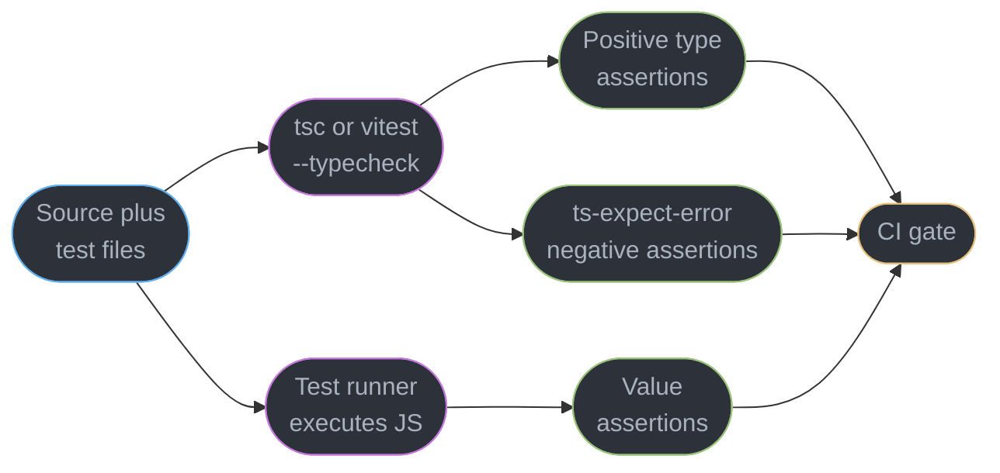
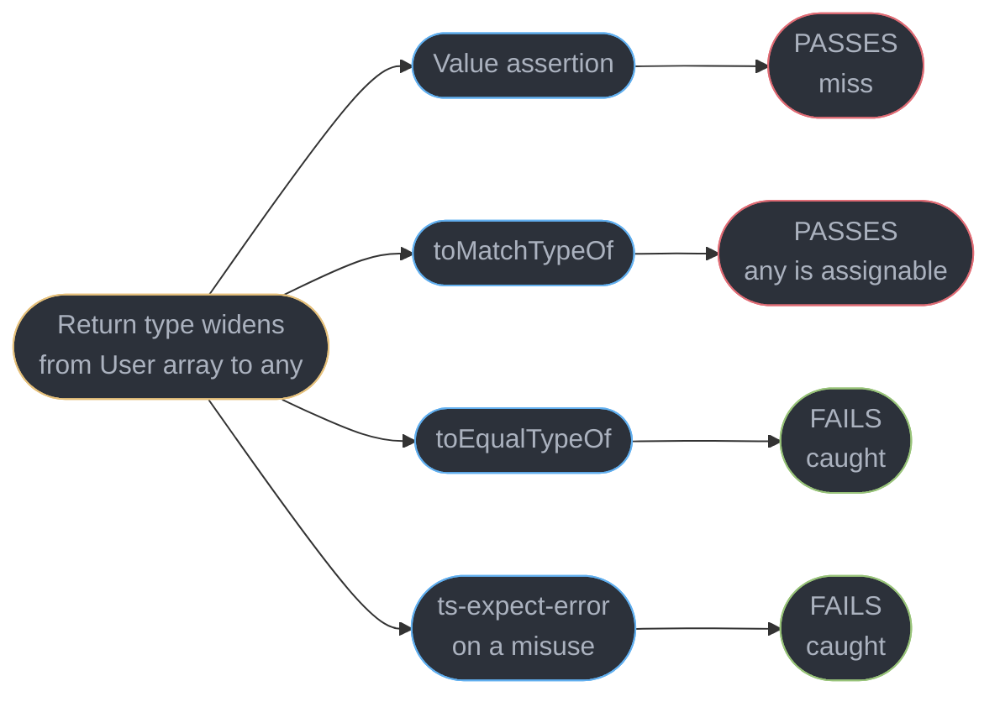
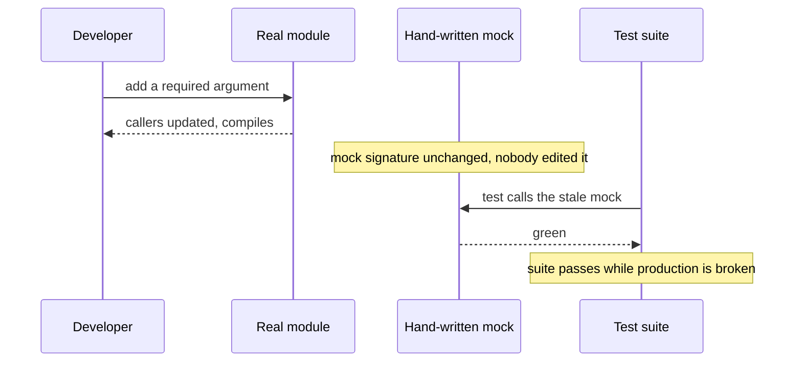
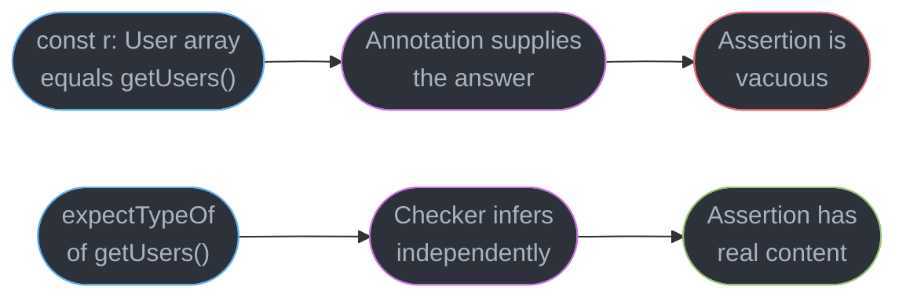
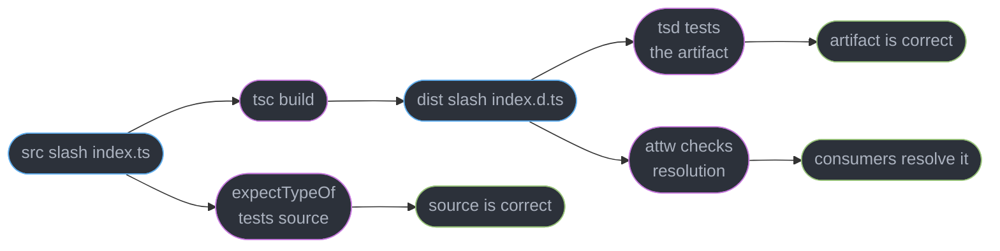

# Testing Typed Code

---

## 1. Concept Overview

A test suite for a TypeScript codebase has two jobs, and most suites only do one. The
familiar job is checking that values are right at runtime: given this input, the function
returns that output. The other job is checking that **types** are right at compile time:
given this input, the function's return type is `User[]` and not `any`, the generic infers
`"admin" | "user"` and not `string`, and the misuse a caller is most likely to attempt is
rejected rather than silently accepted.

The second job matters because the type system is the part of a TypeScript library that
consumers actually program against, and it is the part with no runtime behaviour to catch
regressions. A refactor that widens a return type from `User[]` to `any[]` breaks every
consumer's safety and passes every runtime test in the repository. Nothing fails. The
suite is green, the build ships, and the damage surfaces months later as an unexplained
`undefined` in someone else's code.

This module covers what is specific to testing typed code: type-level assertions with
`expectTypeOf` and `tsd`, `@ts-expect-error` used deliberately as an assertion rather than
as a suppression, typing test doubles so a mock cannot drift from the thing it replaces,
testing that a generic's *inference* behaves, and asserting on emitted `.d.ts` output.

It does **not** teach a test runner. Vitest configuration, watch mode, coverage, browser
mode, mocking network traffic and the CI test pyramid belong to
[`../../react/testing_and_frontend_ci/`](../../react/testing_and_frontend_ci/testing_and_frontend_ci.md),
which owns those for the whole front-end track. Everything here assumes you already have
a runner and asks only: what do you assert that a runner cannot?

Target is TypeScript 7.0 with Vitest 5.0.

---

## 2. Intuition

> A runtime test asks "did this code do the right thing?" A type test asks "will the
> compiler let anyone do the wrong thing?"

**Mental model.** Think of a published type surface as an API with no implementation. A
consumer's editor calls it thousands of times a day through autocomplete and error
squiggles. You have unit tests for your functions; the type surface is a function too —
from source text to accept-or-reject — and it is currently untested.

**Why it matters.** Type regressions are invisible to every tool you already run. A
runtime test cannot see them because both the old and new types erase to identical
JavaScript. A linter cannot see them because the code is legal. Coverage cannot see them
because coverage counts executed lines and a type executes nothing. Only an assertion
written against the type itself will fail.

**Key insight.** The strongest type test is usually a *negative* one. Asserting that
`parseConfig({ prot: 443 })` is an error catches a typo-tolerance bug that no positive
assertion will, because the positive case keeps passing while the type quietly widens.
`@ts-expect-error` is the tool for this, and it is the one place in TypeScript where a
suppression comment is an assertion: if the error stops occurring, the comment itself
becomes the error.

---

## 3. Core Principles

1. **A type assertion must fail when the type changes.** `expectTypeOf(x).toEqualTypeOf<T>()`
   is invariant and will fail if the type widens. `toMatchTypeOf` is assignability-based
   and will not — a widening to `any` passes it. Prefer the strict form and reach for the
   loose one deliberately.
2. **Assert the inference, not the annotation.** Writing `const r: User[] = getUsers()` and
   then asserting on `r` tests nothing; the annotation supplied the answer. Assert on the
   bare call so the checker's own inference is what is measured.
3. **`@ts-expect-error` is an assertion; `@ts-ignore` is a suppression.** The first fails
   the build when the error disappears. The second never fails. There is essentially no
   case for `@ts-ignore` in a codebase that compiles.
4. **A mock must be typed against the real thing.** A hand-written stub object is a second
   implementation that drifts silently. Deriving the mock's type from the real module means
   the mock stops compiling when the real signature changes.
5. **Type tests run under the checker, not the runner.** A type-level assertion has no
   runtime behaviour; it is checked by `tsc` (or Vitest's `--typecheck` mode) and is a
   no-op at execution. A suite that never type-checks its test files is not running them.
6. **Test the public surface, not the internals.** Assert against the emitted `.d.ts` or
   the package entry point, because that is what a consumer resolves. An assertion against
   an internal path can pass while the published types are broken.

---

## 4. Types / Architectures / Strategies

### 4.1 The four kinds of assertion

| Kind | Tool | Fails when | Runs under |
|------|------|-----------|-----------|
| Runtime value | any runner | the returned value is wrong | the runner |
| Positive type | `expectTypeOf`, `assertType` | the inferred type changes | the checker |
| Negative type | `@ts-expect-error` | the misuse stops being an error | the checker |
| Emitted surface | `tsd`, `attw`, `publint` | the shipped `.d.ts` changes or misresolves | a separate CLI |

Most suites have only the first row. The cheapest large win is adding the third: negative
assertions cost one comment line each and catch the widening failures that positive
assertions structurally cannot.

### 4.2 `expectTypeOf` versus `assertType` versus `tsd`

| Tool | Ships with | Strictness | Best for |
|------|-----------|-----------|---------|
| `expectTypeOf` | `expect-type`, bundled in Vitest | invariant with `toEqualTypeOf` | in-repo type tests beside unit tests |
| `assertType` | Vitest | assignability only | a quick check inside an existing test |
| `tsd` | standalone CLI | invariant, runs against the built `.d.ts` | a published library's shipped surface |
| TSTyche | standalone CLI | `.type.toBe` identity, plus `toBeCallableWith` | one suite rerun on several TypeScript versions |

`expectTypeOf` tests the types in your source. `tsd` tests the types in your `dist`. A
library wants both, because `isolatedDeclarations` and `exports` maps can make the two
diverge — see
[`../declaration_files_and_library_authoring/`](../declaration_files_and_library_authoring/declaration_files_and_library_authoring.md).

### 4.3 Where type tests live

Beside the unit tests (`sum.test-d.ts` next to `sum.test.ts`) is the common choice and
keeps them in a developer's eyeline. A separate `type-tests/` directory is better when the
suite is large enough to need its own `tsconfig` with stricter flags than the app.

---

## 5. Architecture Diagrams

### The two checkers, and what each can see



Type assertions erase to nothing, so a runner that never type-checks its test files
executes them as empty statements and reports them green. This is the single most common
way a type suite is silently dead.

### What each assertion catches



A widening to `any` is the regression that matters most and the one two of the four
assertion styles wave through. `toMatchTypeOf` passing here is not a bug in the tool — it
asks about assignability, and everything is assignable to `any`.

### The mock-drift failure



The mock is a second implementation of the same contract. Nothing links the two, so the
compiler has no reason to complain — which is exactly what typing the mock from the real
module fixes.

### Inference is what you are testing



### Source types versus shipped types



Three distinct failures. Source can be right while the artifact is wrong (a bad `exports`
map), and the artifact can be right while consumers still resolve the wrong file.

### Where a type test belongs in CI


Type tests belong in the type-check step, not the test step — they cost nothing extra
once `tsc` is already running over the project.

---

## 6. How It Works — Detailed Mechanics

### 6.1 `expectTypeOf` and the invariance that matters

```ts
import { expectTypeOf, test } from "vitest";

interface User { id: string; name: string }
declare function getUsers(): User[];

test("getUsers returns User[]", () => {
  expectTypeOf(getUsers()).toEqualTypeOf<User[]>();   // invariant: exact match
  expectTypeOf(getUsers()).toMatchTypeOf<object[]>(); // assignable: looser on purpose
  expectTypeOf(getUsers).returns.toEqualTypeOf<User[]>();
  expectTypeOf(getUsers).parameters.toEqualTypeOf<[]>();
});
```

`toEqualTypeOf` is the one that guards a regression. Suppose someone changes the
implementation and the return type silently becomes `any[]`:

```ts
// BROKEN: this assertion still passes after the return type degrades to any[]
expectTypeOf(getUsers()).toMatchTypeOf<User[]>();

// FIX: invariant comparison fails the moment the type is not exactly User[]
expectTypeOf(getUsers()).toEqualTypeOf<User[]>();
```

`any` is assignable to `User[]` and `User[]` is assignable to `any`, so the assignability
check is satisfied in both directions and `toMatchTypeOf` reports success. Only the
invariant comparison distinguishes them.

### 6.2 `@ts-expect-error` as an assertion

```ts
interface Config { protocol: "http" | "https"; port: number }
declare function connect(c: Config): void;

// @ts-expect-error - protocol must be a known literal, not an arbitrary string
connect({ protocol: "ftp", port: 21 });

// @ts-expect-error - excess property 'prot' is a typo and must be rejected
connect({ protocol: "https", port: 443, prot: 1 });

// @ts-expect-error - port is required
connect({ protocol: "https" });
```

Each comment asserts that the line below it fails to compile. If a later refactor widens
`protocol` to `string`, the first line stops erroring and TypeScript reports
`Unused '@ts-expect-error' directive.` — the test fails, which is the whole point.

Always write the reason after the directive. A bare `@ts-expect-error` tells the next
reader nothing about which error was intended, so a *different* error silently satisfies it.

### 6.3 Testing inference, not annotation

```ts
declare function first<T>(xs: readonly T[]): T | undefined;

// BROKEN: the annotation tells the checker the answer, so this asserts nothing
const a: string | undefined = first(["x", "y"]);
expectTypeOf(a).toEqualTypeOf<string | undefined>();

// FIX: assert on the bare call and let inference produce the type under test
expectTypeOf(first(["x", "y"])).toEqualTypeOf<string | undefined>();
expectTypeOf(first([1, 2] as const)).toEqualTypeOf<1 | 2 | undefined>();
```

The broken form would keep passing even if `first` were changed to return `any`, because
the annotation on `a` re-narrows it before the assertion runs. This is the most common way
a type test is vacuous.

### 6.4 Testing a generic's inference behaviour

Inference is the behaviour consumers actually feel, and it has edge cases worth pinning:

```ts
declare function pick<T, K extends keyof T>(obj: T, keys: readonly K[]): Pick<T, K>;

const src = { id: "u1", name: "Ada", age: 36 };

expectTypeOf(pick(src, ["id", "name"])).toEqualTypeOf<{ id: string; name: string }>();

// const type parameters preserve literal tuples without `as const` at the call site
declare function tuple<const T extends readonly unknown[]>(...xs: T): T;
expectTypeOf(tuple("a", 1)).toEqualTypeOf<readonly ["a", 1]>();

// NoInfer keeps the second parameter from widening the inference site
declare function withDefault<T>(items: T[], fallback: NoInfer<T>): T;
// @ts-expect-error - fallback must not widen T to string | number
withDefault([1, 2], "zero");
```

Positive and negative assertions on the same function are complementary: the first pins
what inference produces, the second pins what it refuses.

### 6.5 Typing test doubles so they cannot drift

```ts
// BROKEN: a hand-shaped stub. Nothing ties it to the real module.
const paymentsMock = {
  charge: (amount: number) => Promise.resolve({ ok: true }),
};

// FIX: derive the mock's type from the real module, so a signature change breaks it
import type * as Payments from "./payments";

const paymentsMock: typeof Payments = {
  charge: vi.fn(async (amount: number, idempotencyKey: string) => ({ ok: true })),
  refund: vi.fn(async () => ({ ok: true })),
};
```

When `charge` gains its required `idempotencyKey` parameter, the broken stub keeps
compiling and the suite keeps passing while production is broken. The fixed form fails at
`tsc` time with `Property 'refund' is missing in type ...`, which is the failure you want.

Vitest's `vi.mocked` preserves the original signature when wrapping an imported function:

```ts
import { fetchUser } from "./api";
vi.mock("./api");

const mocked = vi.mocked(fetchUser);
mocked.mockResolvedValue({ id: "u1", name: "Ada" });
// @ts-expect-error - the mock's resolved value must match the real return type
mocked.mockResolvedValue({ id: 1 });
```

### 6.6 Testing the emitted declaration, not the source

```ts
// api.test-d.ts, run by `tsd` against the built package
import { expectType, expectError } from "tsd";
import { createClient } from "..";

const c = createClient({ baseUrl: "https://example.test" });
expectType<Promise<Response>>(c.get("/users"));
expectError(createClient({}));                    // baseUrl is required
expectError(createClient({ baseUrl: 42 }));       // baseUrl must be a string
```

`tsd` resolves the package the way a consumer does, through `exports` and `types`, so it
catches the class of bug where the source is correct but the shipped surface is not — a
`declaration` build that emitted `any` because a type was not exported, or an `exports`
map whose `types` condition points at a stale file.

Pair it with the two resolution linters in CI:

```bash
npx @arethetypeswrong/cli --pack .   # ESM/CJS resolution correctness
npx publint                          # packaging correctness
```

### 6.7 Running the type tests

Type assertions erase, so the runner must be told to type-check:

```ts
// vitest.config.ts
import { defineConfig } from "vitest/config";

export default defineConfig({
  test: {
    typecheck: {
      enabled: true,
      include: ["**/*.test-d.ts"],
      tsconfig: "./tsconfig.test.json",
    },
  },
});
```

Without `typecheck.enabled`, Vitest strips the types and executes `expectTypeOf(...)` as a
call that returns an object and asserts nothing. The suite reports green having tested
nothing at all. Confirm the wiring by breaking one assertion deliberately and watching it
fail — a type suite that has never failed has never been verified to run.

### 6.8 Keeping type tests fast

Type tests are checked by `tsc`, so they cost checker time, and a heavily generic test file
can dominate a build. Two habits keep it bounded:

- Give the type tests their own `tsconfig` with a narrow `include`, so an incremental app
  build does not re-check them.
- Watch for depth: a recursive conditional type asserted twenty ways will hit the
  instantiation ceiling described in
  [`../conditional_and_mapped_types/`](../conditional_and_mapped_types/conditional_and_mapped_types.md).
  Measure with `tsc --extendedDiagnostics` before assuming the app is at fault; see
  [`../the_typescript_compiler_and_type_performance/`](../the_typescript_compiler_and_type_performance/the_typescript_compiler_and_type_performance.md).

### 6.9 Testing one type surface against several compiler versions

A published `.d.ts` is checked by the **consumer's** compiler, not yours. In October 2026
consumers are split across TypeScript 5.x, 6.0 and 7.0, and DefinitelyTyped tests
`@types` packages against every version less than 2 years old. A suite that runs on one
compiler misses two kinds of regression: declarations an older compiler cannot read (a
`const` type parameter `[5.0]`, or a `NoInfer<T>` `[5.4]` that a 5.3 consumer cannot resolve
and, under `skipLibCheck`, silently treats as `any`), and inference that differs between
versions.

**`tsd` checks one version, and not yours.** `tsd` 0.33.0, released 2025-08-05 and still its
latest, depends on `@tsd/typescript` `^5.9.2`: it embeds its own 5.9 compiler and ignores the
`typescript` your project installs. A green `tsd` run says the surface works on 5.9.

**TSTyche runs the suite once per version.** The `target` option in `tstyche.json` takes a
minor (`"5.6"`), a patch (`"5.8.2"`), a dist-tag (`"latest"`), a range (`">=5.6"`) or several
joined with `||`. TSTyche downloads each compiler from the npm registry and reruns every test
file on it. `npx tstyche --list` prints the versions a range expands to.

```json
// tstyche.json
{ "target": ">=5.6", "testFileMatch": ["typetests/*.tst.ts"] }
```

```ts
// typetests/client.tst.ts
import { expect, test } from "tstyche";
import { createClient } from "@acme/sdk";

test("createClient", () => {
  const c = createClient({ baseUrl: "https://example.test" });
  expect(c.get("/users")).type.toBe<Promise<Response>>();
  expect(createClient).type.not.toBeCallableWith({});
});
```

**The TypeScript 7 leg needs a separate step.** TSTyche drives the compiler through its
JavaScript API, and TypeScript 7.0 has no stable programmatic API until 7.1. TSTyche 7.x
(7.2.5, 2026-09-10) therefore tops out at 6.0: its 7.2.2 release made it load TypeScript 6
when 7 is installed. TS 7 support landed in TSTyche 8.0.0-beta.0 on 2026-10-11 as a breaking
change. Until 8.0 is stable, cover 7.0 by running `tsc` 7 over a fixture consumer file that
holds `expectTypeOf` and `@ts-expect-error` assertions, which are plain types any compiler checks.

| Version leg | Tool | Checks |
|-------------|------|--------|
| 5.6 to 6.0 | TSTyche 7.2.5, `"target": ">=5.6"` | the full `.tst.ts` suite per minor |
| 7.0 | `tsc -p tsconfig.typetest.json` with `typescript@7` | `expectTypeOf` and `@ts-expect-error` fixtures |
| 5.9 only | `tsd` 0.33.0 | its `expectType` / `expectError` assertions |

Which versions belong in `target` is a support-policy decision, covered in
[`../declaration_files_and_library_authoring/`](../declaration_files_and_library_authoring/declaration_files_and_library_authoring.md).

---

## 7. Real-World Examples

**A published SDK's negative suite.** A client library exposes
`createClient({ baseUrl, timeoutMs })`. Its `test-d` file contains four positive
assertions and eleven `@ts-expect-error` lines — missing `baseUrl`, wrong types for each
option, an unknown option, a method called with the wrong argument count. The negative
block is what catches an accidental `[key: string]: unknown` index signature added to the
options type, which would otherwise make every typo legal for every consumer.

**A monorepo's shared-schema package.** A `@acme/schemas` package exports Zod schemas plus
their inferred types. Its type tests assert that `z.infer<typeof UserSchema>` equals the
hand-written `User` interface, so the two cannot drift. This is the one case where
asserting a type against an annotation is correct: the annotation is a second, independent
statement of the contract, not a restatement of the inference.

**A React component library.** Prop types are asserted with `expectTypeOf` on the component
itself, plus `@ts-expect-error` on the illegal prop combinations that a discriminated union
is supposed to forbid. See
[`../../react/typing_react_components/`](../../react/typing_react_components/typing_react_components.md)
for how those unions are built.

---

## 8. Tradeoffs

| Choice | Gains | Costs | Use when |
|--------|-------|-------|---------|
| `toEqualTypeOf` | catches widening, including to `any` | brittle against deliberate refactors | the type is a published contract |
| `toMatchTypeOf` | survives harmless changes | misses widening entirely | you genuinely mean "assignable to" |
| `@ts-expect-error` | catches misuse becoming legal | needs a comment per case | guarding a union or a required field |
| `tsd` against `dist` | tests what consumers resolve | needs a build first, slower | publishing a package |
| `expectTypeOf` in source | fast, runs with the unit tests | cannot see packaging bugs | application code |
| Typed mocks from `typeof import` | drift breaks the build | verbose for wide modules | the mocked module is volatile |

| Suite shape | Type-check time | Regression coverage |
|-------------|----------------|--------------------|
| Runtime tests only | baseline | misses every type regression |
| Plus positive type tests | +5-15% | catches changed types |
| Plus negative assertions | +5-15% | also catches widened types |
| Plus `tsd` and `attw` in CI | +20-40s per publish | also catches packaging failures |

---

## 9. When to Use / When NOT to Use

### Write type tests when

- The code is a **published package** — the type surface is the API.
- A **generic's inference** is a feature, not an accident (`pick`, `tuple`, a query builder).
- A **discriminated union** exists specifically to make bad combinations unrepresentable;
  without a negative assertion, nothing proves it still does.
- A type is **derived** rather than written (`z.infer`, `ReturnType`, a mapped type), so a
  change upstream can silently reshape it.
- You are **migrating from JavaScript** and want a ratchet that stops types regressing to `any`.

### Do NOT write type tests when

- The type is a plain annotation on a plain function — `add(a: number, b: number): number`
  has no inference to test.
- The assertion restates the annotation on the same line (see §6.3); that is a tautology.
- You are testing the *compiler* rather than your code. `expectTypeOf<string>().toEqualTypeOf<string>()`
  is not your suite's job.
- The cost lands on every incremental build and the value is low — put them in a separate
  `tsconfig` first, then decide.

---

## 10. Common Pitfalls

### Pitfall 1: the type suite never runs

```ts
// vitest.config.ts -- BROKEN: no typecheck block
export default defineConfig({ test: { include: ["**/*.test.ts"] } });
```

`*.test-d.ts` files are not in `include`, and `typecheck` is off. The suite reports green
with zero type assertions executed.

```ts
// FIX
export default defineConfig({
  test: { typecheck: { enabled: true, include: ["**/*.test-d.ts"] } },
});
```

Verify by breaking an assertion on purpose. A type suite that has never gone red has never
been proven to run at all.

### Pitfall 2: `@ts-ignore` where `@ts-expect-error` was meant

`@ts-ignore` silences whatever error occurs and never complains when the error stops
occurring. It cannot fail, so it cannot test. Every `@ts-ignore` in a compiling codebase
should be `@ts-expect-error` with a reason, and `"@typescript-eslint/ban-ts-comment"`
enforces it.

### Pitfall 3: a negative assertion satisfied by the wrong error

```ts
// BROKEN: this passes because of a typo in the function name, not the intended violation
// @ts-expect-error
conect({ protocol: "ftp", port: 21 });
```

The directive is satisfied by `Cannot find name 'conect'`, so the union is never actually
tested. Always state the intended error in the comment, and if a directive is load-bearing
consider asserting the message with `tsd`'s `expectError` plus a targeted positive test
next to it.

### Pitfall 4: asserting on a variable the annotation already narrowed

Covered in §6.3 and worth repeating because it is the most common vacuous test. If the
assertion's expected type also appears as an annotation on the value being asserted, the
test cannot fail.

### Pitfall 5: testing source when consumers read `dist`

A package whose `exports` map points `types` at a stale `.d.ts` will pass every
`expectTypeOf` test in the repository and still ship broken types. Only `tsd` against the
built artifact, plus `attw`, sees it. See
[`../modules_resolution_and_package_exports/`](../modules_resolution_and_package_exports/modules_resolution_and_package_exports.md).

### Pitfall 6: `expectTypeOf` on a value that is already `any`

`expectTypeOf(x).toEqualTypeOf<Whatever>()` where `x` is `any` passes for every
`Whatever`. When testing a boundary that might have degraded, assert the negative too:
`expectTypeOf(x).not.toBeAny()`.

---

## 11. Technologies & Tools

| Tool | What it is for | How you invoke it |
|------|---------------|-------------------|
| Vitest | Test runner with built-in type-testing mode | `vitest --typecheck` |
| expect-type | `expectTypeOf` assertions, bundled with Vitest | `import { expectTypeOf } from "vitest"` |
| tsd | Type assertions against a built `.d.ts` | `npx tsd` |
| TSTyche | Type test runner with a TypeScript version matrix | `npx tstyche --target '>=5.6'` |
| arethetypeswrong | Detects ESM/CJS type-resolution failures | `npx @arethetypeswrong/cli --pack .` |
| publint | Detects packaging and `exports` mistakes | `npx publint` |
| TypeScript | The checker that actually runs type tests | `tsc --noEmit -p tsconfig.test.json` |
| typescript-eslint | Enforces `@ts-expect-error` over `@ts-ignore` | `ban-ts-comment` rule |
| Zod | Schemas whose inferred types are worth pinning | `z.infer<typeof S>` |

Versions verified 2026-10-19: Vitest 5.0.5, TypeScript 7.0, typescript-eslint 8.71.2
(which still runs on `tsc6` because TypeScript 7.0 has no stable Compiler API until 7.1),
Zod 4.6.7, tsd 0.33.0 (embeds TypeScript 5.9), TSTyche 7.2.5 (runs TypeScript 5.4 to 6.0).
Related reading:
[`../declaration_files_and_library_authoring/`](../declaration_files_and_library_authoring/declaration_files_and_library_authoring.md)
and
[`../../react/testing_and_frontend_ci/`](../../react/testing_and_frontend_ci/testing_and_frontend_ci.md).

---

## 12. Interview Questions with Answers

**Q: Why can a test suite be fully green while a type regression ships?**
**Short:** Types erase before execution, so a widened return type produces byte-identical JavaScript and every runtime assertion keeps passing.

Both the correct `User[]` and the degraded `any[]` compile to the same emitted code, so no
executed assertion can distinguish them. Coverage cannot help either, because a type
executes no lines. The regression is only visible to a check that runs under the checker —
an `expectTypeOf` comparison or a `@ts-expect-error` on a misuse that has become legal.

**Q: What is the difference between `toEqualTypeOf` and `toMatchTypeOf`?**
**Short:** Invariance versus assignability -- toEqualTypeOf demands an exact match, while toMatchTypeOf only asks that one type be assignable to the other.

The distinction decides whether widening is caught. `any` is assignable to `User[]`, so
`toMatchTypeOf<User[]>()` passes even after the return type has degraded to `any`, which is
precisely the regression worth guarding. Use `toEqualTypeOf` for anything that is a
published contract and reach for the loose form only when "assignable to" is genuinely
what you mean.

**Q: How does `@ts-expect-error` differ from `@ts-ignore`?**
**Short:** One fails the build when the error disappears and the other never fails at all, which makes only the first of them an actual test.

`@ts-expect-error` asserts that the following line does not compile; when the line starts
compiling, TypeScript reports `Unused '@ts-expect-error' directive.` and the build breaks.
`@ts-ignore` silences whatever happens and stays silent forever. In a codebase that
compiles there is essentially no case for `@ts-ignore`, and
`@typescript-eslint/ban-ts-comment` can enforce that.

**Q: Why is asserting on an annotated variable usually a vacuous test?**
**Short:** Writing the expected type as an annotation supplies the answer to the checker, so the assertion compares that annotation against itself.

`const a: string | undefined = first(["x"])` re-narrows the value before the assertion sees
it, so the test would still pass if `first` returned `any`. Assert on the bare call —
`expectTypeOf(first(["x"])).toEqualTypeOf<string | undefined>()` — so the checker's own
inference is the thing under test. The one legitimate exception is pinning a derived type
against an independently written interface, where the annotation is a second statement of
the contract rather than a restatement.

**Q: A mock keeps a suite green while production breaks. What went wrong?**
**Short:** A hand-shaped stub is a second implementation with no link to the real module, so a changed signature updates callers and leaves the stub untouched.

Nothing tells the compiler the stub is supposed to match anything. Typing it as
`typeof import("./payments")` — or wrapping the real import with `vi.mocked` — makes the
mock fail to compile the moment the real signature changes, converting a silent runtime
failure into a build error. The verbosity is the price of the link.

**Q: What does testing the built `.d.ts` catch that testing source does not?**
**Short:** Packaging failures -- a stale exports condition or an unexported type can leave shipped declarations broken while every in-repo assertion passes.

`expectTypeOf` runs against your source, which is correct by construction if the source is
correct. Consumers resolve the package through `exports` and `types`, so a build that
emitted `any` for an unexported type, or a `types` condition pointing at a stale file,
never touches an in-repo test. `tsd` resolves the way a consumer does, and
`@arethetypeswrong/cli` catches the ESM/CJS resolution half.

**Q: `tsd` passes on every commit, yet a consumer on TypeScript 6.0 hits errors inside your shipped `.d.ts`. How?**
**Short:** tsd 0.33.0 checks with its own embedded TypeScript 5.9 compiler, so a green run says nothing about how the declarations behave on 6.0 or 7.0.

`tsd` depends on `@tsd/typescript` `^5.9.2` and ignores the `typescript` your project
installs, and 0.33.0 (2025-08-05) is still its latest release. The consumer's compiler is
the one that reads your `.d.ts`, so a regression in how 6.0 infers or resolves a type never
appears in the 5.9 run. Run the type suite once per supported version with TSTyche's `target`
option, and add a `tsc` 7 fixture check for the 7.0 leg.

**Q: How do you keep a type suite from slowing the build?**
**Short:** Give the type tests their own tsconfig with a narrow include, so an incremental application build never re-checks them.

Type assertions are work for `tsc`, and a file full of recursive conditional types asserted
twenty ways can dominate a check. Isolating them means the app's watch loop stays fast
while CI still runs them. Measure before blaming the app: `tsc --extendedDiagnostics`
reports instantiation counts and check time per file.

**Q: How do you run one type suite against several TypeScript versions, and where does TypeScript 7 fit?**
**Short:** TSTyche's target option, such as ">=5.6", downloads each compiler and reruns the suite per version; TSTyche 7.x stops at 6.0, so check 7.0 with tsc 7 directly.

`target` accepts minors, patches, dist-tags and ranges joined with `||`, and
`npx tstyche --list` shows what a range expands to. TSTyche drives the compiler through its
JavaScript API, which TypeScript 7.0 does not offer as a stable API until 7.1, so TSTyche
7.2.5 loads TypeScript 6 when 7 is installed. TS 7 support is in TSTyche 8.0.0-beta.0
(2026-10-11). Until that is stable, run `tsc` 7 over a fixture file of `expectTypeOf` and
`@ts-expect-error` assertions, which need no API. Take the version list from the package's
published support window, not from what CI happens to install.

**Q: What does `expectTypeOf(x).not.toBeAny()` guard against?**
**Short:** An assertion silently satisfied by any, since a value typed any matches every expected type you could compare it against.

If a boundary has degraded to `any` — an untyped import, a `JSON.parse`, a cast — then
`toEqualTypeOf<Whatever>()` passes for every `Whatever` and the test provides no
information. Adding the negative assertion pins the failure at the point where the type
was lost rather than somewhere downstream.

**Q: Why write negative assertions when positive ones already pass?**
**Short:** A positive assertion keeps passing as a type widens, so only a case asserted to be rejected can prove the constraint still exists.

If `protocol` widens from `"http" | "https"` to `string`, every valid call still
type-checks and every positive assertion is still satisfied. The only thing that changes is
that an invalid call has become legal — which is exactly what a `@ts-expect-error` line
detects. Negative assertions cost one comment each and cover the failure mode that positive
ones structurally cannot.

**Q: How would you pin a generic function's inference behaviour?**
**Short:** Assert on calls that exercise each inference site, including the literal-preserving and widening cases, rather than on a single happy-path call.

For `pick<T, K extends keyof T>`, assert the returned shape for a two-key call, assert that
`const` type parameters keep a literal tuple without `as const` at the call site, and add a
`@ts-expect-error` for the argument that should not be accepted. Inference is what
consumers experience through autocomplete, so it deserves the same treatment as behaviour.

**Q: What happens to a type assertion at runtime?**
**Short:** Nothing -- it erases with every other type construct, which is why the runner has to be configured to type-check the file.

`expectTypeOf(x).toEqualTypeOf<T>()` has a runtime implementation that returns an object
and asserts nothing; all the meaning is in the type arguments, which are gone before
execution. Vitest's `typecheck.enabled` runs `tsc` over the matched files so the assertions
are actually evaluated. Without it the suite reports green having checked nothing.

**Q: When is it correct to assert a type against a hand-written interface?**
**Short:** When the interface is an independent statement of the same contract, such as pinning a schema's inferred type against a separately authored shape.

Asserting `z.infer<typeof UserSchema>` equals a hand-written `User` is valuable precisely
because the two were written separately: a change to either breaks the test. This is the
opposite of the vacuous case in §6.3, where the annotation and the expectation are the same
statement written twice.

**Q: How do you verify a type suite is actually running?**
**Short:** Break one assertion deliberately and confirm the build goes red, because a suite that has never failed has never been proven to execute.

The most common failure is silent: a config that does not match the type-test filename
pattern, or `typecheck` left disabled. Both report green. Introducing a deliberate
mismatch — expecting `string` where the type is `number` — takes seconds and is the only
evidence that the wiring works.

**Q: Where do type tests belong in a CI pipeline?**
**Short:** In the type-check step rather than the test step, since tsc is already traversing the project and the marginal cost is small.

Running them alongside `tsc --noEmit` means one traversal instead of two and gives the
failure at the earliest stage that can produce it. The packaging checks — `tsd` against
`dist`, `attw`, `publint` — belong after the build, because they need the artifact that
consumers will resolve.

**Q: What is the risk of over-asserting types?**
**Short:** Brittleness -- an invariant assertion on every internal helper turns a harmless refactor into a wall of failures that teaches the team to delete tests.

The value of a type test scales with how public the type is. A published option object
deserves invariant assertions and negative cases; an internal helper's return type usually
does not. Concentrate the strict assertions on the surface consumers program against and
let internals move.

**Q: How do you type a mock whose module has many exports?**
**Short:** Type the whole double as typeof import of the real module, which forces every export to be provided and to keep its exact signature.

`const mock: typeof import("./payments") = { ... }` fails with
`Property 'refund' is missing in type ...` when an export is added, which is the drift you
want surfaced. When only part of the module matters, `Partial<typeof import("./payments")>`
combined with `vi.mocked` for the pieces under test keeps the link without demanding every
member.

---

## 13. Best Practices

1. **Turn the type suite red once, on purpose.** Until you have watched it fail, you have
   evidence it compiles, not evidence it runs.
2. **Default to `toEqualTypeOf`.** Reach for `toMatchTypeOf` only when assignability is
   genuinely the property you mean, and say so in a comment.
3. **Always give `@ts-expect-error` a reason.** A bare directive can be satisfied by an
   unrelated error, which silently voids the test.
4. **Never assert on a variable you annotated with the expected type.** Assert on the call.
5. **Derive mocks from the real module.** `typeof import("./x")` or `vi.mocked` — never a
   hand-shaped literal for a module that changes.
6. **Test the artifact for anything you publish.** `tsd` plus `@arethetypeswrong/cli` plus
   `publint` in CI, after the build.
7. **Give type tests their own `tsconfig`.** Keeps the incremental app build fast and makes
   their cost measurable in isolation.
8. **Weight assertions by audience.** Strict and negative on the published surface; light
   or absent on internals.
9. **Ban `@ts-ignore`.** `@typescript-eslint/ban-ts-comment` with
   `ts-expect-error: allow-with-description`.
10. **Add a negative assertion whenever you add a union.** The union exists to forbid
    something; nothing else proves it still does.
11. **Run the published surface's type tests on every supported compiler version,** not only
    the one in your lockfile.

---

## 14. Case Study

### The SDK whose types degraded for four months

**The system.** An internal HTTP client, `@acme/api-client`, consumed by 31 services. Its
entry point exports `createClient(options)` returning a typed client whose methods are
generated from a shared OpenAPI schema. 240 runtime tests, 96% line coverage, green on
every commit for four months.

**The symptom.** A consumer team reported that `client.getUser("u1").name` compiled fine
and threw `Cannot read properties of undefined (reading 'name')` in production. Their
editor showed no error and offered no autocomplete on the result — the first clue.

**The cause.** A refactor eleven weeks earlier had extracted a helper and, in doing so,
dropped an export:

```ts
// BROKEN: ResponseOf is used in the public signature but no longer exported
type ResponseOf<P extends Path> = Schema[P]["response"];

export function createClient(o: Options) {
  return {
    getUser: (id: string) => request<ResponseOf<"/users/{id}">>(id),
  };
}
```

With `declaration: true`, the emitter cannot name a type it cannot reference from the
declaration file, so it widened the method's return to `any`. Every one of the 240 runtime
tests still passed — they asserted on values, and the values were correct. Every consumer
lost type safety on that method and gained no error anywhere.

```ts
// FIX: export the type so the emitted declaration can name it
export type ResponseOf<P extends Path> = Schema[P]["response"];
```

`isolatedDeclarations` would have rejected the original at build time; the project did not
have it on.

**What was added.** Three checks, in the order they would have caught it:

```ts
// api.test-d.ts -- would have failed the day of the refactor
import { expectTypeOf } from "vitest";
import { createClient } from "../src";

const c = createClient({ baseUrl: "https://x.test" });

expectTypeOf(c.getUser("u1")).resolves.toEqualTypeOf<{ id: string; name: string }>();
expectTypeOf(c.getUser("u1")).resolves.not.toBeAny();

// @ts-expect-error - id is required
c.getUser();
```

Plus `tsd` against `dist` in the publish job, and `attw` to confirm resolution. The
`not.toBeAny()` line is the one that maps directly to this failure.

**Result.**

| Check | Before | After |
|-------|--------|-------|
| Runtime tests | 240, green | 240, green |
| Type assertions | 0 | 47 positive, 19 negative |
| Methods typed `any` in `dist` | 6 | 0 |
| Time for a type regression to surface | 11 weeks | one CI run |
| Added type-check time | — | 3.1s |

Auditing the rest of the surface after the type tests went in found **five more methods**
already returning `any` from the same class of missing export, none of which any runtime
test or reviewer had noticed.

**What the team took away.**

1. Line coverage says nothing about type coverage. 96% covered, six methods untyped.
2. The failure was invisible in review — the diff that broke it removed one `export`
   keyword from a type alias.
3. `not.toBeAny()` deserves to be routine on any boundary that crosses a build step.
4. `isolatedDeclarations` would have caught this at compile time and is cheaper than the
   test that caught it; both are now on.
5. The negative assertions found nothing on day one and caught two regressions in the
   following quarter, which is the expected shape of their value.
