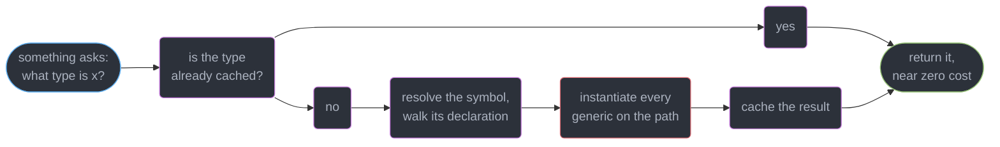
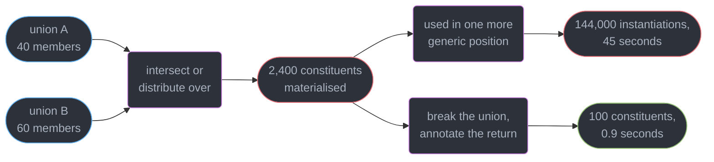
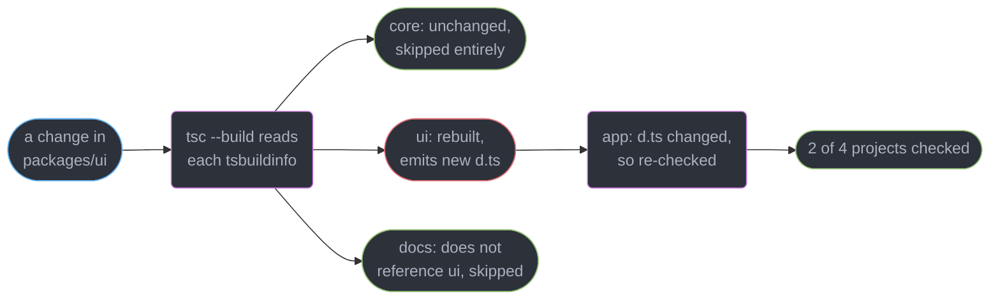
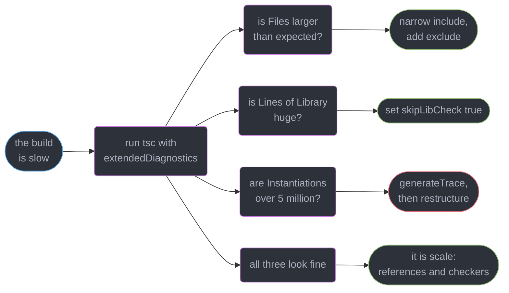

# The TypeScript Compiler and Type Performance

---

## 1. Concept Overview

The compiler pipeline is in this curriculum **because of build speed**. Nobody needs to know
that a binder exists in order to write a discriminated union. They need it the morning CI
goes from 90 seconds to 6 minutes after one pull request, and the only way to say *which*
stage got slower — and therefore which lever to pull — is to know what the five stages are
and which of them is doing the work.

`tsc` runs five stages over your program:

| Stage | Owns | Cost scales with |
|-------|------|------------------|
| Scanner | source text to tokens | bytes of source |
| Parser | tokens to an AST per file | bytes of source |
| Binder | symbols, scopes, flow nodes | declarations per file |
| Checker | types, assignability, inference | **what you ask it, not what you wrote** |
| Emitter | JavaScript and `.d.ts` | files emitted |

The first three are near-linear in how much code you have. The checker is not linear in
anything you can see, because it is **lazy** — it computes a type when something demands it,
and one badly shaped generic can demand a million. That asymmetry is the whole subject.

The target is **TypeScript 7.0**, GA **2026-07-08**, where the compiler became a native Go
binary (internally "Project Corsa"). Recursion depth and conditional-type mechanics live in
[Conditional and Mapped Types](../conditional_and_mapped_types/conditional_and_mapped_types.md);
inference sites and constraints in
[Generics and Type Parameters](../generics_and_type_parameters/generics_and_type_parameters.md);
monorepo structure in
[TypeScript in Large Codebases](../typescript_in_large_codebases/typescript_in_large_codebases.md).
This module owns the machine and its clock.

---

## 2. Intuition

> The parser reads everything you wrote. The checker answers only the questions you asked —
> and a single type can turn one question into 200,000.

**Mental model.** Parsing is a librarian shelving books: bounded, predictable, one pass.
Checking is answering reference questions from those books, and each answer may require
opening forty more. A build gets slow when someone asks a question whose answer requires
opening every book in the building, twice.

**Why it matters.** The two build-speed levers people reach for first — a faster machine and
a faster transpiler — do not touch the checker at all. esbuild strips types in 200 ms and
checks nothing; see
[Modules, Bundling and the Build Pipeline](../../frontend_platform/modules_bundling_and_the_build_pipeline/modules_bundling_and_the_build_pipeline.md).
The check is the part that costs, and it is the part you cannot delete.

**Key insight.** Every slow-build story in TypeScript reduces to one of two shapes: *too many
files entered the program*, or *one type asked for too much work*. The first is a `tsconfig`
problem you fix in a line. The second is a type-design problem you find with a trace.

---

## 3. Core Principles

1. **The checker is lazy and demand-driven.** A type is computed the first time something
   asks for it, then cached. An unreferenced type in an unqueried file costs nothing.
2. **Parse, bind and emit are cheap; check dominates.** In a healthy 1,284-file app, check
   time is 70-85% of the total. If it is not, you have a file-count problem, not a type problem.
3. **Type instantiation is the unit of work.** Each substitution of a generic with concrete
   arguments creates a type object. `Instantiations` in `--extendedDiagnostics` is the closest
   available proxy for "how hard did the checker work".
4. **Unions multiply.** N members intersected or distributed against M produces N x M
   constituents, and the checker materialises all of them before it can answer anything.
5. **Measure the stage, not the wall clock.** "The build is slow" is not actionable.
   `Check time: 14.87s` against `Parse time: 1.42s` is.
6. **The editor and CI are different workloads** over the same program. One is latency on a
   live in-memory program; the other is throughput on a cold one.
7. **TypeScript 7.0 changed the implementation, not the language.** Same syntax, same
   semantics, same `tsconfig`, same diagnostics. A slow type is still slow, 8-12x less so.
8. **Incrementality beats speed.** Re-checking nothing is faster than re-checking quickly.

---

## 4. Types / Architectures / Strategies

### 4.1 Where a build's seconds actually go

Causes, in the order they usually bite:

| Cause | Typical symptom | First move |
|-------|-----------------|------------|
| A wide `include` glob | `Files: 4,182` when the app has 900 | narrow `include`, add `exclude` |
| `skipLibCheck: false` | `Lines of Library` in the millions | set `skipLibCheck: true` |
| Deep generic or recursive types | `Instantiations` over 5,000,000 | `--generateTrace`, then restructure |
| Union and intersection blowup | one file's check time in the seconds | break the union, annotate explicitly |
| Heavy dependency `.d.ts` | slow *cold* build, fast rebuild | narrow imports, check `types` array |

### 4.2 The levers, and what each one buys

| Lever | Buys | Costs |
|-------|------|-------|
| `skipLibCheck: true` | 10-40% off a cold build | a broken dependency declaration goes unseen |
| `incremental: true` | 60-90% off a warm rebuild | a `.tsbuildinfo` to cache and invalidate |
| `composite` + `tsc --build` | only changed projects re-check | `declaration: true` everywhere, real boundaries |
| `--checkers N` `[7.0]` | up to 16.7x on vscode with 8 | memory per checker thread |
| Narrower `include` | linear in files removed | nothing, if the glob was wrong |
| Restructured types | unbounded — 45s to 0.9s is real | design work, and a trace to find it |

### 4.3 Two workloads, one program

| | Batch (`tsc --noEmit`, CI) | Interactive (`tsserver`, editor) |
|---|---|---|
| Program lifetime | one cold run, then exit | live for hours, mutated per keystroke |
| What is measured | total wall clock | p95 latency of one request |
| Dominant cost | full check of every file | re-check of the open file plus its dependents |
| Memory | peak, then freed | steady-state, and it grows |
| Helped by `--checkers` | yes | no — the editor uses its own scheduling |

---

## 5. Architecture Diagrams

### The five stages, and where the work is


Scanner, parser and binder each touch every file exactly once. The checker is the only stage
whose cost is not a function of how much code you have.

### Lazy checking: what actually gets computed



Nothing is computed ahead of time. `tsc --noEmit` is slow only because reporting every
diagnostic in every file means asking about every expression in the program.

### The TypeScript 7.0 port, measured

```mermaid
xychart-beta
    title "Full check, seconds: TypeScript 6 vs the 7.0 Go compiler"
    x-axis ["vscode", "sentry", "bluesky", "playwright"]
    y-axis "seconds" 0 --> 145
    bar [125.7, 139.8, 24.3, 12.8]
    bar [10.6, 15.7, 2.8, 1.47]
```



Microsoft's published figures at GA: 8-12x faster full builds, memory down 6-26%. The tall
bar is `tsc6`, the short one `tsc` 7.0 on the same repository and the same `tsconfig`.

### Union blowup: why one type multiplies



The checker cannot answer "is this assignable" without materialising both sides, so the
product exists in memory before any error is reported.

### Project references: what `tsc --build` skips



Without references, all four projects are one program and every change re-checks all of it.
Structure and enforcement live in
[TypeScript in Large Codebases](../typescript_in_large_codebases/typescript_in_large_codebases.md).

---

## 6. How It Works — Detailed Mechanics

### 6.1 What each stage owns

The **scanner** turns bytes into tokens and knows nothing about meaning. The **parser** builds
one AST per file and is where syntax errors come from; it is also where `.d.ts` files enter,
which is why a 4 MB dependency declaration costs parse time even under `skipLibCheck`.

The **binder** walks each AST once and builds two things: a symbol table mapping names to
declarations per scope, and the **flow graph** that control-flow narrowing later reads. It
computes no types at all. This is why binding a 200,000-line program takes 0.61 seconds while
checking it takes 14.87.

The **checker** is everything else: type resolution, assignability, inference, overload
resolution, narrowing. The **emitter** runs last and is nearly free — under `noEmit` it is
skipped, which saves disk writes, not seconds of checking.

### 6.2 The checker is lazy, and that is the whole story

```ts
// Nothing here costs anything until something asks.
type Deep<T> = T extends readonly [infer H, ...infer R] ? [H, ...Deep<R>] : T;

type Unused = Deep<[1, 2, 3, 4, 5, 6, 7, 8]>;   // declared, never referenced
```

Declaring `Unused` in a file nothing imports costs one symbol and zero type instantiations.
Hover it in the editor and the checker resolves it right then. That is why a type can be
free in CI and cost 400 ms per keystroke in the file that displays it.

The corollary is uncomfortable: **`tsc --noEmit` is the pathological case**, because reporting
diagnostics means asking about every expression in every file. A build that "does nothing but
type-check" is doing the maximum amount of checking possible.

### 6.3 The Go port — what changed and what did not

TypeScript 7.0 (GA 2026-07-08) replaced the JavaScript compiler with a **native Go binary**.
Unchanged: the language, the type system's semantics, the diagnostics, `tsconfig.json`, and
every flag that survived 6.0. A program that checked clean under `tsc6` checks clean under
`tsc` 7.0, with the same errors in the same places.

Changed: the clock, and the memory ceiling.

| Repository | `tsc6` | `tsc` 7.0 | Factor |
|-----------|--------|-----------|--------|
| vscode | 125.7s | 10.6s | 11.9x |
| sentry | 139.8s | 15.7s | 8.9x |
| bluesky | 24.3s | 2.8s | 8.7x |
| playwright | 12.8s | 1.47s | 8.7x |

Editor single-file diagnostics went from 17.5s to under 1.3s on the largest of these. Memory
is down 6-26% depending on the shape of the program.

**Why Go and not Rust.** The port is a direct translation of an existing 400,000-line
graph-heavy codebase whose types point at each other freely and are never freed until the
program ends. Go's shared-memory model and garbage collector accept that structure as-is;
Rust's ownership model would have required redesigning the type graph before a single line
could be ported, turning a translation into a rewrite. Speed was the goal, and a translation
that preserves behaviour is the only kind of port that can be verified against 60,000
existing conformance tests.

### 6.4 Parallelism: `--checkers`, `--builders`, `--singleThreaded`

```bash
tsc --noEmit --checkers 8        # 8 parallel checker threads over the file set
tsc --build --builders 4         # 4 projects built concurrently in a composite graph
tsc --noEmit --singleThreaded    # force one thread: for profiling and for CI determinism
```

`--checkers` splits the file set across threads, each with its own checker instance. On
vscode with 8 checkers the reported speedup reaches **16.7x** over the single-threaded 7.0
baseline. The cost is memory: each checker holds its own type cache, so 8 checkers is roughly
8 partial caches rather than one shared one. On a 2-core CI runner, `--checkers 8` is slower
than the default.

`--singleThreaded` is the one to reach for when a build is *nondeterministically* slow —
it removes scheduling as a variable before you go looking at types.

### 6.5 The API gap: why `tsc6` is still installed

**TypeScript 7.0 has no stable programmatic Compiler API until 7.1.** This is the single most
consequential practical fact for a team adopting 7.0 today. Anything that *embeds* the
compiler rather than shelling out to it cannot run on 7.0 yet:

```json
{
  "devDependencies": {
    "typescript": "7.0.3",
    "typescript6": "npm:@typescript/typescript6@6.0.4",
    "typescript-eslint": "8.69.0"
  }
}
```

typescript-eslint (8.69.0), ts-jest, ts-morph, and the framework template checkers for Vue,
Svelte, Astro and Angular all consume the Compiler API, and so all run against the aliased
`@typescript/typescript6` package whose binary is `tsc6`. The practical consequence: your
**type-check** is 10x faster and your **type-aware lint** is not, so lint becomes the longest
job in CI the week you upgrade. Budget for it. Lint cost and how to bound it belong to
[Linting, Formatting and Code Quality](../../frontend_platform/linting_formatting_and_code_quality/linting_formatting_and_code_quality.md).

### 6.6 Measuring: `--extendedDiagnostics`

```bash
tsc --noEmit --extendedDiagnostics
```

```
Files:                          1284
Lines of Library:              41229
Lines of TypeScript:          198431
Identifiers:                  412903
Symbols:                      388217
Types:                        142880
Instantiations:              1904220
Memory used:                 891234K
I/O Read time:                 0.31s
Parse time:                    1.42s
ResolveModule time:            0.38s
Bind time:                     0.61s
Check time:                   14.87s
Total time:                   17.59s
```

Read it in this order. **`Files`** — is it the number you expected? 1,284 for a 900-file app
means the glob is wrong. **`Lines of Library`** — 41,229 is normal; millions means
`skipLibCheck` is off or a dependency ships an enormous `.d.ts`. **`Check time` as a fraction
of `Total`** — 85% here, which is healthy in the sense that the time is where it should be.
**`Instantiations`** — 1.9M for 198K lines is roughly 10 per line and fine; 50M is a type
problem you can find. **`Memory used`** — near 4 GB means an OOM is coming on a smaller runner.

### 6.7 `--generateTrace` when the numbers say "types"

```bash
tsc --noEmit --generateTrace ./trace
# writes trace/trace.json (timed events) and trace/types.json (the type graph)
```

Open `trace.json` at `ui.perfetto.dev` and you get a flame chart of `checkSourceFile` spans,
one per file, plus `structuredTypeRelatedTo` and `checkExpression` events underneath. The
workflow is mechanical: sort by duration, open the widest span, read the `typeId` on the
hottest event, look that id up in `types.json` to see the actual type. Three minutes from
"the build is slow" to "this mapped type over a 60-member union costs 41 seconds".

Two spans deserve suspicion by name: a long `structuredTypeRelatedTo` means assignability
between two large structural types, and a long `getVariancesWorker` means a generic class
whose variance the checker is measuring the expensive way.

### 6.8 `skipLibCheck` — what it really skips

```json
{ "compilerOptions": { "skipLibCheck": true } }
```

It skips **type-checking of `.d.ts` files** — every declaration file in `node_modules`, every
`@types/*` package, and your own emitted declarations. It does **not** skip parsing them, and
it does **not** stop them being used: every type you import from a dependency is still
resolved, still used for inference, still enforced at your call sites.

What you lose is real. If `@types/legacy-widget` declares `export function init(o: Optoins)`
with a typo that resolves to nothing, or two dependencies declare incompatible versions of
the same global, `skipLibCheck: true` means nobody tells you — you find out when a call site
gets `any` and a runtime `undefined` follows. Near every project enables it anyway, because
the alternative is paying to type-check code you cannot fix, on every build. The honest
mitigation for a library author is `isolatedDeclarations` plus checking your own emitted
`.d.ts` in a separate job, which
[Declaration Files and Library Authoring](../declaration_files_and_library_authoring/declaration_files_and_library_authoring.md)
owns.

### 6.9 Union and intersection blowup

A union of N members combined with one of M members produces up to N x M constituents, and the
checker materialises all of them before it can decide anything. The grid makes the shape
obvious:

```
                B1   B2   B3   ...  B60
          A1    x    x    x         x
          A2    x    x    x         x
          A3    x    x    x         x
          ...
          A40   x    x    x         x

          40 x 60 = 2400 constituents, each a real type object in memory.
          Use the result in one more generic position and it multiplies again.
```

Every cell is a type the checker allocates, caches and then compares against the other side.

```ts
// The realistic source: a form library mapping every field name to every input variant.
type FieldName = "email" | "password" | "firstName" | /* ... 40 in total */ "consent";
type Variant   = { kind: "text"; value: string } | { kind: "num"; value: number } |
                 /* ... 60 in total */ { kind: "file"; value: File };

// Distributes: 40 x 60 = 2400 members, before anything uses it.
type Field = { [K in FieldName]: { name: K } & Variant }[FieldName];
```

Three mitigations, cheapest first:

```ts
// 1. An interface is compared by reference and expanded lazily; a large object type alias
//    is expanded structurally on every comparison.
interface FieldBase { name: FieldName; touched: boolean }

// 2. Break the union at the boundary: one generic per group, not one union of all groups.
type TextField = { name: FieldName; kind: "text"; value: string };

// 3. Stop inference from re-deriving the product at every call site.
function useField<K extends FieldName>(name: K): FieldBase & { name: K } {
  return { name, touched: false };
}
```

The explicit return annotation is the one people skip and the one that matters most: without
it the checker re-infers the full product at every call site, and 200 call sites means 200
inferences of a 2,400-member type. Distribution rules themselves belong to
[Conditional and Mapped Types](../conditional_and_mapped_types/conditional_and_mapped_types.md).

### 6.10 Incremental builds and project references

```json
{
  "compilerOptions": {
    "incremental": true,
    "composite": true,
    "declaration": true,
    "tsBuildInfoFile": "./node_modules/.cache/tsbuildinfo"
  },
  "references": [{ "path": "../core" }, { "path": "../ui" }]
}
```

`incremental: true` writes a `.tsbuildinfo` holding per-file fingerprints and the dependency
graph between files. On the next run `tsc` re-checks only the files downstream of what
changed — typically 60-90% off a warm rebuild, and nothing at all off a cold one, which is
why it helps a developer far more than it helps a fresh CI container. Cache the file in CI
and it helps there too.

`composite: true` promotes a project to a build-graph node: it forces `declaration: true`,
so dependents read the emitted `.d.ts` instead of the source. `tsc --build` then walks
`references`, checks each project at most once, and skips any project whose inputs and
whose dependencies' outputs are unchanged.

**A monorepo without references re-checks everything.** One `tsconfig.json` with an
`include` spanning `packages/*/src` is a single program: touch one line in `packages/ui` and
all 4,182 files are re-checked, because as far as the compiler is concerned there is one
program and it changed.

---

## 7. Real-World Examples

### A monorepo CI job, 9 minutes to 95 seconds

An 11-package product monorepo, 4,182 files, one root `tsconfig.json`, `tsc --noEmit` in CI
at 9m 20s. Four changes, in the order they were made and what each bought:

1. `--extendedDiagnostics` showed `Files: 4182` against 2,690 source files. The `include` was
   `["packages/**/*"]`, pulling in `dist/`, generated OpenAPI clients and 780 fixture files.
   Narrowing to `packages/*/src` and adding `exclude` removed 1,492 files: **9m 20s to 6m 05s**.
2. `skipLibCheck: true`, which had never been set: **6m 05s to 4m 40s**.
3. `composite` on all 11 packages plus `tsc --build`, with the `.tsbuildinfo` files cached
   between CI runs: **4m 40s to 2m 10s** on a typical PR touching two packages.
4. The TypeScript 7.0 upgrade: **2m 10s to 95s** on a cold cache, and 22s warm.

Note the ordering. The 7.0 upgrade was the smallest single win, and it would have looked like
the biggest if it had been done first — 8-12x on a build that was 60% wasted files still
leaves the wasted files.

---

## 8. Tradeoffs

| Choice | Build time | Correctness | Ergonomics |
|--------|-----------|-------------|------------|
| `skipLibCheck: true` | 10-40% faster cold | broken dependency declarations go unseen | nothing to think about |
| `skipLibCheck: false` | slow, on every build | catches a bad `@types` package | you cannot fix the code that fails |
| One big `tsconfig` | re-checks everything | one program, no boundary drift | zero setup |
| `composite` references | only changed projects | enforces real module boundaries | `declaration: true`, no cycles |
| `--checkers 8` | up to 16.7x on a big repo | identical diagnostics | more memory, worse on small runners |
| Precise type, wide union | slow to check | exact | great until it is 40 seconds |
| Interface plus narrow unions | fast | slightly looser | needs deliberate design |
| Transpile-only in dev | instant | **no checking at all** | needs a separate check job |

---

## 9. When to Use / When NOT to Use



**Reach for `--generateTrace` when** `Instantiations` is disproportionate to `Lines of
TypeScript` — over roughly 30 per line. **Reach for project references when** one package's
change re-checks packages that do not depend on it. **Reach for `--checkers` when** the runner
has 8 or more cores and the program is over about 1,000 files.

**Do NOT reach for `--checkers` on a 2-core CI runner** — thread setup and duplicated caches
cost more than the parallelism returns. **Do NOT reach for transpile-only builds as a
performance fix** without a separate `tsc --noEmit` job: you have not made checking faster,
you have deleted it. **Do NOT restructure types before tracing** — the type you suspect is
almost never the one in the flame chart.

---

## 10. Common Pitfalls

### Pitfall 1: the union that costs 45 seconds (BROKEN to FIX)

```ts
// BROKEN — every route name crossed with every param shape, re-inferred per call site.
type Route  = "/users" | "/users/:id" | /* ... 52 routes ... */ "/admin/audit";
type Params = { id: string } | { slug: string } | /* ... 30 shapes ... */ { cursor: string };

type Handler = { [R in Route]: (req: { path: R } & Params) => Response }[Route];
// 53 x 31 = 1,643 constituents. Check time on this file: 45.2s, Instantiations: 61,904,338.
```

```ts
// FIX — an interface for the shared shape, one narrow generic, an explicit return type.
interface Req<R extends Route> { path: R; query: URLSearchParams }

function handler<R extends Route>(path: R, fn: (r: Req<R>) => Response): Route2Handler<R> {
  return { path, fn };
}
interface Route2Handler<R extends Route> { path: R; fn: (r: Req<R>) => Response }
// Same call-site safety. Check time on this file: 0.9s, Instantiations: 412,110.
```

The product never forms because nothing asks for all routes crossed with all params at once —
each call site instantiates exactly one `R`.

### Pitfall 2: `skipLibCheck` hid a broken dependency

A team's `@types/analytics-sdk@3.1.0` shipped `track(event: string, props: Reocrd<string, unknown>)`.
With `skipLibCheck: true` the typo resolved to nothing, `props` became `any`, and every call
site type-checked. Six weeks later a nested object was silently serialised as `"[object
Object]"` in production. `skipLibCheck` was still the right setting; the missing piece was
`attw` and `publint` in the dependency-review job, which
[Modules, Resolution and Package Exports](../modules_resolution_and_package_exports/modules_resolution_and_package_exports.md)
covers.

### Pitfall 3: assuming TypeScript 7.0 makes lint faster

CI went from 4m 10s to 2m 55s after the 7.0 upgrade, not to the 40s the team projected,
because `typescript-eslint` type-aware rules still run on `tsc6` — no stable Compiler API
until 7.1. The type-check job dropped from 2m 30s to 18s; the lint job did not move. Measure
the jobs separately before promising a number.

### Pitfall 4: `include` that swallowed the build output

```json
{ "include": ["src/**/*", "packages/**/*"] }
```

`packages/**/*` matched each package's `dist/`, so every emitted `.js` and `.d.ts` re-entered
the program alongside its own source. `Files` read 4,182 against 2,690 real sources, and the
duplicated declarations produced 60 spurious `ts(2300)` duplicate-identifier errors that the
team had been suppressing with `// @ts-ignore` for a year.

---

## 11. Technologies & Tools

| Tool | Role | Relevance here |
|------|------|----------------|
| TypeScript | The compiler and checker (7.0, native Go) | Owns every flag in this module |
| tsc6 | The 6.0 binary as `@typescript/typescript6` | The only stable Compiler API until 7.1 |
| Perfetto | Trace viewer for `--generateTrace` output | Where a 41-second file becomes visible |
| typescript-eslint | Type-aware linting (8.69.0) | Runs on `tsc6`, so it does not get the 10x |
| ts-morph | Programmatic AST and type manipulation | Compiler-API consumer, pinned to `tsc6` |
| esbuild | Transpile-only, no type checking | Fast emit, zero correctness |
| SWC | Transpile-only, in Rust | Same tradeoff as esbuild |
| Turborepo | Task graph and remote caching | Skips whole `tsc` runs, not just files |
| Nx | Monorepo task graph with affected detection | Pairs with project references |

---

## 12. Interview Questions with Answers

**Q: We added one type and the build went from 90 seconds to 6 minutes. What happened?**
**Short:** One conditional or mapped type over a large union multiplied constituents, so the checker began instantiating millions of types where it previously instantiated thousands.

A union of 40 members crossed with one of 60 produces 2,400 constituents, and the checker
materialises all of them before it can answer any assignability question. `--extendedDiagnostics`
shows it as `Instantiations` jumping an order of magnitude with `Files` unchanged. Find the
file with `--generateTrace` and Perfetto, then break the union or add an explicit return
annotation so inference stops re-deriving the product at every call site.

**Q: What does `skipLibCheck` actually skip?**
**Short:** Type-checking of declaration files is skipped, while those declarations are still parsed, resolved, and used for inference at every one of your call sites.

It applies to all `.d.ts` files — `node_modules`, `@types/*`, and your own emitted
declarations. It typically removes 10-40% of a cold build. The honest cost: a dependency
whose declaration is internally broken, or two dependencies declaring incompatible globals,
now produces no error. Nearly every project enables it because the failing code is code you
cannot fix; compensate by checking your own emitted `.d.ts` in a separate job.

**Q: What changed in TypeScript 7.0, and what did not?**
**Short:** The compiler became a native Go binary delivering 8-12x faster full builds and 6-26% less memory, while the language, semantics and tsconfig stayed identical.

Published GA figures from 2026-07-08: vscode 125.7s to 10.6s, sentry 139.8s to 15.7s,
bluesky 24.3s to 2.8s, playwright 12.8s to 1.47s; editor single-file diagnostics 17.5s to
under 1.3s. New flags `--checkers`, `--builders` and `--singleThreaded` control parallelism.
What did not change matters more in review: a slow type is still slow, just 10x less so, so
the upgrade is not a substitute for fixing a 60-member union.

**Q: Why is `tsc6` still installed on a project that upgraded to TypeScript 7.0?**
**Short:** No stable programmatic Compiler API exists until 7.1, so every tool that embeds the compiler rather than shelling out to it still runs the aliased 6.0 binary.

typescript-eslint 8.69.0, ts-jest, ts-morph and the Vue, Svelte, Astro and Angular template
checkers all consume the Compiler API, so `package.json` carries
`"typescript6": "npm:@typescript/typescript6@6.0.4"` alongside `typescript@7`. The practical
consequence is that your type-check gets the 10x and your type-aware lint does not, so lint
becomes the longest CI job. Measure the two jobs separately before promising a build-time number.

**Q: The editor feels sluggish but CI passes in 40 seconds. Why the disagreement?**
**Short:** The language service holds one live program in memory and re-checks on every keystroke, so latency depends on the open file's dependents rather than on total throughput.

A batch build pays its cost once and exits; `tsserver` pays it repeatedly on a program it
must keep resident, and its memory grows with project size until an editor restart. A single
hovered type that CI never resolves — because nothing referenced it — is computed on every
render of that tooltip. Narrow the editor's project with references, keep `skipLibCheck` on,
and check `tsserver` memory before blaming the extension.

**Q: Which numbers in `--extendedDiagnostics` do you read first?**
**Short:** Check time as a fraction of total, plus Files and Instantiations, because those three separate a configuration problem from a type-design problem in one glance.

`Files` larger than your real source count means a bad `include`. `Lines of Library` in the
millions means `skipLibCheck` is off. `Check time` at 85% of total is where the time should
be; `Parse time` dominating means you are compiling files you do not own. `Instantiations`
over roughly 30 per line of TypeScript is the signal to run `--generateTrace`, and under it,
the fix is configuration, not types.

**Q: Why can an `interface` type-check faster than an equivalent `type` alias?**
**Short:** Interfaces are compared by reference and expanded lazily, while a large object type alias is expanded structurally each time the checker compares it against something.

An interface gets a stable identity the checker can cache and reuse; an anonymous
intersection or a big object alias is re-materialised at each comparison site. The difference
is invisible at 10 properties and measurable at 200 across 300 call sites. Prefer `interface`
for object shapes that appear in many signatures, and keep `type` for unions, conditionals
and anything an interface cannot express.

**Q: What does `--checkers` do, and when does it make things worse?**
**Short:** Parallel checker threads split the file set across workers, reaching 16.7x on vscode with eight, but each worker keeps its own type cache and duplicates memory.

The diagnostics are identical, so it is safe to enable; it is the resource profile that
changes. On a 2-core CI runner, `--checkers 8` loses to the default because thread setup and
cache duplication exceed the parallel gain. `--builders` does the analogous thing for
projects in a composite build, and `--singleThreaded` is what you use when a build is
nondeterministically slow and you need scheduling out of the picture before profiling.

**Q: What does it mean that the checker is lazy?**
**Short:** The checker computes a type the first time something asks for it and caches the result, so an unreferenced declaration in an unqueried file costs nothing at all.

A recursive tuple type declared and never used costs one symbol and zero instantiations —
until you hover it, at which point the editor pays the full price on that keystroke. This is
exactly why editor latency and CI wall-clock have different profiles over the same code. It
also explains the counterintuitive fact that `tsc --noEmit` is the most expensive mode: it
asks about every expression in every file.

**Q: Walk through finding a slow type with `--generateTrace`.**
**Short:** A trace records every check as a timed event, so opening trace.json in Perfetto and sorting by duration names the file, then types.json names the actual type.

Run `tsc --noEmit --generateTrace ./trace`, load `trace/trace.json` at `ui.perfetto.dev`, and
look for the widest `checkSourceFile` span. Underneath it, a long `structuredTypeRelatedTo`
means assignability between two large structural types and a long `getVariancesWorker` means
an expensive generic class. Take the `typeId` from the hottest event and look it up in
`types.json` to see the real type — usually three minutes, start to finish.

**Q: What does `incremental: true` actually store, and when does it buy nothing?**
**Short:** Incremental builds persist per-file fingerprints and the file dependency graph in .tsbuildinfo, so a rebuild re-checks only what is downstream of the change.

It typically removes 60-90% of a warm rebuild and exactly zero of a cold one, which is why it
transforms a developer's watch loop and does nothing in a fresh CI container unless the
`.tsbuildinfo` is part of the cache key. Point `tsBuildInfoFile` somewhere cacheable rather
than beside the output. Deleting the file is always safe and always costs one full build.

**Q: Why does a monorepo without project references re-check everything?**
**Short:** Composite projects give tsc a dependency graph, and without one a single tsconfig spanning every package is a single program that changed.

With `composite: true` on each package and a `references` array, `tsc --build` walks the
graph, checks each project at most once, and skips any project whose inputs and whose
dependencies' outputs are unchanged — so a change in `ui` rebuilds `ui` and `app` and skips
`core` and `docs`. It forces `declaration: true`, because dependents read the emitted `.d.ts`
rather than source. Layout and boundary enforcement live in
[TypeScript in Large Codebases](../typescript_in_large_codebases/typescript_in_large_codebases.md).

**Q: The `Files` count is far higher than our source file count. What causes that?**
**Short:** A wide include glob pulls build output, generated clients and fixtures into the program, and every file that enters is parsed, bound and checked.

`"include": ["packages/**/*"]` matches each package's `dist/`, so emitted `.js` and `.d.ts`
re-enter alongside their own source — which also produces spurious duplicate-identifier
errors people suppress rather than diagnose. Narrow to `packages/*/src`, add an explicit
`exclude`, and confirm with `--extendedDiagnostics` that `Files` matches reality. It is the
cheapest win available and it is almost always available.

**Q: What is an instantiation, and why is the count the number worth watching?**
**Short:** Instantiation count measures how many times a generic was substituted with concrete type arguments, making it the closest available proxy for type-level work.

Each substitution allocates a type object that is cached and compared. Roughly 10 per line of
TypeScript is normal; 30 or more per line means one type is multiplying. The count is
stable across machines, unlike wall-clock time, which makes it the right thing to assert on
in a CI regression check — fail the build when instantiations grow more than 20% in a PR.

**Q: What does the binder do, and why is it so much cheaper than the checker?**
**Short:** The binder walks each AST exactly once to build symbol tables and control-flow nodes, computing no types whatsoever along the way.

It is linear in declarations: 0.61 seconds against 14.87 seconds of checking on a
198,000-line program. Its output is what makes later narrowing possible — the flow graph that
control-flow analysis reads. Knowing binding is cheap is what lets you say confidently that
a slow build is a checking problem, since parse, bind and emit together are usually under
15% of total time.

**Q: Why was the compiler ported to Go rather than Rust?**
**Short:** Go's shared-memory model and garbage collector matched the existing graph-heavy architecture, which let the port stay a direct translation instead of becoming a redesign.

The type graph is cyclic by nature, types point at each other freely, and nothing is freed
until the process exits — a shape Rust's ownership model would have required restructuring
before a single line could move. A direct translation is also the only kind of port
verifiable against 60,000 existing conformance tests, which is what made "same diagnostics,
same semantics" a checkable claim rather than a hope.

**Q: What did TypeScript 6.0 remove versus merely deprecate?**
**Short:** TS 6.0 removed classic resolution, outFile, the AMD/UMD/SystemJS formats, esModuleInterop false and baseUrl as a resolution root, while only deprecating target es5 and downlevelIteration.

Released 2026-03-23 as the last JavaScript-codebase compiler and the explicit deprecation
bridge before the Go port. The distinction is the thing interviewers probe: deprecated
options still work, removed options fail the build outright, so a migration plan needs both
lists. Losing `baseUrl` as a resolution root is the one that bites most, since a bare
`utils/date` specifier no longer resolves.

**Q: We run `tsc --noEmit` to make the build faster. Does skipping emit help?**
**Short:** Emit is a small fraction of a typical build, so skipping it saves disk writes rather than the check time anyone is hoping to cut.

On the 1,284-file program above, emit is under 5% of total while checking is 85%, and
`--noEmit` is in fact the most expensive *checking* mode because reporting every diagnostic
means asking about every expression. `--noEmit` is right when a bundler produces your
JavaScript, for correctness, not for speed. If you need a faster CI signal, cut files,
cache `.tsbuildinfo`, or use project references.

---

## 13. Best Practices

1. **Run `--extendedDiagnostics` before changing anything.** `Files`, `Check time` share and
   `Instantiations` tell you which of the two problems you have in one glance.
2. **Fix the file count first.** Narrowing `include` is a one-line change with a linear
   payoff, and no type restructuring beats deleting 1,492 files from the program.
3. **Enable `skipLibCheck: true`,** and compensate with `attw`, `publint` and a separate
   check of your own emitted `.d.ts` rather than by turning it back off.
4. **Cache `.tsbuildinfo` in CI** or `incremental: true` buys exactly zero seconds.
5. **Trace before you restructure.** The type you suspect is almost never the widest span.
6. **Prefer `interface` for object shapes used in many signatures;** keep `type` for unions,
   conditionals and what interfaces cannot express.
7. **Annotate the return type of any generic used at many call sites** — it stops the checker
   re-deriving a large type per call.
8. **Assert on `Instantiations` in CI,** failing a PR that grows it more than 20%. Wall-clock
   time varies by runner; the count does not.
9. **Budget for the lint job when upgrading to 7.0** — type-aware rules still run on `tsc6`.

---

## 14. Case Study

### The design system whose CI went red at 10 minutes

A component library, 38 components and a 214-token theme, publishes to 60 internal consumers.
CI enforces a 10-minute ceiling. Over four months the type-check crept from 55 seconds to
9m 40s with no single commit visibly to blame, and the team's plan was to raise the ceiling.

`tsc --noEmit --extendedDiagnostics` settled the argument in one run:

```
Files:                          1622
Lines of Library:              41229
Lines of TypeScript:           94118
Types:                        910447
Instantiations:             61904338
Memory used:                3910118K
Check time:                  571.30s
Total time:                  580.02s
```

94,118 lines producing 61.9M instantiations is 658 per line, twenty times the healthy ratio,
with `Files` and `Lines of Library` both normal. That is a type problem, not a configuration
problem, and memory at 3.9 GB meant an OOM was one component away.

`--generateTrace` put 41 of 58 seconds of a single-package run on `Props.ts`, and `types.json`
named the type:

```ts
// BROKEN — every component name crossed with every theme token, re-inferred per call site.
type Component = "Button" | "Card" | /* ... 38 total ... */ "Tooltip";
type Token     = "color.fg.default" | "space.2" | /* ... 214 total ... */ "z.modal";

type StyleProps = {
  [C in Component]: { as: C } & { [T in Token]?: string }
}[Component];

export function styled(p: StyleProps) { /* ... */ }
// 38 x 214 = 8,132 constituents, re-derived at all 119 call sites.
```

```ts
// FIX — token groups per category, one narrow generic, an explicit return annotation.
interface StyleBase { className?: string; testId?: string }

type ColorToken = "color.fg.default" | /* 41 colour tokens */ "color.border.subtle";
type SpaceToken = "space.0" | /* 12 spacing tokens */ "space.11";

interface Styled<C extends Component> extends StyleBase {
  as: C;
  color?: ColorToken;
  space?: SpaceToken;
}

export function styled<C extends Component>(p: Styled<C>): Styled<C> { return p; }
```

Each call site now instantiates exactly one `C` against two small unions instead of
materialising the full 8,132-member product. Nothing about call-site safety changed: passing
`as: "Button"` with an invalid token is still an error, with a shorter message.

**Result.** `Instantiations` fell from 61,904,338 to 3,118,904 — a factor of 19.8.
`Check time` went from 571.3s to 44.6s, memory from 3.9 GB to 710 MB. Two further changes
took it the rest of the way: `composite` on the 6 packages with `tsc --build` (44.6s to 26s
on a typical PR), then the TypeScript 7.0 upgrade (26s to 3.4s). The CI ceiling was never
raised.

**The lesson.** Nobody wrote a slow type on purpose; the token union grew by three or four
entries per sprint and the cost grew multiplicatively while every individual commit looked
free. The team added one CI assertion — fail if `Instantiations` grows more than 20% in a
pull request — which is the cheapest possible guard and would have caught this in week three.
