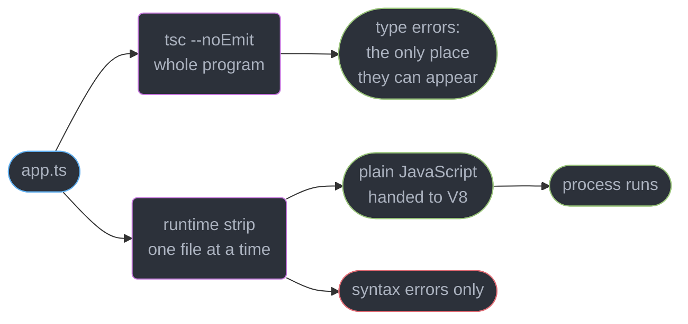
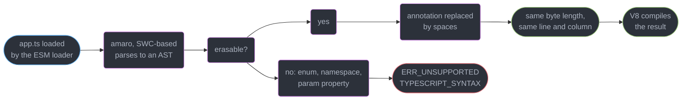
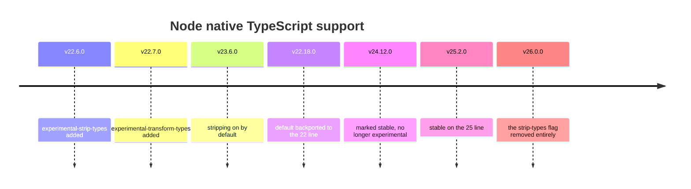
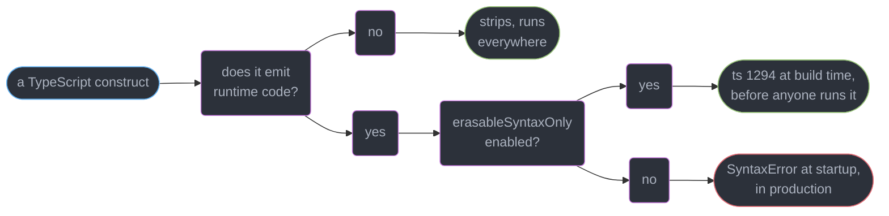
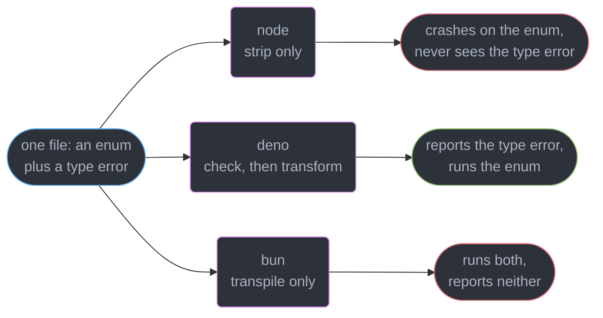
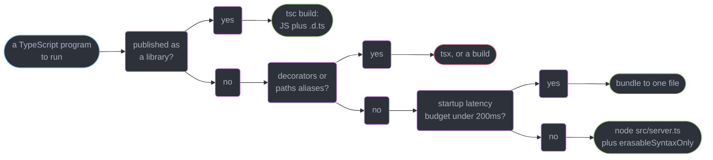

# TypeScript at Runtime — Node, Deno, Bun

---

## 1. Concept Overview

`node app.ts` works now. It has worked without a flag since Node **v23.6.0** and **v22.18.0**,
it became non-experimental at **v24.12.0** and **v25.2.0**, and at **v26.0.0** the
`--experimental-strip-types` flag was deleted because there was nothing left to opt into. Deno
has run TypeScript directly since its first release; Bun has since 1.0. The build step that
every TypeScript service carried for a decade is, for a large class of programs, gone.

What is *not* gone is the type checker. A runtime that runs your `.ts` file is not checking
it — it is deleting the annotations and executing the JavaScript underneath. That is the whole
module in one sentence, and it is the sentence teams get wrong: they delete `tsc` from CI on
the day they delete it from the dev loop, and ship the first `Property 'id' does not exist`
into production three weeks later.

| Operation | Who does it | What it produces | What it catches |
|-----------|-------------|------------------|-----------------|
| **Type checking** | `tsc --noEmit`, `deno check` | nothing on disk | every type error in the program |
| **Type stripping** | Node's `amaro`, Bun, esbuild, `tsx` | JavaScript, per file | syntax errors only |
| **Transpilation** | `tsc`, SWC, Babel, `--experimental-transform-types` | JavaScript, possibly downlevelled | syntax errors only |
| **Bundling** | esbuild, Rollup, Rolldown | one or more output chunks | unresolved imports |

Only the first row reads more than one file at a time, and only the first row can fail on a
type. Everything else is a per-file text transform that has never seen your `tsconfig.json`'s
`strict` block.

This page owns the runtime boundary. `tsconfig`, `strict` and the erasure-vs-emit distinction
belong to
`../typescript_fundamentals_and_tsconfig/typescript_fundamentals_and_tsconfig.md`; ESM/CJS,
`exports` maps and resolution modes to
`../modules_resolution_and_package_exports/modules_resolution_and_package_exports.md`; enums,
decorators and parameter properties as language features to
`../classes_decorators_and_resource_management/classes_decorators_and_resource_management.md`;
compiler internals and check speed to
`../the_typescript_compiler_and_type_performance/the_typescript_compiler_and_type_performance.md`;
bundlers to
`../../frontend_platform/modules_bundling_and_the_build_pipeline/modules_bundling_and_the_build_pipeline.md`;
the event loop and edge runtimes to
`../../frontend_platform/the_node_and_edge_runtimes/the_node_and_edge_runtimes.md`.

---

## 2. Intuition

> Running TypeScript is a *deletion*. Checking TypeScript is an *analysis*. A runtime that
> deletes fast has not analysed anything.

**Mental model.** Think of `: string` as a comment with unusually good tooling. Node's type
stripping literally treats it that way — it overwrites the annotation with spaces and hands
the result to V8. A comment cannot be wrong at runtime, and neither can a type annotation;
that is why deleting it is safe, and equally why deleting it proves nothing.

**Why it matters.** The no-build dev loop is worth real money: no `dist/`, no watcher, no
stale-output bug at 3am, and a `node --watch server.ts` restart in roughly 80-200ms against
the 2-6s a `tsc` project build took. Teams take that win and then, because nothing is red,
quietly stop running the checker.

**Key insight.** Every failure in this module comes from the same confusion: **a construct
that produces runtime code cannot be erased, and a runtime that only erases cannot check.**
Enums fail loudly at the first boundary. Missing type errors fail silently at the second.

---

## 3. Core Principles

1. **Checking and running are separate operations with separate tools.** `tsc --noEmit`
   stays in CI and in the pre-commit hook no matter which runtime executes the code.
2. **Type stripping is per-file and context-free.** It never reads `tsconfig.json`, never
   resolves an import, and therefore can never know whether a type exists.
3. **Erasable syntax is syntax that emits nothing.** Annotations, `interface`, `type`,
   `declare`, generics and `satisfies` erase. Enums, namespaces with bodies, parameter
   properties, `import x = require()` and decorators emit code, so they cannot.
4. **Whitespace-for-annotations preserves line and column numbers**, which is why a stripped
   stack trace is honest without a source map.
5. **`--erasableSyntaxOnly` `[5.8]` moves the runtime's constraint into the compiler**, so a
   file that will not run is a build error rather than a startup crash.
6. **A runtime's speed is not a checking strategy.** Bun transpiles in under a millisecond
   per file and reports exactly as many type errors as Node does: zero.
7. **No build step is a design constraint, not only a convenience.** It costs you `paths`,
   downlevelling, minification and a single-file artifact.

---

## 4. Types / Architectures / Strategies

### 4.1 The four ways a `.ts` file becomes running code

| Strategy | Tool | Type-checked | Build artifact | Startup cost |
|----------|------|--------------|----------------|--------------|
| **Native stripping** | `node app.ts` | no | none | ~1-3ms per file, amortised |
| **Loader / runner** | `tsx app.ts`, `bun app.ts` | no | none | ~1ms per file, cached |
| **Runtime with a checker** | `deno run` after `deno check` | yes, explicitly | none | check is a separate pass |
| **Ahead-of-time build** | `tsc`, esbuild, Rolldown | yes, if `tsc` | `dist/` | zero at runtime |

Rows one, two and four are the same transform with different packaging; row three is the only
one where the runtime's own toolchain will refuse to proceed on a type error — and even that
one checks what Deno resolves, not a mixed repository.

### 4.2 The erasability classes

| Construct | Emits runtime code | `node app.ts` | `--erasableSyntaxOnly` |
|-----------|--------------------|---------------|------------------------|
| `const x: string = "a"` | no | runs | allowed |
| `interface`, `type`, generics, `satisfies` | no | runs | allowed |
| `declare module`, `declare const` | no | runs | allowed |
| `enum Status { Active }` | yes, an object | **throws** | `ts(1294)` |
| `const enum Status { Active }` | inlines, needs the checker | **throws** | `ts(1294)` |
| `namespace N { export const x = 1 }` | yes, an IIFE | **throws** | `ts(1294)` |
| `declare namespace N { }` | no | runs | allowed |
| `constructor(private id: string)` | yes, an assignment | **throws** | `ts(1294)` |
| `import Foo = require("foo")` | yes, a require call | **throws** | `ts(1294)` |
| `@Injectable() class S {}` | yes, a decorator call | **throws** | `ts(1294)` |
| `paths` aliases, `target: es5` | needs `tsconfig` | **unresolved** | not its concern |

The pattern is exact: **anything whose meaning survives into the emitted JavaScript is not
erasable.** The last row is different in kind — path mapping and downlevelling are not
un-erasable syntax, they are configuration the runtime never reads at all, which is why they
break with a module-not-found rather than a syntax error.

### 4.3 Choosing a runner for the dev loop

| Runner | Version | Watch | Decorators | CJS/ESM interop | Use it when |
|--------|---------|-------|------------|-----------------|-------------|
| `node` | 26 / 24 LTS | `--watch` | no | native | erasable code, no `paths` |
| `tsx` | 4.23.13 | `--watch` | yes | esbuild shims both | you have decorators or `paths` |
| `deno` | 2.9 | `--watch` | yes | npm specifiers | greenfield, checking wanted |
| `bun` | 1.4.0 | `--watch` | TC39 standard | very broad | speed and one toolchain |

`ts-node` is not on this list: its last release is **10.9.2**, dated **2023-12-08**. Native
stripping took its default use case and `tsx` took the rest.

---

## 5. Architecture Diagrams

### The two jobs, and where each one runs



The two arrows out of `app.ts` never meet. Delete the upper branch and the program still runs,
which is exactly the failure mode.

### What Node does to your source



Nothing is written to disk and nothing is cached across runs: the transform is cheap enough
that Node redoes it on every start.

### Why the whitespace trick matters for a stack trace

```
source line 42:   async function charge(cents: number): Promise<Receipt> {
stripped line 42: async function charge(cents        )                   {
                                              ^^^^^^^^  ^^^^^^^^^^^^^^^^^
                                              replaced with spaces, not deleted

col:              1234567890123456789012345678901234567890
                  |                    |                  |
                  identical column of `charge` in both     identical `{`
```

Because the replacement is length-preserving, every offset in the stripped output equals the
offset in your source — so `app.ts:42:24` in a stack trace points at `app.ts:42:24` in your
editor with no source map involved.

### The Node type-stripping timeline



Four years from proposal to a deleted flag. The practical read: on any Node you can still
support, `node app.ts` runs — but only Node 24 LTS and newer is a supported production floor.

### Where a construct fails, and how loudly



Same defect, two places to meet it. The flag is the choice between a red CI job and a crashed
container.

### The same file, three runtimes



Only Deno's branch reports the type error, and only because `deno check` is a distinct pass —
which is the same reason the other two branches still need `tsc --noEmit` beside them.

---

## 6. How It Works — Detailed Mechanics

### 6.1 What `node app.ts` actually does

Node embeds **`amaro`**, a thin wrapper around SWC's TypeScript stripper. On loading a `.ts`,
`.mts` or `.cts` file the loader parses it, walks the AST for type-only nodes, and **replaces
each one with the same number of space characters** rather than deleting it. The result is
byte-identical in length to your source and is handed straight to V8.

```ts
// server.ts — exactly as authored
import type { Server } from "node:http";
import { createServer } from "node:http";

interface Config { port: number; host: string }

export function start(cfg: Config): Server {
  return createServer((_req, res) => res.end("ok")).listen(cfg.port, cfg.host);
}
```

```js
// what V8 actually compiles — every removed token is now spaces

import { createServer } from "node:http";


export function start(cfg        )        {
  return createServer((_req, res) => res.end("ok")).listen(cfg.port, cfg.host);
}
```

Three consequences follow. The transform is **per file**, so it cannot know whether `Config`
exists anywhere. It is **stateless**, so there is no cache directory and no stale-output class
of bug. And it costs roughly **1-3ms per file** on first load, which for a 400-module service
is 0.4-1.2s of extra boot — noticeable for a CLI, irrelevant for a long-lived server, and the
main reason production still ships a build for large processes.

### 6.2 What stripping cannot do, with the real errors

```ts
// features.ts
export enum Tier { Free, Pro, Enterprise }              // emits an object
export namespace Billing { export const RATE = 0.029; } // emits an IIFE

export class Account {
  constructor(private readonly id: string) {}           // emits this.id = id
}
```

```
SyntaxError [ERR_UNSUPPORTED_TYPESCRIPT_SYNTAX]: TypeScript enum is not supported in
strip-only mode
    at file:///srv/app/features.ts:2:8

SyntaxError [ERR_UNSUPPORTED_TYPESCRIPT_SYNTAX]: TypeScript namespace declaration is not
supported in strip-only mode

SyntaxError [ERR_UNSUPPORTED_TYPESCRIPT_SYNTAX]: TypeScript parameter property is not
supported in strip-only mode
```

Each of these emits code. `enum Tier` becomes a real object you can index at runtime; a
`namespace` with a body becomes an IIFE assigning to a variable; `private readonly id`
generates `this.id = id` in the constructor body. There is no whitespace to substitute,
because the construct is not an annotation — it is a program.

The fixes are mechanical and each is an improvement on its own merits:

```ts
// FIX — a const object plus a derived union replaces the enum
export const Tier = { Free: 0, Pro: 1, Enterprise: 2 } as const;
export type Tier = (typeof Tier)[keyof typeof Tier];

// FIX — a module is a namespace; the file is already the boundary
export const RATE = 0.029;

// FIX — an ordinary field assignment replaces the parameter property
export class Account {
  readonly id: string;
  constructor(id: string) { this.id = id; }
}
```

`--experimental-transform-types` is the escape hatch: it makes Node *generate* the enum and
namespace code instead of refusing. It is rarely the right answer, because transforming shifts
positions, so Node turns on source maps and you have traded the honest stack trace of §6.5 for
syntax you were better off deleting.

### 6.3 `--erasableSyntaxOnly` moves the failure to build time `[5.8]`

```json
{ "compilerOptions": {
    "erasableSyntaxOnly": true, "verbatimModuleSyntax": true,
    "module": "nodenext", "moduleResolution": "nodenext",
    "target": "es2024", "strict": true, "noEmit": true } }
```

```
features.ts:2:8 - error TS1294: This syntax is not allowed when 'erasableSyntaxOnly' is enabled.

2 export enum Tier { Free, Pro, Enterprise }
         ~~~~~~~~~
```

One flag, one error code, every offending construct. The flag does not change emit — it is a
pure restriction on what the checker accepts, which is why it composes with any build strategy
and costs nothing at runtime. Turn it on the same day you decide to run sources directly, and
the class of bug in §6.2 becomes impossible rather than merely rare.

The migration is bounded and countable. On a 900-file service the usual distribution is
**60-120 enums**, **10-30 namespaces** (nearly all legacy), **200-400 parameter properties**
if the codebase used a DI container, and **zero to hundreds of decorators** depending entirely
on whether it is a NestJS or TypeORM codebase. Enums and namespaces are codemod work of an
afternoon. Parameter properties are mechanical but touch every constructor. Decorators are not
a migration at all — they are a framework decision, and a NestJS service does not run under
plain stripping, full stop.

### 6.4 `tsx`, and when you still need a real build

```bash
npm i -D tsx typescript                  # tsx 4.23.13
npx tsx watch src/server.ts              # restart on change, ~90ms
npx tsc --noEmit --watch                 # the checker, in a second terminal
```

`tsx` is an esbuild-based loader. It handles what stripping refuses — decorators,
`tsconfig.json` `paths`, `target` downlevelling, CJS/ESM interop shims — and it does not type
check either. The two-terminal setup above is the honest dev loop on any runtime: one process
runs, one process checks, and neither pretends to do the other's job.

You still want an ahead-of-time build when any of these is true:

| Reason | Why stripping cannot serve it |
|--------|-------------------------------|
| Publishing a library | consumers need JavaScript plus `.d.ts` — `../declaration_files_and_library_authoring/declaration_files_and_library_authoring.md` |
| Targeting an older runtime | downlevelling is emit, and stripping never downlevels |
| `paths` or `baseUrl` aliases | the runtime never opens `tsconfig.json` |
| Startup latency matters | 400 files at 1-3ms each is 0.4-1.2s of parse on every boot |
| A single-file artifact | bundling, minification and tree-shaking are a bundler's job |
| Decorators in the codebase | not erasable, at any Node version |

Note the asymmetry: nothing on that list is a *development* concern. Running sources in dev and
building for production is a perfectly coherent split, as long as CI type-checks and the
production build is what gets tested.

### 6.5 Source maps and stack traces

The length-preserving strip is what makes the no-build loop debuggable. Because column 24 of
line 42 is still column 24 of line 42, a thrown error points at your actual source:

```
Error: card declined
    at charge (file:///srv/app/billing.ts:42:11)
    at async handler (file:///srv/app/routes.ts:18:3)
```

That trace is produced with **no source map on disk** and no `--enable-source-maps`. Contrast
the three cases you will meet:

| Setup | Trace points at | Source map needed |
|-------|-----------------|-------------------|
| `node app.ts` (strip) | your `.ts`, exact line and column | no |
| `node --experimental-transform-types` | your `.ts`, via a generated map | yes, Node enables it |
| `tsx` / `bun` | your `.ts`, via an in-memory map | yes, installed automatically |
| `tsc` build then `node dist/app.js` | `dist/app.js` unless `sourceMap` is on | yes, plus `--enable-source-maps` |

The last row is the one that bites in production: a minified bundle without a map turns
`billing.ts:42` into `index.js:1:88214`. If you ship a build, ship the map and upload it to
your error tracker; the map is what buys back what stripping gave you for free.

### 6.6 Deno's model

```ts
// server.ts — no package.json, no node_modules, no tsconfig required
import { serveDir } from "jsr:@std/http/file-server";
Deno.serve((req: Request) => serveDir(req, { fsRoot: "./public" }));
```

```bash
deno check server.ts                        # type errors are errors, exit 1
deno run --allow-net --allow-read=./public server.ts
```

Deno **2.9** treats TypeScript as a first-class input rather than a thing to strip: the
compiler is embedded, `deno check` is the checking pass, and enums, namespaces, parameter
properties and decorators all work because Deno transforms rather than strips. Permissions are
the second differentiator — file, network and environment access are denied unless granted on
the command line, so `--allow-net` is not optional boilerplate but the actual capability grant.

The interop cost is what decides adoption. `npm:` and `node:` specifiers make most of the
ecosystem reachable, but packages that reach for native addons, undocumented Node internals or
a bespoke bundler plugin still break, and every import is an explicit URL or JSR/npm specifier
rather than a bare name resolved from `node_modules`. Deno is the low-friction choice for a new
service and a genuine migration project for an existing one.

### 6.7 Bun's model

```bash
bun install                 # the package manager
bun run src/server.ts       # the runtime, transpiling on the fly
bun test                    # the test runner
bun build --target=node     # the bundler
bunx tsc --noEmit           # still yours to run
```

Bun **1.4.0** (2026-08-20) ships the runtime, package manager, bundler and test runner in one
binary — the release that completed the Zig-to-Rust core rewrite and added TC39 standard
decorator support. Its transpiler handles enums, namespaces and parameter properties, so §6.2's
file runs unchanged.

The honest position is the last line of that block. Bun **transpiles and strips but does not
type check**, by default or otherwise; `tsc --noEmit` is exactly as necessary as it is under
Node. What Bun buys is one toolchain instead of five and install times measured in single-digit
seconds. What it costs is a smaller-but-real compatibility gap in Node APIs, and a runtime
whose behaviour under load your on-call team has less collective experience debugging.

### 6.8 The dev loop that is actually correct

```json
{ "scripts": {
    "dev": "node --watch --env-file=.env src/server.ts",
    "check": "tsc --noEmit",
    "check:watch": "tsc --noEmit --watch --preserveWatchOutput",
    "test": "node --test",
    "ci": "npm run check && npm test" },
  "engines": { "node": ">=24.0.0" } }
```

The `check` script is the load-bearing line. It is a separate command precisely so that nobody
can believe `dev` covers it, and `ci` runs it before the tests so a type error fails in 4-9
seconds rather than after a 3-minute suite. `--watch` gives 80-200ms restarts;
`--env-file` removes the last reason to have a runner wrapping the runtime at all.

---

## 7. Real-World Examples

### Deleting the build from a 40-service platform

A payments platform ran 40 Node services, each with a `tsc` build producing `dist/` and a
Dockerfile with a builder stage. Moving to `node src/server.ts` on Node 24 removed the builder
stage from 34 of them: image build time fell from 95s to 38s, and the "I ran the old `dist/`"
support question disappeared entirely.

Six services stayed on the build. Three were NestJS and are decorator-bound; two published
internal libraries and need `.d.ts`; one was a CLI where 620 source files cost 1.4s of strip
time on every invocation. The rule the team wrote down was the honest one: **run sources unless
you are publishing, decorating, or paying startup cost per invocation.**

### The CI job that stopped catching anything

A team adopted `bun run` for dev and production in the same sprint and, because Bun ran
everything green, removed the `tsc --noEmit` step from CI as "redundant with the runtime". Over
the next 19 days, 7 type errors merged — a renamed field on a response type, two `undefined`
paths, an argument order swap between two `string` parameters. The argument swap reached
production and mis-attributed 4,100 audit-log entries before a customer noticed. Re-adding
`bunx tsc --noEmit` cost 11 seconds per pipeline and caught the remaining 6 within an hour.

---

## 8. Tradeoffs

| Decision | Cheaper option | What it costs | Take the expensive one when |
|----------|----------------|---------------|----------------------------|
| Run sources vs build | run sources | 1-3ms per file at boot, no minification | startup latency or a published artifact matters |
| `erasableSyntaxOnly` on/off | off | a startup `SyntaxError` in production | you run sources anywhere, ever |
| Enum vs `as const` union | enum, familiar | not erasable, and a nominal-ish runtime object | you want the code to run unbuilt |
| Node vs Deno | Node, the ecosystem you have | checking is not built in | greenfield, and permissions are worth having |
| Node vs Bun | Node, the boring choice | five tools instead of one, slower installs | compatibility risk outweighs the toolchain win |
| `tsx` vs native stripping | native, zero deps | no `paths`, no decorators, no downlevel | the codebase already uses any of those |

The row people argue about is the first. "No build step" is not primarily a speed win — it is
the deletion of an artifact that could be stale, and of a whole category of "works on my
machine" caused by a `dist/` nobody rebuilt.

---

## 9. When to Use / When NOT to Use



**Run sources directly when:** it is a service, a script, a test or a dev loop, the code is
erasable, and nothing downstream consumes a build output. **Reach for `tsx` when:** decorators
or `paths` are already load-bearing and rewriting them is not this sprint's work. **Reach for
Deno when:** the project is new and you want checking and a permission model as defaults.
**Reach for Bun when:** toolchain consolidation and install speed are the bottleneck.

**Do NOT delete `tsc --noEmit` from CI**, on any runtime, ever. **Do NOT run sources in
production without `erasableSyntaxOnly`** — the first enum a contributor adds is a crashed
container. **Do NOT assume `deno check` covers a mixed repo**; it checks what Deno resolves.
**Do NOT ship a minified production bundle without its source map** uploaded to your error
tracker.

---

## 10. Common Pitfalls

### Pitfall 1: a construct that runs under `tsx` and dies under `node` (BROKEN → FIX)

```ts
// BROKEN — passes CI, runs all through local dev under tsx, crashes on deploy
export enum PayoutState { Pending = "pending", Settled = "settled" }

export class PayoutService {
  constructor(private readonly db: Db, private readonly clock: Clock) {}
  async settle(id: string) { return this.db.set(id, PayoutState.Settled); }
}
```

```
SyntaxError [ERR_UNSUPPORTED_TYPESCRIPT_SYNTAX]: TypeScript enum is not supported in
strip-only mode
```

```ts
// FIX — an as-const union and explicit fields, both erasable
export const PayoutState = { Pending: "pending", Settled: "settled" } as const;
export type PayoutState = (typeof PayoutState)[keyof typeof PayoutState];

export class PayoutService {
  private readonly db: Db;
  private readonly clock: Clock;
  constructor(db: Db, clock: Clock) { this.db = db; this.clock = clock; }
  async settle(id: string) { return this.db.set(id, PayoutState.Settled); }
}
```

The trap is the *asymmetry between environments*: `tsx` transforms, the Dockerfile's `node`
strips, and the difference surfaces only at container start. `erasableSyntaxOnly: true` in the
tsconfig both environments share is the single fix that makes the two agree.

### Pitfall 2: the checker quietly stops running

`node app.ts` prints no warning that it did not check anything, so a team that removes `tsc`
from the loop gets no signal until a runtime `TypeError`. The failure is organisational, not
technical, and the countermeasure is structural: keep `check` as its own npm script, run it in
CI *before* the tests, and put `tsc --noEmit` in the pre-push hook. If your editor is the only
thing checking, then only files someone opened are checked.

### Pitfall 3: `paths` aliases the runtime has never heard of

```ts
// BROKEN — tsconfig maps "@app/*" to "src/*"; tsc is happy, node is not
import { logger } from "@app/lib/logger";
```

```
Error [ERR_MODULE_NOT_FOUND]: Cannot find package '@app' imported from /srv/app/src/server.ts
```

```ts
// FIX — a subpath import, resolved by Node itself from package.json "imports"
import { logger } from "#lib/logger";   // "imports": { "#lib/*": "./src/lib/*.ts" }
```

Path mapping is a *checker* feature; it produces no emit and no resolution behaviour. Node's
`imports` field is the runtime-native equivalent and the checker understands it too, so one
mechanism serves both —
`../modules_resolution_and_package_exports/modules_resolution_and_package_exports.md` owns the
resolution rules.

---

## 11. Technologies & Tools

| Tool | Role | Relevance here |
|------|------|----------------|
| Node.js | Runtime, v26 Current, v24 Active LTS | Native stripping, `--watch`, `--env-file` |
| amaro | Node's embedded SWC type stripper | Whitespace-preserving erasure, no checking |
| TypeScript | Checker and compiler, 7.0 | `tsc --noEmit`, `erasableSyntaxOnly` |
| tsx | esbuild-based TypeScript runner, 4.23.13 | Decorators, `paths`, watch mode |
| Deno | TypeScript-first runtime, 2.9 | `deno check`, permissions, JSR |
| Bun | Runtime plus toolchain, 1.4.0 | Transpile-only execution, one binary |
| esbuild | Go bundler and transformer | The engine underneath tsx |

---

## 12. Interview Questions with Answers

**Q: Why does `node app.ts` run a file that has type errors in it?**
**Short:** Stripping annotations is a per-file text transform that never resolves an import, so it has no way to know a type is wrong or even absent.

Node's `amaro` parses one file, removes the type-only syntax and hands the JavaScript to V8.
Type checking is a whole-program analysis over every file the imports reach, which the loader
never performs. Nothing warns you, and the process starts normally. Keep `tsc --noEmit` as its
own CI step regardless of runtime — it is the only thing that reports a type error.

**Q: Which TypeScript constructs cannot be stripped, and what do they have in common?**
**Short:** Enums, namespaces with bodies, parameter properties, import-equals aliases and decorators all emit runtime JavaScript, so there is nothing to erase.

`enum Tier` becomes a real object, a `namespace` body becomes an IIFE, `constructor(private id)`
generates an assignment, and a decorator becomes a call. Node throws
`ERR_UNSUPPORTED_TYPESCRIPT_SYNTAX` at load. Everything else — annotations, `interface`, `type`,
generics, `satisfies`, `declare` — produces no output and erases cleanly.

**Q: What is `--erasableSyntaxOnly` for?**
**Short:** The compiler rejects any construct a runtime could not erase, converting a startup crash into a build error before the code ever deploys.

`[5.8]` It reports `ts(1294): This syntax is not allowed when 'erasableSyntaxOnly' is enabled`
on enums, namespaces, parameter properties, import-equals and decorators. It changes nothing
about emit — it is a pure restriction on what the checker accepts. Turn it on the same day you
decide to run sources directly, so the two environments cannot disagree.

**Q: When do you still need a real build step?**
**Short:** Publishing a package, targeting an older runtime, using path aliases, or needing a bundled single file all require emit that no runtime performs.

Consumers of a library need JavaScript plus `.d.ts`. Downlevelling and minification are emit
operations. `paths` lives in `tsconfig.json`, which no runtime reads. And 400 source files at
1-3ms of strip each is 0.4-1.2s of boot, which matters for a CLI. Dev on sources, build for
production, is a coherent split as long as CI checks and you test the built artifact.

**Q: How can a stack trace point at a `.ts` line with no source map?**
**Short:** Whitespace replaces each removed token instead of deleting it, so every line and column offset in the output equals the offset in the original file.

`function f(x: number)` becomes `function f(x        )` — same length, same columns. V8 reports
`app.ts:42:11` and that is literally where the code is. The trick only survives pure stripping:
`--experimental-transform-types` generates code, shifts positions, and therefore turns source
maps on. So does `tsx`, and so does any bundled build.

**Q: What is the Node version story for running TypeScript directly?**
**Short:** Default-on behaviour landed in v23.6.0 and v22.18.0, went stable at v24.12.0 and v25.2.0, and the opt-in flag was deleted in v26.0.0.

`--experimental-strip-types` arrived in v22.6.0 and `--experimental-transform-types` in v22.7.0.
Node 26 is Current and Node 24 "Krypton" is Active LTS, started 2025-05-06 on a 30-month
window. Set `"engines": { "node": ">=24.0.0" }` and you can rely on flagless `node app.ts`
without documenting a single flag.

**Q: Where does `tsx` fit now that Node strips types natively, and what happened to `ts-node`?**
**Short:** Watch mode plus decorators, path aliases and CJS interop are what a loader still adds once the runtime handles plain erasure by itself.

`tsx` 4.23.13 wraps esbuild, transforms rather than strips, and reads `tsconfig.json`, so it
runs the code native stripping refuses. It does not type check either. `ts-node` faded because
native stripping took its default case and faster loaders took the rest; its last release is
10.9.2 from 2023-12-08.

**Q: How is Deno's approach to TypeScript different from Node's?**
**Short:** Type checking runs as a first-class command rather than an external tool, and the runtime transforms rather than erases, so enums and decorators work.

Deno 2.9 embeds the compiler: `deno check` fails on a type error with exit 1, and `deno run`
executes `.ts` with no configuration. Permissions are the other half — network, file and env
access are denied until granted with `--allow-net` and friends. The cost is interop: `npm:` and
`node:` specifiers cover most of the ecosystem, but native addons and bundler plugins still break.

**Q: What does Bun give you, and what does it still not do?**
**Short:** One binary bundles the runtime, package manager, bundler and test runner, and none of those four components performs a type check.

Bun 1.4.0 (2026-08-20) completed the Zig-to-Rust core rewrite and added TC39 standard decorator
support. Its transpiler handles enums, namespaces and parameter properties, so code that fails
under plain `node` runs unchanged. Install times drop to single-digit seconds. You still run
`bunx tsc --noEmit`, and you still carry a real Node-API compatibility gap.

**Q: Why does a class with `constructor(private id: string)` fail under native stripping?**
**Short:** A constructor parameter marked private is shorthand for a field declaration plus an assignment, both of which are real statements in the emitted output.

TypeScript expands it to `this.id = id` inside the constructor body — code that does not exist
in your source text, so there is no token to overwrite with spaces. Node reports
`TypeScript parameter property is not supported in strip-only mode`. Declare the field and
assign it explicitly; it is four extra lines per class and it runs on every runtime.

**Q: Why do `paths` aliases stop working when you run sources directly?**
**Short:** Path mapping lives in tsconfig.json, which no runtime opens, and it produces no emit that would rewrite the specifier.

`tsc` uses `paths` only to resolve types during checking — the import string in the output is
byte-identical to the input, so `@app/lib/logger` reaches Node unchanged and gives
`ERR_MODULE_NOT_FOUND`. Use Node's `imports` field in `package.json` (`#lib/*`) instead: the
runtime resolves it natively and the checker understands it too, so one mechanism serves both.

**Q: Can a NestJS or TypeORM codebase run under `node app.ts`?**
**Short:** Decorators emit runtime calls and metadata, so a decorator-driven framework is structurally incompatible with erasure at any Node version.

`@Injectable()` compiles to a function call plus, with `emitDecoratorMetadata`, reflection data
the DI container reads at startup. Nothing there is erasable, and `--experimental-transform-types`
does not cover legacy decorator metadata. Run such a service under `tsx`, Bun, or a real build —
this is a framework choice, not a migration you can codemod.

**Q: When does the no-build loop actually need a source map?**
**Short:** A source map becomes necessary the moment a tool generates code rather than blanking it, because generation moves every position after the change.

Pure stripping preserves offsets, so `node app.ts` needs none.
`--experimental-transform-types`, `tsx`, Bun and any bundled build all rewrite the output, and
each installs a map — in memory for the runners, on disk for a build. The production rule: if
you ship `dist/`, ship `.map` and upload it to your error tracker, or `billing.ts:42` becomes
`index.js:1:88214`.

**Q: What does a stack trace look like in each of the three runtimes?**
**Short:** Frames point at the original file in all three, but only pure erasure achieves it without a map, which is why a missing map only ever hurts a built artifact.

`node app.ts` gives `file:///srv/app/billing.ts:42:11` from position preservation alone. `tsx`
and Bun give the same text through an automatically installed in-memory map. Deno maps back
from its own transform. The single case that degrades is `node dist/app.js` without
`sourceMap` and `--enable-source-maps` — there the frame names the bundle.

**Q: You own an existing Node service on TypeScript 7. How do you decide whether to change runtime?**
**Short:** Migration cost dominates every benchmark, so the correct default is to keep Node and delete the build step rather than replace the runtime.

Turn on `erasableSyntaxOnly`, fix the enums and parameter properties it reports, drop the
builder stage, keep `tsc --noEmit` in CI. That is days of work with no ecosystem risk. Deno and
Bun are worth evaluating for a *new* service, where you pay no migration and get checking-by-
default or one toolchain respectively. Do not rewrite a working service for a startup benchmark.

**Q: What does native stripping cost at startup, and when does that number matter?**
**Short:** Parsing and stripping adds roughly 1-3ms per file on every process start, with no cache, because the transform is redone from source each time.

A 400-module service pays 0.4-1.2s of extra boot — invisible for a long-lived server, and
material for a CLI invoked hundreds of times a day or a function with a cold-start budget. There
is no on-disk cache to warm. Where that cost is real, bundle to a single file; where it is not,
the operational simplicity of no `dist/` is worth more than the milliseconds.

---

## 13. Best Practices

1. **Keep `tsc --noEmit` as its own script and run it in CI before the tests**, on every
   runtime, forever. It is the only thing that reports a type error.
2. **Turn on `erasableSyntaxOnly` `[5.8]` the day you run sources anywhere**, so dev and
   production cannot disagree about what parses.
3. **Prefer `as const` objects with derived unions over enums.** Erasable, tree-shakeable, and
   they compare structurally like the strings they are.
4. **Use `package.json` `imports` (`#lib/*`) instead of tsconfig `paths`** when running
   sources — it is the one alias mechanism both the checker and the runtime honour.
5. **Run one process that executes and one that checks.** `node --watch src/server.ts` beside
   `tsc --noEmit --watch --preserveWatchOutput`.
6. **Build for publishing, for downlevelling, and for cold-start budgets** — and only then.
7. **If you ship a build, ship its source map** and upload it to the error tracker.

---

## 14. Case Study

### The enum that survived every test and killed the deploy

**The service.** `checkout-api`, Node 24 LTS, 310 source files, run as `node src/server.ts`
with no build step — the builder stage had been deleted from the Dockerfile eleven weeks
earlier, cutting image builds from 95s to 38s. CI ran `tsc --noEmit` and 640 tests under
`node --test`. Local development used `tsx watch`, a leftover from the pre-stripping era that
nobody had cleaned up.

```ts
// BROKEN — merged Thursday 16:40, green on every check
export enum RefundReason {
  Duplicate = "duplicate",
  Fraudulent = "fraudulent",
  RequestedByCustomer = "requested_by_customer",
}

export class RefundService {
  constructor(private readonly gateway: Gateway) {}
  async refund(id: string, reason: RefundReason) { return this.gateway.refund(id, reason); }
}
```

Every gate passed. `tsc --noEmit` is a *checker*, and the enum is perfectly well-typed. The 640
tests ran under `node --test` — but the test files imported through a `tsx` register hook the
suite had inherited, so they transformed rather than stripped. Local `tsx watch` did the same.
Nothing in the pipeline ever loaded that file the way production would.

```
SyntaxError [ERR_UNSUPPORTED_TYPESCRIPT_SYNTAX]: TypeScript enum is not supported in
strip-only mode
    at file:///srv/app/src/domain/refunds.ts:2:8
```

The container crash-looped. Rollback took 6 minutes; the on-call engineer spent 25 more
establishing that the code was correct and the *loader* was different, because the file ran
fine on the laptop in front of them.

```ts
// FIX — erasable everywhere, and the tsconfig now forbids the alternative
export const RefundReason = {
  Duplicate: "duplicate",
  Fraudulent: "fraudulent",
  RequestedByCustomer: "requested_by_customer",
} as const;
export type RefundReason = (typeof RefundReason)[keyof typeof RefundReason];

export class RefundService {
  private readonly gateway: Gateway;
  constructor(gateway: Gateway) { this.gateway = gateway; }
  async refund(id: string, reason: RefundReason) { return this.gateway.refund(id, reason); }
}
```

**What changed in the repository afterwards.**

| Guard | Catches | Cost |
|-------|---------|------|
| `erasableSyntaxOnly: true` | every enum, namespace and parameter property, at check time | 71 sites, one afternoon |
| Removed the `tsx` hook from `node --test` | tests now load files the way production does | 0s, a deleted flag |
| `node --check-erasable src/**/*.ts` smoke step | anything the flag misses in generated code | 2s per pipeline |

The `erasableSyntaxOnly` flag alone would have failed the pull request at 16:41. The deeper fix
is the second row: **the dev loop and the test runner must load code the same way production
does**, or a green pipeline is only evidence about the pipeline.

**The lesson.** Deleting the build step is a real simplification and worth taking. It also
turns your runtime's loader into part of your contract — and the moment one environment
transforms while another strips, a construct that is valid TypeScript, correctly typed and
fully tested becomes a deploy-time `SyntaxError`. Make the compiler enforce the runtime's
constraint, and make every environment load code the same way.
