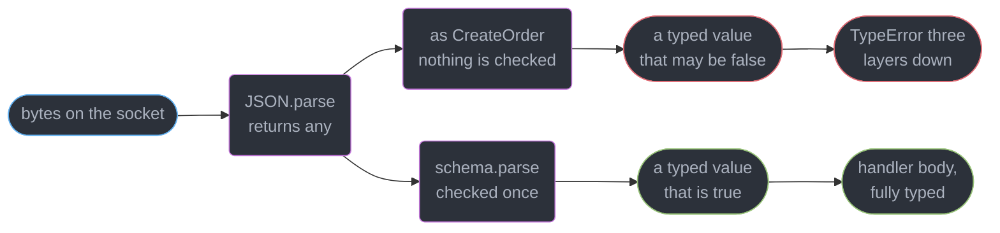
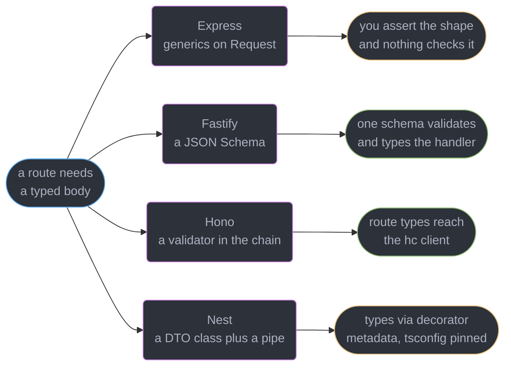
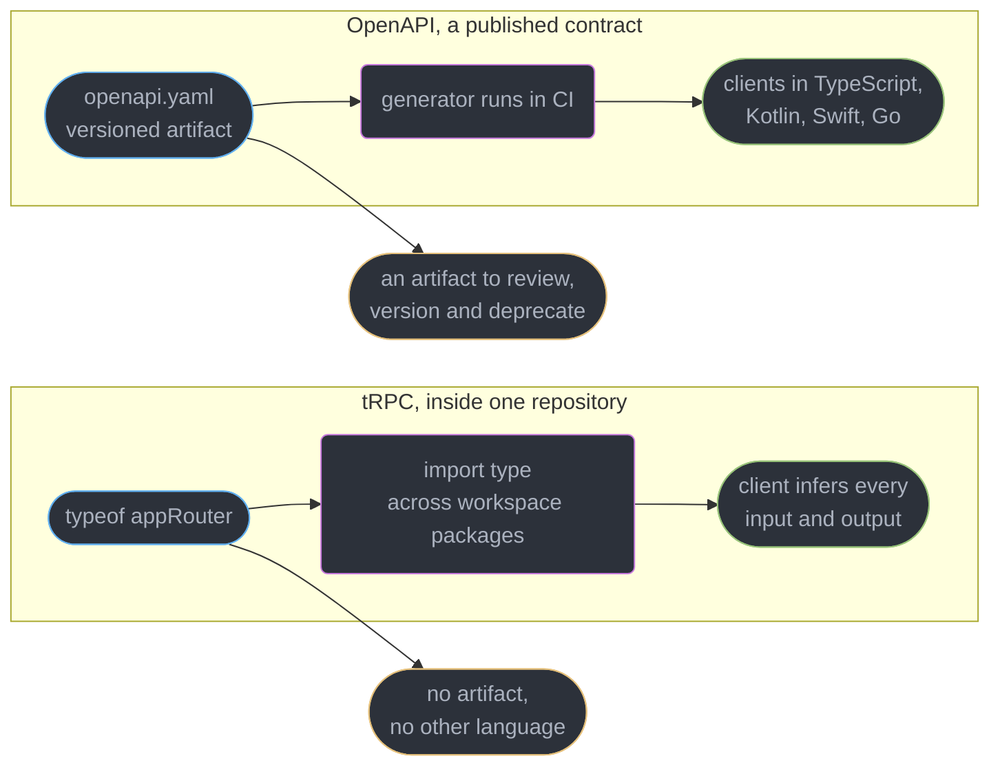
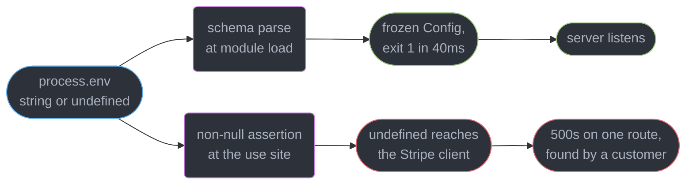
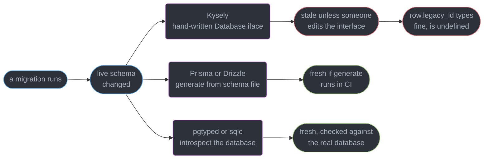
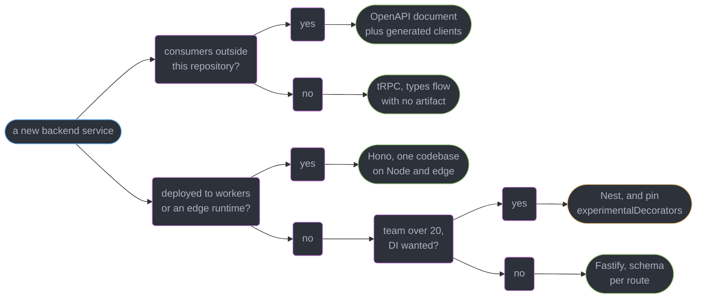

# TypeScript for Node and Backend Services

---

## 1. Concept Overview

This repository teaches backend engineering in Python, Java and Go. Every service in
`../../devops/` is Go, every API module in `../../backend/` is language-neutral or JVM, and
`../../fastapi/` owns the Python side. **This module is the section's claim to "full-stack":
it is where a TypeScript engineer learns to write the server too**, using the same type
system they already use in the browser, against a different set of trust boundaries.

The difference between the two halves is one sentence. In the browser, most values you
handle were produced by code you compiled. On the server, almost nothing was: a request body
is bytes from a stranger, `process.env` is whatever the deployment injected, a database row is
whatever the last migration left behind. TypeScript describes all three perfectly and verifies
none of them.

| Server input | Its honest static type | What people write instead |
|--------------|------------------------|---------------------------|
| `JSON.parse(body)` | `any` | `req.body as CreateOrder` |
| `req.params.id` | `string` | `string`, correct by luck |
| `req.query.limit` | `string \| string[] \| undefined` | `number` |
| `process.env.DB_URL` | `string \| undefined` | `process.env.DB_URL!` |
| A database row | whatever the driver declares | a type generated three migrations ago |

Four of those five are lies the compiler will happily hold. The job of this module is to put
one verified parse between each input and the typed code behind it, and then to keep the
types honest across the wire, the database and the deploy.

**What this page owns:** typing an HTTP handler, end-to-end type flow with tRPC versus
published-contract codegen, typed configuration, error types across the wire, the database
layer, async correctness, and the deployment shape of a TypeScript service.

**What it does not own:**

| Topic | Owner |
|-------|-------|
| Runtimes, type stripping, `tsx` | [`typescript_at_runtime_node_deno_bun`](../typescript_at_runtime_node_deno_bun/typescript_at_runtime_node_deno_bun.md) |
| Zod, Standard Schema, parse-don't-validate | [`runtime_validation_and_parse_dont_validate`](../runtime_validation_and_parse_dont_validate/runtime_validation_and_parse_dont_validate.md) |
| `exports` maps, ESM/CJS | [`modules_resolution_and_package_exports`](../modules_resolution_and_package_exports/modules_resolution_and_package_exports.md) |
| libuv, streams, workers, edge, drain semantics | [`the_node_and_edge_runtimes`](../../frontend_platform/the_node_and_edge_runtimes/the_node_and_edge_runtimes.md) |
| Type-aware lint cost | [`linting_formatting_and_code_quality`](../../frontend_platform/linting_formatting_and_code_quality/linting_formatting_and_code_quality.md) |
| REST and contract design | [`rest_api_design`](../../backend/rest_api_design/rest_api_design.md), [`api_contracts_and_schema_governance`](../../backend/api_contracts_and_schema_governance/api_contracts_and_schema_governance.md) |
| The client half of tRPC and generated SDKs | [`server_state_and_data_fetching`](../../react/server_state_and_data_fetching/server_state_and_data_fetching.md) |

---

## 2. Intuition

> A server is a machine for turning `unknown` into a typed value, doing something with it, and
> turning the result back into bytes. Everything in this module is about where that conversion
> happens and whether it is checked.

**Mental model.** Draw one line around your handler bodies. Outside it: bytes, environment
strings, driver results, third-party JSON — all `unknown`. Inside it: types you can trust
because something at the line verified them. The line is the parse. A codebase without one has
the same types and none of the guarantee.

**Why it matters.** The two most expensive production incidents in TypeScript services are the
same shape. An `as` cast on a request body puts a wrong type into the program and it surfaces
three layers down as `Cannot read properties of undefined`, in the database call, with no
frame naming the handler. A `process.env.X!` on a variable the production deployment never set
gives `undefined` where a string was promised, and the crash happens at first use rather than
at boot.

**Key insight.** The compiler is a proof engine about *your* code and says nothing about the
world. So make every value that entered from the world pass through one function whose return
type it earned. That function is the only place you are allowed to be uncertain.

---

## 3. Core Principles

1. **Every boundary parses exactly once, at the edge of the handler.** Body, params, query,
   headers and environment. Downstream code takes typed arguments and never re-checks.
2. **`as` is not validation.** A cast is a promise you made to the compiler. Nothing verifies
   it, and it fails where the value is *used*, not where it entered.
3. **A type is a contract only inside the compilation unit.** Across a network boundary it is
   documentation; only a serialised schema or a shared source tree makes it enforceable.
4. **Configuration is parsed at boot and frozen.** A missing variable must crash the process in
   the first 100ms, not at 03:00 on the first request that reaches that code path.
5. **Errors that cross the wire must be data.** `Error` does not serialise; a discriminated
   union of error codes does.
6. **Database types are generated from the database, and regenerated by the migration.** A
   hand-maintained row type diverges silently on the first `ALTER TABLE`.
7. **An unawaited promise is a bug the type system can see** — `no-floating-promises` is a
   type-aware rule and it is the highest-value one a Node codebase can turn on.
8. **Request-scoped context belongs in `AsyncLocalStorage`**, not in a parameter threaded
   through fourteen call sites, and not in a module-level mutable.

---

## 4. Types / Architectures / Strategies

### 4.1 Four typing models for an HTTP server

| Framework | Version | Typing model | Body type comes from | Cost |
|-----------|---------|--------------|----------------------|------|
| **Express** | 5.x | Generics on the request object | you, by hand | `req.body` is `any` unless you parse |
| **Fastify** | 5.x | Schema-driven | a JSON Schema attached to the route | you learn a second schema language |
| **Hono** | 4.x | Typed route chain | a validator middleware in the chain | route types live in the app type |
| **Nest** | 11.x | Decorators plus DI | a DTO class plus a pipe | keeps `experimentalDecorators` alive |

**Choose on team and deployment, not taste.** Fastify if throughput and one-schema-per-route
discipline matter. Hono if you deploy to workers or need the same code on Node and an edge
runtime. Nest if the team is large, Java- or Angular-shaped, and wants opinionated DI. Express
if the codebase already is Express and the migration buys nothing.

### 4.2 Two ways to make the client's types true

| | tRPC | OpenAPI codegen |
|---|------|-----------------|
| Artifact | none | `openapi.yaml`, versioned |
| Client types | inferred from `typeof appRouter` | generated by a CI step |
| Consumers | TypeScript, same repository | any language, any repository |
| Breaking change shows up | at `tsc` time, instantly | when the generator reruns |
| Public API surface | no | yes |
| Coupling | client imports server *types* | client imports a document |

tRPC **11.19.0** accepts any Standard Schema validator (`@standard-schema/spec` **1.1.0**)
natively, so `.input(zodSchema)` needs no adapter. Its whole benefit — and its whole
constraint — is that the client does `import type { AppRouter }` from the server package.
That is a monorepo coupling. **It is not a public API surface**: you cannot hand `AppRouter` to
an Android team, and versioning it means versioning a TypeScript type.

### 4.3 Three ways to type the database layer

A query builder infers result types from the query you wrote (Kysely); an ORM generates them
from a schema file (Prisma, Drizzle); raw SQL generates them from the database itself. All
three share one failure: a type that still claims a column exists after a migration dropped it.
Worked through in §6.6.

---

## 5. Architecture Diagrams

### The boundary: where `unknown` becomes a typed value



Both paths produce a value the compiler types identically. Only the lower one produces a value
the *runtime* agrees with, and the upper one's failure surfaces in the database layer where no
frame names the handler.

### Four frameworks, four places the body type comes from



Fastify and Hono are the two whose types are *derived* rather than *declared*, which is the
property that makes them impossible to drift.

### Two ways a client learns the server's types



The choice is not about elegance. It is about whether anyone outside your repository will ever
call this service.

### Configuration: fail at boot or fail at 03:00



The two branches cost the same to write. One fails in the deploy pipeline, the other fails in
whatever hour a user first touches the code path.

---

## 6. How It Works — Detailed Mechanics

### 6.1 The request body is `any`, and every framework agrees

`JSON.parse` is declared to return `any` in `lib.es5.d.ts`. Every body parser wraps it, so
`req.body` starts as `any` and *assigning* it a type is pure assertion:

```ts
// Express 5 — the type is a claim, not a check
import express, { type Request, type Response } from "express";

interface CreateOrder { sku: string; qty: number; }

const app = express();
app.use(express.json());

app.post("/orders", (req: Request<unknown, unknown, CreateOrder>, res: Response) => {
  // req.body.qty is number here. At runtime it is whatever the caller sent.
  res.json({ total: req.body.qty * 499 });    // "3" * 499 === 1497, "x" * 499 === NaN
});
```

`{"qty": "x"}` gives `NaN`, is serialised as `null` by `JSON.stringify`, and the client shows a
blank price. No error, no log line, no stack. The fix is not a better annotation; it is a parse.

### 6.2 Parse at the edge, pass typed values inward

The technique — schemas, Standard Schema, branded types, why parsing beats validating — is
owned by
`../runtime_validation_and_parse_dont_validate/runtime_validation_and_parse_dont_validate.md`.
Here is only its application to a handler, with all four inputs treated the same way:

```ts
import { z } from "zod";                      // zod 4.6.7

const Body = z.object({ sku: z.string().min(1), qty: z.int().min(1).max(999) });
const Params = z.object({ tenant: z.string().uuid() });
const Query = z.object({ dryRun: z.stringbool().default(false) });

app.post("/t/:tenant/orders", (req, res) => {
  const parsed = Body.safeParse(req.body);
  if (!parsed.success) return res.status(400).json({ code: "invalid_body", issues: parsed.error.issues });
  const { tenant } = Params.parse(req.params);
  const { dryRun } = Query.parse(req.query);
  return placeOrder(tenant, parsed.data, { dryRun }).then((r) => res.json(r));
});
```

`placeOrder` takes typed arguments and re-checks nothing. Note `Query`: query strings are
`string`, never `number` or `boolean`, so `?dryRun=false` without a coercing schema is the
truthy string `"false"` — and `?size=1000000` without a `.max(100)` is an unbounded scan.

Fastify inverts the ergonomics by making the schema the route's declaration, so the handler's
types are *derived* from the thing that validates:

```ts
import Fastify from "fastify";
import { Type, type Static } from "@sinclair/typebox";

const BodySchema = Type.Object({ sku: Type.String(), qty: Type.Integer({ minimum: 1 }) });
type Body = Static<typeof BodySchema>;

const app = Fastify({ logger: true }).withTypeProvider();

app.post<{ Body: Body }>("/orders", { schema: { body: BodySchema } }, async (req) => {
  return { total: req.body.qty * 499 };       // qty is number, validated by the same schema
});
```

One declaration produces the validator, the handler's static type, and a compiled response
serialiser worth roughly 2x `JSON.stringify` throughput. There is no second place for the shape
to be written and therefore no place for it to drift.

### 6.3 tRPC: types without an artifact

```ts
// server/router.ts
import { initTRPC } from "@trpc/server";        // 11.19.0
import { z } from "zod";

const t = initTRPC.context<{ userId: string }>().create();

export const appRouter = t.router({
  order: t.router({
    create: t.procedure
      .input(z.object({ sku: z.string(), qty: z.int().positive() }))   // Standard Schema, no adapter
      .mutation(async ({ input, ctx }) => placeOrder(ctx.userId, input)),
    byId: t.procedure.input(z.string().uuid()).query(({ input }) => findOrder(input)),
  }),
});

export type AppRouter = typeof appRouter;      // the entire client contract, as a type
```

The client imports `AppRouter` as a **type only**, so nothing from the server reaches the
browser bundle, and `client.order.create.mutate({ sku, qty })` is checked against the Zod
schema's inferred input. Rename `qty` to `quantity` and every call site is a compile error in
the same `tsc` run. The client half belongs to
`../../react/server_state_and_data_fetching/server_state_and_data_fetching.md`.

What it costs: the client must be in the same repository, or install a versioned server
package, which reintroduces exactly the artifact tRPC removed. There is no document to review,
no schema for a mobile team, no way to deprecate a field. When any of that is required, publish
OpenAPI — governance is
`../../backend/api_contracts_and_schema_governance/api_contracts_and_schema_governance.md`.

### 6.4 Typed configuration, parsed once at boot

```ts
// config.ts — imported by server.ts before anything else
import { z } from "zod";

const Env = z.object({
  NODE_ENV: z.enum(["development", "test", "production"]),
  PORT: z.coerce.number().int().min(1).max(65535).default(3000),
  DATABASE_URL: z.url(),
  STRIPE_SECRET_KEY: z.string().startsWith("sk_"),
  SHUTDOWN_GRACE_MS: z.coerce.number().int().default(15_000),
});

const parsed = Env.safeParse(process.env);
if (!parsed.success) {
  console.error("invalid environment:", z.treeifyError(parsed.error));
  process.exit(1);                              // 40ms after start, in the deploy pipeline
}
export const config = Object.freeze(parsed.data);
```

Three properties matter. **`z.coerce.number()`** exists because every variable is a string;
`SHUTDOWN_GRACE_MS` as `"15000"` in arithmetic is a bug. **`Object.freeze`** stops a later
module mutating config. And **the parse runs at import time**, so a missing
`STRIPE_SECRET_KEY` exits before the process binds a port — the deploy rolls back in under 90
seconds and no user sees it. Never widen instead: `process.env.STRIPE_SECRET_KEY!` types as
`string`, is `undefined` when the secret was not injected, and reaches the SDK as
`Bearer undefined`.

### 6.5 Errors that survive JSON

`Error`'s `message` and `stack` are non-enumerable own properties, so:

```ts
JSON.stringify(new Error("card declined"));     // '{}'  — the client gets an empty object
```

The fix is to make errors *data* with a discriminant, and map them to status codes in one place:

```ts
export type AppError =
  | { code: "not_found"; resource: string }
  | { code: "conflict"; field: string }
  | { code: "payment_declined"; reason: string; retryable: boolean }
  | { code: "rate_limited"; retryAfterSec: number };

const STATUS: Record<AppError["code"], number> = {
  not_found: 404, conflict: 409, payment_declined: 402, rate_limited: 429,
};

export class DomainError extends Error {
  constructor(readonly detail: AppError) { super(detail.code); }
}

app.use((err: unknown, _req, res, _next) => {          // registered last
  if (err instanceof DomainError) return res.status(STATUS[err.detail.code]).json(err.detail);
  logger.error({ err }, "unhandled");
  return res.status(500).json({ code: "internal" });   // never leak err.message
});
```

`Record<AppError["code"], number>` is the load-bearing line: add a variant and `STATUS` is a
compile error until it gets a status. The client parses the response with the same union, so
`switch (body.code)` is exhaustive on both sides —
`../unions_narrowing_and_exhaustiveness/unions_narrowing_and_exhaustiveness.md` owns narrowing.

**`Result` versus throw, honestly.** A `Result<T, E>` return makes every failure visible in the
signature and impossible to forget. It is also viral: once `charge()` returns one, every caller
handles or forwards it, and a ten-frame stack becomes ten `if (!r.ok)` blocks. Throwing is
idiomatic in Node — every framework's error middleware and `AsyncLocalStorage` propagation
assume it. The workable split: **throw across layers, return a result at the one boundary where
the caller genuinely has two paths** (payment declined, optimistic-lock conflict).

### 6.6 Typing the database layer



Kysely infers a result type from the query itself, so selecting three columns gives a type with
three properties and a typo is a compile error:

```ts
const row = await db
  .selectFrom("orders")
  .innerJoin("customers", "customers.id", "orders.customer_id")
  .select(["orders.id", "orders.total_cents", "customers.email"])
  .where("orders.tenant_id", "=", tenant)
  .executeTakeFirstOrThrow();
// row: { id: string; total_cents: number; email: string } — nothing wider, nothing narrower
```

Prisma and Drizzle move the source of truth into a schema file; `pgtyped` runs your query
against a live database and emits the exact result type. All three are correct designs. The one
that fails in production is any of them **with the generation step outside CI** — regenerate in
the job that applies the migration, and make a dirty diff fail the build.

### 6.7 Async correctness

**Floating promises.** `@typescript-eslint/no-floating-promises` needs type information to know
an expression is a `Promise`, which is why it only runs under a type-aware config:

```ts
// no-floating-promises reports this
app.post("/orders", (req, res) => {
  auditLog.write({ route: "/orders", user: req.user.id });   // returns Promise<void>
  res.status(202).end();
});
```

```
error  Promises must be awaited, end with a call to .catch, end with a call to .then
       with a rejection handler or be explicitly marked as ignored with the `void`
       operator  @typescript-eslint/no-floating-promises
```

The response is already sent when the write rejects, so the rejection becomes an
`unhandledRejection` — and on Node **26** and **24 LTS** the default
`--unhandled-rejections=throw` kills the process. Either `await` it, or
`void auditLog.write(...).catch(logger.error)` to state the fire-and-forget deliberately. The
cost of type-aware linting for a whole repository is covered by
`../../frontend_platform/linting_formatting_and_code_quality/linting_formatting_and_code_quality.md`.

**Request context without a parameter.** `AsyncLocalStorage` carries a typed store across every
`await` in the request, which is also how OpenTelemetry propagates span context:

```ts
import { AsyncLocalStorage } from "node:async_hooks";

type RequestContext = { requestId: string; tenant: string; userId: string | null };
const als = new AsyncLocalStorage<RequestContext>();
export const ctx = () => als.getStore();       // RequestContext | undefined — honest

app.use((req, _res, next) =>
  als.run({ requestId: crypto.randomUUID(), tenant: req.params.tenant, userId: null }, next));
```

`getStore()` returns `| undefined` because code can run outside a request, and that is the type
telling the truth — do not assert it away in a background job.

**Typed streams.** An async generator gives `for await` a checked element type:

```ts
async function* pageOrders(tenant: string): AsyncGenerator<Order, void, undefined> {
  for (let cursor: string | null = null; ; ) {
    const page = await db.orders.page(tenant, cursor);
    yield* page.items;
    if (!page.next) return;
    cursor = page.next;
  }
}
for await (const order of pageOrders(tenant)) res.write(JSON.stringify(order) + "\n");
```

### 6.8 Deployment shape

Running `src/server.ts` directly is the right dev loop and a defensible production choice for a
long-lived server; building is right when you need a small image layer, a single artifact, or a
cold-start budget. That choice, and the constructs that force a build, are
[`typescript_at_runtime_node_deno_bun`](../typescript_at_runtime_node_deno_bun/typescript_at_runtime_node_deno_bun.md).
If you build, `node --enable-source-maps dist/server.js` plus an uploaded `.map` is what keeps a
frame saying `billing.ts:42:11` instead of `server.js:1:88214`.

The one shape worth stating here is the ordering: a `SIGTERM` handler must **fail readiness
first**, wait out the load balancer's deregistration delay, and only then close the server —
closing first resets in-flight requests. The handler itself and the drain semantics behind it
belong to
[`the_node_and_edge_runtimes`](../../frontend_platform/the_node_and_edge_runtimes/the_node_and_edge_runtimes.md).

---
## 7. Real-World Examples

### A monorepo that outgrew tRPC in one direction only

A logistics company ran a Next.js dashboard and a Fastify API in one pnpm workspace, wired with
tRPC. For 18 months this was the correct choice: 240 procedures, zero generated code, and a
field rename surfaced as 11 compile errors in the same `tsc` run rather than as a support
ticket.

Then a partner asked for an integration and an internal Kotlin team needed the same endpoints.
The team did not migrate. They kept tRPC for the dashboard and published a separate OpenAPI
surface over 14 of the 240 procedures — the ones that were genuinely a product. The lesson they
wrote down: **tRPC is an internal convenience, an OpenAPI document is a product decision**, and
a service can carry both as long as the second is a deliberate subset rather than a generated
dump of the first.

---

## 8. Tradeoffs

| Decision | Cheaper option | What it costs | Take the expensive one when |
|----------|----------------|---------------|----------------------------|
| Cast vs parse the body | `as`, one token | a runtime bug three layers away | always, at any trust boundary |
| tRPC vs OpenAPI | tRPC, no artifact | no non-TypeScript consumer, monorepo coupling | anyone outside the repo calls you |
| Express vs Fastify | Express, familiar | body types are declared, not derived | throughput or schema discipline matters |
| Nest vs plain framework | plain, less machinery | DI, module boundaries, decorator conventions | 20+ engineers on one codebase |
| ORM vs query builder | ORM, less SQL | a generation step that can be skipped | you need the exact query and its exact type |
| Throw vs `Result` | throw, idiomatic | failure is invisible in the signature | the caller genuinely has two paths |
| Run sources vs build | run sources | boot-time strip cost, no single artifact | cold-start budget or a small image matters |
| Type-aware lint on/off | off, 4x faster lint | `no-floating-promises` cannot run | any codebase with real async work |

The row that is argued most is the second, and it is usually argued as a taste question. It is
not: it is the question of whether your types can leave the repository.

---

## 9. When to Use / When NOT to Use



**Write the server in TypeScript when:** the team already writes TypeScript, the service is
I/O-bound, and end-to-end type flow to a TypeScript client is worth real money.
**Reach for Go or Java instead when:** the workload is CPU-bound, needs true parallelism beyond
worker threads, or the operational expertise on call is elsewhere —
`../../backend/` and `../../devops/` own that comparison.

**Do NOT** cast a request body, ever. **Do NOT** read `process.env` anywhere except one config
module. **Do NOT** expose a tRPC router as a public API. **Do NOT** ship a build without its
source map. **Do NOT** run a Node service without `no-floating-promises` enabled.

---

## 10. Common Pitfalls

### Pitfall 1: `process.env.X!` that is undefined in production (BROKEN → FIX)

```ts
// BROKEN — types as string, is undefined whenever the deployment forgot the variable
import Stripe from "stripe";
export const stripe = new Stripe(process.env.STRIPE_SECRET_KEY!, { apiVersion: "2026-06-30" });
export const webhookSecret = process.env.WEBHOOK_SIGNING_SECRET!;
```

```
StripeAuthenticationError: Invalid API Key provided: undefined
    at /srv/app/node_modules/stripe/cjs/RequestSender.js:112:21
```

```ts
// FIX — one parse at boot, everything downstream reads a frozen typed object
import { config } from "./config.js";          // exits 1 at import if anything is missing
export const stripe = new Stripe(config.STRIPE_SECRET_KEY, { apiVersion: "2026-06-30" });
export const webhookSecret = config.WEBHOOK_SIGNING_SECRET;
```

The non-null assertion is the whole bug: it tells the compiler to stop tracking `| undefined`
at exactly the point where `undefined` is most likely. Ban `!` on `process.env` with an
`@typescript-eslint/no-non-null-assertion` rule scoped to that expression, and the config module
becomes the only file allowed to touch `process.env`.

### Pitfall 2: the type that outlived its column

A `DROP COLUMN legacy_ref` shipped on a Tuesday; the Prisma client was regenerated locally by
the author but the CI image cached `node_modules` and reused a client generated 6 days earlier.
`order.legacy_ref` type-checked, was `undefined` at runtime, and was written into an export CSV
as the literal string `undefined` for 41,000 rows.

Run generation inside the CI job that applies migrations, then fail the build on a dirty
working tree (`git diff --exit-code`). Generated code that is committed but not verified is
worse than generated code that is not committed at all: it looks reviewed.

---

## 11. Technologies & Tools

| Tool | Role | Relevance here |
|------|------|----------------|
| Node.js | Runtime, v26 Current, v24 Active LTS | The deployment target; `--env-file`, `--enable-source-maps` |
| TypeScript | Checker and compiler, 7.0 | `tsc --noEmit` in CI is the only type gate |
| Fastify | HTTP framework, 5.x | Schema-derived handler types and fast serialisation |
| Express | HTTP framework, 5.x | Generics on the request; body stays `any` without a parse |
| Hono | HTTP framework, 4.x | Typed route chain, one codebase on Node and edge |
| NestJS | Opinionated framework, 11.x | DI and decorators; pins `experimentalDecorators` |
| tRPC | End-to-end typed RPC, 11.19.0 | Client infers procedures; Standard Schema input |
| Zod | Schema validator, 4.6.7 | Boundary parsing and typed configuration |
| Standard Schema | Validator interface spec, 1.1.0 | Lets tRPC accept any conforming validator |
| Kysely | Typed SQL query builder | Result types inferred from the query written |
| Prisma | Schema-first ORM | Generated client; regenerate in the migration job |
| Drizzle ORM | Schema-in-TypeScript ORM | Types from the same file that defines the schema |
| pgtyped | SQL-to-TypeScript generator | Types produced by running queries on a live database |
| typescript-eslint | Type-aware linting, 8.71.2 | `no-floating-promises`, `no-misused-promises` |
| OpenTelemetry | Tracing and metrics SDK | Request context alongside `AsyncLocalStorage` |
| Pino | Structured logger | Child logger per request from the async store |

---

## 12. Interview Questions with Answers

**Q: Why is a request body untyped no matter what you annotate it as?**
**Short:** JSON arrives as bytes and `JSON.parse` returns `any`, so any annotation on the body is an assertion the compiler accepts without verifying.

`JSON.parse` is declared to return `any` in `lib.es5.d.ts`, and every body parser wraps it.
Writing `Request<unknown, unknown, CreateOrder>` states a shape and checks nothing, so
`{"qty":"x"}` reaches your arithmetic and produces `NaN`. Put one schema parse at the edge of
the handler and pass the parsed value inward; nothing downstream should re-check.

**Q: What does tRPC give you that OpenAPI codegen does not, and what does codegen give you back?**
**Short:** Shared TypeScript source lets the client infer procedure types with no artifact and no generator, but only for consumers inside the same repository.

tRPC's client does `import type { AppRouter }` from the server, so a renamed field is a compile
error in the same `tsc` run and nothing ships to the browser bundle. OpenAPI produces a
versioned document, clients in Kotlin or Go, and a reviewable diff when the contract changes.
Use tRPC for an internal dashboard, publish OpenAPI the moment anyone outside the repo calls you.

**Q: Why does `process.env` need a schema instead of a non-null assertion?**
**Short:** Every environment variable is `string | undefined`, so a boot-time parse is the only thing that turns a missing value into a failure you can see immediately.

`process.env.STRIPE_SECRET_KEY!` types as `string`, is `undefined` when the deployment omitted
it, and fails at first use — which may be a webhook route nobody exercises for 31 hours. A Zod
parse of `process.env` at module load exits with code 1 in about 40ms, before the port is
bound, so the deploy rolls back. Freeze the result and let no other file read `process.env`.

**Q: What does a floating promise actually cost in a request handler?**
**Short:** An unawaited promise detaches from the request, so its rejection arrives after the response is sent and lands as an unhandled rejection.

`auditLog.write(...)` without `await` returns before the write completes; if it rejects, the
response has already gone out and Node's default `--unhandled-rejections=throw` on v24 LTS and
v26 terminates the process. `@typescript-eslint/no-floating-promises` catches every instance,
but it needs type information so the config must be type-aware. Either await it or write
`void p.catch(logger.error)` to make the fire-and-forget deliberate.

**Q: Compare how Express, Fastify, Hono and Nest type a route.**
**Short:** Four typing models exist — loose generics, schema-derived types, a typed route chain, and decorator metadata — and the choice follows team and deployment.

Express takes generics on `Request` that you assert by hand. Fastify derives the handler's
types from the JSON Schema it also validates and serialises with, so the two cannot drift. Hono
threads route input and output through the app type, which is what makes its `hc` client typed.
Nest uses DTO classes plus pipes and is the only one that pins `experimentalDecorators` on.

**Q: Why does an `Error` not survive a JSON response, and what do you send instead?**
**Short:** Message and stack are non-enumerable own properties, so `JSON.stringify(err)` produces an empty object and the client learns nothing.

Send a discriminated union instead: `{ code: "payment_declined", reason, retryable }`. Map code
to status in one `Record<AppError["code"], number>`, which turns a new union member into a
compile error until it has a status. The same union is what the client narrows on, so the
switch is exhaustive on both sides — and never put `err.message` in a 500 body.

**Q: Should backend TypeScript return a `Result` type or throw?**
**Short:** Returning a discriminated result makes every failure visible in the signature, but it is viral — each caller must handle it or forward it explicitly.

Throwing is idiomatic in Node: every framework's error middleware, every library and
`AsyncLocalStorage` propagation assume it. A `Result` shines exactly where the caller has two
real paths — a declined payment, a version conflict — and becomes noise where the only action
is to propagate. Throw across layers, return a result at the one boundary that branches.

**Q: What are the three ways to type a database layer, and how do they differ?**
**Short:** Query builders infer result types from the query written, ORMs generate them from a schema file, and raw SQL needs a generator run against a live database.

Kysely gives a type with exactly the columns you selected, so a typo is a compile error and a
join is inferred. Prisma and Drizzle move the truth into a schema file. `pgtyped` and `sqlc`
introspect the real database, which is the only approach that cannot disagree with it. Pick on
how much raw SQL you want; wire the generation into CI whichever you pick.

**Q: What failure do all database typing approaches share?**
**Short:** Generated database types are a snapshot, so a migration that drops a column leaves the type still asserting a field the database no longer returns.

`row.legacy_ref` type-checks against a client generated six days ago and is `undefined` at
runtime — the same defect as an `as` cast, arrived at honestly. It is worse than an ungenerated
type because it looks reviewed. Run generation in the job that applies migrations and fail the
build on a dirty tree with `git diff --exit-code`.

**Q: What is `AsyncLocalStorage` for in a typed service?**
**Short:** Request-scoped values live in a store that follows the async context, so code deep in a call stack reads them without a parameter threaded through every function.

Wrap the request in `als.run({ requestId, tenant, userId }, next)` and any logger, metric or
audit call can read it. `getStore()` returns `RequestContext | undefined` because code can run
outside a request, and that `| undefined` is the type telling the truth — do not assert it away
in a background job. It is also how OpenTelemetry propagates its span context.

**Q: What is wrong with `req.body as CreateOrder` beyond it being unchecked?**
**Short:** A cast asserts a shape the compiler never verifies, so the first place the lie surfaces is the layer that dereferences the missing field.

The stack trace names the database call or the serialiser, not the handler that accepted the
body, so debugging starts three layers from the cause. Casts also suppress the error you would
otherwise get when the real shape changes. Replace with `Schema.parse(req.body)`: same
ergonomics, a real runtime check, and the failure is a 400 at the boundary.

**Q: How do you type a streaming response?**
**Short:** An async generator typed to yield the chunk type gives `for await` a checked element and drops into `Readable.from` unchanged.

Declare `AsyncGenerator<Order, void, undefined>` and each `yield` is checked against `Order`
while each `for await` binding is inferred as one. Backpressure is still yours to handle — a
`res.write` returning `false` means wait for `drain`. Stream mechanics and the Web Streams
bridge belong to `../../frontend_platform/the_node_and_edge_runtimes/the_node_and_edge_runtimes.md`.

**Q: How does a schema-driven framework keep validation and types from drifting?**
**Short:** Declaring a JSON Schema per route produces the validator and the handler's static types from one source, so there is no second place to update.

Fastify's type provider turns a TypeBox or Zod schema into both the runtime check and the
compile-time `req.body` type, and reuses it for a compiled response serialiser worth roughly a
2x throughput win over `JSON.stringify`. Express requires two declarations — an interface and a
schema — which is exactly the pair that goes out of sync. Derived beats declared.

**Q: What does deploying a built TypeScript service require that running sources does not?**
**Short:** Production stack traces need the build's source map, uploaded to the error tracker, or a frame names a bundle offset instead of a file and line.

Run `node --enable-source-maps dist/server.js` and ship the `.map`, or `billing.ts:42:11`
becomes `server.js:1:88214`. Running `src/server.ts` directly avoids the whole problem because
type stripping preserves positions. The choice between the two, and the constructs that force
a build, are in `../typescript_at_runtime_node_deno_bun/typescript_at_runtime_node_deno_bun.md`.

**Q: What is the health-check and shutdown contract for a Node service?**
**Short:** A readiness endpoint must start failing before the server stops accepting connections, or the load balancer keeps routing into a draining process.

Separate `/livez` (is the process alive) from `/readyz` (may it take traffic). On `SIGTERM`,
flip `ready = false` first, wait about 5 seconds for the load balancer's deregistration delay,
then `server.close()` and drain the connection pool, with a hard `process.exit(1)` after the
grace window. Closing first gives in-flight requests connection resets.

**Q: Where should a domain error become an HTTP status code?**
**Short:** One mapping table from error code to status keeps status numbers out of handlers, so a new error variant gets a code in exactly one place.

`const STATUS: Record<AppError["code"], number>` makes the compiler reject an unmapped variant,
which is the whole point — a handler scattering `res.status(409)` inline has no such check.
The error middleware registered last is the single place that reads it and the single place
that logs the unhandled case as a 500 with an opaque body.

---

## 13. Best Practices

1. **One parse per boundary, at the edge of the handler** — body, params, query and headers,
   all four, then typed values inward with no re-checking.
2. **Never `as` a value that came from the network**, and never `!` a value that came from
   `process.env`. Both are assertions the runtime will not honour.
3. **Parse configuration at import time and freeze it.** Exit 1 with the field name; one module
   is the only file allowed to read `process.env`.
4. **Make errors a discriminated union with a single code-to-status map**, so adding a variant
   is a compile error until it is mapped.
5. **Turn on type-aware linting for `no-floating-promises` and `no-misused-promises`.** They are
   the two rules that catch real production bugs no other check can see.
6. **Generate database types in the job that runs migrations**, then fail on a dirty diff.
7. **Keep `tsc --noEmit` as its own CI step before the tests**, whatever runtime executes the
   service — nothing else reports a type error.
8. **Choose tRPC for an internal client and OpenAPI for a published one**, and be willing to
   run both over different subsets.

---

## 14. Case Study

### The cast that crashed in the database layer

**The service.** `orders-api`, Node 24 LTS, Fastify on 9 routes and Express on 3 legacy ones,
Kysely against PostgreSQL, 180 requests per second at peak. CI ran `tsc --noEmit`, 720 tests,
and ESLint with a non-type-aware config, chosen 14 months earlier when type-aware linting took
the lint job from 12s to 51s.

```ts
// BROKEN — the legacy Express route, merged with two approvals
interface BulkImport { rows: { sku: string; qty: number; warehouse: string }[] }

app.post("/import", async (req, res) => {
  const body = req.body as BulkImport;                    // no parse anywhere
  const values = body.rows.map((r) => ({
    sku: r.sku, qty: r.qty, warehouse_id: WAREHOUSES[r.warehouse].id,
  }));
  db.insertInto("import_lines").values(values).execute(); // no await either
  res.status(202).json({ accepted: body.rows.length });
});
```

Two defects, both invisible to the compiler. The cast let a partner send
`{"rows":[{"sku":"A1","qty":3,"warehouse":"eu-west"}]}` where the agreed key was `warehouseId`,
so `r.warehouse` was `undefined` on every row from every other partner sending the documented
shape. And the insert was never awaited.

```
TypeError: Cannot read properties of undefined (reading 'id')
    at /srv/app/dist/routes/import.js:14:52
```

The route had already returned **202 Accepted** with a row count before the insert rejected, so
the partner's dashboard showed 12,400 lines imported. Nothing was. The rejection became an
`unhandledRejection` that killed the worker, restarted in 3 seconds — so the only external
symptom was a restart count nobody alerted on. **Nine days** and 41,000 phantom lines later, a
warehouse manager asked why stock had not moved.

```ts
// FIX — parse at the boundary, await the write, answer only after it lands
const BulkImport = z.object({
  rows: z.array(z.object({
    sku: z.string().min(1),
    qty: z.coerce.number().int().min(1),
    warehouseId: z.enum(Object.keys(WAREHOUSES) as [string, ...string[]]),
  })).min(1).max(5_000),
});

app.post("/import", async (req, res) => {
  const parsed = BulkImport.safeParse(req.body);
  if (!parsed.success) return res.status(400).json({ code: "invalid_body", issues: parsed.error.issues });
  const values = parsed.data.rows.map((r) => ({
    sku: r.sku, qty: r.qty, warehouse_id: WAREHOUSES[r.warehouseId].id,
  }));
  await db.insertInto("import_lines").values(values).execute();
  return res.status(202).json({ accepted: values.length });
});
```

| Guard added afterwards | Catches | Cost |
|------------------------|---------|------|
| Zod parse on all 12 route bodies | any shape mismatch, as a 400 at the edge | 2 days, 12 schemas |
| Type-aware ESLint, `no-floating-promises` | 31 unawaited promises, 4 of them writes | lint 12s to 51s |
| `no-non-null-assertion` on `process.env` | 22 assertions moved into `config.ts` | 40 minutes |
| Alert on restarts above 2/hour | the symptom visible on day one | one alarm rule |

Any one of the four closes the incident; the codebase had none.

**The lesson.** The compiler proved everything it was asked to prove. `BulkImport` is a correct
description of a shape that never arrived, and `db.insert(...).execute()` is a valid expression
statement. **A type is a claim about a value, and the only claims worth trusting on a server
are the ones something checked at the boundary** — a parse for data coming in, a type-aware
lint rule for the promises going out.
