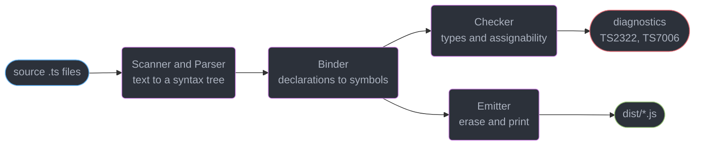
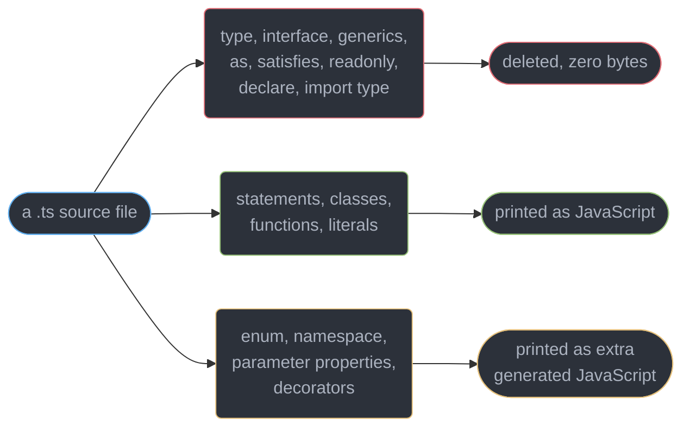
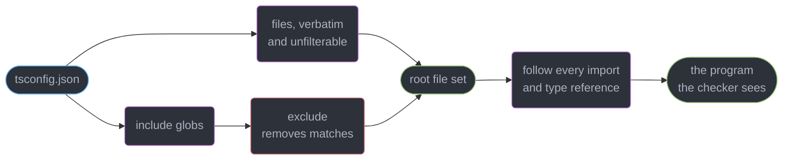
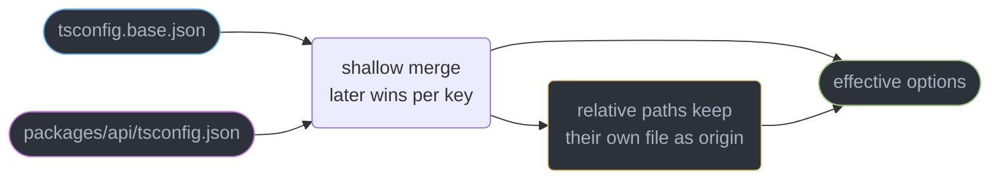
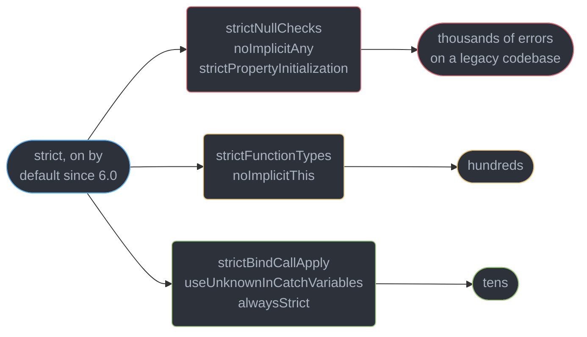
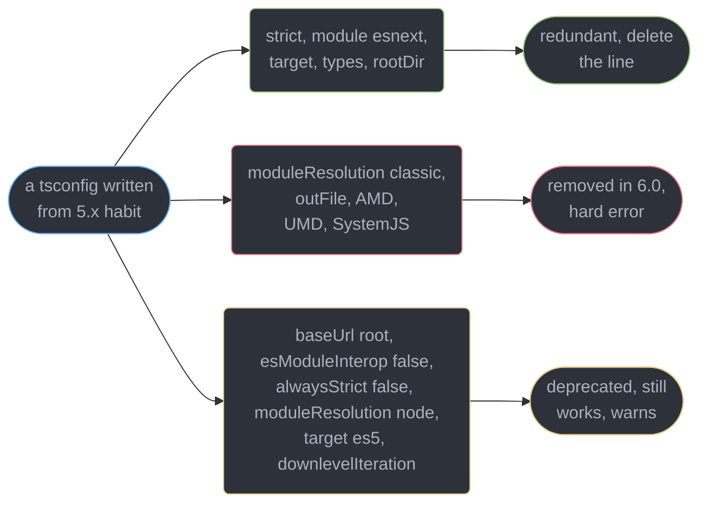

# TypeScript Fundamentals and tsconfig

---

## 1. Concept Overview

TypeScript does exactly two things to your code, in this order: it **checks** it against a type
system, then it **deletes** every annotation and hands the remaining JavaScript to the runtime.
Nothing it learned survives — no runtime, no type tag on a value, no `instanceof MyInterface`,
and no production cost for a `strict` codebase over an `any`-riddled one.

That single fact generates most of the confusion beginners have and most of the architecture
decisions seniors make. A `tsconfig.json` is therefore not a build configuration in the webpack
sense; it is **the specification of a language** — `strictNullChecks` alone changes whether
`null` is a member of every type. Two directories with different `tsconfig.json` files compile
two different languages that happen to share a syntax.

| The compiler's job | What it produces | Survives to runtime |
|--------------------|------------------|--------------------|
| Type-check | Diagnostics (`TS2322`, `TS7006`, …) | No |
| Erase and emit | `.js` files | Yes |
| Declaration emit | `.d.ts` files | No — consumed by other compilations |
| Source mapping | `.js.map`, `.d.ts.map` | Only for debuggers |

The target here is **TypeScript 7.0** (GA 2026-07-08), whose compiler is a native Go binary —
7.7-11.9x faster full builds, 6-26% lower memory, `--checkers` / `--builders` / `--singleThreaded`
controlling parallelism. **TypeScript 6.0** (2026-03-23) matters more for this module: it rewrote
the *defaults*, so a `tsconfig.json` typed from 5.x muscle memory now mostly restates them.

---

## 2. Intuition

> `tsc` is a very thorough proofreader who marks up your manuscript, then publishes the book
> with every mark rubbed out. The marks were never going to be printed.

**Mental model.** The type layer is scaffolding around a building: it constrains what you can
do while you build, catches you stepping off a beam, and on opening day it is gone. Asking how
to check a type at runtime is asking to leave the scaffolding up.

**Why it matters.** Every practical TypeScript decision follows from the erasure boundary: why
`zod` exists, why an `enum` is a rare thing that *does* emit code, why `as` cannot protect you,
and why `tsconfig.json` is the highest-leverage file in the repository — a one-line change
there can produce 4,000 new errors or hide 4,000 real bugs.

**Key insight, and the one that catches everyone.** The compiler's guarantee is *conditional*:
"given that every value entering this program has the type you declared, no type error occurs."
Every `any`, every `as`, every un-parsed `fetch` response is an unproven premise.

---

## 3. Core Principles

1. **Check then erase.** Type checking and emit are independent. `tsc` emits JavaScript for a
   file with 200 type errors unless `noEmitOnError` is set — a red build still produces output.
2. **The type system is unsound by design.** `any`, assertions, array index access and
   bivariant method parameters are holes traded for the ability to describe real JavaScript.
3. **`tsconfig.json` defines the language, not the build** — `strictNullChecks` changes the
   meaning of every type in the project.
4. **The file set is computed, not listed.** `include` seeds it; imports pull in far more;
   `exclude` only filters the seed.
5. **`strict` is an umbrella over 8 flags**, and each may be re-enabled or disabled after it.
6. **`target` is emitted syntax; `lib` is assumed APIs.** They default together and are
   independently overridable.
7. **Type information flows only through `.d.ts` files.** A package with no declarations and no
   `@types` entry is `any` at every call site.
8. **Configuration layers via `extends`, and the merge is shallow** — a nested object such as
   `paths` is replaced wholesale, never merged key by key.

---

## 4. Types / Architectures / Strategies

### 4.1 The three file-set inputs

`files` (`["src/global.d.ts"]`) is an explicit list with no globs and is never filtered by
`exclude`. `include` (`["src/**/*"]`) supports `*`, `?` and `**/`, defaults to `**/*` when both it
and `files` are absent, and picks up only `.ts`, `.tsx` and `.d.ts` — plus `.js`/`.jsx` under
`allowJs`. `exclude` (`["**/*.test.ts", "dist"]`) defaults to `node_modules`, `bower_components`,
`jspm_packages` and `outDir`, and subtracts from `include` **only**.

### 4.2 `compilerOptions` grouped by what each group actually controls

```json
{
  "compilerOptions": {
    "target": "es2025", "lib": ["es2025", "dom", "dom.iterable"],
    "module": "esnext", "moduleResolution": "bundler",
    "outDir": "dist", "rootDir": ".",
    "declaration": true, "declarationMap": true, "sourceMap": true,
    "isolatedModules": true, "skipLibCheck": true,
    "noUncheckedIndexedAccess": true, "noImplicitOverride": true,
    "noFallthroughCasesInSwitch": true, "exactOptionalPropertyTypes": true
  }
}
```

Five groups, and knowing an option's group tells you what breaks when you change it:
**language semantics** (`strict` and its 8 members, `exactOptionalPropertyTypes`), **syntax and
API surface** (`target`, `lib`), **module system** (`module`, `moduleResolution`,
`verbatimModuleSyntax` — module 8's territory), **output** (`outDir`, `rootDir`, `declaration`,
`sourceMap`, `noEmit`), and **checking scope and speed** (`skipLibCheck`, `types`, `allowJs`,
`checkJs`).

### 4.3 Layering with `extends`

```json
{
  "extends": ["../../tsconfig.base.json", "@company/tsconfig/strict.json"],
  "compilerOptions": { "outDir": "dist", "noUncheckedIndexedAccess": false },
  "include": ["src"]
}
```

`extends` accepts a string or an array (later entries win), resolves bare specifiers through
`node_modules`, and merges **shallowly**: `compilerOptions` keys override one at a time, but a
whole `paths` object from a base is discarded the moment the child declares its own. Relative
paths inside an inherited config resolve against **the file they were written in** — the usual
monorepo surprise. `files`/`include`/`exclude` replace the parent's; `references` never inherits.

---

## 5. Architecture Diagrams

### The pipeline, as orientation

Five phases, strictly ordered — and the checker's output never reaches the emitter.
`../the_typescript_compiler_and_type_performance/the_typescript_compiler_and_type_performance.md`
owns the detail.



### What survives erasure

Everything on the red path exists only while the checker runs.



### How the file set is really computed

`exclude` filters the seed and nothing after it, which is why excluding an imported file
changes nothing.



### `extends` resolution and the shallow merge



### `strict` is an umbrella over 8 flags

Ordered by migration cost: the first three are a one-week job on a large codebase, the other
five an afternoon each.



---

## 6. How It Works — Detailed Mechanics

### 6.1 Erasure, and the four constructs that break it

```ts
// input.ts
interface User { id: string; name: string }
type Id = User["id"];
const greet = (u: User): string => `hi ${u.name}`;
const raw = JSON.parse("{}") as User;

enum Level { Low, High }                 // emits an object
class Point { constructor(private x: number) {} }   // emits this.x = x

// emitted input.js:
// const greet = (u) => `hi ${u.name}`;   const raw = JSON.parse("{}");
// var Level; (function (Level) { ... })(Level || (Level = {}));
// class Point { constructor(x) { this.x = x; } }
```

`interface`, `type`, the annotation and the `as` all vanish. The `enum` and the parameter
property do not: they are **type-directed emit**, syntax whose meaning requires the compiler to
generate JavaScript, and `namespace` plus legacy `experimentalDecorators` are the other two.
`--erasableSyntaxOnly` [5.8] bans exactly those four so a file can run under a strip-only loader
such as Node's (`../typescript_at_runtime_node_deno_bun/typescript_at_runtime_node_deno_bun.md`).
Prefer a string-literal union to an `enum` and a plain field to a parameter property.

### 6.2 What TS 6.0 changed about the defaults



`strict: true`, `module: "esnext"`, `types: []`, `rootDir: "."` and
`noUncheckedSideEffectImports: true` are now the defaults, and `target` **floats** to the latest
stable ECMAScript edition instead of being pinned to `es3`/`es5` — `es2025` as of the 6.0
release. `types: []` is the sharpest: `tsc` no longer auto-includes every `@types/*` package, so
a project relying on ambient `describe`/`it` from `@types/jest` must name it. Only three things
are true removals and they are hard errors: `moduleResolution: "classic"`, `outFile`, and the
AMD/UMD/SystemJS module formats. Everything else 6.0 disapproves of — `baseUrl` as a resolution
root, `esModuleInterop: false`, `alwaysStrict: false`, `moduleResolution: "node"`, `target: "es5"`,
`downlevelIteration` — is **deprecated**: it warns and compiles exactly as before. That asymmetry
is the point of a bridge release, and it is the fact most write-ups state backwards.

### 6.3 `strict`, flag by flag

| Flag | What it catches | Typical cost on a 100k-line untyped codebase |
|------|-----------------|---------------------------------------------|
| `strictNullChecks` | `null`/`undefined` used as a real value | 60-75% of all new errors; the whole migration |
| `noImplicitAny` | An untyped parameter or binding silently becoming `any` | 15-25%; mostly mechanical annotation |
| `strictPropertyInitialization` | A class field never assigned in the constructor | Needs `strictNullChecks`; `!` or `\| undefined` |
| `strictFunctionTypes` | A callback taking a narrower parameter than declared | Low, and only on function-typed **properties** |
| `noImplicitThis` | `this` of unknown type in a standalone function | Low; fixed with a `this` parameter |
| `strictBindCallApply` | Wrong arguments through `bind`, `call`, `apply` | Very low |
| `useUnknownInCatchVariables` | Treating a caught value as an `Error` | Low, but touches every `catch` block |
| `alwaysStrict` | Emits `"use strict"` and parses in strict mode | None; `false` is deprecated in 6.0 and warns |

```ts
// strictNullChecks: null and undefined leave every other type
const el = document.getElementById("root");
el.innerHTML = "";        // 'el' is possibly 'null'. ts(18047)

// noImplicitAny
function sum(a, b) { return a + b; }   // Parameter 'a' implicitly has an 'any' type. ts(7006)

// strictPropertyInitialization
class Service { private client: Client; }
// Property 'client' has no initializer and is not definitely assigned in the constructor. ts(2564)

// useUnknownInCatchVariables
try { risky(); } catch (e) { console.log(e.message); }   // 'e' is of type 'unknown'. ts(18046)
// FIX: if (e instanceof Error) console.log(e.message);
```

The migration order that works is the reverse of the table: land the five cheap flags in a day,
then `noImplicitAny`, then `strictNullChecks` last and **per directory** via a nested
`tsconfig.json` or project references
(`../typescript_in_large_codebases/typescript_in_large_codebases.md`). One `strict: true` commit
on 100k lines produces 3,000-9,000 errors and gets reverted.

### 6.4 The four safety flags outside `strict`

```ts
// noUncheckedIndexedAccess — every index read gains | undefined
const ids: string[] = ["a"];
const first = ids[0];             // string | undefined
first.toUpperCase();              // 'first' is possibly 'undefined'. ts(18048)
const [head] = ids;               // string | undefined too
for (const id of ids) id.toUpperCase();   // OK — iteration is exempt

// noImplicitOverride
class Base { save() {} }
class Child extends Base { save() {} }
// This member must have an 'override' modifier because it overrides a member in the
// base class 'Base'. ts(4114)

// noFallthroughCasesInSwitch
switch (kind) { case "a": doA(); case "b": doB(); break; }   // Fallthrough case. ts(7029)

// exactOptionalPropertyTypes — absent is no longer the same as present-and-undefined
interface Patch { name?: string }
const p: Patch = { name: undefined };   // error unless declared `name?: string | undefined`
```

`noUncheckedIndexedAccess` is the highest-value flag outside `strict` and the noisiest: it is
honest about a real unsoundness (`arr[99]` is typed `T` and is `undefined`), adding 400+ errors
per 10k array-heavy lines. `exactOptionalPropertyTypes` matters wherever absent and undefined
differ at runtime — `in` checks, `Object.keys()`, `JSON.stringify`, and a partial update that
would otherwise null a column.

### 6.5 `target` vs `lib`

```ts
// target controls SYNTAX DOWN-LEVELLING
const x = obj?.a ?? 0;
// target es2025 → emitted unchanged
// target es2018 → const x = (_a = obj === null || obj === void 0 ? void 0 : obj.a) !== null
//                           && _a !== void 0 ? _a : 0;

// lib controls WHICH DECLARATIONS EXIST
[1, 2].at(-1);       // needs lib es2022 — otherwise: Property 'at' does not exist on
                     // type 'number[]'. Do you need to change your target library? ts(2550)
document.title;      // needs lib dom — absent in a Node-only project
```

`target` *seeds* `lib`, so `"target": "es2025"` implies `"lib": ["es2025"]` plus `dom` when
none is stated, and stating `lib` overrides that seed entirely — a Node service should say
`"lib": ["es2025"]` with no `dom` so `document` fails to resolve instead of crashing. Raising
`lib` while shipping to a runtime without `Array.prototype.at` is the reverse mistake: the
compiler is happy, the browser throws, and only a polyfill changes what the runtime provides.

### 6.6 Declaration output, source maps and `isolatedModules`

```ts
// with "declaration": true and "declarationMap": true, for src/api.ts
export function load(id: string) { return { id, ok: true as const }; }
// dist/api.d.ts:  export declare function load(id: string): { id: string; ok: true };
// dist/api.d.ts.map maps that signature back to src/api.ts

// isolatedModules: each file must be transpilable alone
export { User } from "./types";
// Re-exporting a type when 'isolatedModules' is enabled requires using 'export type'. ts(1205)
export type { User } from "./types";        // FIX

const enum Level { Low }                    // also rejected under isolatedModules
```

`declaration` is what makes a package consumable by another TypeScript project; without it,
consumers see `any`. `declarationMap` lets go-to-definition land in your **source** rather than
the generated `.d.ts`, worth its 5-10% output-size cost in any monorepo, and `sourceMap` does the
same for the runtime debugger. `isolatedModules` asserts every file can be transpiled with no
knowledge of any other — the contract esbuild, SWC, Babel, Vite, Bun and Node's type stripper all
need. It is a compatibility flag, not a performance one.

### 6.7 Type acquisition, `@types`, `skipLibCheck` and JS interop

```json
{
  "compilerOptions": {
    "types": ["node", "vitest/globals"],
    "typeRoots": ["./node_modules/@types", "./typings"],
    "skipLibCheck": true, "allowJs": true, "checkJs": false
  }
}
```

Types reach the compiler by three routes: a `types` field or export condition in the package
itself, a `@types/<pkg>` package from DefinitelyTyped, or a hand-written `.d.ts` in your repo.
With none of them you get `Could not find a declaration file for module 'left-pad'. ts(7016)`
and the import is `any`. `types: []` — the 6.0 default — stops every `@types/*` folder being
auto-included as a **global** ambient script, which is how `@types/jest`'s `describe` used to
leak into a Vitest project and error in files that imported neither.

`skipLibCheck: true` skips checking inside `.d.ts` files, removing 15-30% of check time on a
large `node_modules`, because two dependencies shipping incompatible versions of the same
declarations fail a check you cannot fix. The cost is that an error inside a dependency's types
stays hidden until it reaches your call site, so a **library author** turns it off in release CI.
`allowJs` admits `.js` files and `checkJs` checks them via JSDoc — split so a migration runs
`allowJs` first, then `// @ts-check` file by file, then `checkJs`.

---

## 7. Real-World Examples

### A complete TS 7.0 application config

```json
{
  "compilerOptions": {
    "lib": ["es2025"], "moduleResolution": "bundler",
    "outDir": "dist", "sourceMap": true,
    "isolatedModules": true, "verbatimModuleSyntax": true,
    "skipLibCheck": true, "types": ["node"],
    "noUncheckedIndexedAccess": true, "noImplicitOverride": true,
    "noFallthroughCasesInSwitch": true
  },
  "include": ["src"]
}
```

Every line is doing work. `strict`, `module`, `target` and `rootDir` are absent because 6.0
already sets them the way this project wants, and `lib` is stated only to drop `dom` from a Node
service. The same file written in 2024 carried 9 more redundant lines and 2 (`baseUrl`,
`moduleResolution: "node"`) that still build under 6.0 but warn on every run, and are scheduled
to stop resolving.

### A monorepo base plus a leaf

```json
{
  "extends": "../../tsconfig.base.json",
  "compilerOptions": {
    "outDir": "dist", "rootDir": "src",
    "declaration": true, "declarationMap": true, "composite": true
  },
  "include": ["src"],
  "references": [{ "path": "../shared" }]
}
```

The base holds every semantic option so all 40 packages compile one language; the leaf holds
only paths and its output shape. `composite` plus `references` lets `tsc --build` skip 39
unchanged packages — module 14's mechanism, and why `references` is not inherited.

---

## 8. Tradeoffs

| Decision | Cost | Benefit |
|----------|------|---------|
| `strict: true` on legacy code | 3,000-9,000 errors at once on 100k lines | Removes the entire null-dereference class |
| `noUncheckedIndexedAccess` | 400+ errors per 10k array-heavy lines | Closes the largest remaining unsoundness |
| `skipLibCheck: true` | Dependency declaration bugs surface later | 15-30% faster checks, unblocked builds |
| `declaration: true` | 5-15% longer build, `.d.ts` in output | The package is consumable by TypeScript |
| `isolatedModules: true` | Bans `const enum` and untyped re-exports | Works with every single-file transpiler |

| Approach to checking | Speed | Fidelity | Where it fits |
|----------------------|-------|----------|---------------|
| `tsc --noEmit` in CI | Slowest, full program | Complete | The gate that must pass |
| `tsc --watch` locally | Incremental after first run | Complete | The inner loop |
| Editor language service | Per-file, lazy | Complete for open files | Authoring |
| esbuild / SWC transpile | 20-100x faster | **None** — erases without checking | Dev server and bundling |

The last row is the one to internalise: your bundler does not type-check, so a green
`vite build` proves nothing about types.

---

## 9. When to Use / When NOT to Use

**Set an option deliberately when:**

- It changes semantics you have decided about — `noUncheckedIndexedAccess`,
  `exactOptionalPropertyTypes`, `verbatimModuleSyntax`.
- It describes your runtime — `lib` for a Node service, `types` for your test framework.
- It describes your output contract — `declaration`, `declarationMap`, `outDir`, `composite`.

**Delete the option when** it restates a 6.0 default (`strict`, `module: "esnext"`, `target`,
`rootDir`, `esModuleInterop`) — a shorter config is one someone reads before changing it.

**Do NOT reach for the type system when:**

- The value crosses a process boundary — a `fetch` response, `process.env`, a database row, a
  `JSON.parse` result. Parse them, per
  `../runtime_validation_and_parse_dont_validate/runtime_validation_and_parse_dont_validate.md`.
- You need a runtime type test. There is no `instanceof` for an `interface`; use a
  discriminant field, `zod`, or a `class`.
- You are tempted to write `as` to silence an error — an assertion suppresses the check, and
  `satisfies` gives the check without it
  (`../structural_typing_and_assignability/structural_typing_and_assignability.md`).

---

## 10. Common Pitfalls

### Pitfall 1: `exclude` that excludes nothing (BROKEN → FIX)

```ts
// BROKEN — tsconfig.json says "exclude": ["src/legacy"], yet legacy still fails the build
// src/index.ts
import { parse } from "./legacy/parser";     // pulls src/legacy/parser.ts into the program
// error TS7006: Parameter 'input' implicitly has an 'any' type.   ← in the "excluded" file

// FIX — exclusion is not reachability. Give it its own compilation unit with looser
// options and depend on its emitted .d.ts:
//   src/legacy/tsconfig.json  { "compilerOptions": { "strict": false, "composite": true } }
//   root tsconfig.json        "references": [{ "path": "./src/legacy" }]
```

`exclude` filters the `include` glob before the program is built, and every file reached by an
import is compiled, checked and emitted regardless. The only way to give a directory different
rules is to make it a different compilation.

### Pitfall 2: assuming the type survives to runtime

```ts
// BROKEN — the annotation is a comment as far as the running program is concerned
interface CreateUser { email: string; age: number }

app.post("/users", async (req, res) => {
  const body: CreateUser = req.body;      // req.body is any; nothing is verified
  await db.insert(body);                  // age arrives as "not-a-number", hits an int column
});

// FIX — parse at the boundary, and let the type come out of the parser
import { z } from "zod";
const Create = z.object({ email: z.email(), age: z.number().int().min(0) });

app.post("/users", async (req, res) => {
  const parsed = Create.safeParse(req.body);
  if (!parsed.success) return res.status(400).json({ issues: parsed.error.issues });
  await db.insert(parsed.data);           // typed AND verified
});
```

`const body: CreateUser = req.body` compiles because `any` is assignable to everything. The
annotation is a claim, not a check, and it is the single most common way a `strict` codebase
still crashes in production.

### Pitfall 3: `target` and `lib` confused for one setting

```ts
// BROKEN — a browser bundle targeting old devices, with lib raised to silence an error
// { "target": "es2017", "lib": ["es2023", "dom"] }
const last = items.at(-1);      // compiles clean; lib says Array.prototype.at exists
// Safari 14 on the actual user's phone: TypeError: items.at is not a function

// FIX — lib describes the runtime; only a polyfill changes the runtime
// { "target": "es2017", "lib": ["es2017", "dom"] }
const last = items[items.length - 1];      // or polyfill, and keep lib honest
```

Raising `lib` is how developers "fix" a `Property 'at' does not exist` error, and it works
perfectly — it deletes the warning that was telling the truth. `target` down-levels *syntax* and
never adds a *method*.

### Pitfall 4: a green bundler build with a red type-check

A Vite or esbuild build strips types without checking them, so `npm run build` succeeds while
`tsc --noEmit` reports 340 errors. Teams find out when a refactor ships a
`Cannot read properties of undefined` on a "successful" deploy. Make `tsc --noEmit` its own
required CI job on the same commit.

---

## 11. Technologies & Tools

| Tool | Role | Relevance to this module |
|------|------|--------------------------|
| TypeScript | The compiler and checker, 7.0 native Go binary | Owns every flag discussed here |
| tsc6 | The 6.0 binary published as `@typescript/typescript6` | The only stable Compiler API until 7.1 |
| typescript-eslint | Type-aware linting, 8.69.0 | Still runs on `tsc6`; needs a project config |
| ts-morph | Programmatic AST and codemods | Also pinned to `tsc6` until 7.1 |
| DefinitelyTyped | The `@types` registry | Supplies declarations for untyped packages |
| esbuild | Transpile-only bundler | Erases types, never checks them |
| Zod | Runtime schema validation | Closes the gap erasure leaves at the boundary |

---

## 12. Interview Questions with Answers

**Q: Does TypeScript give you any guarantee at runtime?**
**Short:** None whatsoever — annotations are deleted before the code runs, so a value arriving from outside the program was never checked.

Erasure means an `interface` leaves zero bytes and there is no runtime tag to inspect. The
guarantee is conditional: given that every input matches its declaration, no type error occurs.
`JSON.parse`, `process.env`, a database driver and an untyped dependency all supply
`any`, which voids the premise. Validate at the boundary and the guarantee holds again.

**Q: Why does `tsc` still write JavaScript when the build reported 40 errors?**
**Short:** Checking and emitting are independent phases, and emit is not gated on diagnostics unless `noEmitOnError` is set.

The emitter works from the syntax tree the binder produced, not from the checker's verdict,
which is deliberate: a partially broken file should still be runnable during development. Set
`noEmitOnError: true` for a release build, or use `noEmit: true` and let a bundler produce the
output while `tsc` acts purely as the gate.

**Q: A file listed in `exclude` is still producing errors. Why?**
**Short:** Exclusion filters the `include` globs that seed the program, and any file reached by an import joins it regardless.

The root set is `files` plus the `include` matches minus the `exclude` matches; the compiler
then walks every import and type reference from that root set and adds what it finds. So
`exclude` only prevents a file becoming an *entry point*. To give a directory different
options it must become a separate compilation with its own `tsconfig.json`, wired in through
project references.

**Q: What is the difference between `target` and `lib`?**
**Short:** `target` chooses which syntax gets down-levelled during emit, while `lib` chooses which built-in API declarations are assumed to exist.

Lowering `target` rewrites `?.` and `class` fields into older equivalents. Raising `lib` adds
`Array.prototype.at` to the type system and adds nothing to the runtime. `target` seeds `lib`
when `lib` is unset, which is why the two look coupled; a Node service should state `lib`
explicitly so `document` does not resolve.

**Q: Which flags does `strict` actually turn on?**
**Short:** Eight of them: strictNullChecks, noImplicitAny, strictFunctionTypes, strictBindCallApply, strictPropertyInitialization, useUnknownInCatchVariables, alwaysStrict and noImplicitThis.

`strict` is a shorthand, not a mode, and each member can be overridden individually after it —
`{"strict": true, "strictNullChecks": false}` is legal and is the standard partial-migration
posture. On a legacy codebase `strictNullChecks` alone accounts for 60-75% of the new errors,
which is why it goes last.

**Q: Why do most projects set `skipLibCheck` to true?**
**Short:** Declaration files in `node_modules` are not yours to fix, and two dependencies shipping conflicting `.d.ts` versions will otherwise fail a build you cannot unblock.

It typically removes 15-30% of check time on a large dependency tree. The tradeoff is that a
real error inside a dependency's declarations goes unreported until it surfaces at your call
site. A package author should disable it in CI so the declarations they publish are verified
before release.

**Q: What does `isolatedModules` guarantee, and what does it forbid?**
**Short:** It guarantees every file can be transpiled with no knowledge of any other file, which bans `const enum` and re-exporting a type without `export type`.

Single-file transpilers — esbuild, SWC, Babel, Bun, Node's type stripper — cannot know whether
`export { User } from "./types"` names a type or a value, so they cannot decide whether to erase
the line. It is a compatibility flag rather than a performance one and belongs in any project
not built solely by `tsc`.

**Q: Which TypeScript syntax actually emits JavaScript?**
**Short:** Four constructs are type-directed emit rather than pure annotation: `enum`, `namespace`, constructor parameter properties, and legacy experimental decorators.

Everything else — interfaces, type aliases, generics, `as`, `satisfies`, `readonly`,
`declare`, `import type` — leaves nothing behind. `--erasableSyntaxOnly` [5.8] rejects those
four precisely so a file can be executed by a strip-only loader. Preferring a string-literal
union to an `enum` costs nothing and keeps the file erasable.

**Q: What changed in the TypeScript 6.0 defaults?**
**Short:** `strict`, `module: esnext`, `types: []`, `rootDir: "."` and `noUncheckedSideEffectImports` became the defaults, and `target` now floats to the latest stable ECMAScript edition.

The consequence is that a config carried over from 5.x is mostly redundant lines. The one that
bites is `types: []`: `@types/*` packages are no longer auto-included as globals, so a project
depending on ambient `describe` or `it` must name the package. Deleting the redundant lines
makes the remaining options visibly intentional.

**Q: Which options were removed in 6.0, and which were only deprecated?**
**Short:** Only `moduleResolution classic`, `outFile` and the AMD/UMD/SystemJS formats were removed; everything else 6.0 disapproves of is deprecated and still compiles with a warning.

Confusing the two lists is the fastest way to give wrong migration advice. A removed option is a
hard configuration error that stops the build; a deprecated one emits a warning and compiles
exactly as before. The deprecated list is the long one: `baseUrl` as a resolution root,
`esModuleInterop: false` and `allowSyntheticDefaultImports: false`, `alwaysStrict: false`,
`moduleResolution: "node"` (`node10`), `target: "es5"` and `downlevelIteration`. Fix the
three removals to unblock the build, then work the warnings down before 7.x turns them into
errors — replace `baseUrl` with `paths` relative to the config file, and `outFile` with a bundler.

**Q: What is `noUncheckedIndexedAccess` and why is it not in `strict`?**
**Short:** It adds `| undefined` to every index and index-signature read, closing a real unsoundness that would have broken too much existing code to include by default.

`arr[99]` is typed `T` and evaluates to `undefined`, and the flag makes that visible. It can
produce 400+ errors per 10k array-heavy lines, most fixed by `for...of` iteration, which the
flag exempts, or by an explicit guard. It is the highest-value flag outside the umbrella and
should be enabled on any new project from day one.

**Q: How does `extends` merge configuration?**
**Short:** Shallowly and per key, with later entries winning, and relative paths inside an inherited file resolving against that file rather than the child.

A child declaring its own `paths` discards the base's `paths` object entirely instead of merging
entries into it. `files`, `include` and `exclude` from the child replace the parent's outright,
and `references` is never inherited at all. The path-origin rule is the usual monorepo surprise:
an `outDir` in a base config points relative to the base's directory.

**Q: A dependency import is typed `any`. What are the possible causes?**
**Short:** The package ships no declarations, no matching `@types` package is installed, or the resolution mode cannot see the `types` condition in its exports map.

The first two produce `Could not find a declaration file for module 'x'. ts(7016)`; the third
resolves the runtime entry while missing the declarations, which is what `arethetypeswrong`
diagnoses. The fixes in order of preference are installing `@types/x`, writing a local
`.d.ts` with the members you use, and — last — `declare module "x"`, which types the whole
package as `any` and hides the problem.

**Q: What is the practical caveat for tooling on TypeScript 7.0 today?**
**Short:** There is no stable programmatic Compiler API until 7.1, so typescript-eslint, ts-jest, ts-morph and framework template checkers still run on the 6.0 binary.

Those tools resolve `typescript@npm:@typescript/typescript6`, whose binary is `tsc6`, while
`tsc` itself is the native Go build. A repository therefore holds two compilers for a while,
and a semantic option changed in `tsconfig.json` must be understood by both. Plan for the
duplication rather than being surprised by it in CI.

**Q: Why do `allowJs` and `checkJs` exist separately?**
**Short:** `allowJs` lets JavaScript files enter the program so they can be imported and emitted, while `checkJs` additionally type-checks them by inferring from JSDoc.

Splitting them is what makes an incremental migration possible: turn on `allowJs` with
`checkJs` false so nothing breaks, add `// @ts-check` to one file at a time, then flip
`checkJs` on with `// @ts-nocheck` marking the stragglers. Setting both at once on a large
JavaScript codebase produces the same all-at-once error wall as flipping `strict`.

**Q: Why is `declarationMap` worth enabling in a monorepo?**
**Short:** It makes go-to-definition land in the original source file instead of the generated declaration, which is what makes cross-package navigation usable.

Without it, jumping into a sibling package's function stops at a signature in `dist/*.d.ts` with
no body, and refactoring tools rename the declaration rather than the implementation. The cost
is a 5-10% increase in emitted output size and no runtime cost at all, since
`.d.ts.map` files are never shipped to a browser.

---

## 13. Best Practices

1. **Delete every option that restates a 6.0 default.** A 12-line config gets read; a 40-line
   one gets cargo-culted.
2. **State `lib` explicitly on a Node service** so `document` fails to resolve rather than
   compiling and crashing, and **never raise `lib` to silence a missing-method error** — ship a
   polyfill or use a method the runtime has.
3. **Run `tsc --noEmit` as its own required CI job.** Your bundler does not type-check.
4. **Enable `noUncheckedIndexedAccess`, `noImplicitOverride` and
   `exactOptionalPropertyTypes` on new projects from commit one**, when the cost is zero.
5. **Migrate to `strict` in reverse cost order** — the five cheap flags, then `noImplicitAny`,
   then `strictNullChecks` per directory. Never in one commit.
6. **Set `isolatedModules` and `verbatimModuleSyntax`** in anything a single-file transpiler
   will touch, which is nearly everything.
7. **Keep semantics in the base config and paths in the leaf** so a monorepo compiles one
   language across every package.
8. **Parse at every process boundary** — an annotation on `req.body` is a comment.
9. **Turn `skipLibCheck` off in a library's release CI**; the declarations you publish are the
   product.

---

## 14. Case Study

### A 340k-line platform moving from a 5.4 config to TypeScript 7.0

A payments platform runs 41 packages in one pnpm workspace: 340k lines of TypeScript, 18k of
untyped JavaScript, and a `tsconfig.base.json` grown by accretion since 2021. Full type-check
took **4m 50s** on CI, the job had been marked `continue-on-error: true` two years earlier
"temporarily", and 3 incidents in 6 months traced to `undefined` reaching a path the checker had
waved through. The starting config:

```json
{
  "compilerOptions": {
    "target": "es5", "module": "commonjs", "moduleResolution": "node",
    "lib": ["es2020", "dom"],
    "baseUrl": ".", "paths": { "@app/*": ["packages/*/src"] },
    "esModuleInterop": true, "skipLibCheck": true, "allowJs": true,
    "strict": false, "strictNullChecks": true
  }
}
```

Nothing here failed the 6.0 build. That is what made it dangerous. `target: es5`,
`moduleResolution: "node"` and `baseUrl` as a resolution root are all **deprecated, not removed**:
each emitted a warning on every run, and every one of those warnings went into a job already
marked `continue-on-error: true`. Nobody had read that log in two years, so a config the compiler
had been complaining about since March looked, from the dashboard, entirely healthy. Meanwhile
`target: es5` was down-levelling every `async` function into a state machine nobody needed on
Node 24, `strict: false` with `strictNullChecks: true` meant `noImplicitAny` had been off for
four years, and `lib: ["es2020", "dom"]` let a backend package reference `window`.

The forcing function was the 7.0 upgrade, not a broken build. The team read the 6.0 warnings for
the first time while scoping it, found `baseUrl` on the list, and had to decide whether to move
115 bare `utils/*` specifiers to `paths` now or discover them the day a release turned the
deprecation into an error. They moved first — a two-day mechanical change with the warnings as
the worklist, done while the old behaviour still worked as a fallback. Doing it after the
removal would have meant a red build with 115 unresolved-module errors and no way back.

```ts
// BROKEN — found by noImplicitAny the moment it was enabled, in a settlement path
export function reconcile(batch, ledger) {          // both parameters were implicitly any
  return batch.rows.map((r) => ({
    id: r.id,
    delta: r.amount - ledger.get(r.id).amount,      // ledger.get returns Entry | undefined
  }));
}
// production: one unmatched id per 40k rows threw
// TypeError: Cannot read properties of undefined (reading 'amount')

// FIX — annotate, then let strictNullChecks force the missing case into the open
export function reconcile(batch: Batch, ledger: Map<string, Entry>): Delta[] {
  return batch.rows.map((r) => {
    const prior = ledger.get(r.id);                 // Entry | undefined
    if (!prior) throw new UnmatchedRowError(r.id);  // explicit, logged, alertable
    return { id: r.id, delta: r.amount - prior.amount };
  });
}
```

The migration ran over 6 weeks in five commits. Deleting the dead 5.x options and letting the
6.0 defaults apply took the base config from 34 lines to the 11 shown in §7. `noImplicitAny`
produced 1,847 errors, 91% of them a missing parameter annotation a codemod supplied, and
`noUncheckedIndexedAccess` produced 612 more, landed one package per day.
`types: ["node", "vitest/globals"]` removed an ambient `@types/jest` shadowing Vitest's own
globals in 7 packages, and the remaining JavaScript moved behind `allowJs: true,
checkJs: false` in one leaf project rather than the workspace root.

**Outcome after one quarter.** Full type-check fell from 4m 50s to **31s** — the 7.0 Go compiler
accounts for most of it, and dropping `target: es5` removed the down-level transform entirely.
The CI job lost its `continue-on-error` flag the day the last error cleared. The 612
`noUncheckedIndexedAccess` errors contained 4 genuine crash sites, one the reconciliation path
above, and `exactOptionalPropertyTypes` caught 23 places where a present-but-`undefined` field
nulled a required column in a partial update. Bundle size fell 11%, all erased `es5` helpers.

**The lesson.** A `tsconfig.json` is the only file in a repository that can make thousands of
lines of code mean something different, and it is the file least often read. This migration found
no bugs by writing new types — it found them by deleting eleven options that had turned the
checker off.
