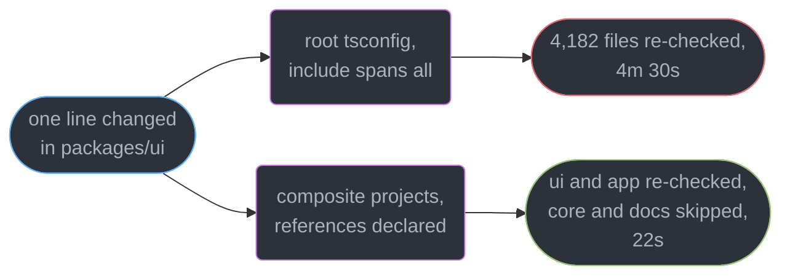
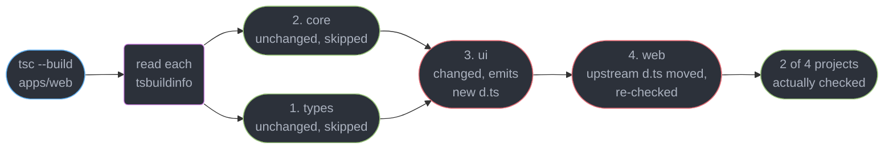
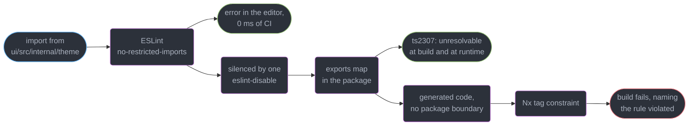
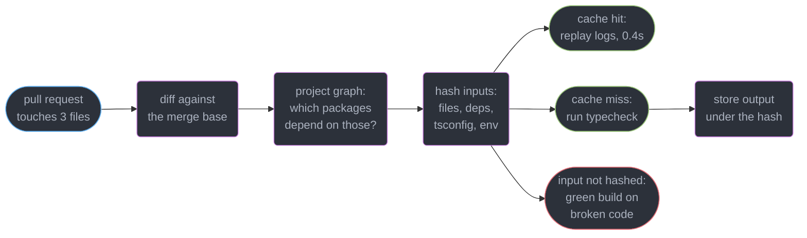
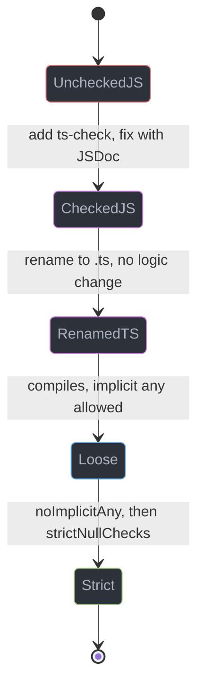
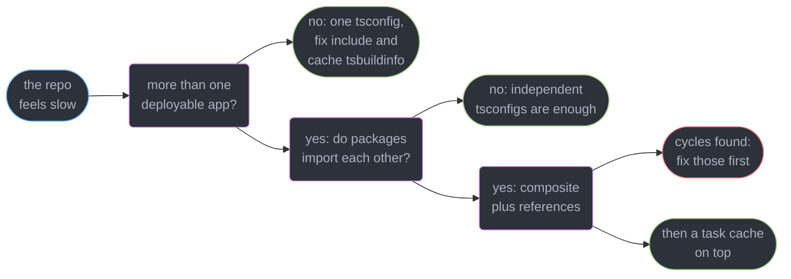

# TypeScript in Large Codebases

---

## 1. Concept Overview

TypeScript is pleasant at 10,000 lines and adversarial at 500,000. Nothing about the language
changes; what changes is that four properties which were free at small scale each acquire a
price, and none of them announces itself with an error message.

| What breaks | Where it starts to hurt | What it looks like on a Tuesday |
|-------------|------------------------|---------------------------------|
| Full type-check | ~100k lines, one `tsconfig` | `tsc --noEmit` takes 4m 30s, so nobody runs it before pushing |
| Editor responsiveness | ~250k lines in one program | 900 ms from keystroke to red squiggle, autocomplete arrives after the next word |
| Predictable blast radius | ~15 packages | "does this change break `checkout`?" is answered by pushing and waiting |
| Ownership of the seams | any size, once teams outnumber 3 | `any` crosses a package boundary and nobody notices for six weeks |

The through-line is that **a large codebase's type health is a process property, not a code
property**. It degrades on its own — one `@ts-ignore` at a time, one union member per sprint,
one deep import that was faster than exporting properly — and improves only when somebody
measures it. Every technique here is a way of making a slow degradation visible while it is
still cheap.

This module owns **structure and process**: project references, workspace layout, enforced
boundaries, incremental CI, migration, and containing `any`. It does not own the compiler.
Build speed, `--extendedDiagnostics`, union blowup and `skipLibCheck` belong to
[The TypeScript Compiler and Type Performance](../the_typescript_compiler_and_type_performance/the_typescript_compiler_and_type_performance.md);
`exports` maps and specifier resolution to
[Modules, Resolution and Package Exports](../modules_resolution_and_package_exports/modules_resolution_and_package_exports.md);
`.d.ts` authoring to
[Declaration Files and Library Authoring](../declaration_files_and_library_authoring/declaration_files_and_library_authoring.md).

---

## 2. Intuition

> A folder structure is a suggestion. A compiler error is a boundary. Everything in this
> module is the work of turning the first into the second.

**Mental model.** Think of a monorepo as a city. `packages/` are districts, `index.ts` files
are the roads in and out, and a deep import is somebody cutting through a back garden. It is
faster once, and it is why the district cannot be renovated three years later — forty
strangers now walk through that garden and none of them knows they are trespassing.

**Why it matters.** The failure mode is never a bad decision. It is 400 individually
reasonable ones: a shortcut import at 6pm, an `any` on a third-party callback, a package
added to the root `tsconfig` because that was where things went. Each costs 30 seconds of
build time or one unchecked value, and the sum is a codebase where nobody can predict what a
change breaks.

**Key insight.** Every fix here converts an *invisible, gradual* cost into a *loud, immediate*
one. A boundary you cannot cross without a lint error. A strictness baseline that fails CI
when it moves the wrong way. An `any` budget printed in the pull request. The technique is
always the same: make the degradation fail a build today rather than surface as an incident
in November.

---

## 3. Core Principles

1. **One program means one blast radius.** A single `tsconfig` whose `include` spans every
   package makes every change a whole-repo change, to the compiler and to your CI.
2. **A boundary that nothing enforces does not exist.** Convention holds for about six weeks
   after the person who wrote it stops reviewing every pull request.
3. **Enforce at the cheapest layer that catches it.** Lint catches it in the editor,
   `exports` catches it at resolution, a project reference catches it in the build graph.
4. **Migrate at the leaves.** A module with no first-party imports can be typed correctly in
   isolation. A module at the root cannot be typed at all until its dependencies are.
5. **Ratchet, do not target.** "Zero errors by Q3" fails. "Never more errors than yesterday"
   succeeds, because it is enforceable in 30 lines of CI.
6. **Contain `any`, do not ban it.** It enters legitimately at every untyped boundary. The
   discipline is that it stops one function later, not that it never appears.
7. **Cache correctness beats cache hit rate.** A task cache that misses one input is worse
   than no cache: it returns green on code that does not compile.
8. **Someone owns the base `tsconfig`.** Shared configuration with no owner is copy-paste
   with extra steps, and it drifts within two quarters.

---

## 4. Types / Architectures / Strategies

### 4.1 Four repository shapes, and what each costs

| Shape | Type-check unit | Blast radius | Where it stops working |
|-------|----------------|--------------|------------------------|
| Single app, one `tsconfig` | the whole app | everything | ~100k lines, or when two teams share it |
| Monorepo, one root `tsconfig` | the whole repo | everything | immediately — this is the trap |
| Monorepo, per-package `tsconfig`, no references | one package, manually | unknown | when a package imports another's source |
| Monorepo, composite project references | one project node | computable from the graph | cyclic dependencies, which it forbids |

The third row is the common half-migration: each package has its own config, but they import
each other's `src/` directly, so the boundary exists on disk and nowhere in the build.

### 4.2 The three enforcement layers

| Layer | Mechanism | Catches | Fails at |
|-------|-----------|---------|----------|
| Lint | `no-restricted-imports` patterns | a deep import as you type it | anything that dodges the pattern, and generated code |
| Package resolution | `exports` in the workspace package | any specifier not publicly declared, at build and at runtime | nothing — but it needs real package boundaries |
| Build graph | `references` plus Nx tag constraints | an import from a package not declared as a dependency | in-package layering, which it cannot see |

Use all three. Lint gives the fastest feedback, `exports` gives the one that cannot be
suppressed, and the graph gives the architectural rule ("`feature` may not import `feature`").

### 4.3 Migration strategies, ranked by how often they finish

| Strategy | Mechanism | Finishes? |
|----------|-----------|-----------|
| Leaf-first, file-by-file | `allowJs`, rename one leaf module at a time | Yes — every step ships independently |
| `// @ts-check` first | type-check `.js` in place, fix, then rename | Yes — decouples the rename from the fixing |
| Big-bang branch | convert everything, merge once | Almost never — it rebases against a moving trunk for months |
| New code only | `.ts` for new files, `.js` forever for old | Stalls — the untyped core keeps producing `any` at every call |

---

## 5. Architecture Diagrams

### One program versus a referenced graph



The compiler has no notion of a package. Without `references` there is one program, and one
program that changed must be checked in full.

### What `tsc --build` walks



The order is a topological sort of `references`. A project is skipped when its own inputs and
all its dependencies' emitted outputs are unchanged, which is why `declaration: true` is not
optional under `composite`.

### The three layers a bad import has to get through



Each layer catches what the one before it missed. Only the middle layer cannot be silenced by
a comment, which is why a published package's `exports` map is the strongest boundary
available.

### Incremental CI: the affected graph



The red path is the only interesting one. A hit that should have been a miss is
indistinguishable from a real pass, and it stays that way until the nightly full build.

---

## 6. How It Works — Detailed Mechanics

### 6.1 Composite projects and `references`

Three files make a package a node in the build graph. The shared base carries everything that
must not differ between packages:

```json
// tsconfig.base.json — owned by the platform team, extended by every package
{
  "compilerOptions": {
    "strict": true,
    "target": "es2023",
    "module": "nodenext",
    "moduleResolution": "nodenext",
    "composite": true,
    "declaration": true,
    "declarationMap": true,
    "skipLibCheck": true
  }
}
```

The per-package config adds only what is local — its own inputs, its own output, and who it
depends on:

```json
// packages/ui/tsconfig.json
{
  "extends": "../../tsconfig.base.json",
  "compilerOptions": {
    "rootDir": "src",
    "outDir": "dist",
    "tsBuildInfoFile": "../../node_modules/.cache/tsbuildinfo/ui.json"
  },
  "include": ["src/**/*"],
  "references": [{ "path": "../core" }, { "path": "../types" }]
}
```

`composite: true` forces `declaration: true` and requires every input file to be matched by
`include` or `files` — the build needs a closed input set to fingerprint. `references` then
changes what an import of `@acme/core` resolves to: the emitted `core/dist/index.d.ts`, not
`core/src/index.ts`. That is the whole mechanism. A dependent reads a *contract*, so it can be
skipped whenever that contract is byte-identical to last time.

`tsc --build apps/web --verbose` names the exact input that invalidated each project, which is
the fastest way to find a generated file nobody meant to include:

```
Project 'packages/core/tsconfig.json' is up to date because newest input is older than output
Project 'packages/ui/tsconfig.json' is out of date because output is older than input 'src/Button.tsx'
Project 'apps/web/tsconfig.json' is out of date because output is older than input 'ui/dist/index.d.ts'
```

Two costs are real. **Cycles are forbidden** — `error TS6202: Project references may not form a
circular graph` — and untangling two packages that grew together is days of work. And
`declaration: true` means every exported symbol needs an inferrable type, so a deeply inferred
export now needs an annotation; `isolatedDeclarations` `[5.5]` makes that rule explicit and
per-file, in
[Declaration Files and Library Authoring](../declaration_files_and_library_authoring/declaration_files_and_library_authoring.md).

### 6.2 `extends` — what inherits and what does not

`extends` shallow-merges `compilerOptions`, and every relative path in the base resolves
**relative to the base file**, not to the file extending it:

| Field | Behaviour when extending |
|-------|-------------------------|
| `compilerOptions` | merged key by key, child wins per key |
| `include`, `exclude`, `files` | **replaced entirely** if the child declares them |
| `outDir`, `baseUrl`, `paths` | inherited, but resolved against the base file's directory |
| `references` | never inherited — always local |

Put `strict`, `target`, `module` and `skipLibCheck` in the base; keep `rootDir`, `outDir`,
`include` and `references` in the package. Never put `paths` in a shared base: the aliases
resolve against the repository root and appear to work until one package is published.

### 6.3 The workspace layout

The convention that survives is two top-level directories with one rule between them: **`apps`
may depend on `packages`, `packages` may not depend on `apps`.** Every first-party dependency is
declared even though the files are on disk anyway, because that declaration is what the task
graph and the tag constraints read:

```json
// apps/web/package.json
{ "name": "@acme/web", "private": true,
  "dependencies": { "@acme/ui": "workspace:*", "@acme/core": "workspace:*" } }
```

`workspace:*` tells pnpm 11.25.0 to link the local package and refuse to fall back to the
registry, so a typo is an install error rather than a silent download of somebody else's
`@acme/ui`; on publish it is rewritten to the real version. Lockfiles and phantom dependencies
belong to
[Package Management and Supply Chain](../../frontend_platform/package_management_and_supply_chain/package_management_and_supply_chain.md).

### 6.4 Enforcing the boundary

**Layer one, lint.** Ban the shapes, not the names, so the rule holds for packages that do not
exist yet:

```js
// eslint.config.js — flat config, typescript-eslint 8.69.0
export default [{
  rules: {
    "no-restricted-imports": ["error", { patterns: [
      { group: ["@acme/*/src/*", "@acme/*/dist/*"],
        message: "Import the package root. Deep paths are not a public API." },
      { group: ["**/internal/**"], message: "internal/ is private to its package." }
    ]}]
  }
}];
```

**Layer two, `exports`.** One public entry per package, everything else unreachable:

```json
// packages/ui/package.json
{
  "name": "@acme/ui",
  "exports": {
    ".": { "types": "./dist/index.d.ts", "default": "./dist/index.js" },
    "./styles.css": "./dist/styles.css"
  }
}
```

Anything unlisted now fails at resolution — `error TS2307: Cannot find module
'@acme/ui/src/internal/theme' or its corresponding type declarations` — at build time and at
runtime. This is the layer no comment can suppress. Conditional exports and the dual-package
hazard are owned by
[Modules, Resolution and Package Exports](../modules_resolution_and_package_exports/modules_resolution_and_package_exports.md).

**Layer three, the project graph.** Nx 23.2.0 tags express the architectural rule that path
patterns cannot:

```json
// nx.json — tags live on each project, constraints live once
{ "constraints": [
  { "sourceTag": "scope:checkout", "onlyDependOnLibsWithTags": ["scope:checkout", "scope:shared"] },
  { "sourceTag": "type:feature", "onlyDependOnLibsWithTags": ["type:ui", "type:util", "type:data"] }
]}
```

The `type:feature` rule is the valuable one: features may compose shared libraries but may not
reach sideways into each other, which is what keeps a 40-package repo from becoming one package
wearing 40 hats. The single-application equivalent is in
[React Architecture and Antipatterns](../../react/react_architecture_and_antipatterns/react_architecture_and_antipatterns.md).

### 6.5 Incremental CI

Two graphs stack. `tsc --build` skips *projects* whose inputs are unchanged; Turborepo 2.10.12
or Nx skips *tasks* whose whole input hash is unchanged, across machines through a remote cache
— replaying a cached typecheck is 0.4 seconds against 22 seconds of real work.

```json
// turbo.json
{ "tasks": { "typecheck": {
  "dependsOn": ["^typecheck"],
  "outputs": ["dist/**", "node_modules/.cache/tsbuildinfo/**"]
}}}
```

`dependsOn: ["^typecheck"]` is the same topological order `tsc --build` computes, so the two
compose rather than fight: the `.tsbuildinfo` is declared as an output and is restored from the
cache alongside `dist/`.

**The honest failure is the `inputs` array.** Every hand-written entry is a chance to forget
one. Omit `../../tsconfig.base.json` and a `strict: false` slipped into the base changes no
hash: 41 packages report cache hits, CI is green in 38 seconds, and the repository is
unchecked. Diagnose with `turbo run typecheck --dry=json`, which prints each task's hash and
resolved inputs. Prefer omitting `inputs` entirely — the default hashes every tracked file plus
the lockfile — and run one uncached full typecheck nightly so a wrong key surfaces within a day.

### 6.6 Migrating JavaScript to TypeScript

```json
// tsconfig.json during migration
{ "compilerOptions": { "allowJs": true, "checkJs": false, "strict": true, "noImplicitAny": false },
  "include": ["src/**/*"] }
```

`allowJs` lets `.js` files enter the program so a `.ts` file can import them; `checkJs: false`
means they are inferred from but never reported on. The program is whole from day one and only
converted files are held to the rules. Then opt in a file at a time: `// @ts-check` at the top
of a `.js` file turns on checking for that file alone with types read from JSDoc, which is how
you learn a module's real shape *before* renaming it.



Go **leaf-first**: a module with no first-party imports can be typed correctly on its own, while
a root module inherits `any` from everything beneath it and gets typed twice. On a 1,900-file
codebase that is roughly 40 files a week per engineer at the leaves against 8 at the root, for
the same effort.

The ratchet is what keeps it moving without a freeze. Enable the next strict flag in a separate
config, record the error count, and fail only on an increase:

```js
// scripts/ratchet.mjs — run in CI after the normal typecheck
import { spawnSync } from "node:child_process";
import { readFileSync, writeFileSync } from "node:fs";

const run = spawnSync("npx", ["tsc", "-p", "tsconfig.strict.json", "--noEmit"], { encoding: "utf8" });
const count = (run.stdout.match(/error TS\d+:/g) ?? []).length;
const baseline = Number(readFileSync("ts-errors.baseline", "utf8").trim());

if (count > baseline) {
  console.error(`Strict errors ${count} exceed baseline ${baseline}.`);
  process.exit(1);
}
if (count < baseline) writeFileSync("ts-errors.baseline", `${count}\n`);
```

Thirty lines, no dependency, and it turns "we should be stricter someday" into a rule enforced
on every pull request. A team that started at 4,180 `strictNullChecks` errors reached zero in
eleven months with no dedicated migration sprint. Suppress the stragglers with
`@ts-expect-error` plus a removal condition, never `@ts-ignore` — §10 has the difference.

### 6.7 Owning `any`

`any` enters legitimately at three places: an untyped or wrongly-typed dependency, a
deserialization boundary (`JSON.parse`, `res.json()`, `localStorage`), and a cast where you
genuinely know more than the compiler. The rule is not "never" — it is that `any` must not
survive the function it entered.

```ts
import { z } from "zod";

const Invoice = z.object({ id: z.string(), cents: z.number().int(), paidAt: z.iso.datetime().nullable() });
type Invoice = z.infer<typeof Invoice>;

export async function fetchInvoice(id: string): Promise<Invoice> {
  const res = await fetch(`/api/invoices/${id}`);
  const raw: unknown = await res.json();   // NOT any: unusable until it is narrowed
  return Invoice.parse(raw);               // throws here, not 40 frames later in a chart
}
```

`unknown` is `any` with the assignability removed — it accepts every value and permits no
operation until narrowed, which is what forces the parse to exist. The discipline itself is
owned by
[Runtime Validation and Parse, Don't Validate](../runtime_validation_and_parse_dont_validate/runtime_validation_and_parse_dont_validate.md).

The lint rules that find the leaks — `no-unsafe-assignment`, `no-unsafe-member-access`,
`no-unsafe-argument`, `no-unsafe-return` — are type-aware, so they need a program and cost
roughly 4-8x an unaware run. On TypeScript 7.0 they still run on `tsc6`, since there is no
stable Compiler API until 7.1, so lint does **not** get the Go compiler's 8-12x and becomes the
longest CI job the week you upgrade. Bounding that cost belongs to
[Linting, Formatting and Code Quality](../../frontend_platform/linting_formatting_and_code_quality/linting_formatting_and_code_quality.md).

Measure type coverage as a **trend**, not a target. `type-coverage --detail` reports the
percentage of expressions typed more specifically than `any`; a healthy large codebase sits at
96-99%. Chasing 100% produces `as` casts, which score as covered and are strictly worse than
the `any` they replaced. Assert with `--at-least` pinned one tenth of a point below today's
number, and raise it whenever it drifts up on its own.

---

## 7. Real-World Examples

### A 41-package product monorepo, 6m 40s to 48s

2,900 TypeScript files across 41 packages, one root `tsconfig.json`, `tsc --noEmit` in CI at
6m 40s on every pull request. Four changes, in the order they landed:

1. **Per-package `tsconfig` with `composite` and `references`.** Two weeks of work, most of it
   breaking three dependency cycles that `error TS6202` refused to build. Result on a typical
   two-package pull request: **6m 40s to 2m 05s**.
2. **Turborepo with the default `inputs` and a remote cache.** Unaffected packages replayed
   instead of running: **2m 05s to 1m 10s**, and 0.4s on a re-run of an unchanged branch.
3. **`exports` maps on all 41 packages.** Not a speed change — it surfaced 217 deep imports,
   106 of which pointed at files the owning team had believed were private.
4. **TypeScript 7.0.** **1m 10s to 48s** cold. The type-aware lint job did not move, and
   became the critical path at 2m 15s.

The ordering matters the same way it does for compiler work: the 7.0 upgrade multiplies
whatever is left, so doing it first would have made the structural wins look optional.

### A 190,000-line JavaScript service, migrated in nine months

An Express service, no types, 1,900 files, and no migration sprint ever scheduled. The whole
plan: `allowJs` on day one, `// @ts-check` plus JSDoc on any file touched for other reasons, a
ratchet on the strict error count, and a rule that new files are `.ts`. Twelve months later
1,760 of 1,900 files were TypeScript under full `strict`; the remaining 140 sit in a legacy
billing module fenced behind an `exports` map. Dedicated migration time: zero engineer-weeks.

---

## 8. Tradeoffs

| Choice | Feedback speed | Correctness | Cost to adopt |
|--------|---------------|-------------|---------------|
| One root `tsconfig` | slowest — whole repo per change | one program, no drift possible | zero |
| Composite references | only affected projects | strongest structural boundary | days, plus breaking every cycle |
| Task cache with explicit `inputs` | fastest | **a missed input ships broken code** | hours, and permanent vigilance |
| Lint boundary rules | instant, in the editor | suppressible with one comment | one config block |
| `exports` boundary | at resolution | unsuppressible, holds at runtime | needs real package boundaries |
| Nx tag constraints | at build | expresses architecture, not paths | adopting the Nx graph |
| Big-bang JS to TS | one merge | uniform result, eventually | months, usually abandoned |
| Ratchet migration | continuous | uneven for a year | 30 lines of CI |
| Contain `any` at boundaries | n/a | the leak stops one function in | a parse at each boundary |

---

## 9. When to Use / When NOT to Use



**Reach for project references when** one package's change re-checks packages that do not
depend on it, or when the repo has more than about 8 packages. **Reach for `exports` maps
when** you cannot name every consumer of a package from memory. **Reach for the ratchet when**
a strictness flag has more than about 50 errors — under that, just fix them.

**Do NOT split a 40k-line single app into project references** — you will pay `declaration`
annotations and cycle-breaking to save seconds you were not spending. **Do NOT hand-write
`inputs` arrays** before you have a nightly full build to catch a wrong one. **Do NOT start a
big-bang JavaScript conversion branch**: it rebases against a moving trunk until someone
declares it dead. **Do NOT set a type-coverage target** — targets are met with `as`.

---

## 10. Common Pitfalls

### Pitfall 1: the `paths` alias that works locally and breaks on publish (BROKEN to FIX)

```json
// BROKEN — packages/ui/tsconfig.json, and a consumer file that compiles clean:
//   import { logger } from "@core/logger";
{ "compilerOptions": { "baseUrl": ".", "paths": { "@core/*": ["../core/src/*"] } } }
```

`paths` is a **compile-time resolution hint only**. TypeScript does not rewrite the specifier
at emit, so `dist/index.js` ships `require("@core/logger")` and the consumer gets
`Error: Cannot find module '@core/logger'` at runtime — a failure that never appears in the
repository that defined the alias.

```json
// FIX — a real dependency, resolved identically by tsc, the bundler and Node, so the
// import becomes `import { logger } from "@acme/core";` and survives publication.
{ "dependencies": { "@acme/core": "workspace:*" } }
```

Keep `paths` for a single app's internal aliases (`@/components/*`) which are bundled and never
published. Never use it to reach another package.

### Pitfall 2: the cache key that was green on broken code

A team narrowed `inputs` to `["src/**", "tsconfig.json"]` to improve the hit rate. Someone
relaxed `strictNullChecks` in `tsconfig.base.json` while debugging and pushed it by accident.
No package's hash changed, so 41 typecheck tasks reported cache hits and CI passed in 38
seconds — for nineteen days, until a nightly full build failed with 340 errors. `inputs` must
list every file that can change the result, including the base config, the lockfile, and the
compiler version. The safer default is not to write `inputs` at all.

### Pitfall 3: `@ts-ignore` suppressing an error that had not happened yet

```ts
// BROKEN — silences whatever appears here, forever
// @ts-ignore
return sdk.track(name, payload, opts);
```

The original error was a wrong `payload` type in the SDK's declarations. When the SDK was
upgraded and fixed that, the comment stayed, and it then silenced a genuine
`Argument of type 'RetryOpts' is not assignable to parameter of type 'TrackOptions'` for
another eight months.

```ts
// FIX — self-deleting: becomes error TS2578 the moment the underlying error is gone
// @ts-expect-error analytics-sdk 3.1 types payload as object. Delete after the 4.x upgrade.
return sdk.track(name, payload, opts);
```

---

## 11. Technologies & Tools

| Tool | Role | Relevance here |
|------|------|----------------|
| TypeScript | Compiler and checker (7.0, native Go) | `composite`, `references`, `tsc --build` |
| tsc6 | The 6.0 binary as `@typescript/typescript6` | Only stable Compiler API until 7.1 |
| pnpm | Workspace package manager (11.25.0) | `workspace:*`, strict `node_modules` layout |
| Turborepo | Task graph and remote caching (2.10.12) | Skips whole typecheck tasks by input hash |
| Nx | Monorepo graph with affected detection (23.2.0) | Tag-based dependency constraints |
| typescript-eslint | Type-aware linting (8.69.0) | `no-unsafe-*`, `no-restricted-imports` |
| type-coverage | Percentage of non-`any` expressions | The trend metric, via `--at-least` |
| knip | Unused files, exports and dependencies | Finds what a boundary change orphaned |
| syncpack | Version alignment across workspace manifests | Stops two packages pinning different React |
| publint | Publish-time package manifest checks | Catches a broken `exports` map before release |

---

## 12. Interview Questions with Answers

**Q: Why does a monorepo re-check every file when one package changes?**
**Short:** One tsconfig whose include glob spans every package is a single program to the compiler, and a program that changed must be checked in its entirety.

The compiler has no concept of a package — `packages/*/src` is just 4,182 files in one
program, so a one-line edit in `ui` re-checks `core`, `docs` and everything else. Per-package
`tsconfig` files alone do not fix it if those packages import each other's `src/` directly,
because the importing project pulls the imported source back into its own program. The fix is
`composite: true` plus a `references` array, which makes dependents read emitted `.d.ts` and
lets `tsc --build` skip unchanged projects.

**Q: What do project references actually buy, and what do they cost?**
**Short:** Referenced projects are consumed as emitted declarations rather than source, so tsc --build skips any project whose inputs and dependencies' outputs are unchanged.

`tsc --build` topologically sorts `references`, checks each project at most once, and uses each
project's `.tsbuildinfo` to decide whether to skip it — a change in `ui` rebuilds `ui` and
`web` while `core` and `docs` are untouched. The costs are concrete: `composite` forces
`declaration: true`, so every exported symbol needs an inferrable or annotated type, and cycles
become `error TS6202` rather than something that quietly worked. Budget the cycle-breaking as
the real work; the config itself is twenty lines.

**Q: How do you enforce a module boundary that a folder convention only suggests?**
**Short:** Stack three layers, because each catches what the previous one missed: lint patterns, an exports map, and a dependency constraint on the project graph.

`no-restricted-imports` with patterns like `@acme/*/src/*` fails in the editor at zero CI cost,
but a one-line `eslint-disable` defeats it. An `exports` map with a single `"."` entry makes
the deep specifier fail to resolve at all — `error TS2307`, and at runtime too — which is the
only unsuppressible layer. Nx tag constraints add the architectural rule that paths cannot
express, such as `type:feature` never importing another `type:feature`.

**Q: How would you migrate 190,000 lines of JavaScript to TypeScript without stopping feature work?**
**Short:** Turn on allowJs so the program is whole from day one, then convert leaf modules file by file while a CI ratchet forbids the error count from rising.

`allowJs: true` with `checkJs: false` lets `.js` and `.ts` coexist in one program; `// @ts-check`
plus JSDoc then types a `.js` file in place, so discovering a module's real shape is separate
from renaming it. Work at the leaves — a module with no first-party imports converts about 40
files a week per engineer against 8 at the root, because a root module inherits `any` from
everything beneath it. Never open a big-bang conversion branch: it rebases against a moving
trunk until someone declares it dead.

**Q: A `paths` alias works locally and the published package throws at runtime. Why?**
**Short:** Nothing rewrites the specifier at emit, so a compile-time alias survives into the JavaScript and fails resolution in any consumer that does not share your tsconfig.

`"paths": { "@core/*": ["../core/src/*"] }` satisfies the checker, but `dist/index.js` still
contains `require("@core/logger")` and the consumer gets `Cannot find module '@core/logger'`.
The failure is invisible in the repository that defined the alias, which is why it ships. Use
`paths` only for an application's internal aliases that a bundler resolves and nothing
publishes, and use a real `workspace:*` dependency for anything crossing a package.

**Q: Why `@ts-expect-error` rather than `@ts-ignore`?**
**Short:** Budgeting suppressions works only if each one self-deletes -- TS2578 fires when the error underneath disappears, so the count can ratchet down but never silently drift up.

`@ts-ignore` silences the line forever and, worse, silences whatever error appears there next —
one team's ignore outlived the SDK bug it was added for by eight months and then hid a genuine
argument-type mismatch. Every suppression should carry a reason and a removal condition in the
comment. Track the total directive count as a budget: a pull request that raises it owes a
sentence in the description.

**Q: How do you turn on a strict flag in a codebase with 4,000 errors?**
**Short:** Freeze the current count as a checked-in baseline and fail CI only when it rises, which turns a migration into a rule that enforces itself.

Enable the flag in a separate `tsconfig.strict.json`, count `error TS` lines in CI, compare
against a `ts-errors.baseline` file, and rewrite the baseline downward whenever the count
falls. Thirty lines, no dependency. New code is written under the flag from day one and old
code improves whenever someone is already in the file — one team went from 4,180
`strictNullChecks` errors to zero in eleven months with no dedicated migration sprint.

**Q: Where does `any` legitimately enter a codebase, and how do you stop it spreading?**
**Short:** It arrives from untyped dependencies, deserialization and deliberate casts, and it is contained by receiving the value as unknown and parsing it immediately.

`unknown` is `any` with assignability removed: it accepts every value and permits no operation
until narrowed, so `const raw: unknown = await res.json()` forces a schema parse before
anything downstream can touch it. Enable `noImplicitAny` for the accidental cases and the
type-aware `no-unsafe-assignment` / `no-unsafe-member-access` / `no-unsafe-argument` rules for
the ones that leak from typed code. Banning `any` outright is counterproductive — people reach
for `as`, which suppresses the same check and looks clean.

**Q: How can an incremental CI pipeline report a green build on code that does not compile?**
**Short:** A cache key that omits one real input produces hits where there should be misses, and a wrongly-hit cached pass is indistinguishable from a real one.

A hand-written `inputs: ["src/**", "tsconfig.json"]` misses `tsconfig.base.json`, so a
strictness flag relaxed in the base changes no hash and every package replays its old success —
one team ran that way for nineteen days. Diagnose with `turbo run typecheck --dry=json`, which
prints each task's hash and resolved inputs. Prefer omitting `inputs` so the default hashes
every tracked file plus the lockfile, and schedule a nightly uncached full build so a bad key
is caught within a day.

**Q: What does and does not inherit through `extends` in a shared `tsconfig`?**
**Short:** compilerOptions merge key by key, include and exclude are replaced wholesale by the child, references never inherit, and every relative path resolves against the base file.

That last clause causes most of the confusion: `outDir`, `rootDir` and especially `paths`
declared in a base resolve relative to the base's directory, so an alias inherited by twelve
packages points at the repository root and appears to work until one of them is published. Put
`strict`, `target`, `module` and `skipLibCheck` in the base; keep `rootDir`, `outDir`,
`include` and `references` local. Give the base file a named owner, or it becomes copy-paste
with extra steps within two quarters.

**Q: What is the difference between `allowJs`, `checkJs` and `// @ts-check`?**
**Short:** allowJs lets JavaScript files enter the program, checkJs reports errors in all of them at once, and the per-file comment opts in one file at a time.

`allowJs: true` with `checkJs: false` is the migration setting: `.js` modules are parsed and
inferred from so `.ts` files can import them, but nothing in them is reported. Adding
`// @ts-check` to one file turns on checking for that file alone, with types read from JSDoc,
which lets you discover and fix a module's real shape before committing to a rename. Flipping
`checkJs: true` repo-wide produces thousands of errors on day one and is the version of this
migration that gets abandoned.

**Q: What does `workspace:*` do that a version range does not?**
**Short:** The workspace protocol demands the local package and refuses to fall back to the registry, turning a misspelled internal dependency into an install error.

`"@acme/ui": "workspace:*"` links the on-disk package, and pnpm rewrites it to the real version
at publish time; a plain `"^1.0.0"` would silently download a stranger's package of that name
if yours were missing or renamed. Declare every first-party dependency even though the files
are already on disk — that declaration is what the Turborepo and Nx task graphs read to compute
what a change affects. Workspace mechanics and phantom dependencies are covered in
`frontend_platform/package_management_and_supply_chain/`.

**Q: The editor lags on every keystroke but CI passes in 40 seconds. What is going on?**
**Short:** Editor latency tracks the size of the program the language service must keep resident and re-check per edit, which one repo-wide tsconfig makes as large as possible.

A batch build pays its cost once and exits; `tsserver` holds a live program and re-checks the
open file plus its dependents on every edit, with memory that grows for hours. Project
references shrink what the editor loads for a given file to that project and its declared
dependencies, and `declarationMap: true` keeps go-to-definition landing in source rather than in
a `.d.ts`. The compiler-side mechanics of the two workloads are in
[The TypeScript Compiler and Type Performance](../the_typescript_compiler_and_type_performance/the_typescript_compiler_and_type_performance.md).

**Q: What does `composite: true` require that a normal project does not?**
**Short:** Promoting a project to a build-graph node forces declaration emit, demands a closed input set, and makes any dependency cycle a hard error.

`declaration: true` is implied, so every exported symbol needs a type the compiler can write
down — deeply inferred exports now need annotations, which `isolatedDeclarations` makes an
explicit per-file rule. Every input file must be matched by `include` or `files`, because the
build needs a closed set to fingerprint into `.tsbuildinfo`. And two packages that import each
other stop building at all with `error TS6202`, which is usually the largest and most
worthwhile part of the adoption cost.

**Q: How should type coverage be measured and what target should a team set?**
**Short:** Track the percentage of expressions with a type more specific than any as a trend, and pin the floor just under today's number rather than setting a goal.

`type-coverage --detail` on a healthy large codebase reports 96-99%. Chasing 100% produces `as`
casts, which score as covered and are strictly worse than the `any` they replaced, because an
assertion lies to the checker where `any` merely gives up. Assert with `--at-least` set one
tenth of a point below the current value and raise it whenever it drifts up on its own. The
number is a smoke alarm, not a scoreboard.

**Q: Who should own the shared `tsconfig` and the rule for adding a dependency?**
**Short:** Type health degrades by default and improves only when a named person or team owns the base config, the boundary rules, and the metric that shows drift.

Unowned shared configuration is copy-paste with a longer path — it forks quietly, and within
two quarters four packages have four different `strict` settings. The workable arrangement is a
platform owner for `tsconfig.base.json`, the ESLint boundary rules and the CI ratchet, plus a
written rule for adding a workspace dependency, since every new edge in the graph enlarges
somebody's rebuild. None of it is a TypeScript feature, and it is the half that determines
whether the other half survives the year.

---

## 13. Best Practices

1. **Give every package a `composite` `tsconfig` with explicit `references`** once the repo
   passes about 8 packages — before that, the annotation and cycle cost outweighs the saving.
2. **Break dependency cycles first.** `error TS6202` is not a config problem to work around; it
   is the boundary violation you were looking for.
3. **Keep `paths` inside a single bundled application.** Cross-package aliases compile and then
   fail at runtime in a repository you do not control.
4. **Stack all three boundary layers,** because only the `exports` map cannot be silenced with
   a comment.
5. **Do not hand-write task-cache `inputs`** without a nightly uncached build to catch a wrong
   one. A cache that is wrong is worse than no cache.
6. **Ratchet strictness on a checked-in baseline** rather than scheduling a migration sprint.
7. **Use `@ts-expect-error` with a reason and a removal condition,** never `@ts-ignore`.
8. **Receive every boundary value as `unknown` and parse it,** so `any` stops one function in.
9. **Assert on type coverage as a floor just below today's value,** and never set a target.
10. **Name an owner for the base `tsconfig`, the boundary rules and the metric.** Unowned
    configuration forks within two quarters.

---

## 14. Case Study

### The design-system package that four teams could not refactor

A 41-package repository. `@acme/ui` ships 62 components, consumed by 6 applications. Its
`package.json` had a `main` field, no `exports`, and no lint rule about deep paths. Over three
years, 217 imports reached past the public entry point. A routine renaming of `ui/src/internal/` broke four teams' builds in one afternoon, and the
retrospective found the real number: 106 of the 217 imports pointed at files the design-system
team believed were private. Type-check time was the secondary problem — the root `tsconfig`
made every pull request a 6m 40s whole-repo check.

The broken shape, and the two changes that fixed it:

```ts
// BROKEN — apps/checkout/src/PriceField.tsx
// PriceInput was never exported, so checkout reached in and took it.
import { PriceInput } from "@acme/ui/src/internal/PriceInput";
import { tokens } from "@acme/ui/src/theme/tokens";
// Compiles. Also means ui/src/internal/ is now checkout's public API, and nobody told ui.
```

```json
// FIX, step 1 — packages/ui/package.json: one door in, everything else unresolvable
{
  "name": "@acme/ui",
  "exports": {
    ".": { "types": "./dist/index.d.ts", "default": "./dist/index.js" },
    "./styles.css": "./dist/styles.css"
  }
}
```

```ts
// FIX, step 2 — the component is promoted to the public surface, on purpose, with a type
// that the package now owns and can evolve behind a version bump.
import { PriceInput, tokens } from "@acme/ui";
```

Every unmigrated deep import became `error TS2307: Cannot find module
'@acme/ui/src/internal/PriceInput' or its corresponding type declarations.` The rollout ran
over a two-week deprecation window: the lint pattern `@acme/*/src/*` shipped as a warning
first, printing all 217 sites in CI, then rose to an error, and the `exports` map landed last
so nothing could regress.

Of the 217, 111 became legitimate public exports, 74 moved into the consuming applications
because they were never design-system concerns, and 32 were deleted as dead code that `knip`
found once the boundary was explicit.

**Result.** `@acme/ui` refactored its internals four times in the following year with zero
consumer breakage. Adding `composite` and `references` across the 41 packages took CI from
6m 40s to 2m 05s on a typical pull request, and a Turborepo remote cache took it to 1m 10s;
the TypeScript 7.0 upgrade then took it to 48s.

**The lesson.** Nobody made a bad decision. Each of the 217 imports was one engineer, on one
afternoon, choosing a two-second workaround over a five-minute export — and the cost was paid
by four other teams three years later, in one afternoon, all at once. The nine-line lint rule
that would have prevented every one of them was available the entire time.
