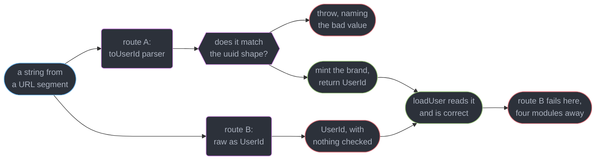
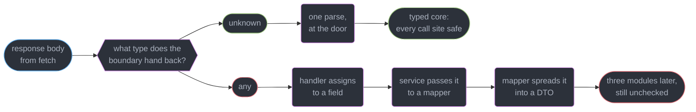
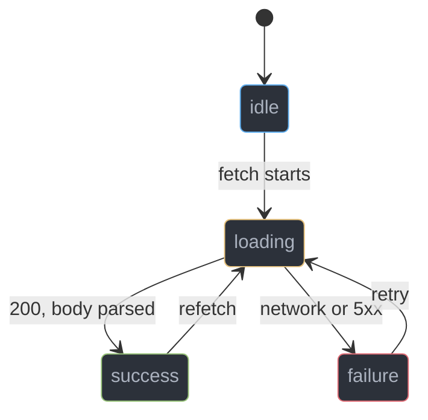
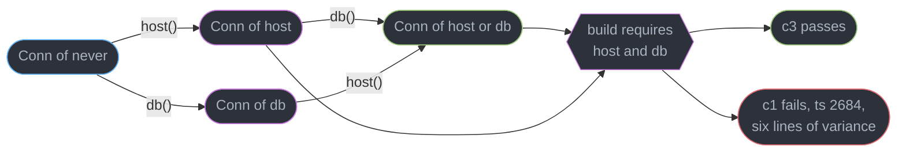
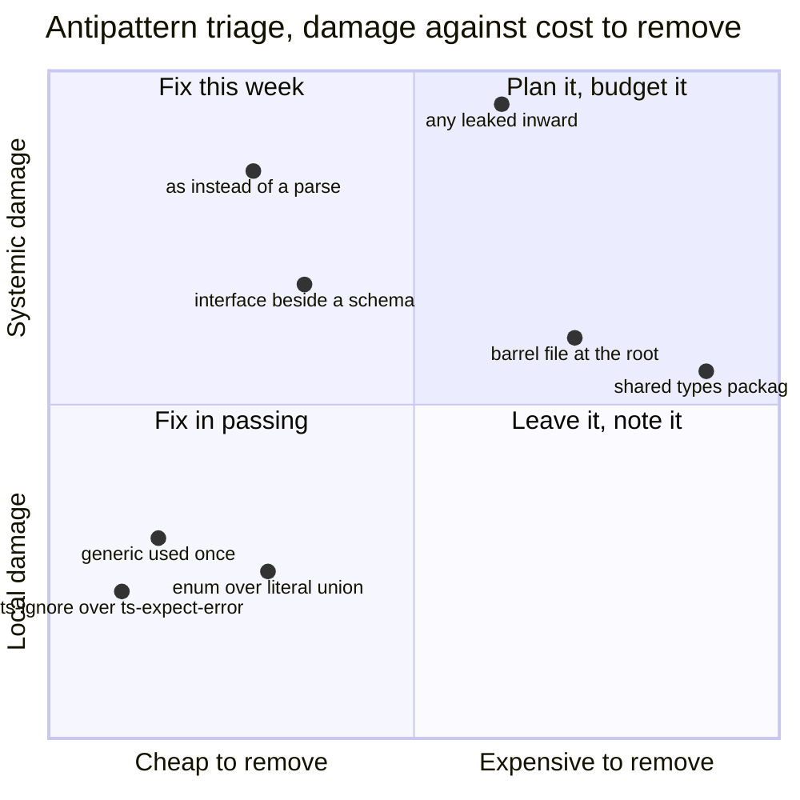
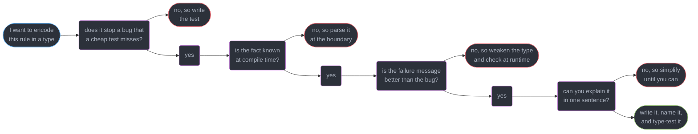

# TypeScript Patterns and Antipatterns

---

## 1. Concept Overview

Fifteen modules taught mechanics. This one spends them.

The type system does exactly one thing: it decides which programs the compiler will let you keep.
Everything else — structural assignability, narrowing, generics, conditional types, declaration
files — is machinery in service of that single decision. A pattern is a way of arranging your types
so the compiler's decision matches the decision you would have made in review. An antipattern is a
way of arranging them so the compiler's answer is "yes" when the honest answer is "I have no idea".

That framing makes the catalogue below shorter than it looks, because almost every antipattern in
TypeScript is the same move wearing a different hat: **an assertion of a fact for which no evidence
exists**. `as` asserts a shape nobody checked. `any` asserts that checking is somebody else's
problem. A hand-written `interface` beside a Zod schema asserts that two files will stay in step.
`@ts-ignore` asserts that the error was wrong. Each is a lie the compiler is contractually obliged
to believe, and each is repaid far away from where it was told.

The patterns are the inverse: arrangements that turn a fact you *established* into a fact the
compiler can *carry*. A branded type carries "this string was parsed". A discriminated union carries
"only these four combinations exist". None of them are new mechanics — they are the mechanics from
modules 2 through 15, pointed at the boundary where knowledge is created.

The target is **TypeScript 7.0** (GA 2026-07-08). Nothing here is version-gated: every pattern below
worked on 4.9, and every antipattern below was still shipping the week this was written. What 7.0
changed is the price of getting it wrong — an 8-12x faster checker means a bad type costs 400ms of
editor latency instead of 3s, which is worse, because now nobody notices.

---

## 2. Intuition

> A type is a claim you are asking the next engineer to trust without reading your code. The
> question is never "is this claim true" — it is "did anything actually establish it".

**Mental model.** Draw a line around your program. Outside it: HTTP responses, `JSON.parse`,
`process.env`, `localStorage`, a `postMessage` payload, a database driver's `any`. Inside it: types
you can rely on. The line has one legal crossing — a parse — and every pattern here is either about
making that crossing narrow, or about making the *inside* precise enough to catch what a parse
cannot. `as` and `any` are holes in the line: places where a value enters the trusted region
unchecked, invisible from inside, because the far-end type reads exactly like one that was earned.

**Why it matters.** The whole value proposition of a type system is that a claim proven once holds
everywhere downstream, for free. That leverage is symmetric. A false claim is *also* free everywhere
downstream, and it does not fail at the assertion — it fails four modules away, in a function that
had every right to trust its parameter, with a stack trace naming the innocent party. The 3am
debugging cost of `as` is paid by someone who never typed it.

**Key insight.** Complexity in the type system is not free and is not linear in value. A type that
catches one real bug a year and produces a nine-line variance error whenever a junior gets a
parameter wrong is a net loss, and no flag tells you so. The judgment this module installs:
**compare the error message the type produces against the bug it prevents**. If the message is
worse, you have moved cost from production to the editor and called it safety.

---

## 3. Core Principles

1. **Make illegal states unrepresentable, then you cannot handle them wrong.** Four optional fields
   admit 16 combinations; a four-member tagged union admits four —
   `../unions_narrowing_and_exhaustiveness/unions_narrowing_and_exhaustiveness.md`.
2. **A brand is only worth what minted it.** `string & { readonly __brand: unique symbol }` is
   nominal typing bolted onto a structural system, and its guarantee comes entirely from the rule
   that the only function returning it does a real check first.
3. **`as` is not a fix, it is a suppression.** It changes what the checker believes and nothing
   about what is in memory. The three legitimate uses are in §4.1; everything else is debt.
4. **`unknown` is the honest type for foreign data.** One narrowing at the door buys the guarantee
   that nothing downstream can be wrong about it —
   `../runtime_validation_and_parse_dont_validate/runtime_validation_and_parse_dont_validate.md`.
5. **One source of truth per shape.** A Zod schema and a hand-written `interface` for the same
   object are two truths that drift silently; `z.infer` makes the type a consequence.
6. **A type parameter appearing once in a signature is not generic.** It is an `as` with extra
   syntax — `../generics_and_type_parameters/generics_and_type_parameters.md`.
7. **TypeScript has no higher-kinded types, and the workaround costs more than it returns** for
   almost every application codebase. Know the pattern so you can read `fp-ts`; do not build one.
8. **Prefer the weaker type plus a runtime check** whenever the stronger type's failure names
   nothing — the conclusion
   `../template_literal_types_and_type_level_programming/template_literal_types_and_type_level_programming.md`
   reached for type-level programs, generalised to the whole type system.

---

## 4. Types / Architectures / Strategies

### 4.1 The three legitimate uses of `as`

Everything else is an unpaid claim.

| Use | Example | Why it is fine |
|-----|---------|----------------|
| Minting a brand, inside its parser | `return raw as UserId` after the check | the check is the evidence; the cast is bookkeeping |
| `as const` | `["a", "b"] as const` | not an assertion at all — a widening instruction |
| Weakening to `unknown` | `res.json() as unknown` | it removes a claim rather than adding one |

`satisfies` `[4.9]` removes the fourth case people reach for — "check this literal against `Config`
but keep its narrow type". `as Config` throws away the narrowing and skips excess-property checking;
`satisfies Config` checks and keeps. See
`../structural_typing_and_assignability/structural_typing_and_assignability.md`.

### 4.2 The pattern shelf

| Pattern | Encodes the fact | Reach for it when |
|---------|-----------------|-------------------|
| Branded type | "this value was validated" | an id, a money amount or a sanitised string crosses many functions |
| `unknown` at the boundary | "this came from outside" | any `fetch`, `JSON.parse`, env read, message handler |
| Discriminated union | "only these N states exist" | any object with 2+ mutually exclusive optional fields |
| `never` exhaustiveness check | "every case is handled, today and tomorrow" | the union will gain members |
| Phantom type parameter | "these steps have run" | a library builder with a real required-order constraint |
| Defunctionalised URI | "this container is generic over its element" | you are writing `fp-ts`, and you are not |

### 4.3 The antipattern catalogue

Diagnosis, then the module that owns the fix. Nothing is re-explained here.

| Antipattern | What it actually costs | Owning module |
|-------------|----------------------|---------------|
| `as` in place of a parse | a runtime `TypeError` several modules from the cast | `../runtime_validation_and_parse_dont_validate/` |
| `any` accepted "until the deadline" | every value it touches becomes `any`, silently, transitively | `../unions_narrowing_and_exhaustiveness/` |
| An assertion hiding a real error | the bug the checker found, still present, now invisible | `../structural_typing_and_assignability/` |
| An `interface` beside a Zod schema | two truths that drift, and the type wins in review | `../runtime_validation_and_parse_dont_validate/` |
| A generic used once in a signature | an unsound cast dressed as polymorphism | `../generics_and_type_parameters/` |
| `enum` where a literal union fits | a runtime object, a nominal type, an import that survives erasure | `../classes_decorators_and_resource_management/` |
| A barrel file re-exporting a folder | one import pulls the whole folder into the graph and the check | `../modules_resolution_and_package_exports/` |
| `@ts-ignore` instead of `@ts-expect-error` | it stays green after the error is fixed, forever | `../testing_typed_code/` |
| Type-level machinery for a runtime fact | editor latency, and an error message naming nothing | `../template_literal_types_and_type_level_programming/` |
| A shared `types.ts` every package imports | a rebuild of everything on any type change | `../typescript_in_large_codebases/` |
| `any` in a published `.d.ts` | your users' safety, not yours | `../declaration_files_and_library_authoring/` |
| A 40-member union in a hot generic | 100ms+ of hover latency on every keystroke | `../the_typescript_compiler_and_type_performance/` |

---

## 5. Architecture Diagrams

### The 16 combinations you never meant to allow

```
   { loading?: boolean; data?: T; error?: E; retryAt?: Date }

   loading  data   error  retryAt   meaning                    reachable?
   -------  -----  -----  -------   ------------------------   ----------
     -        -      -      -       idle                       yes
     x        -      -      -       loading                    yes
     -        x      -      -       success                    yes
     -        -      x      x       failure, will retry        yes
     x        x      -      -       loading with stale data?   unspecified
     x        -      x      -       loading and failed?        nonsense
     -        x      x      -       succeeded and failed       nonsense
     ...      9 more combinations, every one of them nonsense

   4 optional fields -> 16 states, 5 meant;  a 5-member tagged union -> 5 states
```

Every nonsense row is a branch some reader eventually guards against. The union does not document
the five legal states — it is the only thing that exists.

### Two ways to reach a `UserId`, and only one of them proves anything



Both routes produce a value the checker calls `UserId`, and downstream code cannot tell them apart.
That is the entire argument for the rule that a brand may be minted in exactly one place.

### The trust boundary, and what a leaked `any` does to it



`unknown` is a wall with one door. `any` is not a wall — it is an instruction to the checker to stop
asking, and the instruction propagates through every assignment, spread and return it touches.

---

## 6. How It Works — Detailed Mechanics

### 6.1 Branded types, and the rule that makes them mean something

TypeScript is structural (`../structural_typing_and_assignability/`), so `type UserId = string` buys
nothing: every `string` is a `UserId`. A brand is an intersection with a property no real string has
and no other brand can duplicate:

```ts
type UserId = string & { readonly __brand: unique symbol };
type OrderId = string & { readonly __brand: unique symbol };

const UUID = /^[0-9a-f]{8}-[0-9a-f]{4}-[0-9a-f]{4}-[0-9a-f]{4}-[0-9a-f]{12}$/i;

// The ONLY function in the codebase that produces a UserId.
export function toUserId(raw: string): UserId {
  if (!UUID.test(raw)) throw new Error(`not a user id: ${raw}`);
  return raw as UserId;                     // the check above is the evidence
}
```

The brand then rejects both an unproven `string` and a sibling brand — the pair of mistakes no other
technique in a structural system catches:

```ts
declare function loadUser(id: UserId): void;
declare const raw: string;
declare const oid: OrderId;

loadUser(raw);
// Argument of type 'string' is not assignable to parameter of type 'UserId'.
//   Type 'string' is not assignable to type '{ readonly __brand: unique symbol; }'. (2345)

loadUser(oid);
// Argument of type 'OrderId' is not assignable to parameter of type 'UserId'.
//   Types of property '__brand' are incompatible.
//     Two different types with this name exist, but they are unrelated. (2345)
```

`unique symbol` is what separates the two. A string-literal brand (`{ __brand: "user" }`) also keeps
them distinct, but any file can forge one by writing the literal; `unique symbol` has no syntax that
produces the property at all, so `toUserId` is structurally the only way in. Nothing is emitted —
the intersection erases to `string`, and `typeof` at runtime is `"string"`.

One rule holds the pattern up: **the parser is the only mint**. The moment a second file writes
`raw as UserId`, `UserId` means "a string somebody felt good about". Enforce it with
`typescript-eslint`'s `no-unsafe-type-assertion`, or by exporting the type from the module that
exports the parser and nothing else. Brands pay for entity ids that are all `string`, money in minor
versus major units, sanitised versus raw HTML; they do not pay for a value two functions in one file
share, nor where a schema already parses it — Zod's `.brand()` gives the branded output type free.

### 6.2 Containing `any` at the boundary

```ts
// The boundary function returns unknown, not any, and not a lie about the shape.
async function getJson(url: string): Promise<unknown> {
  const res = await fetch(url);
  if (!res.ok) throw new Error(`${url}: HTTP ${res.status}`);
  return res.json() as unknown;            // res.json() is Promise<any>; close it here
}
```

One parse then turns that `unknown` into a type the rest of the module may trust:

```ts
const UserSchema = z.object({ id: z.string().uuid(), email: z.string().email() });
type User = z.infer<typeof UserSchema>;    // one source of truth, derived not written

export async function getUser(id: string): Promise<User> {
  return UserSchema.parse(await getJson(`/api/users/${id}`));
}
```

Three details carry the weight. `res.json()` is typed `Promise<any>` in the DOM lib, so *not*
re-typing it is already a leak; `as unknown` there is legitimate because it strictly weakens.
`z.infer` makes the type a consequence of the schema, not a second declaration of it. And `getUser`
returns `User`, so the `unknown` never escapes the module — the boundary is one function wide.

The asymmetry worth arguing about: `unknown` is **contagious in the direction you want** and `any`
is contagious in the direction you do not. Assign an `unknown` anywhere and the compiler stops you
at that line, fix local. Assign an `any` and the target becomes unchecked, silently, along with
everything it flows into — so an `any` three modules inward produces zero errors and one runtime
failure in the fourth. `unknown` at the door costs one narrowing; `any` at the door costs an audit.
For a codebase already full of `any`, push it **outward** toward the boundary rather than deleting
it in place: change one boundary function's return to `unknown`, fix the errors, repeat.

### 6.3 Discriminated unions, and exhaustiveness that survives the next member



Four nodes, five edges. The optional-field object in §5 has sixteen nodes and no edges, which is why
the tagged union is the honest encoding. The guard that keeps it honest as members are added:

```ts
type Result<T, E> =
  | { status: "idle" } | { status: "loading" }
  | { status: "success"; data: T } | { status: "failure"; error: E };

// in the default arm of a switch over s.status, after every case is handled:
const exhaustive: never = s;
throw new Error(`unhandled status: ${JSON.stringify(exhaustive)}`);
// drop the "failure" case and this line reports, at compile time:
// Type '{ status: "failure"; error: Error; }' is not assignable to type 'never'. (2322)
```

The error names the exact member you forgot. `never` is the empty set
(`../unions_narrowing_and_exhaustiveness/`), so anything assignable to it is a member the narrowing
failed to remove — three lines that turn "I handled every case today" into "I will be told when
someone adds a fifth". Keep the `throw`: a tag can arrive at runtime from a stale service the
compile-time check never saw. The discriminant must be a **literal type on a shared property name**;
`status: string` does not narrow, and a union discriminated by a field's mere *presence* narrows
only under `in`-checks. Tag it.

### 6.4 Higher-kinded types, and the workaround to read rather than write

TypeScript cannot express `Functor<F>` where `F` is itself generic. `interface Functor<F> { map<A, B>(fa: F<A>, f: (a: A) => B): F<B> }` is a syntax error: `F` is a type, and a type cannot take
arguments. The standing request (microsoft/TypeScript#1213, open since 2014) is the most-referenced
missing feature in the language. The workaround is **defunctionalisation**: replace the type
constructor with a string key into a global interface the checker can index.

```ts
interface URItoKind<A> {
  readonly Array: A[];
  readonly Option: { _tag: "None" } | { _tag: "Some"; value: A };
}
type URIS = keyof URItoKind<unknown>;
type Kind<F extends URIS, A> = URItoKind<A>[F];        // "apply" F to A

interface Functor<F extends URIS> {
  readonly map: <A, B>(fa: Kind<F, A>, f: (a: A) => B) => Kind<F, B>;
}

const arrayFunctor: Functor<"Array"> = { map: (fa, f) => fa.map(f) };
const r = arrayFunctor.map([1, 2, 3], (n) => n.toFixed(2));   // string[]
```

`Kind<"Array", number>` resolves to `number[]` because `URItoKind<number>["Array"]` is `number[]`.
The indirection works — it is how `fp-ts` typed 60+ abstractions for years, and reading it is a
prerequisite for reading that library.

The honest verdict: **do not build one.** Every container must be registered in one global
`URItoKind` by declaration merging (`../declaration_files_and_library_authoring/`), so a third-party
type you do not control cannot participate; errors degrade to
`Type 'Kind<F, B>' is not assignable to type 'Kind<F, B>'` when a variance detail is off; and
inference through `Kind` is weak enough that call sites need explicit type arguments. The payoff —
one `map` across six containers — is a handful of lines you would otherwise write six times.
`Effect`, the successor to most `fp-ts` usage, took the other road: one concrete `Effect<A, E, R>`,
algorithms specialised to it. Copy that unless you are publishing a library whose whole purpose is
abstracting over containers, and then only with type tests (`../testing_typed_code/`) per instance.

### 6.5 Builders, `this` types, and where phantom parameters stop being readable

The cheap, good version is a `this`-returning chain, which needs no phantom anything:

```ts
class Query {
  private parts: string[] = [];
  where(clause: string): this { this.parts.push(clause); return this; }
  build(): string { return this.parts.join(" "); }
}
class PagedQuery extends Query { page(n: number): this { return this; } }
```

Returning `this` rather than `Query` is what keeps `new PagedQuery().where("x").page(1)` typed as
`PagedQuery` — `../classes_decorators_and_resource_management/`. That is the ordinary case, and the
ordinary case is nearly all of them. The version that tracks *which* steps have run accumulates a
union of step names in a phantom type parameter, and `build` constrains `this` against it:



```ts
type Step = "host" | "db";

declare class Conn<Set extends Step = never> {
  private readonly __set: (s: Set) => Set;             // invariant: forces exact matching
  host(h: string): Conn<Set | "host">;
  db(d: string): Conn<Set | "db">;
  build(this: Conn<"host" | "db">): string;            // callable once both have run
}
declare function conn(): Conn;

conn().host("a").db("b").build();                      // fine
conn().host("a").build();
// The 'this' context of type 'Conn<"host">' is not assignable to method's 'this'
//   of type 'Conn<"host" | "db">'.
//   Types of property '__set' are incompatible.
//     Type '(s: "host") => "host"' is not assignable to type '(s: "host" | "db") => "host" | "db"'.
//       Types of parameters 's' and 's' are incompatible.
//         Type '"host" | "db"' is not assignable to type '"host"'. (2684)
```

The `(s: Set) => Set` field is not decoration. With a plain `readonly __set: Set` the phantom sits in
a covariant position, `Conn<"host">` stays assignable to `Conn<"host" | "db">`, and the constraint
**silently does nothing** — it compiles and you ship a builder that enforces nothing. `Set` in both
parameter and return position makes it invariant under `strictFunctionTypes`
(`../generics_and_type_parameters/`), which is what makes the check bite.

And there is the argument against the pattern, in the error text: six lines of variance elaboration
to say **"you forgot to call `.db()`"**. The reader does not learn that; they learn the builder is
haunted, and reach for `as any`. Against a required options object, or `build()` throwing
`Error("db() is required")` on the first unit test, it catches the same bug seconds earlier for a
message nobody can read. Library only, with a type test asserting the error, and never past three
steps — the elaboration grows with the union.

---

## 7. Real-World Examples

**Zod's `.brand()`.** `z.string().uuid().brand<"UserId">()` makes the parser and the brand one
declaration, so the "only one mint" rule holds by construction rather than by review — which is why
hand-rolling the `unique symbol` version is worth doing only where no schema exists.

**Redux Toolkit and TanStack Query.** Both expose request state as a discriminated union rather than
the four-optional-field object their predecessors used. TanStack Query v5 exposes
`status: "pending" | "error" | "success"` precisely so `if (query.status === "success")` narrows
`query.data` from `T | undefined` to `T`. The four-boolean API it replaced could not.

**`fp-ts` and `Effect`.** `fp-ts` is the canonical URI-defunctionalisation codebase — `URItoKind`,
`URItoKind2` and `URItoKind3` for one, two and three type parameters, plus a `Kind` per arity.
`Effect` abandoned that encoding for a single concrete `Effect<A, E, R>`, and its adoption curve
against `fp-ts` is the best available evidence of what the HKT workaround costs a user base.

**tRPC's builder.** `t.procedure.input(schema).query(fn)` is a phantom-parameter builder at library
scale: the `input` call threads the parsed type into the handler's argument. It works because the
library owns the errors, tests them, and the payoff — a typed client with no code generation — is
worth an occasionally opaque message. Application builders rarely clear that threshold.

---

## 8. Tradeoffs



| Choice | What it buys | What it costs | Verdict |
|--------|-------------|--------------|---------|
| Branded id vs plain `string` | catches `loadUser(order.id)`, which nothing else catches | 1 alias, 1 parser, 1 lint rule | worth it past 2 id types |
| `unknown` vs `any` at a boundary | a local error instead of a remote one | 1 narrowing per entry point | always |
| Tagged union vs optional fields | 5 states instead of 16, and narrowing that works | 1 tag field, a small migration | always |
| `never` guard vs a plain `default` | a compile error when a member is added | 3 lines per switch | worth it if the union will grow |
| Phantom builder vs required options | the error moves from a test to the editor | a 6-line variance message | library only |
| URI defunctionalisation vs concrete types | one `map` across N containers | global registration, weak inference, opaque errors | almost never |
| `satisfies` vs `as` | excess-property checking plus the narrow type | zero | always, where it applies |

The row that decides most reviews is the last: `as` and `satisfies` cost the same to type, and one
checks your object while the other tells the compiler to stop looking.

---

## 9. When to Use / When NOT to Use



**Reach for the type system when** the fact is knowable at compile time, the bug it prevents is one
tests catch late or not at all (an id swapped for another id, an unhandled union member, a state no
test enumerated), and the failure message names the mistake. Those three conditions describe branded
ids, tagged unions and exhaustiveness guards; everything else here is situational.

**Do NOT reach for it when** the fact arrives at runtime — no type checks a `fetch` response, and
`as` pretending otherwise is worse than `unknown`. Nor when the type needs a comment to be read; the
next maintainer deletes it rather than fixes it. Nor when a generator already owns the shape: an
OpenAPI or Prisma codegen emits real named types with real error locations for zero check time.

**And TypeScript itself is sometimes the wrong tool.** A capstone that cannot name a case against
its own subject is advertising. Three real ones:

- **A genuinely dynamic boundary.** A plugin host loading unknown modules, an RPC bridge, a
  spreadsheet formula evaluator, a `Proxy`-based ORM whose shape is a runtime string. The types come
  out `unknown` plus a parse at every edge, which is correct and buys nothing over a JavaScript file
  with the same parse. JS with JSDoc types on the public surface is a defensible call.
- **A one-file script.** A 60-line migration, a build hook, a one-shot data fix. Node runs `.ts`
  directly now (`../typescript_at_runtime_node_deno_bun/`), which cuts the setup cost but not the
  cost of arguing about `strict` for a file you delete on Thursday.
- **A team that does not want it.** TypeScript is a discipline enforced by review, not a compiler
  flag. Where people add `any` to close the build you get no safety and real friction — decorative
  types and slower CI. Fix the agreement first, or use JSDoc types with `checkJs`, which gets most
  of the value with no build step and no syntax anyone can object to.

---

## 10. Common Pitfalls

### Pitfall 1: optional-field soup, and the guard that lies (BROKEN → FIX)

```ts
// BROKEN — 4 optional fields, 16 representable states, 5 intended.
interface Soup<T, E> { loading?: boolean; data?: T; error?: E; retryAt?: Date }

function view(s: Soup<string, Error>): string {
  if (s.loading) return "...";
  if (s.error) return s.error.message;
  return s.data.toUpperCase();
  //     's.data' is possibly 'undefined'. (18048)
}
// The usual "fix" is `s.data!` or `s.data as string`, which ships the crash.
// Nothing here stops a reducer producing { loading: true, error: e, data: d }.
```

```ts
// FIX — the tag makes the 11 nonsense states unrepresentable, and narrowing works.
type State<T, E> =
  | { status: "idle" }
  | { status: "loading" }
  | { status: "success"; data: T }
  | { status: "failure"; error: E; retryAt?: Date };

function viewFixed(s: State<string, Error>): string {
  switch (s.status) {
    case "idle": return "";
    case "loading": return "...";
    case "success": return s.data.toUpperCase();   // T, not T | undefined
    case "failure": return s.error.message;
    default: { const _: never = s; throw new Error(`unhandled: ${JSON.stringify(_)}`); }
  }
}
```

The `18048` error was not the problem — it was the type system correctly reporting that the shape
permits a state the code cannot handle, and `!` deletes the report while keeping the state.
`retryAt` moving onto the `"failure"` member is the second half of the win: it is now impossible to
schedule a retry for a successful request.

### Pitfall 2: `as` accepts a subset, and fails four modules later (BROKEN → FIX)

```ts
interface User { id: string; email: string; createdAt: Date }

// BROKEN — `as` is legal whenever the types overlap in EITHER direction, and
// { id, email } is a supertype of User, so this passes with no diagnostic at all.
declare const row: { id: string; email: string };
const u = row as User;
sendWelcome(u);                     // fine here
function sendWelcome(x: User) { return x.createdAt.getTime(); }
// TypeError: Cannot read properties of undefined (reading 'getTime')  <- in production

// FIX — `satisfies` for a literal you control, a parse for data you do not.
const cfg = { url: "/v1", retry: 3 } satisfies { url: string; retries: number };
// Object literal may only specify known properties, and 'retry' does not exist
//   in type '{ url: string; retries: number; }'. (2353)   <- the typo, named

const parsed: User = UserSchema.parse(row);
// ZodError: createdAt: Required                            <- the field, named, at the door
```

The comparison is the point. `as` on the same typo is silent, `satisfies` names the property, and
the parse names the field and the received value. Note that `as` does report on a *disjoint* type
(`2352`, "neither type sufficiently overlaps"), which is why people trust it: it checks overlap,
never sufficiency.

### Pitfall 3: the generic that is an `as` with extra syntax

```ts
// BROKEN — T appears once, in the return position, so nothing infers it: the
// caller picks, and the function returns whatever they claim.
function getConfig<T>(key: string): T { return store[key]; }
const port = getConfig<number>("port");     // it is a string. No error, ever.

// FIX — take the schema, return what it parses.
function getConfig2<S extends z.ZodType>(key: string, schema: S): z.infer<S> {
  return schema.parse(store[key]);
}
const port2 = getConfig2("port", z.coerce.number().int());   // number, checked
```

The rule from `../generics_and_type_parameters/`: **a type parameter must appear at least twice** —
once where an argument infers it, once where it is used. `typescript-eslint`'s
`no-unnecessary-type-parameters` flags exactly this shape.

---

## 11. Technologies & Tools

| Tool | Role | Relevance here |
|------|------|----------------|
| TypeScript | The compiler and checker (7.0, native Go) | Owns `satisfies`, `unique symbol`, variance, narrowing |
| tsc6 | The 6.0 binary as `@typescript/typescript6` | The only stable Compiler API until 7.1; what lint and codemods run on |
| Zod | Runtime schema parsing | `z.infer` for one source of truth, `.brand()` for branded output types |
| Valibot | Modular schema library | Same contract at roughly a tenth of the bundle, via Standard Schema |
| Standard Schema | Cross-library validator interface | Lets a framework accept any validator without depending on one |
| ts-reset | Standard-library type patches | `JSON.parse` returns `unknown`; closes the most common `any` leak |
| typescript-eslint | Type-aware linting | `no-explicit-any`, `no-unsafe-*`, `ban-ts-comment`, `no-unnecessary-type-parameters` |
| fp-ts | Functional library | The reference implementation of URI defunctionalisation |
| Effect | Effect system | The counter-example: one concrete type instead of an HKT encoding |
| type-fest | Derived-type library | Already-written `Opaque`, `Simplify`, `RequireExactlyOne` |
| Vitest | Test runner exposing `expectTypeOf` | Type tests for any pattern here — `../testing_typed_code/testing_typed_code.md` |
| knip | Unused-export finder | Finds the dead exports a barrel file hides |

---

## 12. Interview Questions with Answers

**Q: When does a branded type earn its complexity?**
**Short:** A brand pays for itself once two or more `string` ids can be confused at a call site, because no other technique in a structural type system catches that swap.

`loadUser(order.id)` type-checks with plain `string` and fails in production; brand both ids and it
is a compile error. The rule that makes it real is that the brand is minted in exactly one place — a
parser that does the check — otherwise `UserId` degrades to "a string somebody asserted". Below two
confusable ids the alias costs more than it returns; above it, use Zod's `.brand()`.

**Q: Why is `as` not a fix for a type error?**
**Short:** An assertion silences the checker without changing a byte of memory, so the bug it hides surfaces later, in a function that had every right to trust its parameter.

`as` is legal whenever the two types overlap in *either* direction, so asserting `{ id, email }` to
a three-field `User` passes with no diagnostic and `user.createdAt.getTime()` throws four modules
away. For a literal you control use `satisfies`, which keeps the narrow type and still runs
excess-property checking; for data you do not control, parse it.

**Q: When should you NOT use a generic?**
**Short:** One occurrence of a type parameter in a signature means nothing infers it, so the caller chooses the type and the function becomes an unchecked cast with nicer syntax.

`function get<T>(key: string): T` lets `get<number>("port")` return a string with no error, ever. The
test is mechanical: a type parameter must appear at least twice — once where an argument infers it,
once where it is used, which `typescript-eslint`'s `no-unnecessary-type-parameters` checks for you.
Return `unknown` and narrow, or take a schema and return `z.infer<S>`.

**Q: When is TypeScript the wrong tool for a job?**
**Short:** Plain JavaScript wins on a genuinely dynamic boundary, on a one-file script you will delete this week, and on a team that adds `any` to close the build.

A plugin host or a `Proxy`-backed ORM ends up `unknown` plus a parse at every edge, which is the same
program a JS file with the same parse would be. A team that does not want the discipline produces
decorative types and slower CI — `checkJs` with JSDoc types gets most of the value with no build
step. Naming these honestly is what separates using a tool from advocating one.

**Q: Why is `unknown` better than `any` for foreign data?**
**Short:** Foreign data typed `unknown` fails at the assignment that misuses it, whereas `any` produces no error at all and infects everything it flows into.

The contagion runs opposite ways: assign an `unknown` anywhere and the compiler stops you locally
with a fix you can see; assign an `any` and the target silently becomes unchecked, along with
everything downstream. That is why an `any` three modules inward yields zero errors and one runtime
failure. `fetch().json()` is `Promise<any>`, so closing that leak is usually the highest-value edit.

**Q: What is wrong with `{ loading?: boolean; data?: T; error?: E }`?**
**Short:** Four optional fields admit sixteen representable states when you meant five, and eleven of them are combinations no reader will ever guard against correctly.

Nothing prevents `{ loading: true, error: e, data: d }`, narrowing does not work (`s.data` stays
`T | undefined` after `if (!s.error)`), and the usual response is `s.data!`, which ships the crash.
A tagged union makes the illegal states unrepresentable and makes `s.data` a plain `T` inside the
`"success"` branch. TanStack Query v5's `status` field exists for exactly this reason.

**Q: How does the `never` exhaustiveness check work, and why add the `throw`?**
**Short:** Assigning the narrowed value to a `never`-typed variable fails to compile the moment a union member is not handled, naming the member you forgot.

After four handled cases the switch's `default` narrows `s` to `never`; add a fifth member and the
assignment reports `Type '{ status: "failure"; ... }' is not assignable to type 'never'. (2322)`. The
`throw` matters because compile-time exhaustiveness says nothing about runtime: a stale service can
send a tag your build never saw. Three lines per switch, on any union that will gain members.

**Q: TypeScript has no higher-kinded types. What is the workaround?**
**Short:** Defunctionalisation swaps the missing type constructor for a string key into a global interface, so `Kind<"Array", number>` becomes an ordinary indexed access resolving to `number[]`.

`interface URItoKind<A> { Array: A[] }` plus `type Kind<F extends URIS, A> = URItoKind<A>[F]` lets
`Functor<F extends URIS>` be written at all, and it is how `fp-ts` typed its whole hierarchy. The
costs are global registration through declaration merging, weak inference through `Kind`, and errors
reading `Type 'Kind<F, B>' is not assignable to type 'Kind<F, B>'`. `Effect` dropped the encoding.

**Q: How do phantom type parameters track builder steps, and what do they cost?**
**Short:** Phantom parameters accumulate a union of the methods already called, and `build` constrains its `this` so it is only callable once the required members are present.

`host()` returns `Conn<Set | "host">`, `build(this: Conn<"host" | "db">)` demands both. The phantom
must sit in an **invariant** position — `(s: Set) => Set`, not `readonly __set: Set` — or
`Conn<"host">` stays assignable to `Conn<"host" | "db">` and the constraint enforces nothing. The
price is a six-line variance error meaning "you forgot `.db()`", so keep it to libraries.

**Q: Why prefer `@ts-expect-error` to `@ts-ignore`?**
**Short:** An expect-error directive fails the build once the error underneath it disappears, reporting `Unused '@ts-expect-error' directive. (2578)`, so the suppression cannot outlive its reason.

`@ts-ignore` stays green forever and also swallows any *new* error appearing on the same line, which
is how a codebase reaches 400 of them with nobody knowing which are still needed. The self-deleting
property is also what makes `@ts-expect-error` the standard negative assertion in type tests. Ban
`@ts-ignore` with `@typescript-eslint/ban-ts-comment` and require a tracking reference.

**Q: When is `enum` the wrong choice against a union of string literals?**
**Short:** String literal unions vanish at emit while an `enum` compiles to a runtime IIFE object that must be imported as a value, which breaks type-only imports and pure erasure.

The union also narrows from a plain string with no ceremony, is exhaustively checkable with `never`,
and needs no import to write a member. `enum` earns its place only where you need the runtime object
— reverse lookups, iterating members, a wire format with numeric codes. Full mechanics in
`../classes_decorators_and_resource_management/classes_decorators_and_resource_management.md`.

**Q: Why is an `interface` beside a Zod schema an antipattern?**
**Short:** One shape declared twice always drifts, so infer the type from the schema and let the runtime enforcement and the compile-time claim come from a single declaration.

The drift is silent and asymmetric: the type is what review reads and the schema is what runtime
enforces, so a field added to the interface alone compiles everywhere and rejects every real payload.
`type User = z.infer<typeof UserSchema>` makes the type a consequence. The same rule governs OpenAPI
and Prisma clients — the generated types are the truth, and a hand-written mirror is a second truth.

**Q: What is actually wrong with barrel files?**
**Short:** A barrel re-export makes one import pull the whole folder into the module graph, so the checker, the bundler and the test runner all load modules nobody asked for.

`import { Button } from "@ui"` drags in every component the barrel names, defeating tree-shaking
where any of them has a side effect and inflating the type-check surface. It also manufactures
circular imports between siblings that never referenced each other. Import from the file, use the
`exports` map (`../modules_resolution_and_package_exports/`), and run `knip` on the dead exports.

**Q: How do you decide whether a clever type is worth keeping?**
**Short:** If the error message a type produces is worse than the bug it prevents, the type is wrong, however elegant the encoding is.

Three questions, in order: does it catch a class of bug that a cheap test cannot, will the next
maintainer read it without a comment, and does its failure name the mistake? A type reporting
`not assignable to type 'never'` at an unrelated call site fails the third regardless of
correctness. The usual resolution is a weaker type plus a runtime check.

**Q: A brand survives every function call, so why can it not survive `JSON.parse`?**
**Short:** Brands exist only in the checker and erase completely at emit, so a value crossing a serialisation boundary arrives as an ordinary `string` with no property to inspect.

`typeof userId` is `"string"` at runtime; the intersection emits nothing. Anything that leaves the
process — a network response, `localStorage`, a worker `postMessage`, a database row — comes back
unbranded and must be re-minted through the parser. Typing the deserialised object as the branded
shape with `as` is the exact antipattern the brand existed to prevent.

**Q: You have inherited a codebase with 900 explicit `any`s. Where do you start?**
**Short:** Push the `any` outward toward the trust boundary one function at a time instead of deleting it in place, since a boundary fixed once removes the `any` from everything downstream.

Change one boundary function's return to `unknown`, fix the errors it raises, repeat; the count falls
faster than the edits because each fix is upstream of many uses. `noImplicitAny` finds none of these
— they are explicit — so use `no-unsafe-assignment`, `no-unsafe-member-access` and
`no-unsafe-return` with a ratchet in CI, and add `ts-reset` early for `JSON.parse`.

---

## 13. Best Practices

1. **Brand any id that can be confused with another id**, and export the type only from the module
   that exports its parser.
2. **Type every boundary function `unknown`** and parse once. `fetch().json()` is `any` by default.
3. **Derive types from schemas with `z.infer`.** Never maintain a hand-written twin.
4. **Replace two or more mutually exclusive optional fields with a tag** before writing the first
   guard against them.
5. **Put a `never` guard in every switch over a union** that will gain members, and `throw` in it.
6. **Use `satisfies` wherever you were about to write `as`** on an object literal.
7. **Ban `@ts-ignore`;** require `@ts-expect-error` with a tracking reference.
8. **Require a type parameter to appear twice** or delete it.
9. **Read the error message your type produces before merging it.** If it is worse than the bug,
   weaken the type and add a runtime check.
10. **Type-test the patterns you keep** with `expectTypeOf`, failure cases included —
    `../testing_typed_code/testing_typed_code.md`.

---

## 14. Case Study

### The payments service that trusted itself

A 22-engineer payments team ran a TypeScript 7.0 service in `strict` mode with 0 uses of `any` in
its own source and a green CI for 19 months. It issued a refund of 4,900 GBP against an order whose
total was 49.00 GBP, twice, before anyone noticed. The postmortem found no missing check. It found
three assertions.

```ts
// BROKEN — the three lines that did it, in three different files.

// 1. providers/stripe.ts — the SDK's webhook body is `any`, and it leaked inward.
export function parseWebhook(body: any): RefundEvent {
  return body.data.object;                       // no parse; `any` in, RefundEvent out
}

// 2. domain/order.ts — amounts are numbers, and nothing says which unit.
interface Order { id: string; total: number }         // minor units, per the wiki
interface Refund { orderId: string; amount: number }  // major units, per the other wiki

// 3. api/refund.ts — the id came from a query string as `string`.
const order = await loadOrder(req.query.orderId as string);
await issueRefund({ orderId: order.id, amount: event.amount });
```

The webhook delivered `amount` in minor units, as Stripe always has, and the refund path treated it
as major. Because `parseWebhook` returned `RefundEvent` on the strength of an `any`, nothing
downstream had reason to doubt it, and because both fields were `number` the unit error was
invisible at all eleven call sites it passed through. The `as string` was unrelated to the incident
and had been silently accepting `string[]` from a repeated query parameter for the whole 19 months.

```ts
// FIX — one boundary parse, one brand per unit, one brand per id. 60 lines total.
type Minor = number & { readonly __brand: unique symbol };
type Major = number & { readonly __brand: unique symbol };
type OrderId = string & { readonly __brand: unique symbol };

const RefundSchema = z.object({
  order_id: z.string().uuid(),
  amount_minor: z.number().int().nonnegative(),
});

export function parseWebhook(body: unknown): { orderId: OrderId; amount: Minor } {
  const e = RefundSchema.parse(body);                      // throws, naming the field
  return { orderId: e.order_id as OrderId, amount: e.amount_minor as Minor };
}

export const toMajor = (m: Minor): Major => (m / 100) as Major;

declare function issueRefund(r: { orderId: OrderId; amount: Major }): Promise<void>;

// issueRefund({ orderId, amount: event.amount });
// Type 'Minor' is not assignable to type 'Major'.
//   Types of property '__brand' are incompatible.
//     Two different types with this name exist, but they are unrelated. (2345)
```

**What it cost and what it bought.** Three type aliases, one schema, one conversion function and a
codemod over 41 call sites — two days. The unit error became a compile error at all eleven sites.
`as string` became `z.string().uuid()`, which immediately caught two other endpoints accepting
arrays. Promoting `no-unsafe-return` to `error` turned up 6 further `any` leaks from SDK types, none
of which had ever produced a diagnostic.

**The lesson, and the section's.** Every module before this one taught a mechanism, and the failure
used none of them wrongly: `strict` was on, the `any` count was zero, coverage was 84%, and the bug
walked in because three people asserted a fact instead of establishing one. The type system is a
machine for propagating claims, and it is exactly as trustworthy as the place each claim entered it.
That is the discipline: **find where knowledge is created — the parse, the mint, the tag — and make
those the only ways in.** Everything downstream is then free, which is the promise the language
actually makes.
