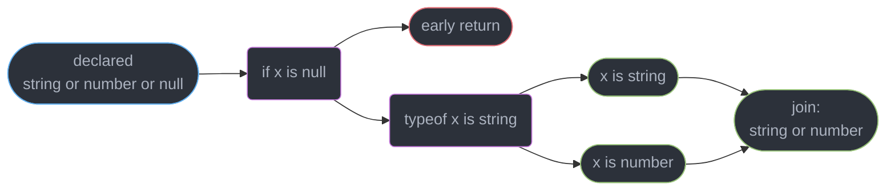
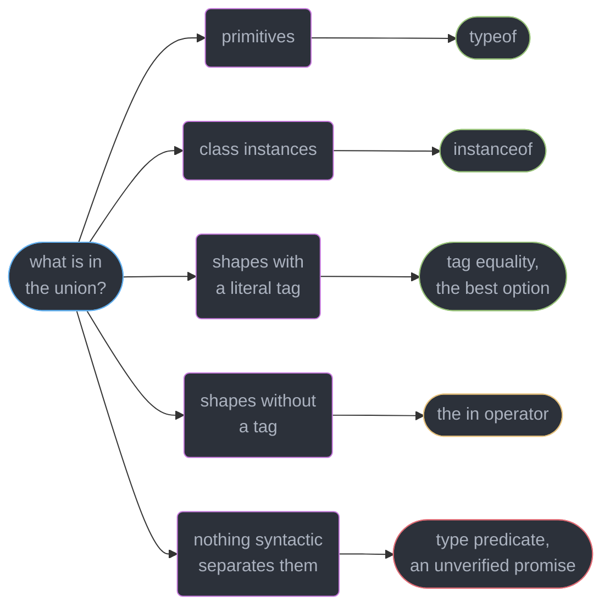
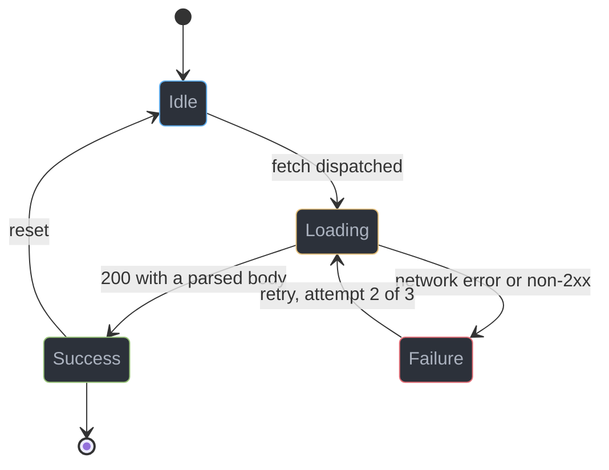
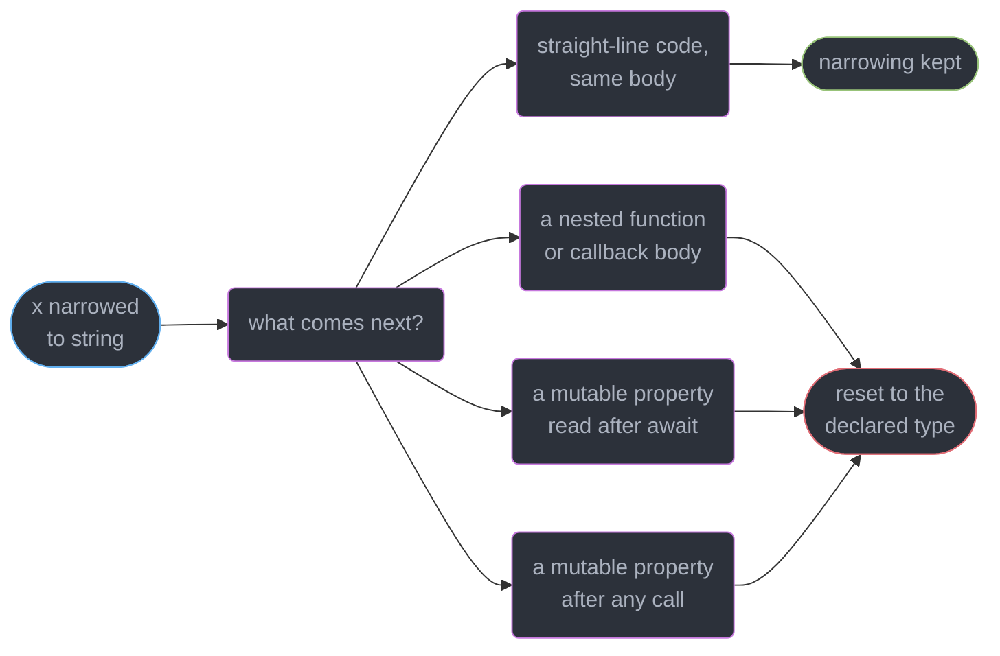
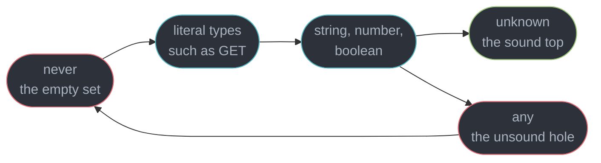
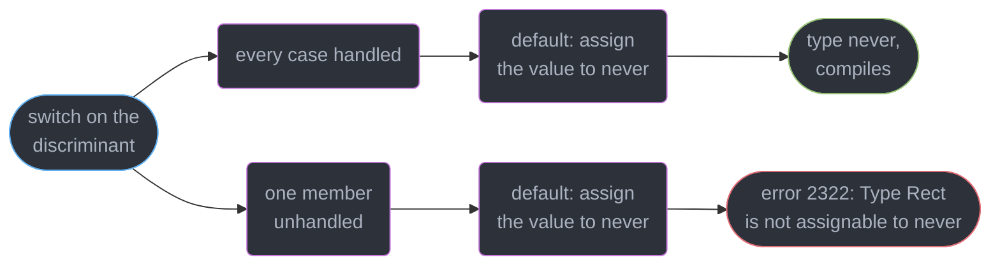

# Unions, Narrowing and Exhaustiveness

---

## 1. Concept Overview

A union `A | B` is a **set of types**, and a value of that type is a member of exactly one of them
at runtime — but the checker does not know which one until you prove it. **Narrowing** is the proof
procedure: the compiler builds a control-flow graph over your function and, at every reference,
computes which union members survive the conditions dominating that point. **Exhaustiveness
checking** is the reverse — at a point you claim is unreachable the surviving set should be empty,
and `never` is how you assert that.

Three mechanisms do all the work, and confusing them is the source of most union bugs:

| Mechanism | What it is | Trusted because |
|-----------|-----------|-----------------|
| Built-in narrowing | `typeof`, `instanceof`, `in`, `===`, truthiness, `Array.isArray` | The checker models each operator's runtime semantics |
| Type predicate `x is T` | A function whose return type is a narrowing claim | **You said so — the body is never verified** |
| Assertion `asserts x is T` | A function that throws unless the claim holds | You said so, plus an explicit annotation is required |

The target is **TypeScript 7.0** (GA 2026-07-08). The native Go checker re-implemented control-flow
analysis without changing its semantics; the one narrowing feature worth version-gating is
**inferred type predicates [5.5]**, which makes `arr.filter(x => x !== null)` narrow with no
hand-written guard. Everything here is compile-time only and erased at emit, so a value arriving
from the network has never been narrowed by anything — see
`../runtime_validation_and_parse_dont_validate/runtime_validation_and_parse_dont_validate.md`. It
builds on `../structural_typing_and_assignability/structural_typing_and_assignability.md`, in
particular literal widening, which is what silently destroys a discriminant.

---

## 2. Intuition

> A union is a **set of possibilities**, not a merged shape. Narrowing shrinks the set. `never`
> is the empty set, and reaching it is how you prove you handled everything.

**Mental model.** Think of `Circle | Square` as a locked box holding one of two objects. You may
only touch what *both* could offer until you open the box and check the label. That is why
`shape.radius` errors before the check and works after it.

**Why it matters.** Every real program models mutually exclusive states — loading or loaded or
failed, guest or member, cash or card. As 3 booleans that is 8 combinations of which 5 are illegal;
as a discriminated union it is exactly the 3 that exist, and the compiler names every site that
forgets one.

**Key insight.** Narrowing is a property of a **reference at a program point**, not of a value.
Cross a function boundary, an `await`, or an unproven call and the checker throws it away, because
between those points something else could have written to the location.

---

## 3. Core Principles

1. **A union member set shrinks, it never merges.** `A | B` offers only members present in both,
   with a type that is the union of theirs.
2. **Property access on a union requires the property on every constituent** — otherwise error
   2339, `Property 'radius' does not exist on type 'Circle | Square'`.
3. **Intersections demand all constituents simultaneously.** For objects that composes; for
   disjoint primitives it collapses: `string & number` is `never`.
4. **Narrowing is computed by flow, not by scope.** An early `return` narrows everything after it;
   an assignment re-narrows from the assigned type; a join point unions the incoming narrowings.
5. **Narrowing is reset at any point the checker cannot prove the reference unchanged** — a
   nested function body, a re-read after `await`, or a mutable property after an arbitrary call.
6. **A discriminant must be a literal type.** `type: string` discriminates nothing; `type: "add"`
   partitions the union.
7. **`unknown` is the sound top type, `any` is the hole, `never` is the empty set** — `never`
   vanishes from unions (`string | never` is `string`) and is assignable to everything.
8. **The compiler does not check a predicate body**; `x is T` and `asserts x is T` are promises,
   and a false promise compiles cleanly — the largest routine unsoundness in ordinary code.

---

## 4. Types / Architectures / Strategies

### 4.1 The narrowing operators and what each can split

| Construct | Narrows | Fails on |
|-----------|---------|----------|
| `typeof x === "string"` | Primitives and `function` | Objects, arrays and `null` all read `"object"` |
| `x instanceof C` | Class instances via the prototype chain | Cross-realm values, interfaces, plain object types |
| `"kind" in x` | Object union constituents by key presence | Optional properties, index signatures |
| `if (x)` truthiness | Removes `null`, `undefined`, `0`, `""`, `NaN`, `0n`, `false` | `number` and `string` unions — `0` and `""` are lost |
| `x === "add"` | Literal-typed members | A non-literal discriminant, which widens to no split |
| `Array.isArray(x)` | `any[]` from the rest of the union | Narrows a `readonly T[]` union member to `any[]` |
| `p(x)` where `p` returns `x is T` | Anything you claim | Nothing — it never validates |

### 4.2 Three ways to model "one of several states"

```ts
type LoadA = { loading: boolean; error?: Error; data?: User };   // 2^3 = 8 states, 3 legal
type LoadB = { status: string; error?: Error; data?: User };     // same, plus `data!` everywhere

// C. Discriminated union: exactly 3 representable states, no illegal one exists
type LoadC =
  | { status: "loading" }
  | { status: "error"; error: Error }
  | { status: "success"; data: User };
```

Form A lets `{ loading: true, error: e, data: u }` type-check, and every consumer writes
`data!.name`. Form C makes that value unspellable: `data` exists on exactly one constituent, and
reaching it requires proving `status === "success"` first.

### 4.3 `unknown`, `any`, `never` at a glance

| Type | Assignable **to** it | Assignable **from** it | Use |
|------|---------------------|------------------------|-----|
| `unknown` | Every value | Nothing without narrowing | Untrusted input, `catch` bindings, `JSON.parse` |
| `any` | Every value | Everything, unchecked | Escape hatch; contain it at one boundary |
| `never` | Nothing | Everything | Exhaustiveness, impossible branches, `throw` returns |

---

## 5. Architecture Diagrams

### The flow graph the checker walks

Narrowing is computed per reference by walking backwards through flow nodes to the declaration.



### Which operator can split which union



### A request modelled as a discriminated union



Only `Success` carries `data` and only `Failure` carries `error`, so no consumer reads either
without proving the state first. Adding a fifth state fails every `switch` that omits it.

### Where the checker throws narrowing away



### The top and bottom of the type lattice



`any` sits outside the lattice: it flows to and from every node including `never`, which is why one
`any` erases every guarantee downstream.

### The exhaustiveness check



---

## 6. How It Works — Detailed Mechanics

### 6.1 A union is a member set, not a merged shape

```ts
interface Circle { kind: "circle"; radius: number }
interface Square { kind: "square"; side: number }
type Shape = Circle | Square;

function area(s: Shape): number {
  // Math.PI * s.radius ** 2 → Property 'radius' does not exist on type 'Shape'.
  //                             Property 'radius' does not exist on type 'Square'. (2339)
  if (s.kind === "circle") return Math.PI * s.radius ** 2;   // s: Circle
  return s.side ** 2;                                        // s: Square
}

type Both = Circle & Square;        // kind: "circle" & "square" = never — uninhabitable
type Impossible = string & number;  // never
type Merged = { a: 1 } & { b: 2 };  // { a: 1; b: 2 } — object intersections compose fine
```

The union's accessible members are the **intersection** of its constituents' members, and the type
of a shared member is the **union** of its per-constituent types. `kind` is present on both, so
`s.kind` is `"circle" | "square"` and is legal before any narrowing — that is precisely what makes
it a usable discriminant. `Both` is not an error to *write*; `kind` becomes `never`, so no value
can ever inhabit it, and the failure surfaces at the first attempt to construct one.

### 6.2 The flow graph, joins, and assignment narrowing

```ts
function describe(v: string | number | null | boolean): string {
  if (v === null) return "none";          // early return removes null for everything below
  let out: string | number = 0;           // assignment narrowing: out is number, not 0
  // out.toUpperCase();                   // Property 'toUpperCase' does not exist on type 'number'.
  if (typeof v === "boolean") out = v ? 1 : 0;    // number on this edge
  else if (typeof v === "string") out = v;        // string on this edge
  else out = v;                                   // number on this edge
  return typeof out === "string" ? out : out.toFixed(2);   // at the join: string | number
}
```

The checker attaches a flow node to every reference and walks backwards to the declaration,
applying each condition it passes. Assignment narrows to the **declared type filtered by the
assigned type**, so `out = 0` gives `number` rather than `0`. A join unions the incoming sets, so a
variable narrowed differently on three branches widens to their union — not to its declaration.

### 6.3 `typeof`, `instanceof`, `in`, truthiness, and their traps

```ts
function bad(v: string | string[] | null): number {
  // typeof null is "object", a 1995 bug frozen for compatibility, so v: string[] | null here
  if (typeof v === "object") return v?.length ?? 0;   // v.length → 'v' is possibly 'null'. (18047)
  return v.length;
}

function truthiness(id: string | number | undefined): string {
  if (id) return String(id);              // silently sends 0 and "" to the branch below
  return "missing";                       // id: string | number | undefined — falsy, not absent
}

function correct(id: string | number | undefined): string {
  return id !== undefined ? String(id) : "missing";   // keeps 0 and ""
}

type Fish = { swim(): void };
type Bird = { fly(): void };
function move(a: Fish | Bird): void {
  if ("swim" in a) a.swim();              // a: Fish — `in` narrows by key presence
  else a.fly();                           // a: Bird
}

const fmt = (e: Error | string) => (e instanceof Error ? e.stack ?? e.message : e);
```

`typeof null === "object"` produces the most `possibly null` errors in code that looks correct.
Truthiness produces **no** error at all: `if (id)` reads as a presence check and is a falsiness
check, so `0` and `""` take the missing path — use `!== undefined` or `!= null` whenever the union
contains `number` or `string`. `instanceof` consults the prototype chain, so it cannot narrow an
interface, and it fails across realms: an `Error` from an `iframe` or a Node `vm` context is not
`instanceof` your realm's `Error`.

### 6.4 Discriminated unions and exhaustiveness with `never`

```ts
type Shape =
  | { kind: "circle"; radius: number }
  | { kind: "square"; side: number }
  | { kind: "rect"; w: number; h: number };

function area(s: Shape): number {
  switch (s.kind) {
    case "circle": return Math.PI * s.radius ** 2;
    case "square": return s.side ** 2;
    case "rect":   return s.w * s.h;
    default:
      const _exhaustive: never = s;       // s: never — every member was handled
      throw new Error(`unhandled shape: ${JSON.stringify(_exhaustive)}`);
  }
}

// Delete the "rect" case and the assignment becomes:
// Type '{ kind: "rect"; w: number; h: number; }' is not assignable to type 'never'. (2322)
```

The `never` assignment is the whole trick: in the `default`, `s` holds whatever the cases did not
remove. Handle all three and that is `never`; `s satisfies never` [4.9] is the same check with no
binding. Add a fourth member and **every** `switch` that omits it fails at its own `default`,
giving the complete work list from one type edit. Two flags complete
the pattern: `noImplicitReturns` catches the `if`/`else if` version with no `default`, where the
missing case falls out returning `undefined` (7030, `Not all code paths return a value`), and
`noFallthroughCasesInSwitch` catches a `case` that forgot its `break`. Neither is in `strict`.

### 6.5 Type predicates — and the fact that the body is not checked

```ts
type User = { id: string; name: string };

function isUser(v: unknown): v is User {
  return typeof v === "object" && v !== null && "id" in v && "name" in v;
}

// The compiler verifies only that User is assignable to unknown (2677 otherwise).
// It NEVER verifies that the body implies the claim:
function isUserLying(v: unknown): v is User { return true; }   // zero warnings, zero errors

const raw: unknown = JSON.parse('{"id":1}');
if (isUserLying(raw)) raw.name.trim();    // TypeError: Cannot read properties of undefined
```

A predicate is a **promise the checker adopts without evidence**, and it is the single largest
unsoundness in everyday TypeScript — more common than `as`, because it looks like validation.
Error 2677 is the only guard: `A type predicate's type must be assignable to its parameter's type`
catches `function f(v: string): v is number`, a signature mismatch, not a wrong body. Keep bodies
short enough to read in one glance, and prefer a schema parser at trust boundaries.

### 6.6 Assertion functions and the explicit-annotation rule

```ts
function assertDefined<T>(v: T | null | undefined, what: string): asserts v is T {
  if (v == null) throw new Error(`${what} is missing`);
}

function handle(url: string | undefined): string {
  assertDefined(url, "config.url");
  return url.toUpperCase();               // url: string for the rest of the scope
}

// The annotation is mandatory — calling through an un-annotated binding erases the assertion:
// const alias = assertDefined;
// alias(url, "config.url");
// Assertions require every name in the call target to be declared with an explicit
// type annotation. (2775)
```

`asserts v is T` narrows for the **remainder of the enclosing scope** rather than inside a block,
which makes it the right shape for preconditions. The 2775 rule exists because the checker resolves
the signature statically from the call target's declared type, so a `const` holding the function, a
dynamically-reached method, or a function-typed parameter all lose it.

### 6.7 Inferred type predicates [5.5]

```ts
const values: (string | null)[] = ["a", null, "b"];

// Before 5.5 this stayed (string | null)[]; now the arrow gets an implicit `x is string`
const clean = values.filter(x => x !== null);        // string[]
const upper = clean.map(v => v.toUpperCase());       // no non-null assertion needed

function ok(x: string | null) { return x !== null && x.length > 0; }   // x is string — fires
const a = (x: string | null) => { const t = x !== null; return t; };   // boolean — extra binding
function b(x: string | null): boolean { return x !== null; }           // boolean — annotated
function c(x: string | null) {                                         // boolean — two returns
  if (x === null) return false; else return true;
}
```

Four conditions must all hold for the inference to fire: the function has **no explicit return
type annotation**, it has **exactly one** `return` statement (or is an expression-bodied arrow),
it **never mutates** the parameter, and the returned expression narrows the parameter to a proper
subtype of its declared type. There is no diagnostic when it does not fire, so verify with
`expectTypeOf` or the hover type. The rule is conservative on purpose: inferring a predicate from a
multi-branch body would turn ordinary boolean helpers into unsound guards.

### 6.8 `unknown`, `any`, `never` in practice

```ts
try {
  risky();
} catch (e) {                             // e: unknown under useUnknownInCatchVariables (in strict)
  console.error(e instanceof Error ? e.message : String(e));   // e.message → 18046 unnarrowed
}

type A = string | never;                  // string — never is the identity for union
type B = string & never;                  // never — never absorbs intersections

function fail(msg: string): never { throw new Error(msg); }   // cannot complete normally

function pick(v: string | number): string {
  if (typeof v === "string") return v;
  return typeof v === "number" ? String(v) : fail("unreachable");   // v: never in the else
}

declare const u: unknown;
// const s: string = u;                   // Type 'unknown' is not assignable to type 'string'.
const anyVal: any = u;
anyVal.whatever.deeply.nested();          // any accepts everything and returns everything
```

`never` is the union identity element, so `string | never` collapses to `string` — which is why a
fully-narrowed variable ends as `never`, and why a conditional type that filters every member out
yields `never` (union distribution in conditional types is
`../conditional_and_mapped_types/conditional_and_mapped_types.md`). `unknown` differs from `any` in
one direction only: both accept every value, but `unknown` flows out to nothing until narrowed.
Type every trust boundary — `JSON.parse`, `catch`, `fetch` bodies, `process.env` — as `unknown`.

---

## 7. Real-World Examples

### A typed result instead of a thrown error

```ts
type Result<T, E = Error> =
  | { ok: true; value: T }
  | { ok: false; error: E };

async function loadUser(id: string): Promise<Result<User>> {
  const res = await fetch(`/api/users/${id}`);
  if (!res.ok) return { ok: false, error: new Error(`HTTP ${res.status}`) };
  const body: unknown = await res.json();
  if (!isUser(body)) return { ok: false, error: new TypeError("bad payload") };
  return { ok: true, value: body };
}

const r = await loadUser("u_1");
if (r.ok) console.log(r.value.name);      // value exists only on the ok branch
else console.error(r.error.message);      // error exists only on the failure branch
```

`ok: true | false` is a boolean discriminant — legal precisely because `true` and `false` are
literal types. The caller cannot read `r.value` without checking, and the checker enforces that at
every call site rather than at code-review time. It is the shape `neverthrow` and `Effect` ship, and
the shape a Redux action union takes: one literal tag, per-state payloads, one `switch`.

---

## 8. Tradeoffs

| Modelling choice | Illegal states representable | Read cost | Refactor safety |
|------------------|------------------------------|-----------|-----------------|
| Boolean flags (3 booleans) | 5 of 8 | `data!` everywhere | None — adding a state changes nothing |
| Optional fields + `status: string` | Many | Non-null assertions | None — no `switch` ever fails |
| Discriminated union | 0 | Narrow once, read freely | Complete — every site errors |

| Narrowing technique | Verified by the compiler | Runtime cost | Fails on |
|---------------------|--------------------------|--------------|----------|
| `typeof` / `===` literal | Yes | One comparison | `null` reading as `"object"` |
| `in` | Yes | One `in` check | Optional keys, index signatures |
| `instanceof` | Yes | Prototype walk | Interfaces, cross-realm values |
| Inferred predicate [5.5] | Yes | Same as the expression | Annotated or multi-return bodies |
| Hand-written `x is T` | **No** | Whatever you wrote | A wrong body, silently |
| `as T` | No | Zero, fully erased | Everything, silently |
| Schema parse | Yes, at runtime | 1-50 microseconds per object | Nothing, but it is not free |

| Flag | In `strict` | What it changes for narrowing |
|------|-------------|-------------------------------|
| `strictNullChecks` | Yes | `null` and `undefined` become separate members to narrow |
| `useUnknownInCatchVariables` | Yes | `catch (e)` gives `unknown`, forcing a check |
| `noImplicitReturns` | No | Catches a missing case that falls out returning `undefined` |
| `noFallthroughCasesInSwitch` | No | Catches a `case` with no `break` or `return` |
| `noUncheckedIndexedAccess` | No | Index reads become `T \| undefined`, needing narrowing |

---

## 9. When to Use / When NOT to Use

**Reach for a discriminated union when:**

- A value is in exactly one of several states and each carries different data — request
  lifecycles, parser tokens, reducer actions, protocol frames, form validation results.
- You want the compiler to produce the migration list when a state is added: one type edit names
  every unhandled site. This is the single highest-leverage reason.
- Two shapes could otherwise be confused structurally; a literal tag makes them disjoint.

**Reach for a type predicate when** no built-in operator can express the test — an interface with
no runtime marker, or a shape check on `unknown` — accepting that you are asserting, not proving.
**Reach for an assertion function when** the check guards a whole function body rather than one
branch, so `assertDefined(config.url, "config.url")` beats a nested `if`.

**Do NOT use narrowing when:**

- The value crossed a process boundary. Narrowing is erased at emit and proves nothing about a
  JSON payload — parse it (module 10).
- A union exceeds roughly 25 constituents *and* combines with other unions in a mapped or
  conditional type; cross-products blow up check time, per
  `../the_typescript_compiler_and_type_performance/the_typescript_compiler_and_type_performance.md`.
- The states are not mutually exclusive. Three independently-toggleable booleans really are 8
  states, and a union of 8 members is worse than 3 fields.
- You want a predicate only because a discriminant would be easy to add. Add the tag.

---

## 10. Common Pitfalls

### Pitfall 1: the lying type predicate (BROKEN → FIX)

```ts
// BROKEN — the guard checks one field and promises five; the compiler verifies nothing
type Order = { id: string; total: number; items: string[]; status: "paid" | "open"; ts: number };

function isOrder(v: unknown): v is Order {
  return typeof v === "object" && v !== null && "id" in v;
}

const body: unknown = await res.json();
if (isOrder(body)) body.items.length;     // TypeError: Cannot read properties of undefined

// FIX — check every field the claim covers, and return the parsed value instead of a boolean
function parseOrder(v: unknown): Order | null {
  if (typeof v !== "object" || v === null) return null;
  const o = v as Record<string, unknown>;
  if (typeof o.id !== "string" || typeof o.total !== "number") return null;
  if (typeof o.ts !== "number") return null;
  if (!Array.isArray(o.items) || !o.items.every(i => typeof i === "string")) return null;
  if (o.status !== "paid" && o.status !== "open") return null;
  return { id: o.id, total: o.total, items: o.items, status: o.status, ts: o.ts };
}
```

A predicate returning `boolean` puts correctness on a body nobody reviews; a parser returning
`Order | null` is narrowed by the checker itself at the `if (parsed === null)` guard, so the type
follows from real code. The `every` call is what makes `items` honest — `Array.isArray` alone
narrows to `any[]` and would let a `number[]` through.

### Pitfall 2: narrowing lost after `await`

```ts
// BROKEN — the property is re-read after a suspension point, so the narrowing is discarded
class Session { token: string | null = null; async refresh() { this.token = await mint(); } }

async function use(s: Session): Promise<number> {
  if (s.token === null) throw new Error("no token");
  await audit();                          // anything could have run, including s.refresh()
  return s.token.length;                  // 's.token' is possibly 'null'. (18047)
}

// FIX — copy to a const before the suspension point; a const cannot be reassigned
async function useFixed(s: Session): Promise<number> {
  const token = s.token;
  if (token === null) throw new Error("no token");
  await audit();
  return token.length;                    // token: string — the binding is immutable
}
```

The reset is not specific to `await`: any call the checker cannot prove leaves `s.token` untouched
does it, because a mutable property is shared state. The same reset hits a **closure** — a `let`
narrowed to `string` reverts to its declared union inside a `setTimeout` body, since there is no
ordering guarantee for when that body runs. A local `const` is shared with nobody and survives both.

### Pitfall 3: the widened discriminant and the index-signature read

```ts
// BROKEN — the tag widened to string, so nothing discriminates and nothing errors either
type Event = { type: "click"; x: number } | { type: "key"; code: string };
const e = { type: "click", x: 10 };       // { type: string; x: number }
// handle(e);
// Type 'string' is not assignable to type '"click" | "key"'. (2322)

const registry: Record<string, Event> = {};
registry["click"].type;                   // typed Event; TypeError at runtime, the key is absent

// FIX — pin the literal, and turn on noUncheckedIndexedAccess for dynamic keys
const fixed = { type: "click", x: 10 } satisfies Event;
const maybe = registry["click"];          // Event | undefined with noUncheckedIndexedAccess
if (maybe !== undefined) maybe.type;      // narrowed, and the read is now provably safe
```

`noUncheckedIndexedAccess` turns an index read into a narrowable union; without it every
`obj[key]` and `arr[i]` is a silent lie for keys that are absent.

### Pitfall 4: `Array.isArray` against a `readonly` array

```ts
// BROKEN — the readonly member is not preserved, so every element read is `any`
const len = (v: readonly number[] | number) => (Array.isArray(v) ? v.length : 1);   // v: any[]

// FIX — narrow the other member, which leaves the array member exactly as declared
const lenFixed = (v: readonly number[] | number) =>
  typeof v === "number" ? 1 : v.length;   // v: readonly number[]
```

`Array.isArray` is declared as `arg is any[]`, and `readonly number[]` is not assignable to
`any[]`, so the narrowing degrades to `any[]`. Narrow the *other* member, or write a predicate
returning `v is readonly number[]`.

---

## 11. Technologies & Tools

| Tool | Role | Relevance to narrowing |
|------|------|------------------------|
| TypeScript | The compiler and checker (7.0, native Go binary) | Owns control-flow analysis and inferred predicates |
| tsc6 | The 6.0 binary shipped as `@typescript/typescript6` | The only stable Compiler API until 7.1 |
| typescript-eslint | Type-aware linting (8.69.0) | `switch-exhaustiveness-check`, `no-unnecessary-condition` |
| Zod | Runtime schema parsing | Replaces a hand-written predicate at trust boundaries |
| ts-pattern | Exhaustive pattern matching for unions | `.exhaustive()` fails the build on an unhandled member |
| Vitest | Test runner with `expectTypeOf` | Asserts a narrowed type is what you expect |
| ts-reset | Stricter standard library declarations | Retypes `Array.isArray` and `JSON.parse` usefully |
| Effect | Typed effect and error library | Errors as a union in the type, not thrown values |

**Compiler options that change narrowing:** `strictNullChecks`, `useUnknownInCatchVariables`,
`noUncheckedIndexedAccess`, `noImplicitReturns`, `noFallthroughCasesInSwitch` — only the first two
are in `strict`.

---

## 12. Interview Questions with Answers

**Q: Why does a narrowing disappear after an `await`?**
**Short:** A property read after a suspension point is re-read from shared state the checker cannot prove nobody wrote to while the function was paused.

Narrowing binds a reference at a program point, and `s.token` after `await audit()` is a fresh read
of a mutable property. Any code could have run in between, including something that set it to
`null`, so the checker resets it and reports 18047. Copy the value into a `const` before the
suspension point; a `const` local is shared with nobody, so it survives calls and closures alike.

**Q: Does TypeScript verify the body of a `x is T` type predicate?**
**Short:** No. The body is accepted without evidence, so a guard whose body is `return true` compiles with zero diagnostics.

The only check performed is error 2677, that `T` is assignable to the parameter's declared type —
a signature mismatch, not a logic check. That makes predicates the largest routine unsoundness in
ordinary TypeScript, worse than `as` because it reads like validation. Prefer a function returning
`T | null`, whose narrowing the checker derives from a real `if` on the result.

**Q: What is the practical difference between `unknown` and `any`?**
**Short:** Both accept every value going in, but `unknown` flows out to nothing until you narrow it, while `any` flows out to everything unchecked.

Assigning `unknown` to `string` gives `Type 'unknown' is not assignable to type 'string'`, forcing
a `typeof` test, a predicate, or a parse. `any` satisfies every annotation silently, so one `any`
from `JSON.parse` disables checking downstream and the first real diagnosis is a runtime
`TypeError`. `catch` bindings are already `unknown` under `useUnknownInCatchVariables`.

**Q: How do you make the compiler fail every site that forgot a new union member?**
**Short:** Assign the switch subject to a variable of type `never` in the `default` branch, which only compiles when every member has been removed by a case.

In the `default`, the subject holds whatever the cases did not handle. Handle all of them and that
is `never`; miss one and you get `Type '{ kind: "rect"; ... }' is not assignable to type 'never'`
(2322). Adding a member then produces one error per unhandled `switch` across the codebase.
`subject satisfies never` [4.9] is the same check with no unused binding.

**Q: Why can you not read a property that exists on only one member of a union?**
**Short:** The accessible members of a union are the intersection of its constituents' members, so a property missing from any one of them is unreachable.

`Circle | Square` offers only what both offer. Reading `radius` gives 2339, `Property 'radius' does
not exist on type 'Square'`, because the value might be a `Square` at runtime. A shared member's
type is the union of its per-constituent types, which is why `kind` reads as `"circle" | "square"`
and works as a discriminant. Prove which constituent you have, then the property becomes visible.

**Q: Why must a discriminant be a literal type rather than `string`?**
**Short:** Only a literal type partitions the union into disjoint subsets, since comparing against a `string`-typed field removes no members.

With `type: "add" | "clear"` per constituent, `x.type === "add"` eliminates every member whose
literal differs. With `type: string` on both, the comparison is true for either, so nothing narrows.
This is why literal widening is fatal here: `const a = { type: "add", value: 1 }` infers
`{ type: string; ... }` and is not assignable. Pin it with `satisfies`, an annotation, or `as const`.

**Q: What goes wrong with `typeof x === "object"`?**
**Short:** `typeof null` returns the string `"object"`, a JavaScript bug frozen since 1995, so the branch still contains `null`.

Narrowing `string | string[] | null` with `typeof v === "object"` yields `string[] | null`, and
reading `v.length` reports 18047, `'v' is possibly 'null'`. Arrays also report `"object"`, so the
operator cannot separate an array from a plain object either — that needs `Array.isArray`. Check
`v !== null` first, or narrow the primitive member and take the `else` branch instead.

**Q: What does a truthiness check silently exclude?**
**Short:** It removes `0`, `""`, `NaN`, `0n` and `false` alongside `null` and `undefined`, so a valid zero or empty string takes the missing path.

`if (id)` on `string | number | undefined` reads as a presence check and is a falsiness check, so
`id` of `0` takes the "missing" branch with no diagnostic anywhere — silent, which is worse than an
error. Use `id !== undefined` for one nullish member, or `id != null` to remove both `null` and
`undefined` while keeping every falsy value that is genuinely data.

**Q: When does a boolean-returning function get an inferred type predicate [5.5]?**
**Short:** When it has no return-type annotation, exactly one return, no mutation of the parameter, and returns an expression narrowing that parameter to a proper subtype.

`function f(x: string | null) { return x !== null; }` is inferred as `x is string`, so
`arr.filter(f)` yields `string[]` with no hand-written guard. Write `: boolean`, add a second
`return`, or route through an intermediate `const` and you get plain `boolean` back with **no
diagnostic**. Confirm with `expectTypeOf` or the hover type rather than assuming it fired.

**Q: Why does an assertion function need an explicit type annotation on its declaration?**
**Short:** The checker resolves an `asserts` signature statically from the call target's declared type, and an inferred type drops the assertion entirely.

Calling one through a `const` with no annotation, a dynamically-reached method, or a parameter of
function type produces 2775, `Assertions require every name in the call target to be declared with
an explicit type annotation`. Declare these helpers as top-level `function` declarations. Unlike
`x is T`, `asserts x is T` narrows for the rest of the enclosing scope, which suits preconditions.

**Q: What does the `in` operator narrow, and where does it fail?**
**Short:** It splits an object union by whether a key is present, which is the fallback when members share no literal tag and have no class identity.

`if ("swim" in a)` narrows `Fish | Bird` to `Fish`. It fails on **optional** properties, since a
member declaring `swim?: () => void` may be missing the key at runtime and is therefore placed in
both branches; and on index signatures, where every key is declared to exist. Prefer adding a
literal discriminant — `in` is a workaround for shapes you do not control.

**Q: What is `never`, and where does it show up without being written?**
**Short:** The empty set and the bottom type -- assignable to everything, inhabited by nothing, and the identity element for union.

`string | never` collapses to `string`, `string & never` is `never`, and a function that always
throws returns `never`. It appears unwritten at the end of an exhaustive narrowing chain, from an
impossible intersection like `string & number`, and from a conditional type that filters every
member out — that last case is the usual source of a mysterious `never`.

**Q: Why does narrowing not survive into a callback?**
**Short:** A closure can run at any later time, so for a binding that is reassigned anywhere in the function the checker discards what was proven before the closure was created.

Inside `setTimeout(() => ...)`, a `let` narrowed to `string` reverts to its declared union, because
the checker has no ordering guarantee for when the body runs. A `const`, or a parameter never
reassigned anywhere in the function, keeps its narrowing into the closure — the analysis turns on
provable immutability, not on the closure itself.

**Q: How does an intersection of two object types differ from one of two primitives?**
**Short:** Object intersections compose into a shape carrying both member sets, while disjoint primitives have no common inhabitant and collapse to `never`.

`{ a: 1 } & { b: 2 }` is `{ a: 1; b: 2 }` and is perfectly usable. `string & number` is `never`,
and so is `"circle" & "square"` — which is why intersecting two members of a discriminated union
gives a type nothing can inhabit. The error surfaces at the first construction attempt, not at the
type declaration, so an uninhabitable intersection can sit in a codebase unnoticed.

**Q: What does `Array.isArray` do to a `readonly` array in a union?**
**Short:** It is declared as `arg is any[]`, and a readonly array is not assignable to that, so the true branch degrades to `any[]` and every element read becomes `any`.

`readonly number[] | number` narrowed with `Array.isArray` gives `any[]`, silently discarding both
the element type and the readonly modifier. Narrow the other member instead —
`typeof v === "number" ? 1 : v.length` keeps `readonly number[]` intact — or write a predicate
returning `v is readonly number[]`. `ts-reset` retypes the built-in declaration to fix this.

**Q: How does `noUncheckedIndexedAccess` interact with narrowing?**
**Short:** It adds `undefined` to every index-signature and array element read, converting a silent lie into a union you are forced to narrow.

Without it, `registry["click"]` on a `Record<string, Event>` types as `Event` even when the key is
absent, and the first property access throws. With it the read is `Event | undefined`, so a
`!== undefined` check is required before the narrowing applies. The flag is outside `strict` because
it noticeably increases the number of checks in index-heavy code.

**Q: How does assignment narrowing interact with a join point?**
**Short:** An assignment narrows to the declared type filtered by the assigned type, and a join point takes the union of the narrowings arriving on each incoming edge.

Given `let v: string | number`, writing `v = 42` narrows to `number` rather than to the literal
`42`, because the declared type bounds the result. After an `if`/`else` where one branch assigned a
`string` and the other a `number`, `v` is `string | number` again — the union of the two edges, not
a reset to the declaration. That matters when only two of five members can reach a point.

**Q: Which flags catch a missing case that the `never` pattern would not?**
**Short:** `noImplicitReturns` catches an `if`/`else if` chain that falls through returning `undefined`, and `noFallthroughCasesInSwitch` catches a `case` with no terminator.

The `never` assignment only helps where you wrote a `default`. A chain of `if` statements with no
final `else` has no such site, so a missing case simply returns `undefined` — `noImplicitReturns`
reports 7030, `Not all code paths return a value`. `noFallthroughCasesInSwitch` covers a `case`
that forgot its `break`. Neither is in `strict`; enable both alongside the `never` pattern.

---

## 13. Best Practices

1. **Model mutually exclusive states as a discriminated union with a literal tag**, never as
   independent boolean flags or optional fields.
2. **Put a `never` assignment or `satisfies never` in every `default`** — that is what turns a type
   edit into a complete migration list.
3. **Enable `noImplicitReturns` and `noFallthroughCasesInSwitch`**; neither is in `strict`, and each
   covers a gap the `never` pattern cannot see.
4. **Copy a narrowed property to a `const` before any `await`, call, or closure** — a local `const`
   is the only reference whose narrowing survives arbitrary code.
5. **Prefer a parser returning `T | null` to a predicate returning `boolean`**, so the checker
   derives the narrowing from real code instead of adopting your claim.
6. **Never write a predicate wider than its body checks**; if the body cannot check every field,
   narrow the return type to what it can.
7. **Use `!== undefined` or `!= null`, not truthiness**, whenever the union contains `number` or
   `string` — `0` and `""` are data.
8. **Type every trust boundary as `unknown`** — `JSON.parse`, `fetch` bodies, `process.env`,
   `catch` — and narrow at exactly one place.
9. **Add a literal discriminant rather than reaching for `in`**, which is for shapes you cannot
   change and does not split optional properties.
10. **Turn on `noUncheckedIndexedAccess` before trusting any `obj[key]`**, and keep unions under
    roughly 25 constituents where they feed mapped or conditional types.

---

## 14. Case Study

### A checkout service where three booleans hid a fourth state

A payments team ships a TypeScript 7.0 checkout service handling 340,000 orders a day. Order state
was three independent booleans, and a background job that marked orders `refunded` wrote
`{ paid: true, shipped: true, refunded: true }` — a combination none of the 14 consumers of the
type had considered. Refunded orders were shipped a second time for 9 days, at a cost of 2,100
duplicate shipments before a warehouse count surfaced it.

```ts
// BROKEN — 3 booleans encode 8 states, of which 4 are meaningless and none is enforced
interface Order {
  id: string; paid: boolean; shipped: boolean; refunded: boolean;
  trackingId?: string; refundReason?: string;
}

function nextAction(o: Order): string {
  if (!o.paid) return "await-payment";
  if (!o.shipped) return "ship";
  return "close";                       // a refunded order lands here and is shipped again
}

// The guard that was supposed to protect it, and did not
function isShippable(o: Order): o is Order & { paid: true } {
  return o.paid;                        // never checks refunded — the compiler does not care
}
```

The predicate is the second defect and the more instructive one: it claims a shippable order,
inspects one field, and nothing in the type system objects. A tagged union makes the illegal
combination unspellable, and a `switch` moves the correctness burden onto the checker.

```ts
// FIX — 4 states, exactly the 4 that exist, each carrying only its own data
type Order =
  | { status: "pending"; id: string }
  | { status: "paid"; id: string; paidAt: number }
  | { status: "shipped"; id: string; paidAt: number; trackingId: string }
  | { status: "refunded"; id: string; paidAt: number; refundReason: string };   // 4 states, 4 legal

function nextAction(o: Order): string {
  switch (o.status) {
    case "pending":  return "await-payment";
    case "paid":     return "ship";
    case "shipped":  return o.trackingId ? "close" : "trace";
    case "refunded": return "close";
    default:
      o satisfies never;
      throw new Error(`unhandled order status: ${JSON.stringify(o)}`);
  }
}

// Webhooks arrive as unknown and are parsed once at the edge, so nothing downstream asserts
const STATUSES = ["pending", "paid", "shipped", "refunded"] as const;
type Status = (typeof STATUSES)[number];

const parseStatus = (v: unknown): Status | null =>
  STATUSES.includes(v as Status) ? (v as Status) : null;

const status = parseStatus((await req.json() as { status?: unknown }).status);
if (status === null) return reply(400, "unknown status");
// status: Status here — narrowed by the checker, not by a promise
```

**The migration and what it cost.** Adding a fifth state, `"disputed"`, in the same quarter produced
11 compile errors in 11 files, all at a `default` branch — the complete work list, found in 4
seconds of `tsc` rather than by grep. Removing the boolean flags deleted 23 non-null assertions,
because `trackingId` now exists on exactly the one constituent that has it. Type-check time moved
from 6.8s to 6.9s; the emitted JavaScript shrank by 1.4 KB.

**The lesson.** A union tells the compiler how many states exist; booleans tell it nothing and let
the illegal ones through. And a type predicate is a claim, not a check — the compiler believes
whatever you write in that return type, so the only guard worth trusting is one whose narrowing the
checker derived for itself.
